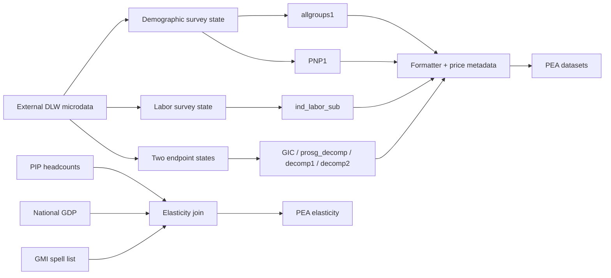

---
{
  "description": "Dependencies, input and output lineage, reference periods and unresolved boundaries.",
  "generated": {
    "by": "process:build-wbg-okf"
  },
  "help_center_commit": "sanitized:3922b3bfe000a87b8aae5305d8d9417ff53718922349db932f5eb85ceef1342d",
  "product_source_pins": {
    "Dashboard": {
      "analysed_commit": "520eace646e46abbe51a8f09b334e283fa455e68",
      "branch": "main",
      "upstream_repo": "worldbank/peaApp"
    },
    "GMI_extended": {
      "analysed_commit": "6f5231790ca118f2bf8c7967f12f1c0f3656ea47",
      "docs_snapshot_commit": "7bc4688b04d22386ae35e11d914a852c99d97b00",
      "upstream_repo": "dasalm20/gmi_extended"
    },
    "Stata_package": {
      "analysed_commit": "4ec2b06ce63e99771630a8f1e1bb8447cbd6f744",
      "branch": "Package_updates-SEP-30th",
      "upstream_repo": "worldbank/pea"
    }
  },
  "sources": [
    {
      "id": "s-6121b1f7a76c7925",
      "resource": "urn:okf:sanitized:6121b1f7a76c7925276a",
      "sha256": "f56298eb3f593f9aa2bed3e66d9925abd1cce6c7cf6c4cd1a3a59fd3e5e43396",
      "title": "GMI_extended/ANSWERS.md"
    },
    {
      "id": "s-1ad785198d219478",
      "resource": "urn:okf:sanitized:1ad785198d2194788031",
      "sha256": "20406463001812074ad0efa337eea425c26e86f2385966119d92c82bc97666aa",
      "title": "GMI_extended/analysis/reference_period_audit.md"
    },
    {
      "id": "s-28b30e99cf27ca47",
      "resource": "urn:okf:sanitized:28b30e99cf27ca473936",
      "sha256": "b14bd347406a00c22bac765deb4ad1e118ab85ebe85bfacf35771eac08802093",
      "title": "GMI_extended/analysis/variable_mixing_audit.md"
    },
    {
      "id": "s-03a55e5b0d916fbf",
      "resource": "urn:okf:sanitized:03a55e5b0d916fbf503d",
      "sha256": "b2f5a0dd0672c5c811ac27825ef8a8f8b6bc52f006e6402246c7cdf6ee0832e7",
      "title": "GMI_extended/architecture/dataset_flow.md"
    },
    {
      "id": "s-ec1c01765ee45d78",
      "resource": "urn:okf:sanitized:ec1c01765ee45d78c0be",
      "sha256": "6b6c5989fc9102a90a348a51bec254d48440b7ba26facfccacfd97869c36b9e3",
      "title": "GMI_extended/architecture/dataset_registry.md"
    }
  ],
  "tags": [
    "gmi_lineage"
  ],
  "title": "GMI lineage — 005",
  "type": "Reference"
}
---

<a id="s-1ad785198d219478-l1"></a>

## Source: GMI_extended/analysis/reference_period_audit.md — lines 1–70

This excerpt and its context come from the pinned curated document.[^s-1ad785198d219478]

<!-- BEGIN s-1ad785198d219478-l1 -->
# Are GMI Extended indicators reference-period agnostic?

**No blanket claim is supported.** Current industry and several labor indicators can mix primary and annual recall fields. Some welfare-only paths do not use the labor recall fields at all, while spell outputs separately depend on their selected endpoint years. Classifications below concern the labor recall dimension; they do not imply independence from survey year, PPP vintage, welfare recall, reporting year, or spell choice.

This report describes the analyzed commit in `manifest.json`. A concurrent source update added an asymmetric fallback to 01b during this analysis; the archived spell file still uses primary industry at both endpoints. Evidence: `01.Programs/01b-GMI extended indicators spells.do:L496-L584`; `01.Programs/archive/01b-GMI extended indicators spells.do:L406-L485`.

## Exact names and origins

`industycat4` and `industycat4_year` have no occurrences in the indexed Stata sources. The actual names are `industrycat4` and `industrycat4_year`. The full positive occurrence list, including comments and QA code, is `index/occurrences.jsonl`; the negative search is scoped to the fingerprinted files in the manifest.

In production analysis, both are imported with GMD ALL survey microdata. There is no original raw-survey construction of these two fields in 01aa/01ab. The first relevant load is the `dlw` call, followed by in-place replacement of the primary field. Their original questionnaires, original raw fields and country-specific harmonization algorithms remain EXTERNAL_DEPENDENCY. Evidence: `01.Programs/01aa-GMI extended indicators.do:L127-L153`; `01.Programs/01ab-GMI extended indicators labor ind.do:L182-L213`.

The added EAP builder supplies a separate, explicit local-name introduction: `industrycat4_1:industrycat4` in a mapping list. It renames the source only when the destination is absent; if destination exists, it drops the source, without filling missing destination observations. `_year` is already expected under its GMD name. Old `industry4`/`industry10` are described as deliberately unused, and no active mapping consumes them. Evidence: `04.Checks_Add_reharmonization_results/code/99-build_eap_local.do:L95-L120,L414-L428`.

QA comments describe primary labor fields as 7-day and `_year` as 12-month, and `lstatus_tr` as 1=7-day only, 2=12-month only, 3=both, 4=other. This is documented intent, not proof that every imported survey obeys it. The production fallback mentions other recalls too. Neither `lstatus_tr` nor `lstatus_ref` selects the production calculation branch. Evidence: `04.Checks_Add_reharmonization_results/code/02-delivery_qcheck.do:L122-L143`; `04.Checks_Add_reharmonization_results/code/99-build_eap_local.do:L47-L52`; `01.Programs/01ab-GMI extended indicators labor ind.do:L327-L335`.

## What actually mixes

Both 01aa and 01ab execute:

```stata
cap replace industrycat4 = industrycat4_year if missing(industrycat4) & !missing(industrycat4_year)
```

The primary value wins when nonmissing. A missing primary is filled when the annual field is nonmissing. If both are missing it remains missing. If either variable is absent or incompatible, `cap` suppresses the failing replacement; it does not create an absent primary field. The annual field is not renamed or averaged with the primary. This is observation-level coalescing into one primary field, followed by aggregation. Evidence: `01.Programs/01aa-GMI extended indicators.do:L259-L265`; `01.Programs/01ab-GMI extended indicators labor ind.do:L327-L335`.

`lstatus`, `industrycat10`, and `empstat` each undergo their own independent fallback in the same blocks. No shared provenance flag enforces one recall definition across the four fields. A row can therefore use primary employment status and annual industry, or annual employment status and primary industry. No country/year/reference-period selector appears in these replacements. Country, module, age and field-availability guards still control which surveys and observations reach each calculation. Evidence: the replacement blocks above; `01.Programs/01aa-GMI extended indicators.do:L61-L86,L309-L403`; `01.Programs/01ab-GMI extended indicators labor ind.do:L108-L152,L342-L408`.

## Indicator comparison

`{L}` denotes the 18 configured poverty-line codes, 2017 and 2021 PPP; `{k}` denotes the stated category range. Individual expanded records, expressions and IDs are in `index/indicators.jsonl`.

| Indicator/row family | Labor-recall class | Actual calculation path / interaction | Outputs and evidence |
|---|---|---|---|
| `_industry_head1..4`, `_industry_head_m` | MIXED, conditional on available fields and missing primary | Coalesced industry; head age≥18; `lstatus==1` uses separately coalesced labor status; mean by poor/nonpoor/total | `GMI_extended_poornonpoor_groups`; 01aa L262-L265,L333-L403,L583-L601; format L285-L362 |
| `_working_head`, `_notworking_head`, `_misslfs_head`, `_empstat_head1..5`, `_empstat_head_m` | MIXED | Own labor/empstat fallback; industrycat4 does not numerically enter these expressions | Same PNP output; 01aa L262-L265,L370-L403,L590 |
| `_industry_ind1..4`, `_industry_ind_m`, `_industry_nonagr_ind` | MIXED | Coalesced industry plus coalesced working-status restriction; age 15–64 | `GMI_extended_ind_labor_fmt`; 01ab L332-L335,L359-L374,L503-L571; format L543-L574 |
| `_industry_nonagr_ind3` | MIXED, intermediate only | Uses categories 2–3; formatter removes it | `GMI_extended_${rnd}_ind_labor_sub`; 01ab L367; format L562-L570 |
| `poor{L}_wrki4_{k}`, `nonpoor{L}_wrki4_{k}`, k=1..4 | MIXED | Poverty flag from PPP welfare; industry classification and worker inclusion from independently coalesced fields | Wide and long labor outputs; 01ab L425-L455,L543; format L579-L629 |
| `poor{L}_nonagr`, `poor{L}_nonagr3` | MIXED, intermediate only | Poor workers in categories 2–4 or 2–3 | Removed by `*nonagr*` filtering except `_industry_nonagr_ind`; 01ab L453-L455; format L562-L570 |
| `_industry10_ind1..10`, `_industry10_ind_m` | MIXED via related fields | industrycat10/year fallback, plus coalesced lstatus; no industrycat4 dependence | Wide labor output; 01ab L334,L379-L388,L543 |
| `_working_ind`, `_notworking_ind`, `_misslfs_ind`, `poor{L}_wrk`, `nonpoor{L}_wrk`, employment-status cross-tabs | MIXED via related fields | lstatus/year and empstat/year; industrycat4 is not a required input | 01ab L332-L335,L348-L350,L403-L405,L437-L465 |
| 01aa poverty/gap/mean/prosperity/inequality rows grouped by `_lstatus` or `_lstatus2` | CONDITIONAL | Welfare formula unchanged, but coalesced lstatus changes subgroup membership, numerator, denominator and population shares | Poverty/indicator/group-wide outputs; 01aa L313-L321,L440,L454-L467,L521-L569; format L128-L141 |
| Same 01aa welfare measures in total/nonlabor subgroup rows | AGNOSTIC within local labor-recall scope | Grouping and welfare expressions do not read labor recall fields | 01aa L440,L454-L467,L512-L569. External welfare recall remains unverified |
| Labor `poor{L}` and subgroup population counts/shares | AGNOSTIC within local labor-recall scope | Welfare, age and nonlabor groups; labor-category availability does not appear in these scalar formulas | 01ab L425-L431,L486-L506,L543-L554 |
| Huppi–Ravallion SEC | MIXED / asymmetric | Later ALL endpoint coalesces industry; earlier endpoint does not. `sector_nonag = industrycat4 ~= 1 if industrycat4 ~= .` at each endpoint; sector decomposition combines endpoint distributions | `decomp2` → `GMI_extended_decomp_fmt`; 01b L496-L542,L547-L584,L613-L633; format L394-L414 |
| Archived Huppi–Ravallion SEC | UNKNOWN upstream recall consistency; no local fallback | Both endpoints use primary industry only. Same field name does not establish consistent recall | archive/01b L431-L478,L514-L535; no annual fallback in that archived file |
| Huppi–Ravallion UR | AGNOSTIC to industry fallback | Urban sector, welfare and weights; same spell dependence but no industry input | 01b L589-L610 |
| GIC percentile welfare means; prosperity-change terms; DR/SK decomposition | AGNOSTIC to these labor fields | Independent GPWG loads select welfare and weights; not the ALL industry path | 01b L296-L344,L349-L475. All depend on PPP and survey/spell selection |
| GDP-poverty elasticities | AGNOSTIC to local industry recall; DEPENDENT on spell years | Imported PIP headcount + GDP + survey metadata + selected spell pair | 01c L72-L108,L121-L179. PIP underlying time definitions external |
| MPO imported actual/projected poverty | UNKNOWN source recall, no local industry path | Imported statistics combined across projection vintages | 03 L54-L122,L128-L195 |
| EAP/QA delivery and comparison metrics | CONDITIONAL diagnostic dimension | Names/coverage evaluated separately; labor-pair emptiness check combines availability flags, not poverty estimates | qcheck L704-L735; diagnostics L628-L663 |

## Numerators, denominators, samples and weights

For an industry share, the stored individual variable is a Boolean equality only for employed persons with nonmissing industry in the age universe. Outside that `if` universe it is missing. `groupfunction [aw=wgt], mean(...)` is the exact aggregation call. The natural weighted-mean reading has weighted qualifying category members in the numerator and weighted nonmissing eligible workers in the denominator; the external command implementation must be obtained to verify its precise conventions. These shares are not established as shares of all 15–64-year-olds simply because a label says so. Missing-industry flags include employed persons with missing industry and therefore use a different valid sample. Evidence: 01ab L366-L371,L447-L454,L543.

In 01aa head characteristics are defined on head observations only and are not copied onto all members. Person weights are preferred when present. Labor/industry fallback changes the eligibility and category values, not the weight variable itself. It can nevertheless change the sum of weights in the denominator. Evidence: 01aa L143-L153,L333-L403,L590; 01ab L246-L255,L332-L405.

For Huppi–Ravallion SEC, there is no explicit working-age or `lstatus==1` filter around sector_nonag. `industrycat4 ~= .` excludes ordinary missing only. It is not the same universe or category expression as 01ab's bounded categories 2–4. The two ALL endpoint datasets are passed to `sedecomposition`, rather than averaging annual and primary field values directly. Evidence: 01b L535,L577,L620-L633.

## Output metadata is not recall harmonization

Formatter joins `rep_year` and `ref_year` after aggregation and renames original `year` to `surv_year`, `rep_year` to `year`. It does not select primary versus annual industry based on `ref_year`. This makes reporting-year labels distinct from the earlier labor-recall fallback. Evidence: `01.Programs/02-GMI format.do:L169-L178,L543-L553`.

The output append of decomp1/decomp2 stacks different decomposition types, removes Shorrocks–Kolenikov and filters missing value3. It does not cause unrelated DR or urban/rural values to numerically use industry merely because they share an output table. Evidence: `01.Programs/02-GMI format.do:L394-L414`.

## What remains unknowable from this checkout

The repository does not contain actual questionnaires, full GMD harmonization sources, input data, or implementations of `groupfunction`, `_ebin`, `drdecomp`, `skdecomp`, and `sedecomposition`. Consequently the number of filled rows, actual surveys mixing recalls, observed output differences, precise external-command denominator behavior and source-specific period meanings are not verified. Source comments reporting past matches or tests are not runtime verification by this analysis. QA/EAP local files are not demonstrably fed back into production by an active patch call in this snapshot.

<!-- END s-1ad785198d219478-l1 -->

<a id="s-28b30e99cf27ca47-l1"></a>

## Source: GMI_extended/analysis/variable_mixing_audit.md — lines 1–20

This excerpt and its context come from the pinned curated document.[^s-28b30e99cf27ca47]

<!-- BEGIN s-28b30e99cf27ca47-l1 -->
# Variable mixing audit

Read [the analytical report](005.md#s-1ad785198d219478-l1) for the indicator table. This document separates mechanisms that can otherwise be confused.

| Mechanism | Source-grounded finding | Evidence |
|---|---|---|
| Direct primary/annual coalescing | industrycat4 is replaced from industrycat4_year only where primary is missing and annual nonmissing. No new merged-field variable is created. | 01aa L263; 01ab L333; current 01b L504 |
| Cross-variable period mixing | lstatus, industrycat4, industrycat10 and empstat are filled independently. Employment eligibility can use one recall and sector another. | 01aa L262-L265; 01ab L332-L335 |
| Across-observation aggregation | Subsequent means include qualifying primary-derived and annual-derived category flags; no source-period grouping or contribution weight is retained. | 01aa L388-L391,L590; 01ab L366-L372,L447-L455,L543 |
| Across-spell comparison | Current 01b fills the later endpoint only. Earlier endpoint sector_nonag uses original primary. | 01b L496-L542,L547-L584,L620-L633 |
| Separate output rows | Appending different decomposition types into one table does not make each formula use the inputs of the other type. | format L394-L414 |
| EAP naming | industrycat4_1 is renamed if industrycat4 is absent; if industrycat4 exists source is dropped. No per-observation filling in this map. | EAP builder L95-L103,L414-L428 |
| QA labor-pair combination | Binary availability flags for base/year are checked jointly to flag both empty. This is not an economic-indicator calculation. | qcheck L704-L735 |
| Local-vs-DLW comparison | Local fields become _p_*; matching and differences are reported. No production overwrite bridge was found. | diagnostics L553-L663 |

Abbreviated filenames in this table mean the exact files linked in [reference_period_audit.md](005.md#s-1ad785198d219478-l1). Exact machine references, including all active/comment occurrences, are in `index/occurrences.jsonl`.

The `cap replace` statement requires an existing compatible destination. If only the annual field exists, the absent primary is not created. If primary exists but is all missing and annual is usable, it can become populated and allow `su`/`r(N)>0` indicator branches to run. A retained nonmissing primary is not reconciled with a conflicting annual value. These are source-level conditional possibilities, not observed data outcomes. Evidence: `01.Programs/01ab-GMI extended indicators labor ind.do:L332-L335,L361-L374`.

Upstream raw survey construction remains outside this checkout. In particular, do not assert universal seven-day semantics from a bare variable name or from one regional comment. Archive and current behavior must not be conflated.

<!-- END s-28b30e99cf27ca47-l1 -->

<a id="s-6121b1f7a76c7925-l1"></a>

## Source: GMI_extended/ANSWERS.md — lines 1–156

This excerpt and its context come from the pinned curated document.[^s-6121b1f7a76c7925]

<!-- BEGIN s-6121b1f7a76c7925-l1 -->
# Questions maintainers and country teams ask

Open the relevant question below, read its answer and evidence, then follow the fuller document; no shell, grep, or `maintenance/query.py` is needed. To locate a named indicator, open the [indicator index](../gmi_indicators/104.md#s-c0d1812880cae6d5-l1) and follow its document link.

These answers summarize the existing analyzed snapshot in [manifest.json](../../lookup/sources/GMI_extended/manifest.json.md), under the [operating rules](016.md#s-d15a1a08fc8cc913-l1). Coverage remains **PARTIAL_STATIC**: source behavior is documented, but no statistical runtime results were verified, and full semantic lineage is incomplete. `VERIFIED_STATIC` does not establish observed values; `INFERRED` denotes a conditional finding, `UNVERIFIED` denotes an unresolved claim, and `EXTERNAL_DEPENDENCY` denotes missing inputs or implementations. Actual affected surveys, filled-row counts, questionnaire-specific recall periods, and output differences remain unverified.

1. [Do the GMI Extended indicators distinguish 7-day from 12-month labor reference periods?](005.md#s-6121b1f7a76c7925-l1)
2. [Which labor variables use annual values to fill gaps, and when?](005.md#s-6121b1f7a76c7925-l1)
3. [Do both endpoints of a sectoral poverty-change spell use the same fallback?](005.md#s-6121b1f7a76c7925-l1)
4. [Would changing the fallback in 01aa automatically change 01ab?](005.md#s-6121b1f7a76c7925-l1)
5. [Are industry shares calculated over everyone aged 15–64?](005.md#s-6121b1f7a76c7925-l1)
6. [Does a percent label prove that labor output values are on a 0–100 scale?](005.md#s-6121b1f7a76c7925-l1)
7. [Are household-head characteristics averaged over all household members?](005.md#s-6121b1f7a76c7925-l1)
8. [Does ref_year harmonize labor recall, and what does the output year mean?](005.md#s-6121b1f7a76c7925-l1)
9. [Do the EAP builder and patch diagnostics feed corrected values into production?](005.md#s-6121b1f7a76c7925-l1)
10. [Does poverty elasticity depend on the spell decomposition outputs?](005.md#s-6121b1f7a76c7925-l1)
11. [Does the GIC output already contain percentage growth rates?](005.md#s-6121b1f7a76c7925-l1)
12. [Does spell construction guarantee exactly the two most recent surveys?](005.md#s-6121b1f7a76c7925-l1)
13. [Why can the master runner skip analytical stages?](005.md#s-6121b1f7a76c7925-l1)
14. [Why can 01aa or 01ab exit with error 198 before processing surveys?](005.md#s-6121b1f7a76c7925-l1)
15. [What documented issue could stop the formatter at drop poor?](005.md#s-6121b1f7a76c7925-l1)

<a id="q1"></a>
## 1. Do the GMI Extended indicators distinguish 7-day from 12-month labor reference periods?

**Answer:** They do not consistently keep the two recall periods separate: current 01aa/01ab fill missing primary labor values from the annual variants, so qualifying aggregates can mix recalls. QA comments describe primary fields as 7-day and `_year` fields as 12-month, but this is intended semantics, not verified questionnaire timing for every survey; country-specific harmonization remains `EXTERNAL_DEPENDENCY`. The production fallback does not use `lstatus_tr` or `lstatus_ref` to select a recall-specific calculation branch.

**Evidence:** `01.Programs/01aa-GMI extended indicators.do:L259-L265`; `01.Programs/01ab-GMI extended indicators labor ind.do:L327-L335`; `04.Checks_Add_reharmonization_results/code/02-delivery_qcheck.do:L122-L143`.

**Fuller document:** [Reference-period audit — exact names and origins](005.md#s-1ad785198d219478-l1).

<a id="q2"></a>
## 2. Which labor variables use annual values to fill gaps, and when?

**Answer:** In current 01aa/01ab, `lstatus`, `industrycat4`, `industrycat10`, and `empstat` are each filled independently from their `_year` counterpart only where the primary value is missing and the annual value is nonmissing. A nonmissing primary value wins, and an absent primary variable is not created because the captured replacement fails. There is no shared provenance flag enforcing the same recall across these four fields, so mixed recall within a row is a conditional possibility, not an observed data result.

**Evidence:** `01.Programs/01aa-GMI extended indicators.do:L259-L265`; `01.Programs/01ab-GMI extended indicators labor ind.do:L327-L335`.

**Fuller document:** [Reference-period audit — what actually mixes](005.md#s-1ad785198d219478-l1).

<a id="q3"></a>
## 3. Do both endpoints of a sectoral poverty-change spell use the same fallback?

**Answer:** No: current 01b fills missing primary industry from annual industry only at the later ALL endpoint, while the earlier endpoint uses primary industry without that fallback. Huppi–Ravallion SEC can therefore compare classifications with different fallback treatment; the archived spell workflow has no fallback at either endpoint. Actual affected observations and numerical changes remain unverified.

**Evidence:** `01.Programs/01b-GMI extended indicators spells.do:L496-L584`; `01.Programs/archive/01b-GMI extended indicators spells.do:L406-L485`.

**Fuller document:** [Reference-period audit — indicator comparison](005.md#s-1ad785198d219478-l1).

<a id="q4"></a>
## 4. Would changing the fallback in 01aa automatically change 01ab?

**Answer:** No: 01aa and 01ab independently load GMD ALL survey microdata and each performs its own in-memory fallback. Changing the replacement in one module does not automatically change the other module's results.

**Evidence:** `01.Programs/01aa-GMI extended indicators.do:L139,L262-L265`; `01.Programs/01ab-GMI extended indicators labor ind.do:L212,L332-L335`.

**Fuller document:** [Cross-module dependencies](001.md#s-8f046e62e5b2779f-l1).

<a id="q5"></a>
## 5. Are industry shares calculated over everyone aged 15–64?

**Answer:** No: the industry-category expressions exclude nonworkers and missing industry through their eligibility conditions, while the missing-industry flag has a different nonmissing sample. The exact denominator, missing-value, and weight conventions of `groupfunction` remain `EXTERNAL_DEPENDENCY` because its implementation is absent.

**Evidence:** `01.Programs/01ab-GMI extended indicators labor ind.do:L366-L371`; `01.Programs/01aa-GMI extended indicators.do:L521-L521`.

**Fuller document:** [Reference-period audit — numerators, denominators, samples and weights](005.md#s-1ad785198d219478-l1); [external aggregation boundary](017.md#s-40f31ae3c5b66ce3-l1).

<a id="q6"></a>
## 6. Does a percent label prove that labor output values are on a 0–100 scale?

**Answer:** No: labor fields are means of 0/1 expressions with percent labels, but no multiplication by 100 is visible before save. The exact external command return scale is unverified.

**Evidence:** `01.Programs/02-GMI format.do:L477-L533`.

**Fuller document:** [Unresolved questions — percent labels](017.md#s-40f31ae3c5b66ce3-l1).

<a id="q7"></a>
## 7. Are household-head characteristics averaged over all household members?

**Answer:** No: head characteristics are defined only on head rows and are not propagated to every household member. Poor/nonpoor profile means use the selected survey weight on nonmissing head rows.

**Evidence:** `01.Programs/01aa-GMI extended indicators.do:L333-L403`.

**Fuller document:** [Unresolved questions — head sample](017.md#s-40f31ae3c5b66ce3-l1).

<a id="q8"></a>
## 8. Does ref_year harmonize labor recall, and what does the output year mean?

**Answer:** No: the formatter attaches reference/reporting metadata after aggregation and does not use `ref_year` to select primary versus annual labor values. It preserves the original survey year as `surv_year` and renames the joined reporting year `rep_year` to `year`.

**Evidence:** `01.Programs/02-GMI format.do:L169-L178,L543-L553`.

**Fuller document:** [Reference-period audit — output metadata is not recall harmonization](005.md#s-1ad785198d219478-l1).

<a id="q9"></a>
## 9. Do the EAP builder and patch diagnostics feed corrected values into production?

**Answer:** No active production patch bridge was found in the analyzed snapshot. The EAP assembler introduces GMD-compatible local names, and diagnostics renames local fields `_p_*` for comparison; this does not establish that 01aa/01ab/01b consume those corrected values.

**Evidence:** `04.Checks_Add_reharmonization_results/code/99-build_eap_local.do:L414-L428,L541`; `04.Checks_Add_reharmonization_results/code/99-gmdpatch_diagnostics.do:L517,L553-L616`.

**Fuller document:** [Cross-module dependencies](001.md#s-8f046e62e5b2779f-l1).

<a id="q10"></a>
## 10. Does poverty elasticity depend on the spell decomposition outputs?

**Answer:** No: 01c builds its own spell/PIP/GDP join and does not read 01b's decomp1/decomp2 outputs. It writes its PEA elasticity file directly, and the formatter does not read that elasticity file.

**Evidence:** `01.Programs/01c-GMI extended spells pov elasticity.do:L72-L194`; `01.Programs/02-GMI format.do:L52,L285,L369,L394-L395,L422,L635`.

**Fuller document:** [Execution map](006.md#s-5e33941ffc71c499-l1); [cross-module dependencies](001.md#s-8f046e62e5b2779f-l1).

<a id="q11"></a>
## 11. Does the GIC output already contain percentage growth rates?

**Answer:** No: it contains weighted percentile-bin mean welfare by survey year; neither this workflow nor the formatter calculates the percentage growth curve formula. Consumer-side GIC growth construction is unavailable.

**Evidence:** `01.Programs/01b-GMI extended indicators spells.do:L370-L379`.

**Fuller document:** [Unresolved questions — GIC output](017.md#s-40f31ae3c5b66ce3-l1).

<a id="q12"></a>
## 12. Does spell construction guarantee exactly the two most recent surveys?

**Answer:** No: the many-to-many merge is followed by dropping singleton spells and reshaping, without a check enforcing exactly two rows. Extra sequence columns can survive while calculations select endpoints 1 and 2, and the comment about the most recent pair is not implemented by an explicit keep-latest rule.

**Evidence:** `01.Programs/01b-GMI extended indicators spells.do:L150-L171`.

**Fuller document:** [Unresolved questions — spell pair count](017.md#s-40f31ae3c5b66ce3-l1); [merge/append audit](001.md#s-86f9f48d3540b261-l122).

<a id="q13"></a>
## 13. Why can the master runner skip analytical stages?

**Answer:** The optional runner defaults to `runall=0`, and its constructed underscore filenames differ from the actual analytical filenames containing spaces; the fetch filename also differs in case. Missing paths are skipped, and captured failures do not stop later stages.

**Evidence:** `01.Programs/00-Master.do:L265-L313`.

**Fuller document:** [Unresolved questions — runner names](017.md#s-40f31ae3c5b66ce3-l1); [execution map](006.md#s-5e33941ffc71c499-l1).

<a id="q14"></a>
## 14. Why can 01aa or 01ab exit with error 198 before processing surveys?

**Answer:** They depend on externally initialized `$resume_aa` and `$resume_ab`, whose definitions are absent from the analyzed repository. If the expanded resume value fails integer validation, the workflow exits with error 198; a resume value greater than one also requires existing accumulator files.

**Evidence:** `01.Programs/01aa-GMI extended indicators.do:L25-L44,L98-L115`; `01.Programs/01ab-GMI extended indicators labor ind.do:L23-L33,L157-L173`.

**Fuller document:** [Execution map — resume requirements](006.md#s-5e33941ffc71c499-l1).

<a id="q15"></a>
## 15. What documented issue could stop the formatter at drop poor?

**Answer:** `INFERRED`: the formatter issues an unguarded `drop poor` before reshape, while 01aa visibly generates suffixed poverty fields rather than an unsuffixed `poor`. With variable abbreviation off, this is a potential stop unless an external command has emitted `poor`; it is not a confirmed runtime failure.

**Evidence:** `01.Programs/02-GMI format.do:L52-L58`.

**Fuller document:** [Unresolved questions — formatter drop](017.md#s-40f31ae3c5b66ce3-l1).

<!-- END s-6121b1f7a76c7925-l1 -->

<a id="s-03a55e5b0d916fbf-l1"></a>

## Source: GMI_extended/architecture/dataset_flow.md — lines 1–39

This excerpt and its context come from the pinned curated document.[^s-03a55e5b0d916fbf]

<!-- BEGIN s-03a55e5b0d916fbf-l1 -->
# Dataset flow and boundaries

All dataset expressions, file writes, join keys, readers and producers are in `index/datasets.jsonl`, `index/outputs.jsonl` and `index/operations.jsonl`. Paths are expressions, not evidence of local existence. There are no production input datasets in the analyzed checkout.

| Input boundary | Source-defined use | Evidence |
|---|---|---|
| PIP API | Headcount/gap/severity at 2017/2021 PPP, framework, population and national GDP | `01.Programs/00b-Pull_API_data.do:L57-L218` |
| GitHub CLASS.dta | Renames fields, derives current income group from last year, extends global latest year by one | `01.Programs/00b-Pull_API_data.do:L245-L272` |
| DLW price framework | Cached copy for formatting; separate fresh pull in elasticity | `01.Programs/00b-Pull_API_data.do:L167-L188`; `01.Programs/01c-GMI extended spells pov elasticity.do:L72-L76` |
| Round survey repo list and GMI spell list | Cached network copies select surveys and pair endpoints | `01.Programs/00c-fetch server data.do:L64-L68`; `01.Programs/01b-GMI extended indicators spells.do:L134-L171` |
| DLW GMD ALL | Demographic/labor analysis; two-endpoint sector/urban decomposition | `01.Programs/01aa-GMI extended indicators.do:L139-L153`; `01.Programs/01ab-GMI extended indicators labor ind.do:L212-L255`; `01.Programs/01b-GMI extended indicators spells.do:L480-L584` |
| DLW GPWG | Percentile welfare bins, prosperity-change and DR/SK decompositions | `01.Programs/01b-GMI extended indicators spells.do:L296-L344` |
| MPO current/previous rounds | Projection and observed poverty inputs | `01.Programs/00c-fetch server data.do:L70-L80`; `01.Programs/03-MPO to PEA.do:L54-L195` |
| world_1000bin.dta | Archive-only PIP bin aggregation and export | `01.Programs/archive/PIP to GIC and Decomposition data.do:L45-L117` |
| Regional SSA/EAP files | QA delivery, local assembly and comparison; no demonstrated integration into production estimates | `04.Checks_Add_reharmonization_results/code/99-build_eap_local.do:L233-L541`; `04.Checks_Add_reharmonization_results/code/99-gmdpatch_diagnostics.do:L505-L663` |



Expected observation levels come from transformations, not inspected schemas. GMD ALL is handled as member observations (`hhid`, `pid`); results aggregate by survey × a subgroup dimension. Spell lists reshape on country/period/welfare type without verifying exactly two endpoints. GIC contains endpoint-year percentile means, not an already computed growth-rate curve. Evidence: `01.Programs/01aa-GMI extended indicators.do:L224-L228,L521-L569`; `01.Programs/01b-GMI extended indicators spells.do:L155-L165,L370-L412`.

ASPIRE appears only as an excluded module in the analyzed production survey filter; there is no demonstrated ASPIRE data extraction dependency. `new.txt` is existence-checked by master but not read as analytical data. `world_1000bin.dta` is checked by master although the current optional runner never invokes its archive consumer. Evidence: `01.Programs/01aa-GMI extended indicators.do:L65-L83`; `01.Programs/00-Master.do:L144-L158,L271-L278`.

<!-- END s-03a55e5b0d916fbf-l1 -->

<a id="s-ec1c01765ee45d78-l1"></a>

## Source: GMI_extended/architecture/dataset_registry.md — lines 1–116

This excerpt and its context come from the pinned curated document.[^s-ec1c01765ee45d78]

<!-- BEGIN s-ec1c01765ee45d78-l1 -->
# Dataset expression registry

This human index mirrors datasets.jsonl. Memory contexts are omitted from this table but remain machine-addressable. No local schema/row inspection was performed.

| Dataset ID | Exact source expression | Writers | Readers | Evidence |
|---|---|---:|---:|---|
| `dataset:2233ff17d89f8e5f` | `$inputapi\pip`ppp1'.dta` | 1 | 1 | `01.Programs/00b-Pull_API_data.do:L68-L68` |
| `dataset:bfbd3a80b3b47697` | `$input\pip`ppp1'.dta` | 2 | 0 | `01.Programs/00b-Pull_API_data.do:L69-L69` |
| `dataset:83ddf112039eda06` | ``pipbase'` | 2 | 2 | `01.Programs/00b-Pull_API_data.do:L81-L81` |
| `dataset:204922f53ae83bbc` | `$inputapi\pip_framework.dta` | 1 | 1 | `01.Programs/00b-Pull_API_data.do:L121-L121` |
| `dataset:5d9cbafab03bc624` | `$input\pip_framework.dta` | 2 | 0 | `01.Programs/00b-Pull_API_data.do:L122-L122` |
| `dataset:3d5327b86b4390ff` | `$inputapi\pip_pop.dta` | 1 | 1 | `01.Programs/00b-Pull_API_data.do:L149-L149` |
| `dataset:a7b0892ed73404b7` | `$input\pip_pop.dta` | 2 | 0 | `01.Programs/00b-Pull_API_data.do:L150-L150` |
| `dataset:2ac400011235d8a6` | `$inputapi\Survey_price_framework.dta` | 1 | 1 | `01.Programs/00b-Pull_API_data.do:L177-L177` |
| `dataset:0fa1cc3d12b9e4be` | `$pfw` | 2 | 14 | `01.Programs/00b-Pull_API_data.do:L178-L178` |
| `dataset:01f1237d8f54211e` | `$inputapi\PIP_all_GDP.dta` | 1 | 2 | `01.Programs/00b-Pull_API_data.do:L207-L207` |
| `dataset:50f6ff5068bd43c0` | `$input\PIP_all_GDP.dta` | 2 | 0 | `01.Programs/00b-Pull_API_data.do:L208-L208` |
| `dataset:fd532614e693f3bd` | `$inputapi\CLASS_incg_region.dta` | 1 | 2 | `01.Programs/00b-Pull_API_data.do:L240-L240` |
| `dataset:20c6d59690848bb2` | `$input\CLASS_incg_region.dta` | 2 | 0 | `01.Programs/00b-Pull_API_data.do:L241-L241` |
| `dataset:45b5ddf45706e7ae` | `$inputapi\CLASS_raw.dta` | 0 | 1 | `01.Programs/00b-Pull_API_data.do:L248-L248` |
| `dataset:152ebfca2def79f0` | ``incgroup'` | 1 | 1 | `01.Programs/00b-Pull_API_data.do:L260-L260` |
| `dataset:5826fda4c7ba28c1` | ``src'` | 0 | 1 | `01.Programs/00c-fetch server data.do:L20-L20` |
| `dataset:2aeff9e603d96595` | ``dst'` | 1 | 0 | `01.Programs/00c-fetch server data.do:L20-L20` |
| `dataset:201abfbcfb662b71` | ``"$other\_tmp_dataall.dta"'` | 1 | 0 | `01.Programs/01aa-GMI extended indicators.do:L42-L42` |
| `dataset:ebfb0c07e9c0fb30` | ``"$other\_tmp_dataall2.dta"'` | 1 | 0 | `01.Programs/01aa-GMI extended indicators.do:L43-L43` |
| `dataset:2427a62d3bc9c48f` | `$fromservers\repo_${rnd}all.dta` | 1 | 4 | `01.Programs/01aa-GMI extended indicators.do:L61-L61` |
| `dataset:e87990ca8c28f7fc` | ``data1'` | 1 | 3 | `01.Programs/01aa-GMI extended indicators.do:L86-L86` |
| `dataset:657b97c2c5f652fa` | ``purgekeys'` | 1 | 1 | `01.Programs/01aa-GMI extended indicators.do:L105-L105` |
| `dataset:1803f3701399296b` | ``acc'` | 1 | 1 | `01.Programs/01aa-GMI extended indicators.do:L109-L109` |
| `dataset:17dff56addc9d807` | ``data2'` | 1 | 2 | `01.Programs/01aa-GMI extended indicators.do:L502-L502` |
| `dataset:43c98132eacaf635` | `$other\_tmp_dataall.dta` | 1 | 2 | `01.Programs/01aa-GMI extended indicators.do:L567-L567` |
| `dataset:8512310a9ae64578` | `$interm\GMI_extended_${rnd}_allgroups1` | 1 | 1 | `01.Programs/01aa-GMI extended indicators.do:L569-L569` |
| `dataset:0689dc27cb40d700` | `$other\_tmp_dataall2.dta` | 1 | 1 | `01.Programs/01aa-GMI extended indicators.do:L599-L599` |
| `dataset:66048030f262ffc6` | `$interm\GMI_extended_${rnd}_PNP1` | 1 | 1 | `01.Programs/01aa-GMI extended indicators.do:L601-L601` |
| `dataset:91ebda5702fd4173` | ``"$other\_tmp_dataall_indlabor_${rnd}.dta"'` | 3 | 4 | `01.Programs/01ab-GMI extended indicators labor ind.do:L68-L68` |
| `dataset:c493f915d00e54fc` | ``data1'` | 1 | 2 | `01.Programs/01ab-GMI extended indicators labor ind.do:L152-L152` |
| `dataset:1cef5431c4dcdace` | ``purgekeys'` | 1 | 1 | `01.Programs/01ab-GMI extended indicators labor ind.do:L164-L164` |
| `dataset:71478d24308fdbfa` | ``data2'` | 1 | 1 | `01.Programs/01ab-GMI extended indicators labor ind.do:L523-L523` |
| `dataset:b086c252d707da34` | `$interm\GMI_extended_${rnd}_ind_labor_sub` | 1 | 1 | `01.Programs/01ab-GMI extended indicators labor ind.do:L571-L571` |
| `dataset:63d8f8eed84996df` | ``datagic'` | 3 | 3 | `01.Programs/01b-GMI extended indicators spells.do:L65-L65` |
| `dataset:6e2abab062b6f7bf` | ``prosdecomp'` | 2 | 2 | `01.Programs/01b-GMI extended indicators spells.do:L66-L66` |
| `dataset:835e794483c72675` | ``dataall'` | 1 | 0 | `01.Programs/01b-GMI extended indicators spells.do:L67-L67` |
| `dataset:09164649566c251f` | ``dataall2'` | 1 | 0 | `01.Programs/01b-GMI extended indicators spells.do:L68-L68` |
| `dataset:fcf68a79046bced7` | ``data1'` | 3 | 2 | `01.Programs/01b-GMI extended indicators spells.do:L139-L139` |
| `dataset:1bd858813fb1d63b` | `$fromservers\GMI_SPspell_all.dta` | 1 | 2 | `01.Programs/01b-GMI extended indicators spells.do:L143-L143` |
| `dataset:0e965207c9d1c47b` | ``qccollect'` | 1 | 3 | `01.Programs/01b-GMI extended indicators spells.do:L230-L232` |
| `dataset:7094c3717d92bd72` | ``data1a'` | 3 | 7 | `01.Programs/01b-GMI extended indicators spells.do:L320-L320` |
| `dataset:bdd3238e3a6788bb` | ``data1b'` | 1 | 2 | `01.Programs/01b-GMI extended indicators spells.do:L542-L542` |
| `dataset:e6516f46dd056c56` | `$interm\GMI_extended_${rnd}_GIC` | 1 | 2 | `01.Programs/01b-GMI extended indicators spells.do:L646-L646` |
| `dataset:2d0b3a24854cc6e6` | ``qcbins'` | 1 | 2 | `01.Programs/01b-GMI extended indicators spells.do:L672-L672` |
| `dataset:613925dd975a1816` | `$qclog` | 2 | 0 | `01.Programs/01b-GMI extended indicators spells.do:L681-L681` |
| `dataset:b0a37e879d226ec9` | ``qcA'` | 1 | 1 | `01.Programs/01b-GMI extended indicators spells.do:L736-L736` |
| `dataset:d026fafdcd1e36ae` | `$qccsv` | 2 | 0 | `01.Programs/01b-GMI extended indicators spells.do:L743-L743` |
| `dataset:edc86bfd1e0c5ba1` | `$interm\GMI_extended_${rnd}_prosg_decomp` | 1 | 1 | `01.Programs/01b-GMI extended indicators spells.do:L750-L750` |
| `dataset:d937273fa2c7b13e` | `$interm\GMI_extended_${rnd}_decomp1` | 1 | 1 | `01.Programs/01b-GMI extended indicators spells.do:L753-L753` |
| `dataset:b78a7dc9998b5853` | `$interm\GMI_extended_${rnd}_decomp2` | 1 | 1 | `01.Programs/01b-GMI extended indicators spells.do:L756-L756` |
| `dataset:078b5b10bd9e3c87` | ``datagic'` | 1 | 0 | `01.Programs/01c-GMI extended spells pov elasticity.do:L19-L19` |
| `dataset:6842c690de887d2e` | ``prosdecomp'` | 1 | 0 | `01.Programs/01c-GMI extended spells pov elasticity.do:L20-L20` |
| `dataset:35ff0e43c51ecfc9` | ``dataall'` | 1 | 0 | `01.Programs/01c-GMI extended spells pov elasticity.do:L21-L21` |
| `dataset:df8f472f9899af90` | ``dataall2'` | 1 | 0 | `01.Programs/01c-GMI extended spells pov elasticity.do:L22-L22` |
| `dataset:a41ea45b4551fe0d` | ``pfw'` | 1 | 1 | `01.Programs/01c-GMI extended spells pov elasticity.do:L76-L76` |
| `dataset:bf829e5629c98fb1` | `$inputapi\pip2021.dta` | 0 | 1 | `01.Programs/01c-GMI extended spells pov elasticity.do:L82-L82` |
| `dataset:471727ca9f95a369` | ``pip1'` | 2 | 2 | `01.Programs/01c-GMI extended spells pov elasticity.do:L87-L87` |
| `dataset:fb40a76b8229a5d7` | `$inputapi\pip2017.dta` | 0 | 1 | `01.Programs/01c-GMI extended spells pov elasticity.do:L89-L89` |
| `dataset:344687d3bd003c83` | ``data1'` | 2 | 2 | `01.Programs/01c-GMI extended spells pov elasticity.do:L119-L119` |
| `dataset:ee115784901fa337` | ``data2'` | 2 | 1 | `01.Programs/01c-GMI extended spells pov elasticity.do:L149-L149` |
| `dataset:634ec6bb67664d65` | `$interm\GMI_extended_${rnd}_pov_elas_raw` | 1 | 0 | `01.Programs/01c-GMI extended spells pov elasticity.do:L180-L180` |
| `dataset:97dd84985edad28a` | `$interm\GMI_extended_${rnd}_pov_elas_fmt` | 1 | 1 | `01.Programs/01c-GMI extended spells pov elasticity.do:L193-L193` |
| `dataset:085509f7e55fbfe3` | `$pea\GMI_extended_pov_elas_fmt` | 2 | 0 | `01.Programs/01c-GMI extended spells pov elasticity.do:L194-L194` |
| `dataset:4db1e556ef0c8c13` | ``data10'` | 1 | 1 | `01.Programs/01c-GMI extended spells pov elasticity.do:L208-L208` |
| `dataset:3d4cc0c6f39d7a60` | ``data1pfw'` | 1 | 1 | `01.Programs/02-GMI format.do:L45-L45` |
| `dataset:2d0e59b446fa346a` | ``data1'` | 1 | 4 | `01.Programs/02-GMI format.do:L97-L97` |
| `dataset:fbbbeeec0e223cee` | `$interm\GMI_extended_${rnd}_pov_groups_level` | 1 | 0 | `01.Programs/02-GMI format.do:L188-L188` |
| `dataset:592f8366d2ea5de6` | `$pea\GMI_extended_pov_groups_level` | 2 | 0 | `01.Programs/02-GMI format.do:L189-L189` |
| `dataset:aade19f85894acb4` | `$interm\GMI_extended_${rnd}_inds_groups` | 1 | 0 | `01.Programs/02-GMI format.do:L235-L235` |
| `dataset:6ab232376b9e6e8a` | `$pea\GMI_extended_inds_groups` | 2 | 0 | `01.Programs/02-GMI format.do:L236-L236` |
| `dataset:f98872cc4b49942f` | `$interm\GMI_extended_${rnd}_groups_wide` | 1 | 0 | `01.Programs/02-GMI format.do:L277-L277` |
| `dataset:1a10e8c6a78eb206` | `$interm\GMI_extended_${rnd}_poornonpoor_groups` | 1 | 0 | `01.Programs/02-GMI format.do:L361-L361` |
| `dataset:91569449211ff718` | `$pea\GMI_extended_poornonpoor_groups` | 2 | 0 | `01.Programs/02-GMI format.do:L362-L362` |
| `dataset:bb1315005d393f59` | `$interm\GMI_extended_${rnd}_GIC_fmt.dta` | 1 | 0 | `01.Programs/02-GMI format.do:L387-L387` |
| `dataset:dc7c3223c9a9d3fe` | `$pea\GMI_extended_GIC_fmt.dta` | 2 | 0 | `01.Programs/02-GMI format.do:L388-L388` |
| `dataset:fed4d1bbbd0fb98c` | `$interm\GMI_extended_${rnd}_decomp_fmt.dta` | 1 | 0 | `01.Programs/02-GMI format.do:L413-L413` |
| `dataset:966404605e9c5e00` | `$pea\GMI_extended_decomp_fmt.dta` | 2 | 0 | `01.Programs/02-GMI format.do:L414-L414` |
| `dataset:a7b47a6e5bb6d3c3` | `$interm\GMI_extended_${rnd}_ind_labor.dta` | 1 | 0 | `01.Programs/02-GMI format.do:L425-L425` |
| `dataset:5ef2c925e2e8feb7` | `$interm\GMI_extended_${rnd}_ind_labor_fmt.dta` | 1 | 1 | `01.Programs/02-GMI format.do:L573-L573` |
| `dataset:90017e490ed978d7` | `$pea\GMI_extended_ind_labor_fmt.dta` | 2 | 0 | `01.Programs/02-GMI format.do:L574-L574` |
| `dataset:f8188c5b231df7db` | `$interm\GMI_extended_${rnd}_ind_labor_long_fmt.dta` | 1 | 0 | `01.Programs/02-GMI format.do:L628-L628` |
| `dataset:cdd28195c4b85619` | `$pea\GMI_extended_ind_labor_long_fmt.dta` | 2 | 0 | `01.Programs/02-GMI format.do:L629-L629` |
| `dataset:e6546d823b2ba046` | `$interm\GMI_extended_${rnd}_prosg_decomp_fmt.dta` | 1 | 0 | `01.Programs/02-GMI format.do:L650-L650` |
| `dataset:50ac8b2767de2ab8` | `$pea\GMI_extended_prosg_decomp_fmt.dta` | 2 | 0 | `01.Programs/02-GMI format.do:L651-L651` |
| `dataset:a15663bfd46d0138` | `$fromservers\global_ex_${rnd}.dta` | 1 | 1 | `01.Programs/03-MPO to PEA.do:L54-L54` |
| `dataset:9ecb2df34ae8c5fc` | ``data1'` | 4 | 4 | `01.Programs/03-MPO to PEA.do:L70-L70` |
| `dataset:ae4f7bd158ead2a8` | `$fromservers\ObservedPoverty2021PPP_${rnd}.dta` | 1 | 1 | `01.Programs/03-MPO to PEA.do:L76-L76` |
| `dataset:eec62961d4b58914` | ``data2'` | 2 | 2 | `01.Programs/03-MPO to PEA.do:L107-L107` |
| `dataset:5e8610d33724736a` | ``data2021'` | 1 | 1 | `01.Programs/03-MPO to PEA.do:L122-L122` |
| `dataset:218b66e72179738c` | `$fromservers\global_ex_${rndprev}.dta` | 1 | 1 | `01.Programs/03-MPO to PEA.do:L128-L128` |
| `dataset:70061ae07f850bb3` | `$fromservers\ObservedPoverty2021PPP_${rndprev}.dta` | 1 | 1 | `01.Programs/03-MPO to PEA.do:L145-L145` |
| `dataset:4e08c38364d81492` | ``data2021_previous'` | 1 | 0 | `01.Programs/03-MPO to PEA.do:L190-L190` |
| `dataset:4c2ca41c09e9c649` | `$pea\MPO_poverty_data` | 1 | 0 | `01.Programs/03-MPO to PEA.do:L195-L195` |
| `dataset:f69c1d7e2da6740d` | ``"D:\daylan\test\GMI\out\_tmp_dataall.dta"'` | 1 | 0 | `01.Programs/archive/01aa-GMI extended indicators.do:L33-L33` |
| `dataset:ac00872141ffb13c` | ``"D:\daylan\test\GMI\out\_tmp_dataall2.dta"'` | 1 | 0 | `01.Programs/archive/01aa-GMI extended indicators.do:L34-L34` |
| `dataset:96215c3f23c334b3` | `\\wbgfscifs01\GTSD\03.projects_corp\04.GPWG\04.GPWG_${rnd}\04.GPWG_${rnd}_QA\01.programs\02.dofile\repo\repo_${rnd}all.dta` | 0 | 4 | `01.Programs/archive/01aa-GMI extended indicators.do:L65-L65` |
| `dataset:8eecbaeb414f26a5` | ``data1'` | 1 | 3 | `01.Programs/archive/01aa-GMI extended indicators.do:L90-L90` |
| `dataset:57b143bcd58e63cd` | ``purgekeys'` | 1 | 1 | `01.Programs/archive/01aa-GMI extended indicators.do:L109-L109` |
| `dataset:98b585f76c18e7dd` | ``acc'` | 1 | 1 | `01.Programs/archive/01aa-GMI extended indicators.do:L113-L113` |
| `dataset:93e4de04cf6bb473` | ``data2'` | 1 | 2 | `01.Programs/archive/01aa-GMI extended indicators.do:L455-L455` |
| `dataset:09d0e95ba6dcc51c` | `D:\daylan\test\GMI\out\_tmp_dataall.dta` | 1 | 2 | `01.Programs/archive/01aa-GMI extended indicators.do:L511-L511` |
| `dataset:1a291c72644c9300` | `${out}\\03.intermediate\\GMI_extended_${rnd}_allgroups1` | 1 | 1 | `01.Programs/archive/01aa-GMI extended indicators.do:L513-L513` |
| `dataset:6869c66e344fc9c0` | `D:\daylan\test\GMI\out\_tmp_dataall2.dta` | 1 | 1 | `01.Programs/archive/01aa-GMI extended indicators.do:L536-L536` |
| `dataset:101da30021cb4578` | `${out}\\03.intermediate\\GMI_extended_${rnd}_PNP1` | 1 | 1 | `01.Programs/archive/01aa-GMI extended indicators.do:L538-L538` |
| `dataset:485cadd7413edee9` | `${out}\\Subnational_2017ICP_${rnd}_rev` | 0 | 2 | `01.Programs/archive/01aa-GMI extended indicators.do:L561-L561` |
| `dataset:41c751203a46bc4f` | ``"D:\daylan\test\GMI\out\_tmp_dataall_indlabor_SM26.dta"'` | 3 | 4 | `01.Programs/archive/01ab-GMI extended indicators labor ind.do:L43-L43` |
| `dataset:d1dca566707234c2` | ``data1'` | 1 | 2 | `01.Programs/archive/01ab-GMI extended indicators labor ind.do:L117-L117` |
| `dataset:60a1186fd9b75234` | ``purgekeys'` | 1 | 1 | `01.Programs/archive/01ab-GMI extended indicators labor ind.do:L126-L126` |
| `dataset:18b7ac299882696b` | ``data2'` | 1 | 1 | `01.Programs/archive/01ab-GMI extended indicators labor ind.do:L436-L436` |
| `dataset:8caab42161a45706` | `${out}\\03.intermediate\\GMI_extended_${rnd}_ind_labor_sub` | 1 | 1 | `01.Programs/archive/01ab-GMI extended indicators labor ind.do:L474-L474` |

<!-- END s-ec1c01765ee45d78-l1 -->

[^s-6121b1f7a76c7925]: GMI_extended/ANSWERS.md, help-center snapshot sanitized:3922b3bfe000a87b8aae5305d8d9417ff53718922349db932f5eb85ceef1342d.
[^s-1ad785198d219478]: GMI_extended/analysis/reference_period_audit.md, help-center snapshot sanitized:3922b3bfe000a87b8aae5305d8d9417ff53718922349db932f5eb85ceef1342d.
[^s-28b30e99cf27ca47]: GMI_extended/analysis/variable_mixing_audit.md, help-center snapshot sanitized:3922b3bfe000a87b8aae5305d8d9417ff53718922349db932f5eb85ceef1342d.
[^s-03a55e5b0d916fbf]: GMI_extended/architecture/dataset_flow.md, help-center snapshot sanitized:3922b3bfe000a87b8aae5305d8d9417ff53718922349db932f5eb85ceef1342d.
[^s-ec1c01765ee45d78]: GMI_extended/architecture/dataset_registry.md, help-center snapshot sanitized:3922b3bfe000a87b8aae5305d8d9417ff53718922349db932f5eb85ceef1342d.
