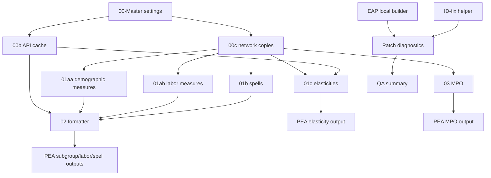
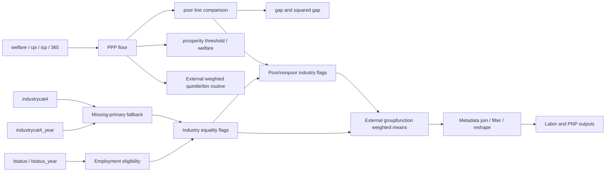

---
{
  "description": "Dependencies, input and output lineage, reference periods and unresolved boundaries.",
  "generated": {
    "by": "process:build-wbg-okf"
  },
  "help_center_commit": "sanitized:3922b3bfe000a87b8aae5305d8d9417ff53718922349db932f5eb85ceef1342d",
  "product_source_pins": {
    "Dashboard": {
      "analysed_commit": "520eace646e46abbe51a8f09b334e283fa455e68",
      "branch": "main",
      "upstream_repo": "worldbank/peaApp"
    },
    "GMI_extended": {
      "analysed_commit": "6f5231790ca118f2bf8c7967f12f1c0f3656ea47",
      "docs_snapshot_commit": "7bc4688b04d22386ae35e11d914a852c99d97b00",
      "upstream_repo": "dasalm20/gmi_extended"
    },
    "Stata_package": {
      "analysed_commit": "4ec2b06ce63e99771630a8f1e1bb8447cbd6f744",
      "branch": "Package_updates-SEP-30th",
      "upstream_repo": "worldbank/pea"
    }
  },
  "sources": [
    {
      "id": "s-ec1c01765ee45d78",
      "resource": "urn:okf:sanitized:ec1c01765ee45d78c0be",
      "sha256": "6b6c5989fc9102a90a348a51bec254d48440b7ba26facfccacfd97869c36b9e3",
      "title": "GMI_extended/architecture/dataset_registry.md"
    },
    {
      "id": "s-5e33941ffc71c499",
      "resource": "urn:okf:sanitized:5e33941ffc71c499edbd",
      "sha256": "179ff02831e20267704464ee0b5a5726adb98079698cfe2df9dcfd56538edd3e",
      "title": "GMI_extended/architecture/execution_flow.md"
    },
    {
      "id": "s-b1cc596588fdf84b",
      "resource": "urn:okf:sanitized:b1cc596588fdf84b94c6",
      "sha256": "6616b0f2f227ea02352df5efa6443f7b2d70f868b406d09a2e3493c6e5489a7b",
      "title": "GMI_extended/architecture/file_inventory.md"
    },
    {
      "id": "s-9820326829d5f7ac",
      "resource": "urn:okf:sanitized:9820326829d5f7aca6a2",
      "sha256": "822e70ead9362a7e2adb046d5a24b3bf0cecd7768f51ca802c61f8dbb6f0f181",
      "title": "GMI_extended/architecture/indicator_flow.md"
    },
    {
      "id": "s-5b708d3f9c379cae",
      "resource": "urn:okf:sanitized:5b708d3f9c379cae4670",
      "sha256": "20a3e0d1b424ccad44d7b6c9dc4b5cf6d142c368b20e3c1c15c4706fe189dd17",
      "title": "GMI_extended/architecture/output_lineage.md"
    }
  ],
  "tags": [
    "gmi_lineage"
  ],
  "title": "GMI lineage — 006",
  "type": "Reference"
}
---

<a id="s-ec1c01765ee45d78-l117"></a>

## Source: GMI_extended/architecture/dataset_registry.md — lines 117–214

This excerpt and its context come from the pinned curated document.[^s-ec1c01765ee45d78]

<details><summary>Source preamble, ancestor headings and table context</summary>

# Dataset expression registry
| Dataset ID | Exact source expression | Writers | Readers | Evidence |
|---|---|---:|---:|---|

</details>

<!-- BEGIN s-ec1c01765ee45d78-l117 -->
| `dataset:487c529c5153c918` | ``datagic'` | 3 | 3 | `01.Programs/archive/01b-GMI extended indicators spells.do:L54-L54` |
| `dataset:a404fd2d1680b9c0` | ``prosdecomp'` | 2 | 2 | `01.Programs/archive/01b-GMI extended indicators spells.do:L55-L55` |
| `dataset:873b66466c7dc505` | ``dataall'` | 1 | 0 | `01.Programs/archive/01b-GMI extended indicators spells.do:L56-L56` |
| `dataset:9dd587dd11bfb0e2` | ``dataall2'` | 1 | 0 | `01.Programs/archive/01b-GMI extended indicators spells.do:L57-L57` |
| `dataset:a91f917022016300` | ``data1'` | 3 | 2 | `01.Programs/archive/01b-GMI extended indicators spells.do:L95-L95` |
| `dataset:4f0ea2547d8ecc02` | `\\wbgfscifs01\GTSD\03.projects_corp\06.GMI\06.GMI_${rnd}\06.GMI_${rnd}_QA\03.output\01.data\GMI_SPspell_all.dta` | 0 | 2 | `01.Programs/archive/01b-GMI extended indicators spells.do:L97-L97` |
| `dataset:3f8e83d7cb5e6088` | ``qccollect'` | 1 | 3 | `01.Programs/archive/01b-GMI extended indicators spells.do:L173-L175` |
| `dataset:903da197524cd35e` | ``data1a'` | 3 | 7 | `01.Programs/archive/01b-GMI extended indicators spells.do:L249-L249` |
| `dataset:4616d75592347ad4` | ``data1b'` | 1 | 2 | `01.Programs/archive/01b-GMI extended indicators spells.do:L443-L443` |
| `dataset:97b4d1fe2fca3006` | `${out}\\03.intermediate\\GMI_extended_${rnd}_GIC` | 1 | 2 | `01.Programs/archive/01b-GMI extended indicators spells.do:L542-L542` |
| `dataset:064b6b46d9cb8bd0` | ``qcbins'` | 1 | 2 | `01.Programs/archive/01b-GMI extended indicators spells.do:L568-L568` |
| `dataset:19195d204fba7f6e` | ``qcA'` | 1 | 1 | `01.Programs/archive/01b-GMI extended indicators spells.do:L632-L632` |
| `dataset:f60ae57952f91282` | `${out}\\03.intermediate\\GMI_extended_${rnd}_prosg_decomp` | 1 | 1 | `01.Programs/archive/01b-GMI extended indicators spells.do:L646-L646` |
| `dataset:95a0eaf4ef22f613` | `${out}\\03.intermediate\\GMI_extended_${rnd}_decomp1` | 1 | 1 | `01.Programs/archive/01b-GMI extended indicators spells.do:L649-L649` |
| `dataset:21a89f14bf7eb45c` | `${out}\\03.intermediate\\GMI_extended_${rnd}_decomp2` | 1 | 1 | `01.Programs/archive/01b-GMI extended indicators spells.do:L652-L652` |
| `dataset:af27dd769958b449` | ``datagic'` | 1 | 0 | `01.Programs/archive/01c-GMI extended spells pov elasticity.do:L5-L5` |
| `dataset:fdc113803a551220` | ``prosdecomp'` | 1 | 0 | `01.Programs/archive/01c-GMI extended spells pov elasticity.do:L6-L6` |
| `dataset:73668592124500c3` | ``dataall'` | 1 | 0 | `01.Programs/archive/01c-GMI extended spells pov elasticity.do:L7-L7` |
| `dataset:d27fe1c915650afb` | ``dataall2'` | 1 | 0 | `01.Programs/archive/01c-GMI extended spells pov elasticity.do:L8-L8` |
| `dataset:44c3bb3f5096947e` | ``pfw'` | 1 | 1 | `01.Programs/archive/01c-GMI extended spells pov elasticity.do:L42-L42` |
| `dataset:93a3a240ca14601f` | `D:\daylan\test\GMI\pip2021.dta` | 0 | 1 | `01.Programs/archive/01c-GMI extended spells pov elasticity.do:L45-L45` |
| `dataset:be76a69895cf6940` | ``pip1'` | 2 | 2 | `01.Programs/archive/01c-GMI extended spells pov elasticity.do:L50-L50` |
| `dataset:cd1049bf073c2c02` | `D:\daylan\test\GMI\pip2017.dta` | 0 | 1 | `01.Programs/archive/01c-GMI extended spells pov elasticity.do:L52-L52` |
| `dataset:d9f5186f9fae8360` | `D:\daylan\test\GMI\PIP_all_GDP.dta` | 0 | 1 | `01.Programs/archive/01c-GMI extended spells pov elasticity.do:L59-L59` |
| `dataset:679e685480a83997` | ``data1'` | 2 | 2 | `01.Programs/archive/01c-GMI extended spells pov elasticity.do:L77-L77` |
| `dataset:c5e926fe224a401c` | ``data2'` | 2 | 1 | `01.Programs/archive/01c-GMI extended spells pov elasticity.do:L104-L104` |
| `dataset:31557146f904dbda` | `${out}\\03.intermediate\\GMI_extended_${rnd}_pov_elas_raw` | 1 | 0 | `01.Programs/archive/01c-GMI extended spells pov elasticity.do:L129-L129` |
| `dataset:5eceb36819fd2743` | `${out}\\03.intermediate\\GMI_extended_${rnd}_pov_elas_fmt` | 1 | 1 | `01.Programs/archive/01c-GMI extended spells pov elasticity.do:L142-L142` |
| `dataset:bd13cd17c8fc0d7e` | `D:\daylan\test\GMI\CLASS_incg_region.dta` | 0 | 1 | `01.Programs/archive/01c-GMI extended spells pov elasticity.do:L147-L147` |
| `dataset:f0b99e403d08d0aa` | ``data10'` | 1 | 1 | `01.Programs/archive/01c-GMI extended spells pov elasticity.do:L151-L151` |
| `dataset:ccfc1bd3bc5a5910` | ``data1pfw'` | 1 | 1 | `01.Programs/archive/02-GMI format.do:L25-L25` |
| `dataset:5a2ef51d43dd56ca` | ``data1'` | 1 | 4 | `01.Programs/archive/02-GMI format.do:L74-L74` |
| `dataset:b5d2f995b9f23f4b` | `${out}\\03.intermediate\\GMI_extended_${rnd}_pov_groups_level` | 1 | 0 | `01.Programs/archive/02-GMI format.do:L160-L160` |
| `dataset:bec648ab4c935c18` | `${out}\\03.intermediate\\GMI_extended_${rnd}_inds_groups` | 1 | 0 | `01.Programs/archive/02-GMI format.do:L202-L202` |
| `dataset:9595a2dd7a846432` | `${out}\\03.intermediate\\GMI_extended_${rnd}_groups_wide` | 1 | 0 | `01.Programs/archive/02-GMI format.do:L240-L240` |
| `dataset:24f0cb3ec900f739` | `${out}\\03.intermediate\\GMI_extended_${rnd}_poornonpoor_groups` | 1 | 0 | `01.Programs/archive/02-GMI format.do:L314-L314` |
| `dataset:06d83e0b9d46c5a5` | `${out}\\03.intermediate\\GMI_extended_${rnd}_GIC_fmt.dta` | 1 | 0 | `01.Programs/archive/02-GMI format.do:L337-L337` |
| `dataset:ea751d5d119be687` | `${out}\\03.intermediate\\GMI_extended_${rnd}_decomp_fmt.dta` | 1 | 0 | `01.Programs/archive/02-GMI format.do:L359-L359` |
| `dataset:17e11d81f7607ed2` | `${out}\\03.intermediate\\GMI_extended_${rnd}_ind_labor.dta` | 1 | 0 | `01.Programs/archive/02-GMI format.do:L366-L366` |
| `dataset:d9df33d5f531fe5e` | `${out}\\03.intermediate\\GMI_extended_${rnd}_ind_labor_fmt.dta` | 1 | 1 | `01.Programs/archive/02-GMI format.do:L511-L511` |
| `dataset:759eecfcd83e04e0` | `${out}\\03.intermediate\\GMI_extended_${rnd}_ind_labor_long_fmt.dta` | 1 | 0 | `01.Programs/archive/02-GMI format.do:L563-L563` |
| `dataset:2fb7b76cc780482b` | `${out}\\03.intermediate\\GMI_extended_${rnd}_prosg_decomp_fmt.dta` | 1 | 0 | `01.Programs/archive/02-GMI format.do:L582-L582` |
| `dataset:3427626a5e7330b6` | `\\wbgfscifs01\GTSD\03.projects_corp\02.MPO\02.MPO_${rnd}\02.MPO_${rnd}_QA\03.output\MPO\01.data\To MFM\global_ex.dta` | 0 | 1 | `01.Programs/archive/03-MPO to PEA.do:L13-L13` |
| `dataset:6800d71435aea616` | ``data1'` | 4 | 4 | `01.Programs/archive/03-MPO to PEA.do:L29-L29` |
| `dataset:cf4aa2b9e9bd92ee` | `\\wbgfscifs01\GTSD\03.projects_corp\02.MPO\02.MPO_${rnd}\02.MPO_${rnd}_QA\03.output\Observed poverty 2021PPP.dta` | 0 | 1 | `01.Programs/archive/03-MPO to PEA.do:L31-L31` |
| `dataset:96ce883fef319ffb` | ``data2'` | 2 | 2 | `01.Programs/archive/03-MPO to PEA.do:L59-L59` |
| `dataset:774036ee086e46e3` | ``data2021'` | 1 | 1 | `01.Programs/archive/03-MPO to PEA.do:L74-L74` |
| `dataset:35eb92bfe1aa230f` | `\\wbgfscifs01\GTSD\03.projects_corp\02.MPO\02.MPO_AM25\02.MPO_AM25_QA\03.output\MPO\01.data\To MFM\global_ex.dta` | 0 | 1 | `01.Programs/archive/03-MPO to PEA.do:L77-L77` |
| `dataset:6b3f084b9b7a2994` | `\\wbgfscifs01\GTSD\03.projects_corp\02.MPO\02.MPO_AM25\02.MPO_AM25_QA\03.output\Observed poverty 2021PPP.dta` | 0 | 1 | `01.Programs/archive/03-MPO to PEA.do:L94-L94` |
| `dataset:606a1b199d469c1d` | ``data2021_previous'` | 1 | 0 | `01.Programs/archive/03-MPO to PEA.do:L139-L139` |
| `dataset:b1385e7ee4a16b09` | `${out}\04.output\PEA_Dashboard\MPO_poverty_data` | 1 | 0 | `01.Programs/archive/03-MPO to PEA.do:L144-L144` |
| `dataset:65f842f01e2dcbc4` | ``dataall'` | 1 | 0 | `01.Programs/archive/Get PIP for PEA.do:L15-L15` |
| `dataset:4f97ccb9abd3a461` | `c:/temp/pip`ppp1'` | 2 | 1 | `01.Programs/archive/Get PIP for PEA.do:L38-L38` |
| `dataset:6497d0c305fb3777` | `${out}\\03.intermediate\pip`ppp1'` | 2 | 0 | `01.Programs/archive/Get PIP for PEA.do:L39-L39` |
| `dataset:a3808ab95018a5ef` | ``data1'` | 1 | 0 | `01.Programs/archive/PIP to GIC and Decomposition data.do:L14-L14` |
| `dataset:2e883d89fc2c056b` | ``data2'` | 1 | 1 | `01.Programs/archive/PIP to GIC and Decomposition data.do:L34-L34` |
| `dataset:75db017d689cec81` | ``data3'` | 1 | 1 | `01.Programs/archive/PIP to GIC and Decomposition data.do:L42-L42` |
| `dataset:090ed4a39f1740c1` | `$datain\world_1000bin.dta` | 0 | 2 | `01.Programs/archive/PIP to GIC and Decomposition data.do:L45-L45` |
| `dataset:ad1a8a9b299e0efc` | ``data4'` | 1 | 1 | `01.Programs/archive/PIP to GIC and Decomposition data.do:L55-L55` |
| `dataset:f2bdbce0d6cfc6af` | `$out\03.intermediate\PIP_povdecomp_${rnd}` | 1 | 1 | `01.Programs/archive/PIP to GIC and Decomposition data.do:L85-L85` |
| `dataset:3f469bde756cdc97` | `$out\03.intermediate\PIP_GICs_${rnd}` | 1 | 0 | `01.Programs/archive/PIP to GIC and Decomposition data.do:L116-L116` |
| `dataset:8dc6b39c2c53d551` | `$out\04.output\PEA_Dashboard\PIP_GICs.csv` | 1 | 0 | `01.Programs/archive/PIP to GIC and Decomposition data.do:L117-L117` |
| `dataset:6794d60b21a0e2dd` | `c:\ado\personal\pea\CLASS_pip.dta` | 0 | 1 | `01.Programs/archive/Update CLASS.do:L2-L2` |
| `dataset:59f8eb4ca8e58a1a` | ``inc_group'` | 1 | 1 | `01.Programs/archive/Update CLASS.do:L22-L22` |
| `dataset:0a619ae899b87ad4` | `c:\ado\personal\pea/CLASS_incg_region.dta` | 1 | 0 | `01.Programs/archive/Update CLASS.do:L29-L29` |
| `dataset:eca063bb15f25e5a` | ``RES'` | 1 | 2 | `04.Checks_Add_reharmonization_results/code/01-Delivery_matrix.do:L105-L108` |
| `dataset:84612331db0d3656` | ``fp'` | 0 | 3 | `04.Checks_Add_reharmonization_results/code/01-Delivery_matrix.do:L194-L194` |
| `dataset:427cc089a9aa2cd7` | `C:\Users\wb570371\Documents\PEA\GMI_extended\04.Checks_Add_reharmonization_results\delivery_matrix_${rnd}.xlsx` | 5 | 0 | `04.Checks_Add_reharmonization_results/code/01-Delivery_matrix.do:L308-L308` |
| `dataset:32b01d7d167771c6` | ``CBOOK'` | 1 | 2 | `04.Checks_Add_reharmonization_results/code/02-delivery_qcheck.do:L229-L229` |
| `dataset:c40ef21ab25ec212` | ``CBTEXT'` | 1 | 4 | `04.Checks_Add_reharmonization_results/code/02-delivery_qcheck.do:L250-L250` |
| `dataset:97bd60f867796290` | ``SM'` | 2 | 6 | `04.Checks_Add_reharmonization_results/code/02-delivery_qcheck.do:L264-L266` |
| `dataset:bfec36f470149a98` | ``fp'` | 0 | 3 | `04.Checks_Add_reharmonization_results/code/02-delivery_qcheck.do:L348-L348` |
| `dataset:3d8ff54e939ac6bd` | ``CAT'` | 3 | 2 | `04.Checks_Add_reharmonization_results/code/02-delivery_qcheck.do:L433-L433` |
| `dataset:a8a45534ac98375d` | ``QC'` | 1 | 1 | `04.Checks_Add_reharmonization_results/code/02-delivery_qcheck.do:L493-L495` |
| `dataset:332709279a34f5a8` | ``CATOK'` | 1 | 2 | `04.Checks_Add_reharmonization_results/code/02-delivery_qcheck.do:L600-L600` |
| `dataset:0f33813001571ce6` | ``SHQ'` | 1 | 2 | `04.Checks_Add_reharmonization_results/code/02-delivery_qcheck.do:L802-L802` |
| `dataset:6f38b6d1e6c5c123` | ``RQ'` | 1 | 1 | `04.Checks_Add_reharmonization_results/code/02-delivery_qcheck.do:L840-L840` |
| `dataset:f2e38524a8489863` | `C:\Users\wb570371\Documents\PEA\GMI_extended\04.Checks_Add_reharmonization_results/GMD_qcheck_`rg'.xlsx` | 4 | 0 | `04.Checks_Add_reharmonization_results/code/02-delivery_qcheck.do:L845-L845` |
| `dataset:6942a540b713eca5` | ``res'` | 1 | 1 | `04.Checks_Add_reharmonization_results/code/99-build_eap_local.do:L171-L176` |
| `dataset:2febce4960782945` | `\\wurepliprdfs06\eapfile\eappp\EAP Harmonization/`cty'/Data/Harmonized/`fn'` | 0 | 4 | `04.Checks_Add_reharmonization_results/code/99-build_eap_local.do:L233-L233` |
| `dataset:1967a1f5d3328403` | ``hh5'` | 1 | 1 | `04.Checks_Add_reharmonization_results/code/99-build_eap_local.do:L281-L281` |
| `dataset:6e9a0d884705ae06` | ``hh1'` | 1 | 1 | `04.Checks_Add_reharmonization_results/code/99-build_eap_local.do:L331-L331` |
| `dataset:9bc217db740a2d58` | ``m9f'` | 1 | 1 | `04.Checks_Add_reharmonization_results/code/99-build_eap_local.do:L385-L385` |
| `dataset:b53e606ad4509745` | `$checks/EAP_data/`p1'_`p2'_`p3'_EAPLOCAL.dta` | 1 | 0 | `04.Checks_Add_reharmonization_results/code/99-build_eap_local.do:L541-L541` |
| `dataset:6609420ff937e458` | `$checks/EAP_data/eap_build_summary.xlsx` | 1 | 0 | `04.Checks_Add_reharmonization_results/code/99-build_eap_local.do:L579-L580` |
| `dataset:e38d6b529f9f8802` | `C:\Users\wb570371\Documents\PEA\GMI_extended\04.Checks_Add_reharmonization_results\gmdpatch_diagnostics_${rnd}.xlsx` | 7 | 0 | `04.Checks_Add_reharmonization_results/code/99-gmdpatch_diagnostics.do:L279-L279` |
| `dataset:20988b65a7b0b9bb` | `them` | 1 | 0 | `04.Checks_Add_reharmonization_results/code/99-gmdpatch_diagnostics.do:L286-L286` |
| `dataset:0a80ba7fb1a68430` | `the` | 1 | 0 | `04.Checks_Add_reharmonization_results/code/99-gmdpatch_diagnostics.do:L396-L396` |
| `dataset:d5a6e52e204ccdba` | ``coderes'` | 1 | 1 | `04.Checks_Add_reharmonization_results/code/99-gmdpatch_diagnostics.do:L452-L454` |
| `dataset:a601cfa6bcc2cdcf` | ``survres'` | 1 | 1 | `04.Checks_Add_reharmonization_results/code/99-gmdpatch_diagnostics.do:L455-L459` |
| `dataset:136b67fe35aeb9b0` | ``varres'` | 1 | 2 | `04.Checks_Add_reharmonization_results/code/99-gmdpatch_diagnostics.do:L461-L464` |
| `dataset:221727da1644714f` | ```reg'_dir'/`f'` | 0 | 1 | `04.Checks_Add_reharmonization_results/code/99-gmdpatch_diagnostics.do:L505-L505` |
| `dataset:63d820ee7dd766ed` | ``pdata'` | 1 | 1 | `04.Checks_Add_reharmonization_results/code/99-gmdpatch_diagnostics.do:L558-L558` |
| `dataset:fb46ce59c0e5bff5` | ```src''` | 0 | 1 | `04.Checks_Add_reharmonization_results/code/99-gmdpatch_diagnostics.do:L734-L734` |
| `dataset:8d36674e746eb496` | `C:\Users\wb570371\Documents\PEA\GMI_extended\04.Checks_Add_reharmonization_results\_qa_data/`dst'.dta` | 1 | 0 | `04.Checks_Add_reharmonization_results/code/99-gmdpatch_diagnostics.do:L739-L739` |
| `dataset:51627126492c211e` | ``blk_merge'` | 1 | 1 | `04.Checks_Add_reharmonization_results/code/99-gmdpatch_diagnostics.do:L773-L773` |
| `dataset:70d7b7bf243ba17d` | ``blk_summ'` | 1 | 1 | `04.Checks_Add_reharmonization_results/code/99-gmdpatch_diagnostics.do:L808-L808` |
| `dataset:43d1d393f80c771f` | ``blk_det'` | 1 | 1 | `04.Checks_Add_reharmonization_results/code/99-gmdpatch_diagnostics.do:L825-L825` |

<!-- END s-ec1c01765ee45d78-l117 -->

<a id="s-ec1c01765ee45d78-l215"></a>

## Source: GMI_extended/architecture/dataset_registry.md — lines 215–239

This excerpt and its context come from the pinned curated document.[^s-ec1c01765ee45d78]

<details><summary>Source preamble, ancestor headings and table context</summary>

# Dataset expression registry
| Dataset ID | Exact source expression | Writers | Readers | Evidence |
|---|---|---:|---:|---|

</details>

<!-- BEGIN s-ec1c01765ee45d78-l215 -->
| `dataset:81e79ccc78e74eef` | `\\WUREPLIPRDFS06\eapfile\eappp\EAP_DATA\datalib_w\ISO3\ISO3_0000_FIES\ISO3_0000_FIES _v01_M\Data\Stata/Merged FIES-LFS 0000_Harmonized.dta` | 0 | 1 | `04.Checks_Add_reharmonization_results/code/99-ISO3_education_trace.do:L81-L81` |
| `dataset:2529bacb45712167` | ``RAW'` | 1 | 1 | `04.Checks_Add_reharmonization_results/code/99-ISO3_education_trace.do:L232-L232` |
| `dataset:85e90d77d96c71a1` | ``CBOOK'` | 1 | 2 | `04.Checks_Add_reharmonization_results/code/99-qa_summary.do:L187-L187` |
| `dataset:e5fd4d24190383dc` | ``CBTEXT'` | 1 | 3 | `04.Checks_Add_reharmonization_results/code/99-qa_summary.do:L206-L206` |
| `dataset:f094031b33e00318` | `C:\Users\wb570371\Documents\PEA\GMI_extended\04.Checks_Add_reharmonization_results\_qa_data/qa_code.dta` | 0 | 3 | `04.Checks_Add_reharmonization_results/code/99-qa_summary.do:L231-L231` |
| `dataset:1c62a83e3280c6aa` | ``CD'` | 1 | 1 | `04.Checks_Add_reharmonization_results/code/99-qa_summary.do:L239-L239` |
| `dataset:d104bf992236edb3` | ``CL'` | 1 | 1 | `04.Checks_Add_reharmonization_results/code/99-qa_summary.do:L248-L248` |
| `dataset:7ced9b7963292c75` | ``CODES_LONG'` | 1 | 3 | `04.Checks_Add_reharmonization_results/code/99-qa_summary.do:L272-L272` |
| `dataset:4c533c645b2a4072` | ``CODELIST'` | 1 | 1 | `04.Checks_Add_reharmonization_results/code/99-qa_summary.do:L305-L305` |
| `dataset:14ca0af0a6fbba61` | `C:\Users\wb570371\Documents\PEA\GMI_extended\04.Checks_Add_reharmonization_results\_qa_data/qa_var.dta` | 0 | 2 | `04.Checks_Add_reharmonization_results/code/99-qa_summary.do:L312-L312` |
| `dataset:83cd18514934b8ac` | ``SH1'` | 1 | 2 | `04.Checks_Add_reharmonization_results/code/99-qa_summary.do:L382-L382` |
| `dataset:5e24a10bbb0787e6` | ``MD'` | 1 | 1 | `04.Checks_Add_reharmonization_results/code/99-qa_summary.do:L398-L398` |
| `dataset:a301b2348c3f3416` | ``SH2'` | 1 | 2 | `04.Checks_Add_reharmonization_results/code/99-qa_summary.do:L498-L498` |
| `dataset:2d6b6e6c0cfd28f7` | ``QC'` | 1 | 1 | `04.Checks_Add_reharmonization_results/code/99-qa_summary.do:L537-L539` |
| `dataset:c315b2e149e5aca7` | `C:\Users\wb570371\Documents\PEA\GMI_extended\04.Checks_Add_reharmonization_results\_qa_data/qa_surv.dta` | 0 | 1 | `04.Checks_Add_reharmonization_results/code/99-qa_summary.do:L542-L542` |
| `dataset:757b61bf25b0bccd` | ``SURV'` | 1 | 3 | `04.Checks_Add_reharmonization_results/code/99-qa_summary.do:L545-L545` |
| `dataset:8a91c885734f1e4a` | ``Q6D'` | 1 | 1 | `04.Checks_Add_reharmonization_results/code/99-qa_summary.do:L613-L613` |
| `dataset:4e9ad02461e77015` | ``SHQ'` | 1 | 1 | `04.Checks_Add_reharmonization_results/code/99-qa_summary.do:L766-L766` |
| `dataset:9ef7e59cc8fd9235` | `C:\Users\wb570371\Documents\PEA\GMI_extended\04.Checks_Add_reharmonization_results\qa_summary_${rnd}.xlsx` | 7 | 0 | `04.Checks_Add_reharmonization_results/code/99-qa_summary.do:L773-L773` |
| `dataset:cfab51f42b1d7a50` | `$reposource\repo_${rnd}all.dta` | 0 | 1 | `01.Programs/00c-fetch server data.do:L64-L65` |
| `dataset:cb96d41fb4ec0df3` | `$gmispell` | 0 | 1 | `01.Programs/00c-fetch server data.do:L67-L68` |
| `dataset:ddf5c6e1172a8c8b` | `$mpopath_cur\03.output\MPO\01.data\To MFM\global_ex.dta` | 0 | 1 | `01.Programs/00c-fetch server data.do:L70-L71` |
| `dataset:c0931fcff8be4088` | `$mpopath_cur\03.output\Observed poverty 2021PPP.dta` | 0 | 1 | `01.Programs/00c-fetch server data.do:L73-L74` |
| `dataset:304fc890fbd9de2e` | `$mpopath_prev\03.output\MPO\01.data\To MFM\global_ex.dta` | 0 | 1 | `01.Programs/00c-fetch server data.do:L76-L77` |
| `dataset:4b0e751b8f2cc6fa` | `$mpopath_prev\03.output\Observed poverty 2021PPP.dta` | 0 | 1 | `01.Programs/00c-fetch server data.do:L79-L80` |

<!-- END s-ec1c01765ee45d78-l215 -->

<a id="s-5e33941ffc71c499-l1"></a>

## Source: GMI_extended/architecture/execution_flow.md — lines 1–37

This excerpt and its context come from the pinned curated document.[^s-5e33941ffc71c499]

<!-- BEGIN s-5e33941ffc71c499-l1 -->
# Execution map

The main entry point is `01.Programs/00-Master.do`. It sets Windows/network paths, current round `SM26`, price framework version `v15`, PPP lists, floors, poverty lines and GMD field lists. `runall` defaults to 0. The configured root is `$gmiroot`; comments explain that DLW may overwrite `$root`. Evidence: `01.Programs/00-Master.do:L10-L16,L32-L34,L102-L113,L168-L241,L265-L313`.



These are source prerequisites, not proof of successful orchestration. File/data edges and exact read/write sites live in `index/dependencies.jsonl` and `index/datasets.jsonl`.

The optional runner constructs names with underscores, unlike the actual spaces in six analysis filenames; the fetch filename also differs in letter case (relevant on case-sensitive systems). It checks existence and uses `cap noisily do`, recording failures and continuing. The diagram therefore describes intended/source dependency order rather than a verified runnable batch. Evidence: `01.Programs/00-Master.do:L271-L313`; actual inventory in `index/files.jsonl`.

`01aa` and `01ab` now depend on externally initialized `$resume_aa` and `$resume_ab`; no definitions appear in this snapshot. Integer validation exits 198 when the expanded local is invalid. Existing accumulator files are required for resume>1; purge uses survey keys at/after the resume row and `keep(master)` to remove old results for those keys. Survey-list order is not fingerprinted by the production code. Evidence: `01.Programs/01aa-GMI extended indicators.do:L25-L44,L98-L115`; `01.Programs/01ab-GMI extended indicators labor ind.do:L23-L33,L157-L173`.

Contrary to the root README, `01c` has no read of 01b decomp1/decomp2; it builds its own spell/PIP/GDP join. `02` does not read the elasticity file. `01c` writes its PEA file directly. `03` is independent of 01aa/01ab/01b/01c/02. Evidence: `01.Programs/01c-GMI extended spells pov elasticity.do:L72-L194`; `01.Programs/03-MPO to PEA.do:L54-L195`; all formatter read sites in `index/blocks.jsonl`.

The nine archived files are independently runnable legacy variants with hardcoded paths and retained scratch commands; they are not invoked by the current runner. Three archive-only workflows extract PIP, construct binned PIP GIC inputs, and update CLASS. Each has its own statement map and output records; path similarity does not merge legacy and current datasets. See `maintenance/archive_differences.json` for exact active-statement differences.

QA workflows are separate user-invoked processes. EAP builder writes `$checks/EAP_data`; diagnostics reads those files plus SSA local files and DLW, loads `_gmdpatch_fixid`, and writes `_qa_data` used by QA summary. Delivery matrix/qcheck directly scan regional deliveries. ISO3 education trace recreates an education chain and compares with DLW; it writes a temporary dataset despite saying screen-only in comments. Evidence: `04.Checks_Add_reharmonization_results/code/99-build_eap_local.do:L45-L52,L537-L580`; `04.Checks_Add_reharmonization_results/code/99-gmdpatch_diagnostics.do:L53-L54,L224-L258,L731-L750`; `04.Checks_Add_reharmonization_results/code/99-qa_summary.do:L36-L43,L210-L231`; `04.Checks_Add_reharmonization_results/code/99-ISO3_education_trace.do:L228-L256`.

<!-- END s-5e33941ffc71c499-l1 -->

<a id="s-b1cc596588fdf84b-l1"></a>

## Source: GMI_extended/architecture/file_inventory.md — lines 1–31

This excerpt and its context come from the pinned curated document.[^s-b1cc596588fdf84b]

<!-- BEGIN s-b1cc596588fdf84b-l1 -->
# File inventory

No source executable is silently excluded. The 25 .do files are all represented below. Version-control internals (including sample hooks) and generated AI_KNOWLEDGE scripts are excluded from production coverage. Finder metadata is inventoried but not interpreted.

| File | Role | Active statements | Lines | Workflow |
|---|---|---:|---:|---|
| `01.Programs/00-Master.do` | Session settings, directories, preflight and optional orchestration | 166 | 362 | [file:98be35f872b2091d](../../lookup/sources/GMI_extended/workflows/00-98be35.md.md) |
| `01.Programs/00b-Pull_API_data.do` | Cache PIP, price framework, GDP and country classification inputs | 230 | 308 | [file:cc12bf8a86984a16](../../lookup/sources/GMI_extended/workflows/00b-cc12bf.md.md) |
| `01.Programs/00c-fetch server data.do` | Copy six network input files with retries and cache checks | 72 | 115 | [file:76305de4daa10f0e](../../lookup/sources/GMI_extended/workflows/00c-76305d.md.md) |
| `01.Programs/01aa-GMI extended indicators.do` | Demographic subgroup poverty and poor/nonpoor profiles | 395 | 649 | [file:4147bae642bb6dfa](../../lookup/sources/GMI_extended/workflows/01aa-4147ba.md.md) |
| `01.Programs/01ab-GMI extended indicators labor ind.do` | Working-age labor and industry poverty cross-tabulations | 286 | 610 | [file:cf70b2568fdbc636](../../lookup/sources/GMI_extended/workflows/01ab-cf70b2.md.md) |
| `01.Programs/01b-GMI extended indicators spells.do` | GIC welfare bins and spell decompositions | 393 | 766 | [file:693ca49303705cc5](../../lookup/sources/GMI_extended/workflows/01b-693ca4.md.md) |
| `01.Programs/01c-GMI extended spells pov elasticity.do` | PIP/GDP spell elasticities and descriptive regressions | 118 | 238 | [file:cf769a0c2afa05ae](../../lookup/sources/GMI_extended/workflows/01c-cf769a.md.md) |
| `01.Programs/02-GMI format.do` | Format demographic, labor, GIC and decomposition outputs | 460 | 651 | [file:ed9a59dcc506e53e](../../lookup/sources/GMI_extended/workflows/02-ed9a59.md.md) |
| `01.Programs/03-MPO to PEA.do` | Combine actual and projected poverty across MPO vintages | 111 | 195 | [file:41c1576ea77152d1](../../lookup/sources/GMI_extended/workflows/03-41c157.md.md) |
| `01.Programs/archive/01aa-GMI extended indicators.do` | Demographic subgroup poverty and poor/nonpoor profiles | 424 | 569 | [file:a16ea0d66abc43f7](../../lookup/sources/GMI_extended/workflows/archive-01aa-a16ea0.md.md) |
| `01.Programs/archive/01ab-GMI extended indicators labor ind.do` | Working-age labor and industry poverty cross-tabulations | 317 | 496 | [file:6cc95ccb6336ad96](../../lookup/sources/GMI_extended/workflows/archive-01ab-6cc95c.md.md) |
| `01.Programs/archive/01b-GMI extended indicators spells.do` | GIC welfare bins and spell decompositions | 413 | 658 | [file:f4a8bcc412c35bb6](../../lookup/sources/GMI_extended/workflows/archive-01b-f4a8bc.md.md) |
| `01.Programs/archive/01c-GMI extended spells pov elasticity.do` | PIP/GDP spell elasticities and descriptive regressions | 137 | 179 | [file:e927035de26cc489](../../lookup/sources/GMI_extended/workflows/archive-01c-e92703.md.md) |
| `01.Programs/archive/02-GMI format.do` | Format demographic, labor, GIC and decomposition outputs | 472 | 583 | [file:0b4abb6f37a1aae3](../../lookup/sources/GMI_extended/workflows/archive-02-0b4abb.md.md) |
| `01.Programs/archive/03-MPO to PEA.do` | Combine actual and projected poverty across MPO vintages | 114 | 144 | [file:4a53fde318bf0089](../../lookup/sources/GMI_extended/workflows/archive-03-4a53fd.md.md) |
| `01.Programs/archive/Get PIP for PEA.do` | Legacy direct PIP extraction at eighteen poverty lines | 47 | 57 | [file:ba02e35104a7e1ee](../../lookup/sources/GMI_extended/workflows/archive-Get_PIP_for_PEA-ba02e3.md.md) |
| `01.Programs/archive/PIP to GIC and Decomposition data.do` | Legacy binned welfare conversion and GIC export | 83 | 118 | [file:ef6ab402032c5fd3](../../lookup/sources/GMI_extended/workflows/archive-PIP_to_GIC_and_Decomposition_data-ef6ab4.md.md) |
| `01.Programs/archive/Update CLASS.do` | Legacy region/income classification preparation | 24 | 29 | [file:a74011951d9fa6b6](../../lookup/sources/GMI_extended/workflows/archive-Update_CLASS-a74011.md.md) |
| `04.Checks_Add_reharmonization_results/code/01-Delivery_matrix.do` | Scan raw regional deliveries for exact GMD names and nonmissing coverage; export delivery workbook. | 340 | 517 | [file:a77151611c30e8fe](../../lookup/sources/GMI_extended/workflows/01-a77151.md.md) |
| `04.Checks_Add_reharmonization_results/code/02-delivery_qcheck.do` | Compare raw delivered distributions with embedded codebooks/thresholds; emit regional qcheck workbooks. | 666 | 1031 | [file:dd095c4aa234e5d1](../../lookup/sources/GMI_extended/workflows/02-dd095c.md.md) |
| `04.Checks_Add_reharmonization_results/code/99-build_eap_local.do` | Assemble EAP person and household modules into GMD-named local comparison files. | 404 | 594 | [file:e7997a55e10871dd](../../lookup/sources/GMI_extended/workflows/99-e7997a.md.md) |
| `04.Checks_Add_reharmonization_results/code/99-gmdpatch_diagnostics.do` | Compare local and DLW files after guarded ID fixes; emit match metrics, cross-tabs and QA tables. | 587 | 958 | [file:30607f798de2d826](../../lookup/sources/GMI_extended/workflows/99-30607f.md.md) |
| `04.Checks_Add_reharmonization_results/code/99-ISO3_education_trace.do` | Rebuild ISO3 education from raw grade codes and compare matched persons with DLW; screen diagnostics and temporary dataset. | 185 | 314 | [file:bfe9b3f95739f102](../../lookup/sources/GMI_extended/workflows/99-bfe9b3.md.md) |
| `04.Checks_Add_reharmonization_results/code/99-qa_summary.do` | Consume qa_surv/qa_var/qa_code; derive codebook, lost-value and distribution-change findings. | 622 | 942 | [file:eaf3b523707c534a](../../lookup/sources/GMI_extended/workflows/99-eaf3b5.md.md) |
| `04.Checks_Add_reharmonization_results/code/gmdpatch_fixid.do` | Define guarded country-specific ID correction helper; no production invocation established. | 127 | 251 | [file:ff0cb1097fa67998](../../lookup/sources/GMI_extended/workflows/gmdpatch_fixid-ff0cb1.md.md) |

<!-- END s-b1cc596588fdf84b-l1 -->

<a id="s-9820326829d5f7ac-l1"></a>

## Source: GMI_extended/architecture/indicator_flow.md — lines 1–31

This excerpt and its context come from the pinned curated document.[^s-9820326829d5f7ac]

<!-- BEGIN s-9820326829d5f7ac-l1 -->
# Indicator construction map

Exact expressions, expanded identities, guards and output links are stored per indicator in `index/indicators.jsonl` and `indicators/*.md`. Counts include current and archived instances and imported/QA statistics; they are not a count of unique economic concepts.



The fallback and industry paths are demonstrated at `01.Programs/01ab-GMI extended indicators labor ind.do:L332-L371,L425-L465,L543-L571`. Head variants use `_head==1` and age≥18 in `01.Programs/01aa-GMI extended indicators.do:L333-L403,L590-L601`.

Welfare mean, poverty FGT inputs and prosperity gap are explicit arithmetic. Quantile assignment, Gini, Theil and decomposition algorithms are external command calls. Preserve this distinction: a complete call/return mapping is not a verified internal implementation. Evidence: `01.Programs/01aa-GMI extended indicators.do:L454-L496,L521`; `01.Programs/01b-GMI extended indicators spells.do:L453-L474,L596-L633`.

The poverty gap input multiplies `(z-welfare)/z` by poor; severity squares it. Prosperity gap is the PPP-specific threshold divided by floored welfare. 01ab additionally drops negative welfare before flooring, while 01aa floors it without that drop. The final stored labor flags are not visibly multiplied by 100 despite percent labels. Evidence: `01.Programs/01aa-GMI extended indicators.do:L454-L467`; `01.Programs/01ab-GMI extended indicators labor ind.do:L425-L431`; `01.Programs/02-GMI format.do:L477-L533,L568-L574`.

For exact expected variables after a wildcard rename or column-order range drop, inspect the source and actual schema. The long labor output removes base fields using range varlists and reshapes line-specific fields. Nonagriculture cross-tabs and the 2–3 variant are dropped earlier. Evidence: `01.Programs/02-GMI format.do:L562-L596`.

<!-- END s-9820326829d5f7ac-l1 -->

<a id="s-5b708d3f9c379cae-l1"></a>

## Source: GMI_extended/architecture/output_lineage.md — lines 1–4

This excerpt and its context come from the pinned curated document.[^s-5b708d3f9c379cae]

<!-- BEGIN s-5b708d3f9c379cae-l1 -->
# Output lineage

Each entry is a write site, not a claim that the output exists. Reverse graph traversal uses dependencies.jsonl. Inferred edges are conservative and may include fields later dropped.


<!-- END s-5b708d3f9c379cae-l1 -->

<a id="s-5b708d3f9c379cae-l5"></a>

## Source: GMI_extended/architecture/output_lineage.md — lines 5–13

This excerpt and its context come from the pinned curated document.[^s-5b708d3f9c379cae]

<details><summary>Source preamble, ancestor headings and table context</summary>

# Output lineage

Each entry is a write site, not a claim that the output exists. Reverse graph traversal uses dependencies.jsonl. Inferred edges are conservative and may include fields later dropped.


# Output lineage

</details>

<!-- BEGIN s-5b708d3f9c379cae-l5 -->
## output:68258e63fedeed82

`$input\pip`ppp1'.dta` — `01.Programs/00b-Pull_API_data.do:L69-L69`

Producer: `block:a6a0ffddf1ada4c8`. Mode: `replace`.
Immediate input datasets: `dataset:2233ff17d89f8e5f, dataset:83ddf112039eda06`.
Indicator IDs: `indicator:003ec0f54c4febb4, indicator:01b128c400693e5d, indicator:07d8a8126faeead6, indicator:0ee09d06ec0f7166, indicator:121dad16527d1a90, indicator:15a3c2a9ce6249b9, indicator:15b6f909731d39bd, indicator:176f0e1b5dd9905f, indicator:1a8e171d1039d69e, indicator:1cd3f51bcd0d8184, indicator:1dd12d61d254f0ea, indicator:1e0293407e4a522f, indicator:21108d0d537ff27a, indicator:2c76ce313ac79ddd, indicator:2f7e060bcf6923c0, indicator:301ecb40212a2921, indicator:38c5feb025c8d910, indicator:3bbcd271ac27747e, indicator:4004c74de6ea5880, indicator:402f53fe76f98238, indicator:4200347d1db21b9c, indicator:421ea1e6f7519c0d, indicator:437ff6640c14ed82, indicator:452275256e5ca92e, indicator:5390e6ce71fa0e63, indicator:5477c45966452b4b, indicator:6515884b80189769, indicator:65eb6b968eefab7c, indicator:665271d64fd08836, indicator:68ec69992d6be898, indicator:6d78ab6024b28816, indicator:71015e2e6866a15d, indicator:79ab2ce42efd63de, indicator:7b647aeaa15b5c9c, indicator:7c1af4ffa990460e, indicator:81c037d69f898b7d, indicator:83027eb3530b3b76, indicator:870d3709082a18cc, indicator:8be039e0b0890d68, indicator:8c6d5cef7c176afe, indicator:903584b625bd3f64, indicator:90ab179d9c4281a6, indicator:b4e0e09edb65f9fa, indicator:b7110352866e735f, indicator:bfb13392dd28d5da, indicator:c1113a875e1dfcd2, indicator:c618e5aa31387cda, indicator:c61e98985058a0e4, indicator:c9b9080c6fde3a5c, indicator:ca5850106bb8a64b, indicator:e74d7770f386c641, indicator:f3bedeeb7e186a89, indicator:f630b00a335b370b, indicator:faa25127069272e9`.
Conditions: `foreach ppp1 of global ppplist {; if `needpull' == 0 {`.


<!-- END s-5b708d3f9c379cae-l5 -->

<a id="s-5b708d3f9c379cae-l14"></a>

## Source: GMI_extended/architecture/output_lineage.md — lines 14–22

This excerpt and its context come from the pinned curated document.[^s-5b708d3f9c379cae]

<details><summary>Source preamble, ancestor headings and table context</summary>

# Output lineage

Each entry is a write site, not a claim that the output exists. Reverse graph traversal uses dependencies.jsonl. Inferred edges are conservative and may include fields later dropped.


# Output lineage
## output:68258e63fedeed82

</details>

<!-- BEGIN s-5b708d3f9c379cae-l14 -->
## output:6abeab3e890db588

``pipbase'` — `01.Programs/00b-Pull_API_data.do:L81-L81`

Producer: `block:afd81f6a7485ff29`. Mode: `replace`.
Immediate input datasets: `dataset:2233ff17d89f8e5f, dataset:83ddf112039eda06`.
Indicator IDs: `not semantically resolved`.
Conditions: `foreach ppp1 of global ppplist {; else {`.


<!-- END s-5b708d3f9c379cae-l14 -->

<a id="s-5b708d3f9c379cae-l23"></a>

## Source: GMI_extended/architecture/output_lineage.md — lines 23–31

This excerpt and its context come from the pinned curated document.[^s-5b708d3f9c379cae]

<details><summary>Source preamble, ancestor headings and table context</summary>

# Output lineage

Each entry is a write site, not a claim that the output exists. Reverse graph traversal uses dependencies.jsonl. Inferred edges are conservative and may include fields later dropped.


# Output lineage
## output:6abeab3e890db588

</details>

<!-- BEGIN s-5b708d3f9c379cae-l23 -->
## output:68041697c3140f21

``pipbase'` — `01.Programs/00b-Pull_API_data.do:L94-L94`

Producer: `block:f709c2830d8dc7e6`. Mode: `replace`.
Immediate input datasets: `dataset:2233ff17d89f8e5f, dataset:83ddf112039eda06`.
Indicator IDs: `not semantically resolved`.
Conditions: `foreach ppp1 of global ppplist {; else {; foreach num of numlist ${pipextra`ppp1'} {`.


<!-- END s-5b708d3f9c379cae-l23 -->

<a id="s-5b708d3f9c379cae-l32"></a>

## Source: GMI_extended/architecture/output_lineage.md — lines 32–40

This excerpt and its context come from the pinned curated document.[^s-5b708d3f9c379cae]

<details><summary>Source preamble, ancestor headings and table context</summary>

# Output lineage

Each entry is a write site, not a claim that the output exists. Reverse graph traversal uses dependencies.jsonl. Inferred edges are conservative and may include fields later dropped.


# Output lineage
## output:68041697c3140f21

</details>

<!-- BEGIN s-5b708d3f9c379cae-l32 -->
## output:45a7f1e145d8f03e

``cachefile'` — `01.Programs/00b-Pull_API_data.do:L100-L100`

Producer: `block:f0da05f4444fc7a7`. Mode: `replace`.
Immediate input datasets: `dataset:83ddf112039eda06`.
Indicator IDs: `not semantically resolved`.
Conditions: `foreach ppp1 of global ppplist {; else {`.


<!-- END s-5b708d3f9c379cae-l32 -->

<a id="s-5b708d3f9c379cae-l41"></a>

## Source: GMI_extended/architecture/output_lineage.md — lines 41–49

This excerpt and its context come from the pinned curated document.[^s-5b708d3f9c379cae]

<details><summary>Source preamble, ancestor headings and table context</summary>

# Output lineage

Each entry is a write site, not a claim that the output exists. Reverse graph traversal uses dependencies.jsonl. Inferred edges are conservative and may include fields later dropped.


# Output lineage
## output:45a7f1e145d8f03e

</details>

<!-- BEGIN s-5b708d3f9c379cae-l41 -->
## output:ad3e54bd2a6a15e0

`$input\pip`ppp1'.dta` — `01.Programs/00b-Pull_API_data.do:L101-L101`

Producer: `block:0ccad5f96bab5f14`. Mode: `replace`.
Immediate input datasets: `dataset:83ddf112039eda06`.
Indicator IDs: `indicator:003ec0f54c4febb4, indicator:01b128c400693e5d, indicator:07d8a8126faeead6, indicator:0ee09d06ec0f7166, indicator:121dad16527d1a90, indicator:15a3c2a9ce6249b9, indicator:15b6f909731d39bd, indicator:176f0e1b5dd9905f, indicator:1a8e171d1039d69e, indicator:1cd3f51bcd0d8184, indicator:1dd12d61d254f0ea, indicator:1e0293407e4a522f, indicator:21108d0d537ff27a, indicator:2c76ce313ac79ddd, indicator:2f7e060bcf6923c0, indicator:301ecb40212a2921, indicator:38c5feb025c8d910, indicator:3bbcd271ac27747e, indicator:4004c74de6ea5880, indicator:402f53fe76f98238, indicator:4200347d1db21b9c, indicator:421ea1e6f7519c0d, indicator:437ff6640c14ed82, indicator:452275256e5ca92e, indicator:5390e6ce71fa0e63, indicator:5477c45966452b4b, indicator:6515884b80189769, indicator:65eb6b968eefab7c, indicator:665271d64fd08836, indicator:68ec69992d6be898, indicator:6d78ab6024b28816, indicator:71015e2e6866a15d, indicator:79ab2ce42efd63de, indicator:7b647aeaa15b5c9c, indicator:7c1af4ffa990460e, indicator:81c037d69f898b7d, indicator:83027eb3530b3b76, indicator:870d3709082a18cc, indicator:8be039e0b0890d68, indicator:8c6d5cef7c176afe, indicator:903584b625bd3f64, indicator:90ab179d9c4281a6, indicator:b4e0e09edb65f9fa, indicator:b7110352866e735f, indicator:bfb13392dd28d5da, indicator:c1113a875e1dfcd2, indicator:c618e5aa31387cda, indicator:c61e98985058a0e4, indicator:c9b9080c6fde3a5c, indicator:ca5850106bb8a64b, indicator:e74d7770f386c641, indicator:f3bedeeb7e186a89, indicator:f630b00a335b370b, indicator:faa25127069272e9`.
Conditions: `foreach ppp1 of global ppplist {; else {`.


<!-- END s-5b708d3f9c379cae-l41 -->

<a id="s-5b708d3f9c379cae-l50"></a>

## Source: GMI_extended/architecture/output_lineage.md — lines 50–58

This excerpt and its context come from the pinned curated document.[^s-5b708d3f9c379cae]

<details><summary>Source preamble, ancestor headings and table context</summary>

# Output lineage

Each entry is a write site, not a claim that the output exists. Reverse graph traversal uses dependencies.jsonl. Inferred edges are conservative and may include fields later dropped.


# Output lineage
## output:ad3e54bd2a6a15e0

</details>

<!-- BEGIN s-5b708d3f9c379cae-l50 -->
## output:bfeac4dbb0964968

`$input\pip_framework.dta` — `01.Programs/00b-Pull_API_data.do:L122-L122`

Producer: `block:c2f1791ccdee2dfd`. Mode: `replace`.
Immediate input datasets: `dataset:204922f53ae83bbc`.
Indicator IDs: `indicator:003ec0f54c4febb4, indicator:01b128c400693e5d, indicator:07d8a8126faeead6, indicator:0ee09d06ec0f7166, indicator:121dad16527d1a90, indicator:15a3c2a9ce6249b9, indicator:15b6f909731d39bd, indicator:176f0e1b5dd9905f, indicator:1a8e171d1039d69e, indicator:1cd3f51bcd0d8184, indicator:1dd12d61d254f0ea, indicator:1e0293407e4a522f, indicator:21108d0d537ff27a, indicator:2c76ce313ac79ddd, indicator:2f7e060bcf6923c0, indicator:301ecb40212a2921, indicator:38c5feb025c8d910, indicator:3bbcd271ac27747e, indicator:4004c74de6ea5880, indicator:402f53fe76f98238, indicator:4200347d1db21b9c, indicator:421ea1e6f7519c0d, indicator:437ff6640c14ed82, indicator:452275256e5ca92e, indicator:5390e6ce71fa0e63, indicator:5477c45966452b4b, indicator:6515884b80189769, indicator:65eb6b968eefab7c, indicator:665271d64fd08836, indicator:68ec69992d6be898, indicator:6d78ab6024b28816, indicator:71015e2e6866a15d, indicator:79ab2ce42efd63de, indicator:7b647aeaa15b5c9c, indicator:7c1af4ffa990460e, indicator:81c037d69f898b7d, indicator:83027eb3530b3b76, indicator:870d3709082a18cc, indicator:8be039e0b0890d68, indicator:8c6d5cef7c176afe, indicator:903584b625bd3f64, indicator:90ab179d9c4281a6, indicator:b4e0e09edb65f9fa, indicator:b7110352866e735f, indicator:bfb13392dd28d5da, indicator:c1113a875e1dfcd2, indicator:c618e5aa31387cda, indicator:c61e98985058a0e4, indicator:c9b9080c6fde3a5c, indicator:ca5850106bb8a64b, indicator:e74d7770f386c641, indicator:f3bedeeb7e186a89, indicator:f630b00a335b370b, indicator:faa25127069272e9`.
Conditions: `if `needpull' == 0 {`.


<!-- END s-5b708d3f9c379cae-l50 -->

<a id="s-5b708d3f9c379cae-l59"></a>

## Source: GMI_extended/architecture/output_lineage.md — lines 59–67

This excerpt and its context come from the pinned curated document.[^s-5b708d3f9c379cae]

<details><summary>Source preamble, ancestor headings and table context</summary>

# Output lineage

Each entry is a write site, not a claim that the output exists. Reverse graph traversal uses dependencies.jsonl. Inferred edges are conservative and may include fields later dropped.


# Output lineage
## output:bfeac4dbb0964968

</details>

<!-- BEGIN s-5b708d3f9c379cae-l59 -->
## output:c763493a63b4cc5d

``cachefile'` — `01.Programs/00b-Pull_API_data.do:L128-L128`

Producer: `block:5c9ac2403d166a11`. Mode: `replace`.
Immediate input datasets: `dataset:204922f53ae83bbc`.
Indicator IDs: `not semantically resolved`.
Conditions: `else {`.


<!-- END s-5b708d3f9c379cae-l59 -->

[^s-ec1c01765ee45d78]: GMI_extended/architecture/dataset_registry.md, help-center snapshot sanitized:3922b3bfe000a87b8aae5305d8d9417ff53718922349db932f5eb85ceef1342d.
[^s-5e33941ffc71c499]: GMI_extended/architecture/execution_flow.md, help-center snapshot sanitized:3922b3bfe000a87b8aae5305d8d9417ff53718922349db932f5eb85ceef1342d.
[^s-b1cc596588fdf84b]: GMI_extended/architecture/file_inventory.md, help-center snapshot sanitized:3922b3bfe000a87b8aae5305d8d9417ff53718922349db932f5eb85ceef1342d.
[^s-9820326829d5f7ac]: GMI_extended/architecture/indicator_flow.md, help-center snapshot sanitized:3922b3bfe000a87b8aae5305d8d9417ff53718922349db932f5eb85ceef1342d.
[^s-5b708d3f9c379cae]: GMI_extended/architecture/output_lineage.md, help-center snapshot sanitized:3922b3bfe000a87b8aae5305d8d9417ff53718922349db932f5eb85ceef1342d.
