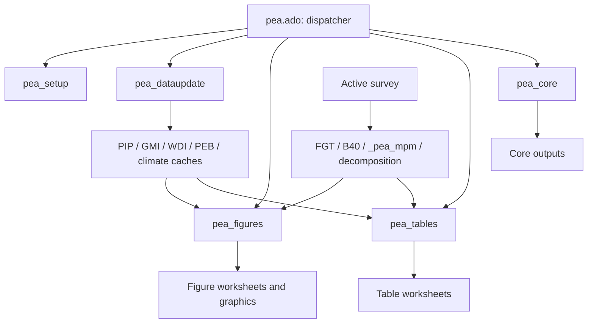
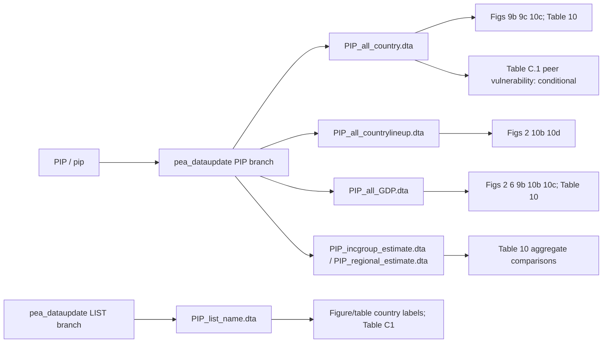
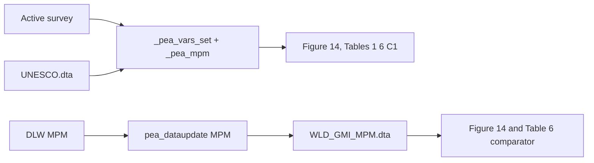
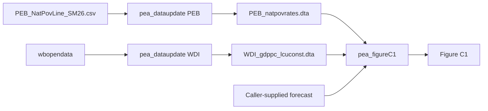
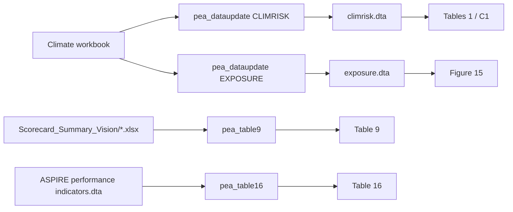

---
{
  "description": "Exact declarations, options, input contracts, variables and output records.",
  "generated": {
    "by": "process:build-wbg-okf"
  },
  "help_center_commit": "sanitized:3922b3bfe000a87b8aae5305d8d9417ff53718922349db932f5eb85ceef1342d",
  "product_source_pins": {
    "Dashboard": {
      "analysed_commit": "520eace646e46abbe51a8f09b334e283fa455e68",
      "branch": "main",
      "upstream_repo": "worldbank/peaApp"
    },
    "GMI_extended": {
      "analysed_commit": "6f5231790ca118f2bf8c7967f12f1c0f3656ea47",
      "docs_snapshot_commit": "7bc4688b04d22386ae35e11d914a852c99d97b00",
      "upstream_repo": "dasalm20/gmi_extended"
    },
    "Stata_package": {
      "analysed_commit": "4ec2b06ce63e99771630a8f1e1bb8447cbd6f744",
      "branch": "Package_updates-SEP-30th",
      "upstream_repo": "worldbank/pea"
    }
  },
  "sources": [
    {
      "id": "s-e7664c93a9a60d44",
      "resource": "urn:okf:sanitized:e7664c93a9a60d446477",
      "sha256": "379c6abff0b20264c14b75d63bc45f78e67f6fbdfeb076fdef1902440c4a82a3",
      "title": "Stata_package/AI_GUIDE.md"
    },
    {
      "id": "s-0f94e8f14289d64b",
      "resource": "urn:okf:sanitized:0f94e8f14289d64b7274",
      "sha256": "64ea754b8f9b4eb2fc3cde1cb3ec197a003a3be098b015af29585391f5a31dd1",
      "title": "Stata_package/ANSWERS.md"
    },
    {
      "id": "s-5b07dacccacbbe7e",
      "resource": "urn:okf:sanitized:5b07dacccacbbe7e7b73",
      "sha256": "dfa7514bab2a5ede43556e0f278218077de2ef34cafc26c80f0ab28b94131bb4",
      "title": "Stata_package/architecture/DATA_LINEAGE.md"
    },
    {
      "id": "s-f4427d47d4bf8a0e",
      "resource": "urn:okf:sanitized:f4427d47d4bf8a0e030b",
      "sha256": "4e9652d4394a03ef540f72a9c116227afe4a6a66d1715bf059bd777d0f991f49",
      "title": "Stata_package/architecture/PEA_Architecture_Mermaid.md"
    },
    {
      "id": "s-b48f53b8b1643b19",
      "resource": "urn:okf:sanitized:b48f53b8b1643b195377",
      "sha256": "b4e5df2f642a5260c912c784a0dfd6312010fd843e96d679a3e25635a6d789cc",
      "title": "Stata_package/architecture/cache-checks.md"
    },
    {
      "id": "s-56c8193a1e6c7f12",
      "resource": "urn:okf:sanitized:56c8193a1e6c7f12f750",
      "sha256": "5b0e4a651df23c1093604dee4918c67d0a048e15bd8bc26f50dd886f5d17ad14",
      "title": "Stata_package/architecture/program_reference.md"
    }
  ],
  "tags": [
    "stata_commands"
  ],
  "title": "Stata commands — 001",
  "type": "Reference"
}
---

<a id="s-e7664c93a9a60d44-l1"></a>

## Source: Stata_package/AI_GUIDE.md — lines 1–52

This excerpt and its context come from the pinned curated document.[^s-e7664c93a9a60d44]

<!-- BEGIN s-e7664c93a9a60d44-l1 -->
# Operating rules for the PEA Stata navigation folder

Use this directory as a routing index. Follow [shared conventions](../assistant_rules/001.md#s-2e28754e69aa417e-l1) and [provenance](../assistant_rules/001.md#s-c4b7dcfce275dd0f-l1); do not treat an old source-level finding as a measured result.
For command options and input contracts, use the [command reference](004.md#s-1a111f0c23d6b2f9-l1); for messages or missing outputs, use the [error index](../stata_errors/002.md#s-38eb878fc22069c4-l1).
For a starting call with input preparation, use the [command templates](../stata_templates/001.md#s-57ca566a3a66b518-l1).

## Minimal retrieval sequence

1. Find the worksheet and row/series in [outputs/INDEX.md](024.md#s-c4532d2802a330e5-l1), preserving core/legacy identity and dynamic category parameters.
2. Read the record’s producer, caller inputs, cache conditions and GMI counterpart.
3. Follow [source/cache lineage](001.md#s-5b07dacccacbbe7e-l1), then the implicated [identifier families](040.md#s-d2c7f17b66229485-l1): grain, join keys, year, PPP, weight and denominator.
4. Check [ISSUES.md](../stata_errors/001.md#s-c752033a03aff2a4-l1) for the producer and shared-helper risks. All original IDs and severities are retained.
5. Consult [WORKFLOW.md](003.md#s-b5496541ea2718ad-l1) when routing, mapping or cache updates matter.
6. Stay inside this help center. Citations name the pinned source line a maintainer could check; they are not an instruction to open the product repo. If the answer is not recorded here, say so.
7. Return the symptom, candidate cause, exact evidence, impact radius, uncertainty and smallest safe validation plan.

## Evidence vocabulary

| Tag | Use |
|---|---|
| `VERIFIED_STATIC` | Source demonstrably contains the supported operation/call; no observed value follows. |
| `INFERRED` | Conditional consequence of source behavior; state the condition. |
| `UNVERIFIED` | Named but unresolved claim, runtime outcome, missing physical schema or unmatched definition. |
| `EXTERNAL_DEPENDENCY` | User inputs, upstream harmonization, APIs, datasets and external command implementations. |

Coverage is **PARTIAL_STATIC**. Do not upgrade evidence on restatement. Never describe a source-level concern as runtime-confirmed. An absent document means not analysed, not nothing to report.

## Required answer structure

- **Observed symptom:** identify it as user-reported unless actual evidence was recorded.
- **Affected outputs:** worksheet, row/series, producer and column role.
- **Upstream path:** source → persisted cache or explicit intermediate → helper → output.
- **Candidate causes:** each with source citation and evidence tag.
- **Collateral impact:** other consumers of the shared cache/helper.
- **Validation:** exact minimum checks needed; do not guess their results.
- **Proposed change:** only within the user’s implementation request.

## Guardrails

- Never infer a physically inspected `.dta`/workbook schema from source references.
- Do not substitute similarly named indicators, PPP vintages, GDP sources or year fields.
- Keep same-named fields in different files/load contexts separate until a crosswalk establishes equivalence.
- Distinguish active survey calculations, persisted comparator caches and call-scoped tempfiles. `data_gmi1_u` is only the last of these.
- Do not change shared helpers before identifying their consumers.
- Do not automatically run or modify product code; the current scope authorizes documentation edits only and expressly prohibits Stata execution.
- Retain every honesty boundary in [AUDIT_SCOPE.md](../stata_errors/001.md#s-0f638d925c7f09ed-l1).

Example: “Why is Table 6 MPM different?” → Table6a row in the output index → local `_pea_mpm` versus `WLD_GMI_MPM.dta` → PPP/survey identity → issue P1-06 → pinned source. Definition equivalence and observed differences remain `UNVERIFIED`.

## Source update — 2026-10-28

Current PEA pin: `4ec2b06ce63e99771630a8f1e1bb8447cbd6f744`. [Changes, resolved issues and limitations](../stata_errors/002.md#s-fd57fda371239c6d-l1). Historical records retain their own source pins.

<!-- END s-e7664c93a9a60d44-l1 -->

<a id="s-0f94e8f14289d64b-l1"></a>

## Source: Stata_package/ANSWERS.md — lines 1–154

This excerpt and its context come from the pinned curated document.[^s-0f94e8f14289d64b]

<!-- BEGIN s-0f94e8f14289d64b-l1 -->
# Questions country teams ask

Coverage: **PARTIAL_STATIC**. These answers summarize the ported seed at the [pinned source](../assistant_rules/001.md#s-c4b7dcfce275dd0f-l1), not observed output values. Follow the fuller document for the row, producer and validation boundary.

1. [Why is this row of Table C.1 blank?](001.md#s-0f94e8f14289d64b-l1)
2. [Why does my rerun differ from the published table?](001.md#s-0f94e8f14289d64b-l1)
3. [Which variables does our country team need to pass?](001.md#s-0f94e8f14289d64b-l1)
4. [Where do the peer columns in Table C.1 come from?](001.md#s-0f94e8f14289d64b-l1)
5. [Should national poverty and the national number of poor have peer values?](001.md#s-0f94e8f14289d64b-l1)
6. [Why does the paid-work row not match our share among workers?](001.md#s-0f94e8f14289d64b-l1)
7. [Why is Table 6 MPM different from our local estimate?](001.md#s-0f94e8f14289d64b-l1)
8. [We requested 2021 PPP. Why does Figure 14 still mention $2.15?](001.md#s-0f94e8f14289d64b-l1)
9. [Why do Figures 10b and 10c show different comparator points?](001.md#s-0f94e8f14289d64b-l1)
10. [Why was a comparator exactly three years away excluded?](001.md#s-0f94e8f14289d64b-l1)
11. [Why does running through pea_core differ from calling a table directly?](001.md#s-0f94e8f14289d64b-l1)
12. [Why does Contents say a figure was produced when the sheet is missing?](001.md#s-0f94e8f14289d64b-l1)
13. [Does “vulnerable” mean the same thing in every table?](001.md#s-0f94e8f14289d64b-l1)
14. [Are the GDP series in the poverty figures interchangeable?](001.md#s-0f94e8f14289d64b-l1)
15. [Can we merge on year and ignore welfare type or survey name?](001.md#s-0f94e8f14289d64b-l1)

<a id="q1"></a>
## 1. Why is this row of Table C.1 blank?

`VERIFIED_STATIC` Peer values are initialized missing and populated only when the expected cache field exists. Local labor is skipped if lstatus() has no nonmissing observations; national headcount labeling also depends on the parsed welfare name. `INFERRED` Check which side is blank before choosing between missing fields, mapping, conditional computation or an absent peer mapping. The actual cause remains `UNVERIFIED`.

**Evidence:** `Stata/plus/p/pea_tableC1.ado:L258-L276`; `Stata/plus/p/pea_tableC1.ado:L572-L611`; `Stata/plus/p/pea_tableC1.ado:L615-L619`.

**Fuller document:** [Details and checks](003.md#s-33a63f5a0977ab0e-l1).

<a id="q2"></a>
## 2. Why does my rerun differ from the published table?

`VERIFIED_STATIC` The selected cache can be reused for up to the age threshold; requested release metadata can trigger a refresh sooner. PERSONAL data paths are independent of the checked-out source directory. `INFERRED` Different cache versions, caller mappings, sample restrictions, year/PPP choices or external releases can change a rerun. Preserve both invocations and provenance before comparing values.

**Evidence:** `Stata/plus/p/pea_dataupdate.ado:L91-L154`; `Stata/plus/p/pea_dataupdate.ado:L373-L381`.

**Fuller document:** [Details and checks](001.md#s-b48f53b8b1643b19-l1).

<a id="q3"></a>
## 3. Which variables does our country team need to pass?

`VERIFIED_STATIC` Choose the output first. For Table C.1, map year, national/PPP welfare and poverty-line fields, onewelfare/oneline, age, lstatus, empstat, industrycat4 and male as required by the rows, plus country, PPP, peers/aggregation and a weight expression. The program explicitly rejects absent age() or lstatus(). With setting(GMD), pea_core maps demographic/labor names via _pea_vars_set; Table C.1 itself has no equivalent mapping block. MPM has an additional helper/input contract. `UNVERIFIED` A syntax option being optional does not prove an omitted input can produce every row.

**Evidence:** `Stata/plus/p/pea_tableC1.ado:L22-L22`; `Stata/plus/p/pea_tableC1.ado:L72-L79`; `Stata/plus/p/pea_tableC1.ado:L191-L199`; `Stata/plus/p/pea_tableC1.ado:L615-L633`; `Stata/plus/p/pea_core.ado:L63-L70`; `Stata/plus/_/_pea_mpm.ado:L20-L32`; `Stata/plus/_/_pea_mpm.ado:L67-L80`.

**Fuller document:** [Details and checks](040.md#s-d86e1a9d3af7e1aa-l1).

<a id="q4"></a>
## 4. Where do the peer columns in Table C.1 come from?

`VERIFIED_STATIC` GMI_extend_all_country.dta supplies peer poverty, inequality, MPM and labor. PIP_all_country.dta supplies peer vulnerability only when onewelfare() equals pppwelfare(). Focus-country climate comes directly from climrisk.dta; peer climate is already in GMI. The classification lookup data_gmi1_u is a tempfile, not another cache.

**Evidence:** `Stata/plus/p/pea_tableC1.ado:L201-L221`; `Stata/plus/p/pea_tableC1.ado:L284-L313`; `Stata/plus/p/pea_tableC1.ado:L395-L418`; `Stata/plus/p/pea_tableC1.ado:L464-L483`; `Stata/plus/p/pea_dataupdate.ado:L850-L852`.

**Fuller document:** [Details and checks](003.md#s-33a63f5a0977ab0e-l1).

<a id="q5"></a>
## 5. Should national poverty and the national number of poor have peer values?

`VERIFIED_STATIC` The peer remapping starts with international poverty rows 3–5 and has no national-rate or national-poor-count mapping for rows 1–2. `INFERRED` Blank peer cells on those rows can follow the source design even when the local national figures exist.

**Evidence:** `Stata/plus/p/pea_tableC1.ado:L258-L276`; `Stata/plus/p/pea_tableC1.ado:L591-L611`.

**Fuller document:** [Details and checks](038.md#s-20874686b559726c-l1).

<a id="q6"></a>
## 6. Why does the paid-work row not match our share among workers?

`VERIFIED_STATIC` Local paid and industry indicators are defined on nonmissing working-age inputs and averaged without an explicit worker-only filter. The labels say “Of which”, but that does not establish a conditional denominator. `UNVERIFIED` Equivalence with the external GMI denominator is unresolved (P1-16).

**Evidence:** `Stata/plus/p/pea_tableC1.ado:L621-L655`.

**Fuller document:** [Details and checks](038.md#s-844456a009101d88-l1).

<a id="q7"></a>
## 7. Why is Table 6 MPM different from our local estimate?

`VERIFIED_STATIC` Table 6 appends cached focus-country records to the local result; its collection takes means. `INFERRED` Overlapping country/year records can blend the two sources (P1-06). `UNVERIFIED` The local and DLW/GMI algorithms are not established as equivalent.

**Evidence:** `Stata/plus/p/pea_table6.ado:L122-L177`.

**Fuller document:** [Details and checks](030.md#s-1dc6d6f109377ed3-l1).

<a id="q8"></a>
## 8. We requested 2021 PPP. Why does Figure 14 still mention $2.15?

`VERIFIED_STATIC` The figure’s label hard-codes $2.15 while _pea_mpm selects $3.00 for 2021 PPP. The cached comparator-selection block does not filter PPP. `INFERRED` A label correction alone would not resolve possible comparator-vintage mixing (P1-05, P2-08).

**Evidence:** `Stata/plus/p/pea_figure14.ado:L79-L128`; `Stata/plus/_/_pea_mpm.ado:L24-L25`.

**Fuller document:** [Details and checks](040.md#s-e789563cc9d4b6ed-l1).

<a id="q9"></a>
## 9. Why do Figures 10b and 10c show different comparator points?

`VERIFIED_STATIC` Figure 10b reads lineup estimates for the focus year; Figure 10c reads actual country estimates and selects the nearest year inside its window. `INFERRED` Those distinct data/selection contracts can produce different points.

**Evidence:** `Stata/plus/p/pea_figure10b.ado:L106-L147`; `Stata/plus/p/pea_figure10c.ado:L93-L152`.

**Fuller document:** [Details and checks](001.md#s-5b07dacccacbbe7e-l1).

<a id="q10"></a>
## 10. Why was a comparator exactly three years away excluded?

`VERIFIED_STATIC` The relevant nearest-year figures use a strict < within rule, so default within(3) excludes an absolute difference of three; Figure 14 hard-codes <3. Table C.1 instead uses an inclusive ±3-year range. `INFERRED` Do not carry one output’s window rule into another (P2-01).

**Evidence:** `Stata/plus/p/pea_figure9b.ado:L123-L145`; `Stata/plus/p/pea_figure14.ado:L109-L112`; `Stata/plus/p/pea_tableC1.ado:L365-L372`.

**Fuller document:** [Details and checks](040.md#s-9e7c1cbffb891d42-l1).

<a id="q11"></a>
## 11. Why does running through pea_core differ from calling a table directly?

`VERIFIED_STATIC` The wrappers construct touse and extract the weight variable, but call children with analytic weights and without the caller’s if/in qualifiers. GMD mapping is a separate conditional wrapper step. `INFERRED` Sample and weight semantics can differ (P1-01).

**Evidence:** `Stata/plus/p/pea_core.ado:L46-L46`; `Stata/plus/p/pea_core.ado:L63-L70`; `Stata/plus/p/pea_core.ado:L148-L195`; `Stata/plus/p/pea_core.ado:L212-L225`.

**Fuller document:** [Details and checks](003.md#s-b5496541ea2718ad-l1).

<a id="q12"></a>
## 12. Why does Contents say a figure was produced when the sheet is missing?

`VERIFIED_STATIC` P0-04 and the core Contents punctuation are fixed: all-missing supplied forecast variables exit 2000; valid values pass this guard, and Contents targets FigureC.1. This does not prove the figure runs: the unchanged label-variable problem P0-05 remains. `Stata/plus/p/pea_figureC1.ado:L42-L53`; `Stata/plus/p/pea_core.ado:L209-L224`.

**Evidence:** `Stata/plus/p/pea_figureC1.ado:L42-L53`; `Stata/plus/p/pea_figureC1.ado:L311-L311`; `Stata/plus/p/pea_core.ado:L204-L221`.

**Fuller document:** [Details and checks](../stata_errors/001.md#s-c752033a03aff2a4-l1).

<a id="q13"></a>
## 13. Does “vulnerable” mean the same thing in every table?

`VERIFIED_STATIC` Active local tables use an interval above poverty; legacy Table 1 uses cumulative welfare below 1.5 times the line; Table C.1 peers use differences between PIP headcounts at rounded/floored cutoffs. `INFERRED` Matching labels alone cannot establish matching populations (P1-09).

**Evidence:** `Stata/plus/p/pea_table1.ado:L131-L133`; `Stata/plus/p/pea_table1_std.ado:L154-L158`; `Stata/plus/p/pea_tableC1.ado:L341-L350`; `Stata/plus/p/pea_tableC1.ado:L395-L418`.

**Fuller document:** [Details and checks](039.md#s-8f21c73aab98f587-l1).

<a id="q14"></a>
## 14. Are the GDP series in the poverty figures interchangeable?

`VERIFIED_STATIC` The PIP branch writes gdppc from its GDP table. Figure C.1 reads WDI gdp_pc_lcu_const instead. `UNVERIFIED` Source labels do not establish interchangeable units, vintages or upstream definitions.

**Evidence:** `Stata/plus/p/pea_dataupdate.ado:L261-L276`; `Stata/plus/p/pea_dataupdate.ado:L357-L381`; `Stata/plus/p/pea_figureC1.ado:L164-L177`.

**Fuller document:** [Details and checks](039.md#s-87002e0164460522-l1).

<a id="q15"></a>
## 15. Can we merge on year and ignore welfare type or survey name?

`VERIFIED_STATIC` The source uses different grains: PIP framework joins include country/year/welfare/survey, while the final GMI labor attachment uses code/year. `INFERRED` Omitting a dimension can attach the wrong survey or leave duplicates (P1-02, P1-07, P1-08). `UNVERIFIED` Neither year/rep_year/lineupyear nor welfare_type/welftype/welf_type is interchangeable without a path-specific crosswalk.

**Evidence:** `Stata/plus/p/pea_dataupdate.ado:L463-L475`; `Stata/plus/p/pea_dataupdate.ado:L839-L848`.

**Fuller document:** [Details and checks](040.md#s-2bfb219f5665520d-l1).

<!-- END s-0f94e8f14289d64b-l1 -->

<a id="s-b48f53b8b1643b19-l1"></a>

## Source: Stata_package/architecture/cache-checks.md — lines 1–33

This excerpt and its context come from the pinned curated document.[^s-b48f53b8b1643b19]

<!-- BEGIN s-b48f53b8b1643b19-l1 -->
# Rerun and cache checks

`VERIFIED_STATIC` The cache directory is read from `sysdir PERSONAL`. The selected primary file is checked for existence/readability, its `_dta[version]` age and, when requested, `_dta[pip_release]`. Captured recursive updates do not prove a complete related bundle. Evidence: `Stata/plus/p/pea_dataupdate.ado:L91-L154`; `Stata/plus/p/pea_dataupdate.ado:L373-L381`.

`INFERRED` A difference from a published workbook requires comparison of the source revision, command/options, input survey, caller sample/weights, field mappings, PPP, reference years, installed dependencies and actual cache metadata. An unchanged package revision does not pin these other inputs.

`UNVERIFIED` The following is a proposed diagnostic for a later authorized Stata session. It was **not run** during the port. Replace expected fields only according to the row record; absence, duplicates and metadata values are not predicted here.

```stata
which pea_tableC1
sysdir
local pea_cache_root : sysdir PERSONAL
preserve
use "`pea_cache_root'pea/GMI_extend_all_country.dta", clear
char list _dta[]
describe code year ppp welftype survname fgt0_ipl gini pg mdpoor_i1 _working_ind
duplicates report code year welftype survname ppp
restore
preserve
use "`pea_cache_root'pea/PIP_all_country.dta", clear
char list _dta[]
describe code year ppp welfare_type headcount*
duplicates report code year welfare_type ppp
restore
preserve
use "`pea_cache_root'pea/climrisk.dta", clear
char list _dta[]
describe code year atrisk
list code year atrisk if code == "<FOCUS_COUNTRY_CODE>"
restore
```

`UNVERIFIED` These checks read caches and return to the active survey; they do not establish correct harmonization, complete schema or unique records after output-specific selection. Compare the exact nearest-year selection and join key in the producer before adding/removing duplicates. Record date, command, input identities and output evidence before changing any runtime evidence status.

<!-- END s-b48f53b8b1643b19-l1 -->

<a id="s-5b07dacccacbbe7e-l1"></a>

## Source: Stata_package/architecture/DATA_LINEAGE.md — lines 1–4

This excerpt and its context come from the pinned curated document.[^s-5b07dacccacbbe7e]

<!-- BEGIN s-5b07dacccacbbe7e-l1 -->
# Bidirectional source/output lineage

`VERIFIED_STATIC` Ported source/cache matrix and reverse program map. Source routes are verified at `97a4659`; expected grains describe source joins, not inspected physical schemas. Corrections and superseded statements are in [the discrepancy record](../stata_errors/002.md#s-a78b56243961d3c5-l1). Start investigations at [outputs/INDEX](024.md#s-c4532d2802a330e5-l1).


<!-- END s-5b07dacccacbbe7e-l1 -->

<a id="s-5b07dacccacbbe7e-l5"></a>

## Source: Stata_package/architecture/DATA_LINEAGE.md — lines 5–62

This excerpt and its context come from the pinned curated document.[^s-5b07dacccacbbe7e]

<details><summary>Source preamble, ancestor headings and table context</summary>

# Bidirectional source/output lineage

`VERIFIED_STATIC` Ported source/cache matrix and reverse program map. Source routes are verified at `97a4659`; expected grains describe source joins, not inspected physical schemas. Corrections and superseded statements are in [the discrepancy record](../stata_errors/002.md#s-a78b56243961d3c5-l1). Start investigations at [outputs/INDEX](024.md#s-c4532d2802a330e5-l1).


# Bidirectional source/output lineage

</details>

<!-- BEGIN s-5b07dacccacbbe7e-l5 -->
## D. Bidirectional lineage

### D1. Source → output matrix

| Source/cache | Producer | Key variables or grain | Direct consumers | Final outputs | Evidence | Claim status |
|---|---|---|---|---|---|---|
| Active survey/GMD microdata | Caller; mappings assigned by `_pea_vars_set` | Survey/person/household; year, welfare, weight, demographics | All survey figures/tables | Figures 1, 3–14, 16, C1; Tables 1–8, 10–15, A2, C1 | Child calls: `Stata/plus/p/pea_figures.ado:L163-L453`; `Stata/plus/p/pea_tables.ado:L199-L404`; `Stata/plus/p/pea_core.ado:L212-L316` | `VERIFIED_STATIC` source route; `EXTERNAL_DEPENDENCY` input values/schema |
| `_fgt0_*`, `_fgt1_*`, `_fgt2_*` | `_pea_gen_fgtvars` | Observation × welfare × line | Most poverty figures/tables | Figures 1, 2, 6–8, C1; Tables 1–4, 7, A2, C1 | `_pea_gen_fgtvars.ado`; representative consumption `Stata/plus/p/pea_figure1.ado:L149-L171` | `VERIFIED_STATIC` source route; `EXTERNAL_DEPENDENCY` input values/schema |
| B40/T60 fields | `_pea_gen_b40` | Observation/year | Orchestrators, Table 1 | Table1/TableA1 and dependent distribution summaries | `Stata/plus/p/pea_figures.ado:L150-L150`; `Stata/plus/p/pea_tables.ado:L176-L176`; `Stata/plus/p/pea_core.ado:L189-L189` | `VERIFIED_STATIC` source route; `EXTERNAL_DEPENDENCY` input values/schema |
| `PIP_all_country.dta` | `pea_dataupdate, datatype(PIP)` | Country-year-welfare type-PPP | Figures 9b, 9c, 10c; Tables 10 and C.1 (conditional peer vulnerability) | Cross-country inequality/PG/GDP figures and comparison table | Producer `Stata/plus/p/pea_dataupdate.ado:L384-L490`; Table C.1: `Stata/plus/p/pea_tableC1.ado:L395-L418`; `Stata/plus/p/pea_tableC1.ado:L464-L483`; `Stata/plus/p/pea_tableC1.ado:L535-L558` | `VERIFIED_STATIC` source route; `EXTERNAL_DEPENDENCY` input values/schema |
| `PIP_all_countrylineup.dta` | PIP branch | Country-lineup year-welfare type-PPP | Figures 2, 10b, 10d | Lined-up poverty, PG/GDP, PG histories | `Stata/plus/p/pea_dataupdate.ado:L498-L560`; `Stata/plus/p/pea_figure2.ado:L127-L171` | `VERIFIED_STATIC` source route; `EXTERNAL_DEPENDENCY` input values/schema |
| `PIP_all_GDP.dta` | PIP branch | `code year`, `gdppc` | Figures 2, 6, 9b, 10b, 10c; Table 10 | GDP-poverty, GDP-Gini, GDP-PG products | `Stata/plus/p/pea_dataupdate.ado:L357-L381`; e.g. `Stata/plus/p/pea_figure6.ado:L141-L164` | `VERIFIED_STATIC` source route; `EXTERNAL_DEPENDENCY` input values/schema |
| `PIP_list_name.dta` | LIST branch | Country code, country name, region | Figures 2, 9b, 10b/c/d, 14; Tables 6, 9, 10 | Country labels, region/benchmark grouping | `Stata/plus/p/pea_dataupdate.ado:L227-L244`; e.g. `Stata/plus/p/pea_figure2.ado:L143-L154` | `VERIFIED_STATIC` source route; `EXTERNAL_DEPENDENCY` input values/schema |
| `PIP_incgroup_estimate.dta` | PIP branch | Income group-year-PPP | Table 10 and upstream comparison preparation | Income-group comparison cells | `Stata/plus/p/pea_dataupdate.ado:L562-L669` | `VERIFIED_STATIC` source route; `EXTERNAL_DEPENDENCY` input values/schema |
| `PIP_regional_estimate.dta` | PIP branch | Region-year-PPP | Table 10 and upstream comparison preparation | Regional comparison cells | `Stata/plus/p/pea_dataupdate.ado:L671-L748` | `VERIFIED_STATIC` source route; `EXTERNAL_DEPENDENCY` input values/schema |
| `POP.dta` | POP branch | Country-year population and age-group population | PIP aggregation; GMI/Table C1 preparation | Population-weighted regional/income-group and Table C1 cells | `Stata/plus/p/pea_dataupdate.ado:L304-L334`; `Stata/plus/p/pea_dataupdate.ado:L373-L381` | `VERIFIED_STATIC` source route; `EXTERNAL_DEPENDENCY` input values/schema |
| `CLASS.dta` | External/bundled raw input | Country-year classifications | CLASS branch; Table 9 | Classification input / Scorecard regional lookup | `Stata/plus/p/pea_dataupdate.ado:L194-L225`; `Stata/plus/p/pea_table9.ado:L74-L74` | `VERIFIED_STATIC` source route; `EXTERNAL_DEPENDENCY` input values/schema |
| `CLASS_incg_region.dta` | CLASS branch | Country-year derived region/current/historical income groups | PIP and GMI preparation; Figure 15 | Aggregate and climate comparison grouping | `Stata/plus/p/pea_dataupdate.ado:L194-L225`; `Stata/plus/p/pea_figure15.ado:L66-L82` | `VERIFIED_STATIC` source route; `EXTERNAL_DEPENDENCY` input values/schema |
| `Survey_price_framework.dta` | `EXTERNAL_DEPENDENCY`: persisted input, no identified repository writer | Country-reporting-year-welfare-survey selection metadata | GMI branch | Table C.1 GMI selection | `Stata/plus/p/pea_dataupdate.ado:L775-L782` | `VERIFIED_STATIC` source route; `EXTERNAL_DEPENDENCY` input values/schema |
| PIP framework API result | `pip tables, table(framework)` (temporary `pfr`) | Country-year-welfare type-survey | PIP country construction only | Figures 9b/c, 10c; Tables 10, C.1 vulnerability | `Stata/plus/p/pea_dataupdate.ado:L456-L490` | `VERIFIED_STATIC` source route; `EXTERNAL_DEPENDENCY` input values/schema |
| `WLD_GMI_MPM.dta` | MPM/DLW branch | Country-survey-year-PPP/reporting metadata | Figure 14; Table 6; GMI preparation | MPM comparator figures/tables; Table C.1 indirectly | `Stata/plus/p/pea_dataupdate.ado:L165-L175`; `Stata/plus/p/pea_figure14.ado:L79-L128`; `Stata/plus/p/pea_dataupdate.ado:L848-L852` | `VERIFIED_STATIC` source route; `EXTERNAL_DEPENDENCY` input values/schema |
| `GMI_extend_all_country.dta` | GMI branch | Country-year-survey-welfare/reporting grain | Table C1 | Peer poverty, inequality, labor, MPM and climate cells | `Stata/plus/p/pea_dataupdate.ado:L757-L852`; `Stata/plus/p/pea_tableC1.ado:L284-L613` | `VERIFIED_STATIC` source route; `EXTERNAL_DEPENDENCY` input values/schema |
| UNESCO cache | UNESCO branch | Country/official primary-age metadata | `_pea_mpm` | Local MPM in Figure 14 and Tables 1, 6, C1 | `Stata/plus/p/pea_dataupdate.ado:L188-L192`; `Stata/plus/_/_pea_mpm.ado:L70-L80` | `VERIFIED_STATIC` source route; `EXTERNAL_DEPENDENCY` input values/schema |
| `climrisk.dta` | CLIMRISK branch | Country; risk percentages | Tables 1 and C.1 focus-country; GMI preparation | `atrisk`/climate cells | `Stata/plus/p/pea_dataupdate.ado:L278-L289`; `Stata/plus/p/pea_table1.ado:L226-L244`; `Stata/plus/p/pea_tableC1.ado:L201-L221`; `Stata/plus/p/pea_dataupdate.ado:L850-L852` | `VERIFIED_STATIC` source route; `EXTERNAL_DEPENDENCY` input values/schema |
| `exposure.dta` | EXPOSURE branch | Country/year; exposure fractions | Figure 15 | Country/region climate exposure comparison | `Stata/plus/p/pea_dataupdate.ado:L291-L302`; `Stata/plus/p/pea_figure15.ado:L39-L103` | `VERIFIED_STATIC` source route; `EXTERNAL_DEPENDENCY` input values/schema |
| PEB cache | PEB branch | Country-year poverty/comparability | Figure C1 | Historical national poverty series | `Stata/plus/p/pea_dataupdate.ado:L246-L254`; `Stata/plus/p/pea_figureC1.ado:L154-L163` | `VERIFIED_STATIC` source route; `EXTERNAL_DEPENDENCY` input values/schema |
| WDI cache | WDI branch / `wbopendata` | Country-year GDP per capita | Figure C1 | Historical GDP series | `Stata/plus/p/pea_dataupdate.ado:L261-L276`; `Stata/plus/p/pea_figureC1.ado:L164-L177` | `VERIFIED_STATIC` source route; `EXTERNAL_DEPENDENCY` input values/schema |
| `ASPIRE performance indicators.dta` | `EXTERNAL_DEPENDENCY`: supplied input; no identified local producer | Country-year-indicator | Table 16 | Social-protection coverage/adequacy table | `Stata/plus/p/pea_table16.ado:L47-L145` | `VERIFIED_STATIC` source route; `EXTERNAL_DEPENDENCY` input values/schema |
| `Scorecard_Summary_Vision/*.xlsx` | External/bundled Scorecard workbooks | Country/year/indicator/value | Table 9 | Country/region inequality comparison | `Stata/plus/p/pea_table9.ado:L27-L30`; `Stata/plus/p/pea_table9.ado:L86-L178` | `VERIFIED_STATIC` source route; `EXTERNAL_DEPENDENCY` input values/schema |

### D2. Output → source index for all 46 analytical programs

| Program | Indicator/output family | Original data and calculation | Primary evidence | Claim status |
|---|---|---|---|---|
| `pea_figure1` | Poverty-rate trends | Survey FGT0 by year/comparability and optional urban group | `Stata/plus/p/pea_figure1.ado:L38-L38`; `Stata/plus/p/pea_figure1.ado:L149-L171`; `Stata/plus/p/pea_figure1.ado:L248-L320` | `VERIFIED_STATIC` source route; `EXTERNAL_DEPENDENCY` input values/schema |
| `pea_figure2` | Poverty vs GDP | Local survey FGT0 + PIP lined-up poverty/GDP/list | `Stata/plus/p/pea_figure2.ado:L120-L171`; `Stata/plus/p/pea_figure2.ado:L245-L299` | `VERIFIED_STATIC` source route; `EXTERNAL_DEPENDENCY` input values/schema |
| `pea_figure3a` | GIC by requested groups | Survey percentile welfare; annualized endpoint growth | `Stata/plus/p/pea_figure3a.ado:L345-L563`; `Stata/plus/p/pea_figure3a.ado:L608-L719` | `VERIFIED_STATIC` source route; `EXTERNAL_DEPENDENCY` input values/schema |
| `pea_figure3b` | GIC by urban/rural | Same percentile method, split by `by()` | `Stata/plus/p/pea_figure3b.ado:L134-L186`; `Stata/plus/p/pea_figure3b.ado:L241-L283` | `VERIFIED_STATIC` source route; `EXTERNAL_DEPENDENCY` input values/schema |
| `pea_figure4` | Datt–Ravallion/Shorrocks decompositions | Survey + external `drdecomp`/`skdecomp` | `Stata/plus/p/pea_figure4.ado:L147-L213`; `Stata/plus/p/pea_figure4.ado:L237-L311` | `VERIFIED_STATIC` source route; `EXTERNAL_DEPENDENCY` input values/schema |
| `pea_figure5a` | Huppi–Ravallion, urban/rural | Survey + local `sedecomposition` | `Stata/plus/p/pea_figure5a.ado:L147-L229`; `Stata/plus/p/pea_figure5a.ado:L261-L295` | `VERIFIED_STATIC` source route; `EXTERNAL_DEPENDENCY` input values/schema |
| `pea_figure5b` | Huppi–Ravallion, industry | Survey; household-head sector + `sedecomposition` | `Stata/plus/p/pea_figure5b.ado:L73-L75`; `Stata/plus/p/pea_figure5b.ado:L156-L240`; `Stata/plus/p/pea_figure5b.ado:L272-L305` | `VERIFIED_STATIC` source route; `EXTERNAL_DEPENDENCY` input values/schema |
| `pea_figure6` | Poverty/GDP growth elasticity | Survey FGT0 + PIP GDP; annualized growth ratios | `Stata/plus/p/pea_figure6.ado:L141-L190`; `Stata/plus/p/pea_figure6.ado:L243-L269` | `VERIFIED_STATIC` source route; `EXTERNAL_DEPENDENCY` input values/schema |
| `pea_figure7a` | Share of poor vs population | Survey FGT0 and weight totals by demographic group | `Stata/plus/p/pea_figure7a.ado:L103-L137`; `Stata/plus/p/pea_figure7a.ado:L153-L176` | `VERIFIED_STATIC` source route; `EXTERNAL_DEPENDENCY` input values/schema |
| `pea_figure7b` | Group poverty rates | Survey FGT0 by demographic group | `Stata/plus/p/pea_figure7b.ado:L105-L135`; `Stata/plus/p/pea_figure7b.ado:L152-L173` | `VERIFIED_STATIC` source route; `EXTERNAL_DEPENDENCY` input values/schema |
| `pea_figure8` | Age-sex poverty profiles | Latest survey, weighted FGT0 | `Stata/plus/p/pea_figure8.ado:L47-L57`; `Stata/plus/p/pea_figure8.ado:L103-L207` | `VERIFIED_STATIC` source route; `EXTERNAL_DEPENDENCY` input values/schema |
| `pea_figure9a` | Gini/Theil/Palma/top-20 | Survey, `_ebin`, `ineqdeco` | `Stata/plus/p/pea_figure9a.ado:L109-L167`; `Stata/plus/p/pea_figure9a.ado:L208-L287` | `VERIFIED_STATIC` source route; `EXTERNAL_DEPENDENCY` input values/schema |
| `pea_figure9b` | Gini vs GDP | Local Gini + PIP country/GDP/list | `Stata/plus/p/pea_figure9b.ado:L105-L164`; `Stata/plus/p/pea_figure9b.ado:L229-L304` | `VERIFIED_STATIC` source route; `EXTERNAL_DEPENDENCY` input values/schema |
| `pea_figure9c` | Gini ranking | Local Gini + PIP nearest-year country estimates | `Stata/plus/p/pea_figure9c.ado:L105-L161`; `Stata/plus/p/pea_figure9c.ado:L174-L236` | `VERIFIED_STATIC` source route; `EXTERNAL_DEPENDENCY` input values/schema |
| `pea_figure9d` | Welfare percentiles | Survey p10/p25/p50/p75/p90 | `Stata/plus/p/pea_figure9d.ado:L80-L120`; `Stata/plus/p/pea_figure9d.ado:L123-L182` | `VERIFIED_STATIC` source route; `EXTERNAL_DEPENDENCY` input values/schema |
| `pea_figure10a` | Prosperity-gap trends | Survey mean `prosgline/floored welfare` | `Stata/plus/p/pea_figure10a.ado:L66-L119`; `Stata/plus/p/pea_figure10a.ado:L198-L230` | `VERIFIED_STATIC` source route; `EXTERNAL_DEPENDENCY` input values/schema |
| `pea_figure10b` | Lined-up PG vs GDP | Local PG + PIP lineup/GDP/list | `Stata/plus/p/pea_figure10b.ado:L86-L147`; `Stata/plus/p/pea_figure10b.ado:L247-L272` | `VERIFIED_STATIC` source route; `EXTERNAL_DEPENDENCY` input values/schema |
| `pea_figure10c` | Nearest-year PG vs GDP | Local PG + PIP country/GDP/list | `Stata/plus/p/pea_figure10c.ado:L93-L152`; `Stata/plus/p/pea_figure10c.ado:L218-L276` | `VERIFIED_STATIC` source route; `EXTERNAL_DEPENDENCY` input values/schema |
| `pea_figure10d` | Historical PG | Local PG + PIP lineup, fixed 20-year window | `Stata/plus/p/pea_figure10d.ado:L86-L168`; `Stata/plus/p/pea_figure10d.ado:L192-L217` | `VERIFIED_STATIC` source route; `EXTERNAL_DEPENDENCY` input values/schema |
| `pea_figure12` | PG-change decomposition | Survey mean-welfare and inequality-ratio log changes | `Stata/plus/p/pea_figure12.ado:L124-L212`; `Stata/plus/p/pea_figure12.ado:L252-L258` | `VERIFIED_STATIC` source route; `EXTERNAL_DEPENDENCY` input values/schema |
| `pea_figure13` | Welfare shares by decile | Survey weighted welfare sums | `Stata/plus/p/pea_figure13.ado:L48-L133`; `Stata/plus/p/pea_figure13.ado:L148-L229` | `VERIFIED_STATIC` source route; `EXTERNAL_DEPENDENCY` input values/schema |
| `pea_figure14` | MPM components/comparators | Local `_pea_mpm` + `WLD_GMI_MPM.dta` | `Stata/plus/p/pea_figure14.ado:L71-L146`; `Stata/plus/p/pea_figure14.ado:L149-L336` | `VERIFIED_STATIC` source route; `EXTERNAL_DEPENDENCY` input values/schema |
| `pea_figure15` | Climate exposure | `exposure.dta` + `CLASS.dta` | `Stata/plus/p/pea_figure15.ado:L37-L103`; `Stata/plus/p/pea_figure15.ado:L104-L141` | `VERIFIED_STATIC` source route; `EXTERNAL_DEPENDENCY` input values/schema |
| `pea_figure16` | Poor household typologies | Latest survey, household composition and work counts | `Stata/plus/p/pea_figure16.ado:L69-L220`; `Stata/plus/p/pea_figure16.ado:L261-L326` | `VERIFIED_STATIC` source route; `EXTERNAL_DEPENDENCY` input values/schema |

<!-- END s-5b07dacccacbbe7e-l5 -->

<a id="s-5b07dacccacbbe7e-l63"></a>

## Source: Stata_package/architecture/DATA_LINEAGE.md — lines 63–87

This excerpt and its context come from the pinned curated document.[^s-5b07dacccacbbe7e]

<details><summary>Source preamble, ancestor headings and table context</summary>

# Bidirectional source/output lineage

`VERIFIED_STATIC` Ported source/cache matrix and reverse program map. Source routes are verified at `97a4659`; expected grains describe source joins, not inspected physical schemas. Corrections and superseded statements are in [the discrepancy record](../stata_errors/002.md#s-a78b56243961d3c5-l1). Start investigations at [outputs/INDEX](024.md#s-c4532d2802a330e5-l1).


# Bidirectional source/output lineage
## D. Bidirectional lineage
### D2. Output → source index for all 46 analytical programs
| Program | Indicator/output family | Original data and calculation | Primary evidence | Claim status |
|---|---|---|---|---|

</details>

<!-- BEGIN s-5b07dacccacbbe7e-l63 -->
| `pea_figureC1` | Poverty/GDP history and forecasts | Survey + PEB + WDI + caller forecasts | `Stata/plus/p/pea_figureC1.ado:L70-L177`; `Stata/plus/p/pea_figureC1.ado:L235-L329` | `VERIFIED_STATIC` source route; `EXTERNAL_DEPENDENCY` input values/schema |
| `pea_table1` | Headline poverty/welfare | Survey + MPM + climate; optional survey SE | `Stata/plus/p/pea_table1.ado:L112-L290`; `Stata/plus/p/pea_table1.ado:L366-L398` | `VERIFIED_STATIC` source route; `EXTERNAL_DEPENDENCY` input values/schema |
| `pea_table1_std` | Legacy headline table | Survey, mandatory survey-SE path | `Stata/plus/p/pea_table1_std.ado:L154-L242`; `Stata/plus/p/pea_table1_std.ado:L384-L434` | `VERIFIED_STATIC` source route; `EXTERNAL_DEPENDENCY` input values/schema |
| `pea_table2` | Subgroup poverty | Survey FGT/population aggregation | `Stata/plus/p/pea_table2.ado:L124-L237` | `VERIFIED_STATIC` source route; `EXTERNAL_DEPENDENCY` input values/schema |
| `pea_table3` | Demographic poverty | Survey FGT by sex/age/education/head status | `Stata/plus/p/pea_table3.ado:L104-L362` | `VERIFIED_STATIC` source route; `EXTERNAL_DEPENDENCY` input values/schema |
| `pea_table4` | Household profiles | Survey characteristics by poor/nonpoor/total | `Stata/plus/p/pea_table4.ado:L95-L397` | `VERIFIED_STATIC` source route; `EXTERNAL_DEPENDENCY` input values/schema |
| `pea_table5` | Labor profile | Latest survey labor/status indicators | `Stata/plus/p/pea_table5.ado:L53-L187`; `Stata/plus/p/pea_table5.ado:L216-L241` | `VERIFIED_STATIC` source route; `EXTERNAL_DEPENDENCY` input values/schema |
| `pea_table6` | MPM comparison | Local `_pea_mpm` + cached GMI MPM | `Stata/plus/p/pea_table6.ado:L47-L188` | `VERIFIED_STATIC` source route; `EXTERNAL_DEPENDENCY` input values/schema |
| `pea_table7` | Vulnerability profiles | Survey interval vulnerability | `Stata/plus/p/pea_table7.ado:L115-L222` | `VERIFIED_STATIC` source route; `EXTERNAL_DEPENDENCY` input values/schema |
| `pea_table8` | Inequality indices | Survey deciles + external `ineqdeco` | `Stata/plus/p/pea_table8.ado:L103-L215` | `VERIFIED_STATIC` source route; `EXTERNAL_DEPENDENCY` input values/schema |
| `pea_table9` | Scorecard inequality | Scorecard workbooks + PIP names + CLASS | `Stata/plus/p/pea_table9.ado:L27-L178` | `VERIFIED_STATIC` source route; `EXTERNAL_DEPENDENCY` input values/schema |
| `pea_table10` | Country/peer indicators | Local survey + PIP country/GDP/list/classification | `Stata/plus/p/pea_table10.ado:L53-L353` | `VERIFIED_STATIC` source route; `EXTERNAL_DEPENDENCY` input values/schema |
| `pea_table11` | GIC table/graphs | Survey percentile welfare growth | `Stata/plus/p/pea_table11.ado:L113-L254` | `VERIFIED_STATIC` source route; `EXTERNAL_DEPENDENCY` input values/schema |
| `pea_table12` | Poverty decomposition | Survey + external `drdecomp`/`skdecomp` | `Stata/plus/p/pea_table12.ado:L137-L253` | `VERIFIED_STATIC` source route; `EXTERNAL_DEPENDENCY` input values/schema |
| `pea_table13a` | Sector decomposition | Survey urban/rural + local `sedecomposition` | `Stata/plus/p/pea_table13a.ado:L155-L272` | `VERIFIED_STATIC` source route; `EXTERNAL_DEPENDENCY` input values/schema |
| `pea_table13b` | Industry decomposition | Survey head-industry + local `sedecomposition` | `Stata/plus/p/pea_table13b.ado:L89-L93`; `Stata/plus/p/pea_table13b.ado:L158-L280` | `VERIFIED_STATIC` source route; `EXTERNAL_DEPENDENCY` input values/schema |
| `pea_table14` | Household typologies | Survey demographic/economic groups | `Stata/plus/p/pea_table14.ado:L104-L315` | `VERIFIED_STATIC` source route; `EXTERNAL_DEPENDENCY` input values/schema |
| `pea_table15` | Decile welfare shares | Survey weighted welfare sums | `Stata/plus/p/pea_table15.ado:L36-L107` | `VERIFIED_STATIC` source route; `EXTERNAL_DEPENDENCY` input values/schema |
| `pea_table16` | Social protection | ASPIRE cache | `Stata/plus/p/pea_table16.ado:L47-L145` | `VERIFIED_STATIC` source route; `EXTERNAL_DEPENDENCY` input values/schema |
| `pea_tableA2` | Detailed subgroup poverty | Survey FGT, population, subgroup fields | `Stata/plus/p/pea_tableA2.ado:L128-L268` | `VERIFIED_STATIC` source route; `EXTERNAL_DEPENDENCY` input values/schema |
| `pea_table_A2_std` | Legacy detailed poverty | Survey; SE code commented out | `Stata/plus/p/pea_table_A2_std.ado:L116-L170`; `Stata/plus/p/pea_table_A2_std.ado:L250-L265` | `VERIFIED_STATIC` source route; `EXTERNAL_DEPENDENCY` input values/schema |
| `pea_tableC1` | Country diagnostics/peers | Survey + MPM + GMI + PIP + climate | `Stata/plus/p/pea_tableC1.ado:L145-L766` | `VERIFIED_STATIC` source route; `EXTERNAL_DEPENDENCY` input values/schema |

---


<!-- END s-5b07dacccacbbe7e-l63 -->

<a id="s-5b07dacccacbbe7e-l88"></a>

## Source: Stata_package/architecture/DATA_LINEAGE.md — lines 88–90

This excerpt and its context come from the pinned curated document.[^s-5b07dacccacbbe7e]

<details><summary>Source preamble, ancestor headings and table context</summary>

# Bidirectional source/output lineage

`VERIFIED_STATIC` Ported source/cache matrix and reverse program map. Source routes are verified at `97a4659`; expected grains describe source joins, not inspected physical schemas. Corrections and superseded statements are in [the discrepancy record](../stata_errors/002.md#s-a78b56243961d3c5-l1). Start investigations at [outputs/INDEX](024.md#s-c4532d2802a330e5-l1).


# Bidirectional source/output lineage
## D. Bidirectional lineage
### D2. Output → source index for all 46 analytical programs

</details>

<!-- BEGIN s-5b07dacccacbbe7e-l88 -->
## Updated dependency boundary

`VERIFIED_STATIC` The POP writer now creates the intended `pop_1564` field. PIP reads POP at `Stata/plus/p/pea_dataupdate.ado:L374-L381` and GMI at `Stata/plus/p/pea_dataupdate.ado:L771-L774`. Existing recursive update failures can still be captured; a successful source fix does not prove a fresh cache. Two binary files were added: `Stata/personal/pea/SM2025/ASPIRE performance indicators.dta` and `Stata/personal/pea/exposure_vulnerability_2021.dta`. The unchanged Table 16 reader expects PERSONAL `pea/ASPIRE performance indicators.dta` without SM2025 (`Stata/plus/p/pea_table16.ado:L48-L55`); EXPOSURE still reads the climate workbook (`Stata/plus/p/pea_dataupdate.ado:L292-L302`). No direct reader of the new exposure filename was found. `UNVERIFIED` Dataset contents, deployment/copy steps and cache freshness were not tested.

<!-- END s-5b07dacccacbbe7e-l88 -->

<a id="s-f4427d47d4bf8a0e-l1"></a>

## Source: Stata_package/architecture/PEA_Architecture_Mermaid.md — lines 1–70

This excerpt and its context come from the pinned curated document.[^s-f4427d47d4bf8a0e]

<!-- BEGIN s-f4427d47d4bf8a0e-l1 -->
# PEA Stata architecture — editable Mermaid source

`VERIFIED_STATIC` Source-flow summary ported from the seed, with lineage corrections at `97a4659`. Arrows describe source reads/calls; input contents and external implementations are `EXTERNAL_DEPENDENCY`. See [lineage evidence](001.md#s-5b07dacccacbbe7e-l1) and [discrepancies](../stata_errors/002.md#s-a78b56243961d3c5-l1).

## Overall execution


## PIP direct consumers


## MPM paths — not interchangeable


## Figure C1


## Specialized outputs


<!-- END s-f4427d47d4bf8a0e-l1 -->

<a id="s-56c8193a1e6c7f12-l1"></a>

## Source: Stata_package/architecture/program_reference.md — lines 1–6

This excerpt and its context come from the pinned curated document.[^s-56c8193a1e6c7f12]

<!-- BEGIN s-56c8193a1e6c7f12-l1 -->
# Program and output reference

`VERIFIED_STATIC` Coverage: **PARTIAL_STATIC**. Ported from FUNCTIONS.md; start with the [output-cell index](024.md#s-c4532d2802a330e5-l1). Risk statements are conditional, and external algorithms remain unverified. All citations use the pin in [PROVENANCE](../assistant_rules/001.md#s-c4b7dcfce275dd0f-l1).

`VERIFIED_STATIC` See [WORKFLOW.md](003.md#s-b5496541ea2718ad-l1) for routing and [DATA_LINEAGE.md](001.md#s-5b07dacccacbbe7e-l1) for source paths.


<!-- END s-56c8193a1e6c7f12-l1 -->

[^s-e7664c93a9a60d44]: Stata_package/AI_GUIDE.md, help-center snapshot sanitized:3922b3bfe000a87b8aae5305d8d9417ff53718922349db932f5eb85ceef1342d.
[^s-0f94e8f14289d64b]: Stata_package/ANSWERS.md, help-center snapshot sanitized:3922b3bfe000a87b8aae5305d8d9417ff53718922349db932f5eb85ceef1342d.
[^s-5b07dacccacbbe7e]: Stata_package/architecture/DATA_LINEAGE.md, help-center snapshot sanitized:3922b3bfe000a87b8aae5305d8d9417ff53718922349db932f5eb85ceef1342d.
[^s-f4427d47d4bf8a0e]: Stata_package/architecture/PEA_Architecture_Mermaid.md, help-center snapshot sanitized:3922b3bfe000a87b8aae5305d8d9417ff53718922349db932f5eb85ceef1342d.
[^s-b48f53b8b1643b19]: Stata_package/architecture/cache-checks.md, help-center snapshot sanitized:3922b3bfe000a87b8aae5305d8d9417ff53718922349db932f5eb85ceef1342d.
[^s-56c8193a1e6c7f12]: Stata_package/architecture/program_reference.md, help-center snapshot sanitized:3922b3bfe000a87b8aae5305d8d9417ff53718922349db932f5eb85ceef1342d.
