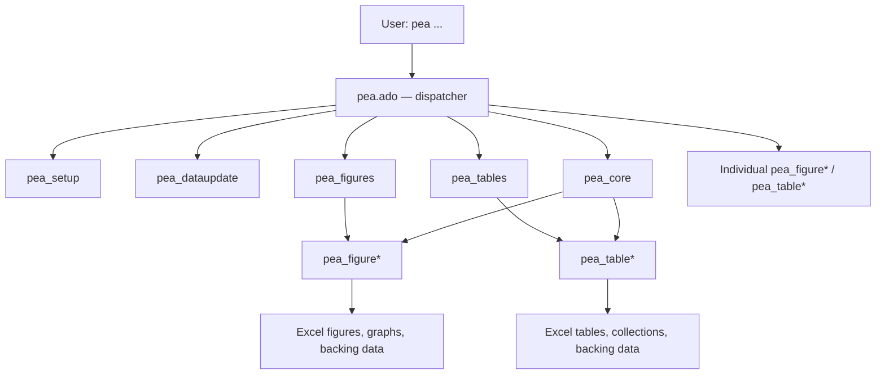
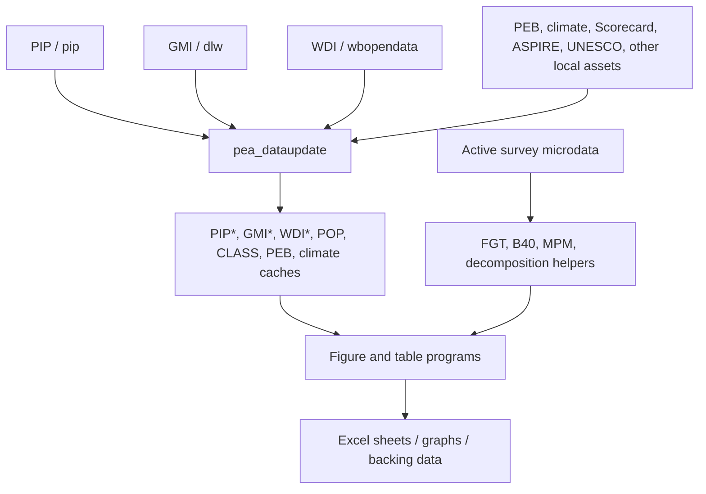

---
{
  "description": "Exact declarations, options, input contracts, variables and output records.",
  "generated": {
    "by": "process:build-wbg-okf"
  },
  "help_center_commit": "sanitized:3922b3bfe000a87b8aae5305d8d9417ff53718922349db932f5eb85ceef1342d",
  "product_source_pins": {
    "Dashboard": {
      "analysed_commit": "520eace646e46abbe51a8f09b334e283fa455e68",
      "branch": "main",
      "upstream_repo": "worldbank/peaApp"
    },
    "GMI_extended": {
      "analysed_commit": "6f5231790ca118f2bf8c7967f12f1c0f3656ea47",
      "docs_snapshot_commit": "7bc4688b04d22386ae35e11d914a852c99d97b00",
      "upstream_repo": "dasalm20/gmi_extended"
    },
    "Stata_package": {
      "analysed_commit": "4ec2b06ce63e99771630a8f1e1bb8447cbd6f744",
      "branch": "Package_updates-SEP-30th",
      "upstream_repo": "worldbank/pea"
    }
  },
  "sources": [
    {
      "id": "s-5345176511c133d7",
      "resource": "urn:okf:sanitized:5345176511c133d7c603",
      "sha256": "f69231df8864a99c97e7ac227654ea526a88fc5ce0dd17bf533ff85037f66ba1",
      "title": "Stata_package/architecture/README.md"
    },
    {
      "id": "s-b5496541ea2718ad",
      "resource": "urn:okf:sanitized:b5496541ea2718adb4e1",
      "sha256": "c547c0c598b62de485e78237472c08c86aced8f8c59a93be61e1759f333e96ee",
      "title": "Stata_package/architecture/WORKFLOW.md"
    },
    {
      "id": "s-56c8193a1e6c7f12",
      "resource": "urn:okf:sanitized:56c8193a1e6c7f12f750",
      "sha256": "5b0e4a651df23c1093604dee4918c67d0a048e15bd8bc26f50dd886f5d17ad14",
      "title": "Stata_package/architecture/program_reference.md"
    },
    {
      "id": "s-33a63f5a0977ab0e",
      "resource": "urn:okf:sanitized:33a63f5a0977ab0ef3a8",
      "sha256": "d679f06c5f77271cf0ac1eddd3c2ef1057918a68121c3b2162fd859c5b4e611c",
      "title": "Stata_package/architecture/table-c1.md"
    },
    {
      "id": "s-8d6b513090f6244e",
      "resource": "urn:okf:sanitized:8d6b513090f6244eb45b",
      "sha256": "52106bf5bb7c35e121c41f9397bb2af4264774e47c36412392f0669959b08b9c",
      "title": "Stata_package/commands/HELPER_CONTRACTS.md"
    },
    {
      "id": "s-a2a56dcbca7c80bf",
      "resource": "urn:okf:sanitized:a2a56dcbca7c80bf1990",
      "sha256": "fcec5d0d23a9dfbb9f8727ecf0afe6bb3cee5acb819ccad9791212f6a1f20e41",
      "title": "Stata_package/commands/groupfunction.md"
    }
  ],
  "tags": [
    "stata_commands"
  ],
  "title": "Stata commands — 003",
  "type": "Reference"
}
---

<a id="s-56c8193a1e6c7f12-l389"></a>

## Source: Stata_package/architecture/program_reference.md — lines 389–472

This excerpt and its context come from the pinned curated document.[^s-56c8193a1e6c7f12]

<details><summary>Source preamble, ancestor headings and table context</summary>

# Program and output reference

`VERIFIED_STATIC` Coverage: **PARTIAL_STATIC**. Ported from FUNCTIONS.md; start with the [output-cell index](024.md#s-c4532d2802a330e5-l1). Risk statements are conditional, and external algorithms remain unverified. All citations use the pin in [PROVENANCE](../assistant_rules/001.md#s-c4b7dcfce275dd0f-l1).

`VERIFIED_STATIC` See [WORKFLOW.md](003.md#s-b5496541ea2718ad-l1) for routing and [DATA_LINEAGE.md](001.md#s-5b07dacccacbbe7e-l1) for source paths.


# Program and output reference
## C. Complete table reverse lineage
### Table 13a — Huppi–Ravallion by urban/rural sector

</details>

<!-- BEGIN s-56c8193a1e6c7f12-l389 -->

`VERIFIED_STATIC` <a id="pea_table13b"></a>

### Table 13b — Huppi–Ravallion by household-head industry

- `VERIFIED_STATIC` **Program:** `pea_table13b`, `Stata/plus/p/pea_table13b.ado:L19-L22`.
- `VERIFIED_STATIC` **Output:** `Table13b`, `Stata/plus/p/pea_table13b.ado:L270-L280`.
- `VERIFIED_STATIC` **Source:** survey microdata.
- `VERIFIED_STATIC` **Method:** assigns all household members the maximum industry-category code observed among household heads, then calls `sedecomposition`, `Stata/plus/p/pea_table13b.ado:L89-L93`; `Stata/plus/p/pea_table13b.ado:L158-L234`.
- `INFERRED` **Risks:** maximum-code assignment assumes one coherent head industry per household; no-sector cases exit with success; sector alignment inherits the `sedecomposition` positional-matching issue.

`VERIFIED_STATIC` <a id="pea_table14"></a>

### Table 14 — demographic/economic household types

- `VERIFIED_STATIC` **Program:** `pea_table14`, `Stata/plus/p/pea_table14.ado:L19-L22`.
- `VERIFIED_STATIC` **Output:** `Table14`, rows for poor/nonpoor/total household-type shares, `Stata/plus/p/pea_table14.ado:L242-L315`.
- `VERIFIED_STATIC` **Source:** survey microdata.
- `VERIFIED_STATIC` **Method:** constructs demographic and economic household typologies related to Figure 16, but the economic table has only four substantive classes plus missing and lacks Figure 16’s “Other” class. See `Stata/plus/p/pea_table14.ado:L104-L240`.
- `VERIFIED_STATIC` **Likely fatal source defect:** unmatched executable `*/` at `Stata/plus/p/pea_table14.ado:L239-L239`.
- `VERIFIED_STATIC` **Interpretation:** person-weighted household classifications, not a household-weighted distribution.
- `VERIFIED_STATIC` **Unused references:** service/asset locals are referenced without being declared, but expand empty.

`VERIFIED_STATIC` <a id="pea_table15"></a>

### Table 15 — decile welfare shares

- `VERIFIED_STATIC` **Program:** `pea_table15`, `Stata/plus/p/pea_table15.ado:L19-L22`.
- `VERIFIED_STATIC` **Output:** `Table15`, decile rows by year, `Stata/plus/p/pea_table15.ado:L99-L107`.
- `VERIFIED_STATIC` **Source:** survey microdata.
- `VERIFIED_STATIC` **Method:** assigns weighted deciles and divides each decile’s welfare sum by total welfare, `Stata/plus/p/pea_table15.ado:L36-L98`.
- `INFERRED` **Defect:** a `comparability` local is referenced in grouping logic but is not declared; it expands empty, so calculations operate by year only.

`VERIFIED_STATIC` <a id="pea_table16"></a>

### Table 16 — social-protection indicators

- `VERIFIED_STATIC` **Program:** `pea_table16`, `Stata/plus/p/pea_table16.ado:L19-L22`.
- `VERIFIED_STATIC` **Output:** `Table16`; rows `over_header#header#indicator`, columns group/year, `Stata/plus/p/pea_table16.ado:L130-L145`.
- `VERIFIED_STATIC` **Direct cache:** `ASPIRE performance indicators.dta`, `Stata/plus/p/pea_table16.ado:L47-L61`.
- `VERIFIED_STATIC` **Displayed families:** coverage and adequacy for all social protection and social assistance, split by total, urban/rural, and quintiles.
- `VERIFIED_STATIC` **Selection:** current country retains all years; benchmark countries use observations within ±3 years and then nearest/tie-latest selection, `Stata/plus/p/pea_table16.ado:L63-L115`.
- `INFERRED` **Risk:** cache existence is checked, but freshness is not; duplicate country-year-indicator records are implicitly averaged by collection.

`VERIFIED_STATIC` <a id="pea_tableA2"></a>

### Table A2 — detailed subgroup poverty

- `VERIFIED_STATIC` **Program:** `pea_tableA2`, `Stata/plus/p/pea_tableA2.ado:L19-L22`.
- `VERIFIED_STATIC` **Output:** `TableA2`, `Stata/plus/p/pea_tableA2.ado:L258-L268`.
- `VERIFIED_STATIC` **Source:** survey microdata and FGT fields.
- `VERIFIED_STATIC` **Method:** age, sex, education, and caller-defined subgroup poverty estimates, poor counts, and composition; the displayed collection suppresses share-of-poor although it is calculated. See `Stata/plus/p/pea_tableA2.ado:L128-L256`.
- `VERIFIED_STATIC` **Survey design:** `svy`/`std` can be accepted and validated but no SE is subsequently calculated or displayed.
- `INFERRED` **Defect:** a branch for nonconstant poverty lines uses undeclared `oneline` at `Stata/plus/p/pea_tableA2.ado:L57-L57`.

`VERIFIED_STATIC` <a id="pea_table_A2_std"></a>

### Table A2 standard/legacy

- `VERIFIED_STATIC` **Program:** `pea_table_A2_std`, `Stata/plus/p/pea_table_A2_std.ado:L19-L22`.
- `VERIFIED_STATIC` **Output:** `TableA2`, `Stata/plus/p/pea_table_A2_std.ado:L250-L265`.
- `UNVERIFIED` **Status:** no verified caller.
- `VERIFIED_STATIC` **Differences:** education applies to age 16+; the standard-error implementation is commented out.
- `VERIFIED_STATIC` **Likely fatal defect:** standalone executable `s` at `Stata/plus/p/pea_table_A2_std.ado:L149-L149`.
- `VERIFIED_STATIC` **Metadata defect:** output notes hard-code 2017 PPP and no PPP validation is performed.

`VERIFIED_STATIC` <a id="pea_tableC1"></a>

### Table C1 — country diagnostics and peers

- `VERIFIED_STATIC` **Program:** `pea_tableC1`, `Stata/plus/p/pea_tableC1.ado:L19-L22`.
- `VERIFIED_STATIC` **Outputs:** `TableC.1`, `Stata/plus/p/pea_tableC1.ado:L716-L745`; `TableC1.M`, `Stata/plus/p/pea_tableC1.ado:L747-L766`.
- `VERIFIED_STATIC` **Sources:** local survey; `_pea_mpm`; `climrisk.dta`; `GMI_extend_all_country.dta` for peers; `PIP_all_country.dta` for peer vulnerability only when `onewelfare()` equals `pppwelfare()`; population/classifications arrive through the GMI cache. See [Table C.1 intermediates](003.md#s-33a63f5a0977ab0e-l1).
- `VERIFIED_STATIC` **Local indicators:** FGT poverty, Gini, prosperity gap, interval vulnerability, MPM, labor measures, and climate risk, `Stata/plus/p/pea_tableC1.ado:L145-L282`; `Stata/plus/p/pea_tableC1.ado:L615-L679`.
- `VERIFIED_STATIC` **Peer indicators:** nearest-year GMI survey indicators, PIP vulnerability, and climate exposures; group and benchmark aggregates use population weights, `Stata/plus/p/pea_tableC1.ado:L284-L613`.
- `UNVERIFIED` **Labor contract:** local working age is 15–64 and `work = lstatus != 1`; paid/agricultural/nonagricultural fields are collapsed among working-age rows with nonmissing values, not explicitly conditioned on `work`. GMI labor fields are precomputed externally, so equivalence is **UNVERIFIED**.
- `INFERRED` **Join risks:** multiple survey records can survive peer nearest-year selection; a later `1:1 code` climate merge can fail. GMI labor is upstream-merged at country-year grain rather than survey grain.
- `VERIFIED_STATIC` **Vulnerability mismatch:** local result uses an interval above poverty; peer PIP result is a difference between two rounded/floored headcounts.
- `VERIFIED_STATIC` **FIXED P2-06:** core Contents now targets `#TableC.1!A1`. `Stata/plus/p/pea_core.ado:L226-L238`.

---


<!-- END s-56c8193a1e6c7f12-l389 -->

<a id="s-56c8193a1e6c7f12-l473"></a>

## Source: Stata_package/architecture/program_reference.md — lines 473–500

This excerpt and its context come from the pinned curated document.[^s-56c8193a1e6c7f12]

<details><summary>Source preamble, ancestor headings and table context</summary>

# Program and output reference

`VERIFIED_STATIC` Coverage: **PARTIAL_STATIC**. Ported from FUNCTIONS.md; start with the [output-cell index](024.md#s-c4532d2802a330e5-l1). Risk statements are conditional, and external algorithms remain unverified. All citations use the pin in [PROVENANCE](../assistant_rules/001.md#s-c4b7dcfce275dd0f-l1).

`VERIFIED_STATIC` See [WORKFLOW.md](003.md#s-b5496541ea2718ad-l1) for routing and [DATA_LINEAGE.md](001.md#s-5b07dacccacbbe7e-l1) for source paths.


# Program and output reference
## C. Complete table reverse lineage
### Table C1 — country diagnostics and peers

</details>

<!-- BEGIN s-56c8193a1e6c7f12-l473 -->
## G. Dispatcher and implementation reconciliation

`VERIFIED_STATIC` The old explicit dispatcher aliases below have no matching executable program in the current 69-program inventory. The explicit branches were removed; dynamic discovery now reports an unrecognized subcommand if no installed program supplies the name:

1. `pea_slides`
2. `pea_table13`
3. `pea_figure3`
4. `pea_figure4a`
5. `pea_figure4b`
6. `pea_figure5`
7. `pea_figure10`
8. `pea_figure11`
9. `pea_figure17`

`VERIFIED_STATIC` Evidence: `Stata/plus/p/pea.ado:L84-L117`; [complete source inventory](018.md#s-523f5bf2f2a3749b-l1).

`VERIFIED_STATIC` Some represent apparent aliases for consolidated implementations—such as `pea_figure4` producing 4a/4b—but no alias programs exist. The dispatcher therefore cannot resolve them by repository-local code.

`VERIFIED_STATIC` Conversely:

- `VERIFIED_STATIC` `pea_figure9d` exists and is called by `Stata/plus/p/pea_figures.ado:L358-L369`, and can now be invoked through generic `pea figure9d` discovery. `Stata/plus/p/pea.ado:L94-L100`.
- `VERIFIED_STATIC` `pea_table11` exists and is available through generic discovery at `Stata/plus/p/pea.ado:L84-L117`, but is not included in `pea_tables`.
- `VERIFIED_STATIC` `sedecomposition` is repository-local at `Stata/plus/s/sedecomposition.ado:L5-L5`; it is not an external analytical dependency.
- `VERIFIED_STATIC` `pea_table1_std` and `pea_table_A2_std` are executable but have no verified callers.

---

<a id="pea_figure1"></a>

<!-- END s-56c8193a1e6c7f12-l473 -->

<a id="s-56c8193a1e6c7f12-l501"></a>

## Source: Stata_package/architecture/program_reference.md — lines 501–507

This excerpt and its context come from the pinned curated document.[^s-56c8193a1e6c7f12]

<details><summary>Source preamble, ancestor headings and table context</summary>

# Program and output reference

`VERIFIED_STATIC` Coverage: **PARTIAL_STATIC**. Ported from FUNCTIONS.md; start with the [output-cell index](024.md#s-c4532d2802a330e5-l1). Risk statements are conditional, and external algorithms remain unverified. All citations use the pin in [PROVENANCE](../assistant_rules/001.md#s-c4b7dcfce275dd0f-l1).

`VERIFIED_STATIC` See [WORKFLOW.md](003.md#s-b5496541ea2718ad-l1) for routing and [DATA_LINEAGE.md](001.md#s-5b07dacccacbbe7e-l1) for source paths.


# Program and output reference
## G. Dispatcher and implementation reconciliation

</details>

<!-- BEGIN s-56c8193a1e6c7f12-l501 -->
## pea_figure1

`VERIFIED_STATIC` Seed reverse-lineage entry: **Poverty-rate trends**. Survey FGT0 by year/comparability and optional urban group. Evidence: `Stata/plus/p/pea_figure1.ado:L38-L38`; `Stata/plus/p/pea_figure1.ado:L149-L171`; `Stata/plus/p/pea_figure1.ado:L248-L320`.

`UNVERIFIED` The supplied FUNCTIONS.md has no fuller narrative for this producer; use its output records and pinned source.

<a id="pea_figure2"></a>

<!-- END s-56c8193a1e6c7f12-l501 -->

<a id="s-56c8193a1e6c7f12-l508"></a>

## Source: Stata_package/architecture/program_reference.md — lines 508–514

This excerpt and its context come from the pinned curated document.[^s-56c8193a1e6c7f12]

<details><summary>Source preamble, ancestor headings and table context</summary>

# Program and output reference

`VERIFIED_STATIC` Coverage: **PARTIAL_STATIC**. Ported from FUNCTIONS.md; start with the [output-cell index](024.md#s-c4532d2802a330e5-l1). Risk statements are conditional, and external algorithms remain unverified. All citations use the pin in [PROVENANCE](../assistant_rules/001.md#s-c4b7dcfce275dd0f-l1).

`VERIFIED_STATIC` See [WORKFLOW.md](003.md#s-b5496541ea2718ad-l1) for routing and [DATA_LINEAGE.md](001.md#s-5b07dacccacbbe7e-l1) for source paths.


# Program and output reference
## pea_figure1

</details>

<!-- BEGIN s-56c8193a1e6c7f12-l508 -->
## pea_figure2

`VERIFIED_STATIC` Seed reverse-lineage entry: **Poverty vs GDP**. Local survey FGT0 + PIP lined-up poverty/GDP/list. Evidence: `Stata/plus/p/pea_figure2.ado:L120-L171`; `Stata/plus/p/pea_figure2.ado:L245-L299`.

`UNVERIFIED` The supplied FUNCTIONS.md has no fuller narrative for this producer; use its output records and pinned source.

<a id="pea_figure3a"></a>

<!-- END s-56c8193a1e6c7f12-l508 -->

<a id="s-56c8193a1e6c7f12-l515"></a>

## Source: Stata_package/architecture/program_reference.md — lines 515–521

This excerpt and its context come from the pinned curated document.[^s-56c8193a1e6c7f12]

<details><summary>Source preamble, ancestor headings and table context</summary>

# Program and output reference

`VERIFIED_STATIC` Coverage: **PARTIAL_STATIC**. Ported from FUNCTIONS.md; start with the [output-cell index](024.md#s-c4532d2802a330e5-l1). Risk statements are conditional, and external algorithms remain unverified. All citations use the pin in [PROVENANCE](../assistant_rules/001.md#s-c4b7dcfce275dd0f-l1).

`VERIFIED_STATIC` See [WORKFLOW.md](003.md#s-b5496541ea2718ad-l1) for routing and [DATA_LINEAGE.md](001.md#s-5b07dacccacbbe7e-l1) for source paths.


# Program and output reference
## pea_figure2

</details>

<!-- BEGIN s-56c8193a1e6c7f12-l515 -->
## pea_figure3a

`VERIFIED_STATIC` Seed reverse-lineage entry: **GIC by requested groups**. Survey percentile welfare; annualized endpoint growth. Evidence: `Stata/plus/p/pea_figure3a.ado:L345-L563`; `Stata/plus/p/pea_figure3a.ado:L608-L719`.

`UNVERIFIED` The supplied FUNCTIONS.md has no fuller narrative for this producer; use its output records and pinned source.

<a id="pea_figure3b"></a>

<!-- END s-56c8193a1e6c7f12-l515 -->

<a id="s-56c8193a1e6c7f12-l522"></a>

## Source: Stata_package/architecture/program_reference.md — lines 522–528

This excerpt and its context come from the pinned curated document.[^s-56c8193a1e6c7f12]

<details><summary>Source preamble, ancestor headings and table context</summary>

# Program and output reference

`VERIFIED_STATIC` Coverage: **PARTIAL_STATIC**. Ported from FUNCTIONS.md; start with the [output-cell index](024.md#s-c4532d2802a330e5-l1). Risk statements are conditional, and external algorithms remain unverified. All citations use the pin in [PROVENANCE](../assistant_rules/001.md#s-c4b7dcfce275dd0f-l1).

`VERIFIED_STATIC` See [WORKFLOW.md](003.md#s-b5496541ea2718ad-l1) for routing and [DATA_LINEAGE.md](001.md#s-5b07dacccacbbe7e-l1) for source paths.


# Program and output reference
## pea_figure3a

</details>

<!-- BEGIN s-56c8193a1e6c7f12-l522 -->
## pea_figure3b

`VERIFIED_STATIC` Seed reverse-lineage entry: **GIC by urban/rural**. Same percentile method, split by `by()`. Evidence: `Stata/plus/p/pea_figure3b.ado:L134-L186`; `Stata/plus/p/pea_figure3b.ado:L241-L283`.

`UNVERIFIED` The supplied FUNCTIONS.md has no fuller narrative for this producer; use its output records and pinned source.

<a id="pea_figure4"></a>

<!-- END s-56c8193a1e6c7f12-l522 -->

<a id="s-56c8193a1e6c7f12-l529"></a>

## Source: Stata_package/architecture/program_reference.md — lines 529–535

This excerpt and its context come from the pinned curated document.[^s-56c8193a1e6c7f12]

<details><summary>Source preamble, ancestor headings and table context</summary>

# Program and output reference

`VERIFIED_STATIC` Coverage: **PARTIAL_STATIC**. Ported from FUNCTIONS.md; start with the [output-cell index](024.md#s-c4532d2802a330e5-l1). Risk statements are conditional, and external algorithms remain unverified. All citations use the pin in [PROVENANCE](../assistant_rules/001.md#s-c4b7dcfce275dd0f-l1).

`VERIFIED_STATIC` See [WORKFLOW.md](003.md#s-b5496541ea2718ad-l1) for routing and [DATA_LINEAGE.md](001.md#s-5b07dacccacbbe7e-l1) for source paths.


# Program and output reference
## pea_figure3b

</details>

<!-- BEGIN s-56c8193a1e6c7f12-l529 -->
## pea_figure4

`VERIFIED_STATIC` Seed reverse-lineage entry: **Datt–Ravallion/Shorrocks decompositions**. Survey + external `drdecomp`/`skdecomp`. Evidence: `Stata/plus/p/pea_figure4.ado:L147-L213`; `Stata/plus/p/pea_figure4.ado:L237-L311`.

`UNVERIFIED` The supplied FUNCTIONS.md has no fuller narrative for this producer; use its output records and pinned source.

<a id="pea_figure5a"></a>

<!-- END s-56c8193a1e6c7f12-l529 -->

<a id="s-56c8193a1e6c7f12-l536"></a>

## Source: Stata_package/architecture/program_reference.md — lines 536–542

This excerpt and its context come from the pinned curated document.[^s-56c8193a1e6c7f12]

<details><summary>Source preamble, ancestor headings and table context</summary>

# Program and output reference

`VERIFIED_STATIC` Coverage: **PARTIAL_STATIC**. Ported from FUNCTIONS.md; start with the [output-cell index](024.md#s-c4532d2802a330e5-l1). Risk statements are conditional, and external algorithms remain unverified. All citations use the pin in [PROVENANCE](../assistant_rules/001.md#s-c4b7dcfce275dd0f-l1).

`VERIFIED_STATIC` See [WORKFLOW.md](003.md#s-b5496541ea2718ad-l1) for routing and [DATA_LINEAGE.md](001.md#s-5b07dacccacbbe7e-l1) for source paths.


# Program and output reference
## pea_figure4

</details>

<!-- BEGIN s-56c8193a1e6c7f12-l536 -->
## pea_figure5a

`VERIFIED_STATIC` Seed reverse-lineage entry: **Huppi–Ravallion, urban/rural**. Survey + local `sedecomposition`. Evidence: `Stata/plus/p/pea_figure5a.ado:L147-L229`; `Stata/plus/p/pea_figure5a.ado:L261-L295`.

`UNVERIFIED` The supplied FUNCTIONS.md has no fuller narrative for this producer; use its output records and pinned source.

<a id="pea_figure5b"></a>

<!-- END s-56c8193a1e6c7f12-l536 -->

<a id="s-56c8193a1e6c7f12-l543"></a>

## Source: Stata_package/architecture/program_reference.md — lines 543–549

This excerpt and its context come from the pinned curated document.[^s-56c8193a1e6c7f12]

<details><summary>Source preamble, ancestor headings and table context</summary>

# Program and output reference

`VERIFIED_STATIC` Coverage: **PARTIAL_STATIC**. Ported from FUNCTIONS.md; start with the [output-cell index](024.md#s-c4532d2802a330e5-l1). Risk statements are conditional, and external algorithms remain unverified. All citations use the pin in [PROVENANCE](../assistant_rules/001.md#s-c4b7dcfce275dd0f-l1).

`VERIFIED_STATIC` See [WORKFLOW.md](003.md#s-b5496541ea2718ad-l1) for routing and [DATA_LINEAGE.md](001.md#s-5b07dacccacbbe7e-l1) for source paths.


# Program and output reference
## pea_figure5a

</details>

<!-- BEGIN s-56c8193a1e6c7f12-l543 -->
## pea_figure5b

`VERIFIED_STATIC` Seed reverse-lineage entry: **Huppi–Ravallion, industry**. Survey; household-head sector + `sedecomposition`. Evidence: `Stata/plus/p/pea_figure5b.ado:L73-L75`; `Stata/plus/p/pea_figure5b.ado:L156-L240`; `Stata/plus/p/pea_figure5b.ado:L272-L305`.

`UNVERIFIED` The supplied FUNCTIONS.md has no fuller narrative for this producer; use its output records and pinned source.

<a id="pea_figure6"></a>

<!-- END s-56c8193a1e6c7f12-l543 -->

<a id="s-56c8193a1e6c7f12-l550"></a>

## Source: Stata_package/architecture/program_reference.md — lines 550–556

This excerpt and its context come from the pinned curated document.[^s-56c8193a1e6c7f12]

<details><summary>Source preamble, ancestor headings and table context</summary>

# Program and output reference

`VERIFIED_STATIC` Coverage: **PARTIAL_STATIC**. Ported from FUNCTIONS.md; start with the [output-cell index](024.md#s-c4532d2802a330e5-l1). Risk statements are conditional, and external algorithms remain unverified. All citations use the pin in [PROVENANCE](../assistant_rules/001.md#s-c4b7dcfce275dd0f-l1).

`VERIFIED_STATIC` See [WORKFLOW.md](003.md#s-b5496541ea2718ad-l1) for routing and [DATA_LINEAGE.md](001.md#s-5b07dacccacbbe7e-l1) for source paths.


# Program and output reference
## pea_figure5b

</details>

<!-- BEGIN s-56c8193a1e6c7f12-l550 -->
## pea_figure6

`VERIFIED_STATIC` Seed reverse-lineage entry: **Poverty/GDP growth elasticity**. Survey FGT0 + PIP GDP; annualized growth ratios. Evidence: `Stata/plus/p/pea_figure6.ado:L141-L190`; `Stata/plus/p/pea_figure6.ado:L243-L269`.

`UNVERIFIED` The supplied FUNCTIONS.md has no fuller narrative for this producer; use its output records and pinned source.

<a id="pea_figure7a"></a>

<!-- END s-56c8193a1e6c7f12-l550 -->

<a id="s-56c8193a1e6c7f12-l557"></a>

## Source: Stata_package/architecture/program_reference.md — lines 557–563

This excerpt and its context come from the pinned curated document.[^s-56c8193a1e6c7f12]

<details><summary>Source preamble, ancestor headings and table context</summary>

# Program and output reference

`VERIFIED_STATIC` Coverage: **PARTIAL_STATIC**. Ported from FUNCTIONS.md; start with the [output-cell index](024.md#s-c4532d2802a330e5-l1). Risk statements are conditional, and external algorithms remain unverified. All citations use the pin in [PROVENANCE](../assistant_rules/001.md#s-c4b7dcfce275dd0f-l1).

`VERIFIED_STATIC` See [WORKFLOW.md](003.md#s-b5496541ea2718ad-l1) for routing and [DATA_LINEAGE.md](001.md#s-5b07dacccacbbe7e-l1) for source paths.


# Program and output reference
## pea_figure6

</details>

<!-- BEGIN s-56c8193a1e6c7f12-l557 -->
## pea_figure7a

`VERIFIED_STATIC` Seed reverse-lineage entry: **Share of poor vs population**. Survey FGT0 and weight totals by demographic group. Evidence: `Stata/plus/p/pea_figure7a.ado:L103-L137`; `Stata/plus/p/pea_figure7a.ado:L153-L176`.

`UNVERIFIED` The supplied FUNCTIONS.md has no fuller narrative for this producer; use its output records and pinned source.

<a id="pea_figure7b"></a>

<!-- END s-56c8193a1e6c7f12-l557 -->

<a id="s-56c8193a1e6c7f12-l564"></a>

## Source: Stata_package/architecture/program_reference.md — lines 564–568

This excerpt and its context come from the pinned curated document.[^s-56c8193a1e6c7f12]

<details><summary>Source preamble, ancestor headings and table context</summary>

# Program and output reference

`VERIFIED_STATIC` Coverage: **PARTIAL_STATIC**. Ported from FUNCTIONS.md; start with the [output-cell index](024.md#s-c4532d2802a330e5-l1). Risk statements are conditional, and external algorithms remain unverified. All citations use the pin in [PROVENANCE](../assistant_rules/001.md#s-c4b7dcfce275dd0f-l1).

`VERIFIED_STATIC` See [WORKFLOW.md](003.md#s-b5496541ea2718ad-l1) for routing and [DATA_LINEAGE.md](001.md#s-5b07dacccacbbe7e-l1) for source paths.


# Program and output reference
## pea_figure7a

</details>

<!-- BEGIN s-56c8193a1e6c7f12-l564 -->
## pea_figure7b

`VERIFIED_STATIC` Seed reverse-lineage entry: **Group poverty rates**. Survey FGT0 by demographic group. Evidence: `Stata/plus/p/pea_figure7b.ado:L105-L135`; `Stata/plus/p/pea_figure7b.ado:L152-L173`.

`UNVERIFIED` The supplied FUNCTIONS.md has no fuller narrative for this producer; use its output records and pinned source.

<!-- END s-56c8193a1e6c7f12-l564 -->

<a id="s-5345176511c133d7-l1"></a>

## Source: Stata_package/architecture/README.md — lines 1–18

This excerpt and its context come from the pinned curated document.[^s-5345176511c133d7]

<!-- BEGIN s-5345176511c133d7-l1 -->
# Execution, caches and producer reference

| Need | Document |
|---|---|
| Dispatcher and orchestrators | [WORKFLOW](003.md#s-b5496541ea2718ad-l1) |
| Persisted caches, inputs and output reverse lineage | [DATA_LINEAGE](001.md#s-5b07dacccacbbe7e-l1) |
| Detailed seed producer narratives | [Program reference](001.md#s-56c8193a1e6c7f12-l1) |
| Table C.1 local/peer paths and intermediates | [Table C.1](003.md#s-33a63f5a0977ab0e-l1) |
| Editable text architecture diagrams | [Mermaid](001.md#s-f4427d47d4bf8a0e-l1) |
| Human editing diagram | [draw.io](../../deployment.md) |

`UNVERIFIED` The draw.io file is copied unchanged from the seed. It is a **diagram for humans, not navigation**; its embedded claims are not individually refreshed. Use the corrected text lineage and source citations for investigations. The Mermaid text preserves the seed diagrams with documented source-lineage corrections.

`VERIFIED_STATIC` Source citations use the upstream commit in [PROVENANCE](../assistant_rules/001.md#s-c4b7dcfce275dd0f-l1). The help center contains documentation only, not the upstream Stata source or input data.

## Source update — 2026-10-28

Current PEA pin: `4ec2b06ce63e99771630a8f1e1bb8447cbd6f744`. [Changes, resolved issues and limitations](../stata_errors/002.md#s-fd57fda371239c6d-l1). Historical records retain their own source pins.

<!-- END s-5345176511c133d7-l1 -->

<a id="s-33a63f5a0977ab0e-l1"></a>

## Source: Stata_package/architecture/table-c1.md — lines 1–32

This excerpt and its context come from the pinned curated document.[^s-33a63f5a0977ab0e]

<!-- BEGIN s-33a63f5a0977ab0e-l1 -->
# Table C.1 — rows, sources and intermediates

Start with the [TableC.1 rows](026.md#s-c4532d2802a330e5-l540) or the [missingness rows](026.md#s-c4532d2802a330e5-l563). Source: `pea_tableC1`; coverage **PARTIAL_STATIC**.

| Column or row role | Source path | Evidence |
|---|---|---|
| Focus-country poverty, distribution and labor | Active survey → FGT/distribution/labor expressions → row labels | `VERIFIED_STATIC` `Stata/plus/p/pea_tableC1.ado:L145-L199`; `Stata/plus/p/pea_tableC1.ado:L615-L679` |
| Focus-country MPM | Active survey → `_pea_mpm` (UNESCO dependency) → `mdpoor_i1 × 100` | `VERIFIED_STATIC` `Stata/plus/p/pea_tableC1.ado:L191-L199`; `Stata/plus/_/_pea_mpm.ado:L67-L80` |
| Peer poverty, inequality, MPM and labor | `GMI_extend_all_country.dta` → requested PPP and nearest survey selection → peer fields | `VERIFIED_STATIC` `Stata/plus/p/pea_tableC1.ado:L284-L302`; `Stata/plus/p/pea_tableC1.ado:L356-L379`; `Stata/plus/p/pea_tableC1.ado:L572-L611` |
| Peer vulnerability | `PIP_all_country.dta`, **only when `onewelfare()` equals `pppwelfare()`**, → upper-minus-lower headcount | `VERIFIED_STATIC` `Stata/plus/p/pea_tableC1.ado:L395-L418`; `Stata/plus/p/pea_tableC1.ado:L464-L483`; `Stata/plus/p/pea_tableC1.ado:L535-L558` |
| Focus-country climate | `climrisk.dta` → `atrisk` → row 51; source year may be reassigned | `VERIFIED_STATIC` `Stata/plus/p/pea_tableC1.ado:L201-L221` |
| Peer climate | `climrisk.dta` → GMI cache producer → `atrisk` in loaded GMI data | `VERIFIED_STATIC` `Stata/plus/p/pea_dataupdate.ado:L850-L852`; `Stata/plus/p/pea_tableC1.ado:L381-L393` |

## Classification intermediate

`VERIFIED_STATIC` `data_gmi1_u` is declared with `tempfile data_gmi1_u`. It is built from `data_gmi1`, which contains the GMI cache after the PPP filter. `_noclass = (incgroup_current == "" | region == "")` flags incomplete classification. `bys code (_noclass year): keep if _n == 1` keeps one row per country, preferring a populated classification. It lasts only for the call and is used as a classification lookup when income group or region is merged onto PIP vulnerability records. It is not a cache on disk and is excluded from the source/cache matrix. Evidence: `Stata/plus/p/pea_tableC1.ado:L300-L313`; `Stata/plus/p/pea_tableC1.ado:L464-L483`.

`UNVERIFIED` The old seed description as a persisted cache is superseded; its original wording and the correction are retained in [L01](../stata_errors/002.md#s-a78b56243961d3c5-l1).

## Row checks before blaming data

`VERIFIED_STATIC` Peer remapping uses explicit fields and initializes `value` to missing; assignment happens only if the field exists. National poverty rate and national poor count (rows 1–2) have no peer-field mapping. Evidence: `Stata/plus/p/pea_tableC1.ado:L572-L611`. `INFERRED` A missing peer field can therefore leave a blank cell; national-line peer blanks need not indicate a failed local calculation.

`VERIFIED_STATIC` The local labor block is gated by nonmissing `lstatus()` observations. Working age is 15–64; `_work` is `lstatus != 1` on nonmissing values. Paid and sector expressions are defined on working-age, nonmissing inputs and collapsed without an explicit `_work==1` condition. Missing employment/sector diagnostics do restrict to workers. Evidence: `Stata/plus/p/pea_tableC1.ado:L615-L679`. `UNVERIFIED` Do not assume these denominators equal the precomputed GMI definitions.

`VERIFIED_STATIC` The GMD mapper produces `nowork` from harmonized `lstatus==2|lstatus==3`; its binary coding is separate from raw GMD status. Evidence: `Stata/plus/_/_pea_vars_set.ado:L58-L77`. `INFERRED` Passing raw GMD status to a child expecting a not-working indicator can change the local working row. Verify the caller mapping rather than interpreting a shared variable name as shared meaning.

`VERIFIED_STATIC` Local national headcount labeling tests the literal parsed name `natwelfare`; PPP rows start at 3 and follow the supplied line list. Peer codes 3–5 are fixed to `fgt0_ipl`, `fgt0_lmicpl`, `fgt0_umicpl`. Evidence: `Stata/plus/p/pea_tableC1.ado:L258-L276`; `Stata/plus/p/pea_tableC1.ado:L591-L605`. `INFERRED` Check the actual welfare field name and line order when a local row disappears or mismatches its peer row. This is a source-based diagnostic, not an additional issue-register entry.

`VERIFIED_STATIC` Group and benchmark aggregates use population weights; ordinary benchmarks retain country records. Nearest-year selection permits ±3 years and takes the latest-year tie, but not necessarily one survey per country. Evidence: `Stata/plus/p/pea_tableC1.ado:L356-L393`; `Stata/plus/p/pea_tableC1.ado:L425-L558`. See P1-07, P1-08, P1-09 and P1-16.

`UNVERIFIED` Minimal runtime validation, not performed: retain the exact invocation and cache versions; verify expected fields, PPP and join uniqueness; inspect the local mapping and labor gate; compare one focus-country row and one peer row before aggregating. Physical schemas, external harmonization and observed numerical effects remain unresolved.

<!-- END s-33a63f5a0977ab0e-l1 -->

<a id="s-b5496541ea2718ad-l1"></a>

## Source: Stata_package/architecture/WORKFLOW.md — lines 1–57

This excerpt and its context come from the pinned curated document.[^s-b5496541ea2718ad]

<!-- BEGIN s-b5496541ea2718ad-l1 -->
# Execution and data workflow

`VERIFIED_STATIC` `VERIFIED_STATIC` Routing and cache-flow diagrams describe source calls, not successful execution. See [cache lineage](001.md#s-5b07dacccacbbe7e-l1), [producer reference](001.md#s-56c8193a1e6c7f12-l1), and [discrepancies](../stata_errors/002.md#s-a78b56243961d3c5-l1).

## 1. Command routing



## 2. Source and cache flow



`VERIFIED_STATIC` **Do not infer every bundled source is refreshed by `pea_dataupdate`:** ASPIRE and some other assets have no identified repository-local producer.

## 3. Key paths

- `VERIFIED_STATIC` `Stata/plus/p/pea.ado`: entry dispatcher
- `VERIFIED_STATIC` `Stata/plus/p/pea_dataupdate.ado`: external/bundled source and cache preparation
- `VERIFIED_STATIC` `Stata/plus/p/pea_figures.ado`, `pea_tables.ado`, `pea_core.ado`: orchestrators
- `VERIFIED_STATIC` `Stata/plus/p/pea_figure*.ado`, `pea_table*.ado`: output implementations
- `VERIFIED_STATIC` `Stata/plus/_/_pea_*.ado`: shared helpers
- `VERIFIED_STATIC` `Stata/plus/s/sedecomposition.ado`: repository-local sector decomposition
- `VERIFIED_STATIC` `Stata/personal/pea/`: reported cache/bundled asset location

## 4. Cross-cutting propagation concern

`VERIFIED_STATIC` The audit reports that orchestrators accept `[if] [in] [aw pw fw]` but can omit caller `if/in` when invoking children and pass weights as analytic weights. Evidence: `Stata/plus/p/pea_figures.ado:L30-L30`; `Stata/plus/p/pea_figures.ado:L107-L120`; `Stata/plus/p/pea_figures.ado:L163-L453`, `Stata/plus/p/pea_tables.ado:L37-L37`; `Stata/plus/p/pea_tables.ado:L136-L153`; `Stata/plus/p/pea_tables.ado:L199-L404`, `Stata/plus/p/pea_core.ado:L46-L46`; `Stata/plus/p/pea_core.ado:L143-L161`; `Stata/plus/p/pea_core.ado:L189-L316`. This is a source-level finding, not a measured runtime result.

## Updated dispatch and producers

`VERIFIED_STATIC` All `pea <subcommand>` calls now use installed-program discovery and dynamic dispatch, with caller-frame restoration and fixed-name frame cleanup. `Stata/plus/p/pea.ado:L84-L117`. Core/tables/figures validate required inputs before preparation; captured child failures remain. Figure 3a preserves/restores its input, can save its result dataset and creates one workbook sheet for all requested groups. See [current Figure 3a contract](006.md#s-3515b9ce53d9344c-l1).

<!-- END s-b5496541ea2718ad-l1 -->

<a id="s-a2a56dcbca7c80bf-l1"></a>

## Source: Stata_package/commands/groupfunction.md — lines 1–56

This excerpt and its context come from the pinned curated document.[^s-a2a56dcbca7c80bf]

<!-- BEGIN s-a2a56dcbca7c80bf-l1 -->
# Bundled groupfunction dependency

Source: `worldbank/pea@4ec2b06ce63e99771630a8f1e1bb8447cbd6f744`, `Stata/plus/g/groupfunction.ado` (795 lines) and companion help (173 lines). `ADDED` to this source tree; banner says version 2.2, 28 Jan 2021. This does not establish which version a user's adopath loads.

`VERIFIED_STATIC` Accepted [if] [in] [aw pw fw]; options sum, rawsum, mean, first, max, min, count, sd, gini, theil, variance, by, norestore, xtile, nq, missing, slow, merge. `Stata/plus/g/groupfunction.ado:L16-L41`. Means use supplied weights, rawsum uses unit weights, count counts nonmissing observations, sd/variance use Mata quadvariance. `missing` affects all-missing sum/rawsum groups; `merge` adds named results to current data instead of replacing it with aggregates. `Stata/plus/g/groupfunction.ado:L207-L279`; `Stata/plus/g/groupfunction.ado:L331-L422`; `Stata/plus/g/groupfunction.ado:L446-L601`.

`VERIFIED_STATIC` Gini/Theil route through CpBCaLC. Gini first tries Python; on failure uses Mata's sorted weighted cumulative sum formula. Theil is weighted mean of `(y/weighted_mean(y))*ln(y/weighted_mean(y))`. `Stata/plus/g/groupfunction.ado:L281-L303`; `Stata/plus/g/groupfunction.ado:L637-L735`; `Stata/plus/g/groupfunction.ado:L766-L795`.

`EXTERNAL_DEPENDENCY` Python integration, NumPy and Stata/Mata execution were not tested. The bundled help's example 2 uses inconsistent names regions/region and weight/w; it is historical upstream text, not a validated runnable template.

`VERIFIED_STATIC` Callers include Table 1/C.1/10 Gini and means; Table 2/3/4/5/7/A2 and Figures 1/2/6/7/8/10 aggregates; Table 14 shares; pea_dataupdate regional/income-group population-weighted aggregates. `Stata/plus/p/pea_tableC1.ado:L187-L187`; `Stata/plus/p/pea_table1.ado:L148-L148`; `Stata/plus/p/pea_dataupdate.ado:L609-L619`. Existing calls were not edited by this update except source/comment movement. `INFERRED` Gini/Theil if/in forwarding differs from mean/count; see U05 in [current status](../stata_errors/001.md#s-b47586ae88626416-l1).

`UNVERIFIED` Setup checks file presence with findfile, without verifying version or installation path. No package installation manifest was added in this diff. The added dependency does not prove deployment. `Stata/plus/p/pea_setup.ado:L44-L59`.

## Syntax

`VERIFIED_STATIC` Exact declaration, including its semicolon delimiter. `Stata/plus/g/groupfunction.ado:L19-L41`.

```stata
	#delimit;
	syntax [if] [in] [aw pw fw] , 
	[
		sum(varlist numeric)  
		rawsum(varlist numeric) 
		mean(varlist numeric) 
		first(varlist numeric) 
		max(varlist numeric) 
		min(varlist numeric) 
		count(varlist numeric) 
		sd(varlist numeric) 
		gini(varlist numeric) 
		theil(varlist numeric)
		VARiance(varlist numeric) 
		by(varlist) 
		norestore
		xtile(varlist numeric)
		nq(numlist max=1 int >0)
		missing
		slow
		merge
	];
#delimit cr
```

## Input checks and output handling

`VERIFIED_STATIC` `xtile()` accepts only one variable in the active guard and requires `nq()`; either failure raises 111. No requested statistic raises 301. `norestore` keeps only the requested fields before processing; without `merge`, aggregates replace the current data. `merge` retains the input records and merges named results by grouping variables. Preserve the input separately when needed. `Stata/plus/g/groupfunction.ado:L43-L53`; `Stata/plus/g/groupfunction.ado:L82-L109`; `Stata/plus/g/groupfunction.ado:L331-L422`.

| Literal diagnostic | Source |
|---|---|
| `` When specifying xtile variables with forby option, only one is allowed `` | `Stata/plus/g/groupfunction.ado:L86-L86` |
| `` When specifying xtile, nq needs to be specified `` | `Stata/plus/g/groupfunction.ado:L91-L91` |
| `` Please specify variables for sum, rawsum, mean, min, max, count, sd, variance, or first `` | `Stata/plus/g/groupfunction.ado:L107-L107` |
| `` Please specify unique names for variables in sum, first, mean, max, min, gini, theil options `` | `Stata/plus/g/groupfunction.ado:L128-L128` |

`INFERRED` The last diagnostic is conditional on local `checks`, while the preceding loop builds local `check`; do not rely on it to validate uniqueness across requests. This is an unexecuted source-level risk. `Stata/plus/g/groupfunction.ado:L119-L129`.

<!-- END s-a2a56dcbca7c80bf-l1 -->

<a id="s-8d6b513090f6244e-l1"></a>

## Source: Stata_package/commands/HELPER_CONTRACTS.md — lines 1–6

This excerpt and its context come from the pinned curated document.[^s-8d6b513090f6244e]

<!-- BEGIN s-8d6b513090f6244e-l1 -->
# Inputs built by helpers

[Command index](004.md#s-1a111f0c23d6b2f9-l1) · [Error index](../stata_errors/002.md#s-38eb878fc22069c4-l1)

Source: `worldbank/pea`, branch `Package_updates-SEP-30th`, commit `4ec2b06ce63e99771630a8f1e1bb8447cbd6f744`. These contracts describe static code, not results for a country or year. Helpers are covered here where they determine what a caller must supply or prepare.


<!-- END s-8d6b513090f6244e-l1 -->

[^s-5345176511c133d7]: Stata_package/architecture/README.md, help-center snapshot sanitized:3922b3bfe000a87b8aae5305d8d9417ff53718922349db932f5eb85ceef1342d.
[^s-b5496541ea2718ad]: Stata_package/architecture/WORKFLOW.md, help-center snapshot sanitized:3922b3bfe000a87b8aae5305d8d9417ff53718922349db932f5eb85ceef1342d.
[^s-56c8193a1e6c7f12]: Stata_package/architecture/program_reference.md, help-center snapshot sanitized:3922b3bfe000a87b8aae5305d8d9417ff53718922349db932f5eb85ceef1342d.
[^s-33a63f5a0977ab0e]: Stata_package/architecture/table-c1.md, help-center snapshot sanitized:3922b3bfe000a87b8aae5305d8d9417ff53718922349db932f5eb85ceef1342d.
[^s-8d6b513090f6244e]: Stata_package/commands/HELPER_CONTRACTS.md, help-center snapshot sanitized:3922b3bfe000a87b8aae5305d8d9417ff53718922349db932f5eb85ceef1342d.
[^s-a2a56dcbca7c80bf]: Stata_package/commands/groupfunction.md, help-center snapshot sanitized:3922b3bfe000a87b8aae5305d8d9417ff53718922349db932f5eb85ceef1342d.
