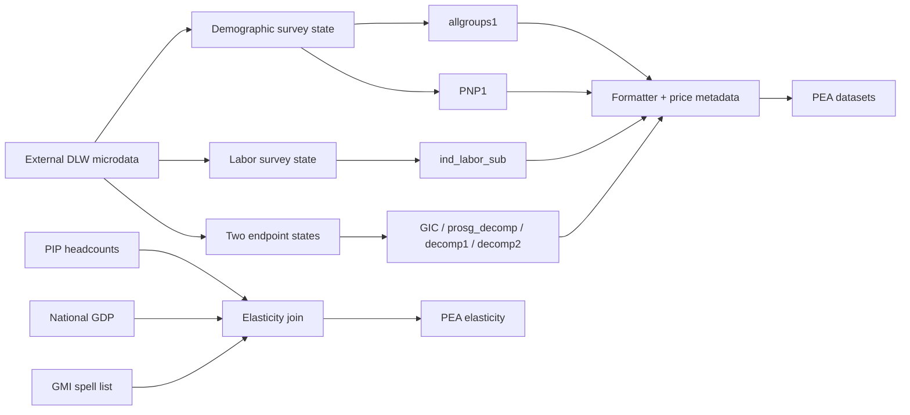
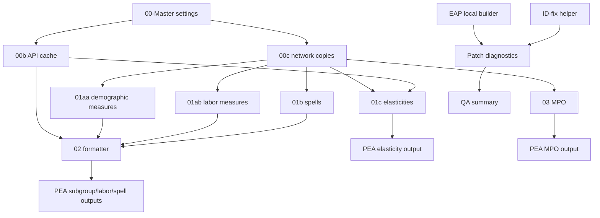

---
{"generated":{"by":"process:build-wbg-okf"},"help_center_commit":"sanitized:3922b3bfe000a87b8aae5305d8d9417ff53718922349db932f5eb85ceef1342d","sources":[{"id":"s-03a55e5b0d916fbf-l1","resource":"urn:okf:sanitized:03a55e5b0d916fbf503d","sha256":"b2f5a0dd0672c5c811ac27825ef8a8f8b6bc52f006e6402246c7cdf6ee0832e7"},{"id":"s-1ad785198d219478-l54","resource":"urn:okf:sanitized:1ad785198d2194788031","sha256":"20406463001812074ad0efa337eea425c26e86f2385966119d92c82bc97666aa"},{"id":"s-1ad785198d219478-l62","resource":"urn:okf:sanitized:1ad785198d2194788031","sha256":"20406463001812074ad0efa337eea425c26e86f2385966119d92c82bc97666aa"},{"id":"s-1ad785198d219478-l68","resource":"urn:okf:sanitized:1ad785198d2194788031","sha256":"20406463001812074ad0efa337eea425c26e86f2385966119d92c82bc97666aa"},{"id":"s-28b30e99cf27ca47-l1","resource":"urn:okf:sanitized:28b30e99cf27ca473936","sha256":"b14bd347406a00c22bac765deb4ad1e118ab85ebe85bfacf35771eac08802093"},{"id":"s-5b80ce0810aba939-l1","resource":"urn:okf:sanitized:5b80ce0810aba939b94b","sha256":"b0b1deb9bb990973c5feea652ac332eb4cc26accdb80fc04ef4b28f2eb5eca3e"},{"id":"s-5e33941ffc71c499-l1","resource":"urn:okf:sanitized:5e33941ffc71c499edbd","sha256":"179ff02831e20267704464ee0b5a5726adb98079698cfe2df9dcfd56538edd3e"},{"id":"s-ec1c01765ee45d78-l1","resource":"urn:okf:sanitized:ec1c01765ee45d78c0be","sha256":"6b6c5989fc9102a90a348a51bec254d48440b7ba26facfccacfd97869c36b9e3"},{"id":"s-ec1c01765ee45d78-l118","resource":"urn:okf:sanitized:ec1c01765ee45d78c0be","sha256":"6b6c5989fc9102a90a348a51bec254d48440b7ba26facfccacfd97869c36b9e3"},{"id":"s-ec1c01765ee45d78-l144","resource":"urn:okf:sanitized:ec1c01765ee45d78c0be","sha256":"6b6c5989fc9102a90a348a51bec254d48440b7ba26facfccacfd97869c36b9e3"},{"id":"s-ec1c01765ee45d78-l168","resource":"urn:okf:sanitized:ec1c01765ee45d78c0be","sha256":"6b6c5989fc9102a90a348a51bec254d48440b7ba26facfccacfd97869c36b9e3"},{"id":"s-ec1c01765ee45d78-l195","resource":"urn:okf:sanitized:ec1c01765ee45d78c0be","sha256":"6b6c5989fc9102a90a348a51bec254d48440b7ba26facfccacfd97869c36b9e3"},{"id":"s-ec1c01765ee45d78-l218","resource":"urn:okf:sanitized:ec1c01765ee45d78c0be","sha256":"6b6c5989fc9102a90a348a51bec254d48440b7ba26facfccacfd97869c36b9e3"},{"id":"s-ec1c01765ee45d78-l35","resource":"urn:okf:sanitized:ec1c01765ee45d78c0be","sha256":"6b6c5989fc9102a90a348a51bec254d48440b7ba26facfccacfd97869c36b9e3"},{"id":"s-ec1c01765ee45d78-l64","resource":"urn:okf:sanitized:ec1c01765ee45d78c0be","sha256":"6b6c5989fc9102a90a348a51bec254d48440b7ba26facfccacfd97869c36b9e3"},{"id":"s-ec1c01765ee45d78-l92","resource":"urn:okf:sanitized:ec1c01765ee45d78c0be","sha256":"6b6c5989fc9102a90a348a51bec254d48440b7ba26facfccacfd97869c36b9e3"}],"type":"Reference"}
---

<!-- Retrieval block: text/docs/GMI_extended/analysis/reference_period_audit/00054.md -->
---
{"generated":{"by":"process:build-wbg-okf"},"help_center_commit":"sanitized:3922b3bfe000a87b8aae5305d8d9417ff53718922349db932f5eb85ceef1342d","sources":[{"id":"s-1ad785198d219478-l54","resource":"urn:okf:sanitized:1ad785198d2194788031","sha256":"20406463001812074ad0efa337eea425c26e86f2385966119d92c82bc97666aa"}],"type":"Reference"}
---

<a id="s-1ad785198d219478-l54"></a>

# Are GMI Extended indicators reference-period agnostic? / Numerators, denominators, samples and weights

Original: `GMI_extended/analysis/reference_period_audit.md:L54-L61`.[^s-1ad785198d219478-l54] Product source: `dasalm20/gmi_extended@6f5231790ca118f2bf8c7967f12f1c0f3656ea47`. 

Source context:

# Are GMI Extended indicators reference-period agnostic?

**No blanket claim is supported.** Current industry and several labor indicators can mix primary and annual recall fields. Some welfare-only paths do not use the labor recall fields at all, while spell outputs separately depend on their selected endpoint years. Classifications below concern the labor recall dimension; they do not imply independence from survey year, PPP vintage, welfare recall, reporting year, or spell choice.

This report describes the analyzed commit in `manifest.json`. A concurrent source update added an asymmetric fallback to 01b during this analysis; the archived spell file still uses primary industry at both endpoints. Evidence: `01.Programs/01b-GMI extended indicators spells.do:L496-L584`; `01.Programs/archive/01b-GMI extended indicators spells.do:L406-L485`.


# Are GMI Extended indicators reference-period agnostic?
## Indicator comparison

## Numerators, denominators, samples and weights

For an industry share, the stored individual variable is a Boolean equality only for employed persons with nonmissing industry in the age universe. Outside that `if` universe it is missing. `groupfunction [aw=wgt], mean(...)` is the exact aggregation call. The natural weighted-mean reading has weighted qualifying category members in the numerator and weighted nonmissing eligible workers in the denominator; the external command implementation must be obtained to verify its precise conventions. These shares are not established as shares of all 15–64-year-olds simply because a label says so. Missing-industry flags include employed persons with missing industry and therefore use a different valid sample. Evidence: 01ab L366-L371,L447-L454,L543.

In 01aa head characteristics are defined on head observations only and are not copied onto all members. Person weights are preferred when present. Labor/industry fallback changes the eligibility and category values, not the weight variable itself. It can nevertheless change the sum of weights in the denominator. Evidence: 01aa L143-L153,L333-L403,L590; 01ab L246-L255,L332-L405.

For Huppi–Ravallion SEC, there is no explicit working-age or `lstatus==1` filter around sector_nonag. `industrycat4 ~= .` excludes ordinary missing only. It is not the same universe or category expression as 01ab's bounded categories 2–4. The two ALL endpoint datasets are passed to `sedecomposition`, rather than averaging annual and primary field values directly. Evidence: 01b L535,L577,L620-L633.


[^s-1ad785198d219478-l54]: urn:okf:sanitized:1ad785198d2194788031#L54-L61

<!-- Retrieval block: text/docs/GMI_extended/analysis/reference_period_audit/00062.md -->
---
{"generated":{"by":"process:build-wbg-okf"},"help_center_commit":"sanitized:3922b3bfe000a87b8aae5305d8d9417ff53718922349db932f5eb85ceef1342d","sources":[{"id":"s-1ad785198d219478-l62","resource":"urn:okf:sanitized:1ad785198d2194788031","sha256":"20406463001812074ad0efa337eea425c26e86f2385966119d92c82bc97666aa"}],"type":"Reference"}
---

<a id="s-1ad785198d219478-l62"></a>

# Are GMI Extended indicators reference-period agnostic? / Output metadata is not recall harmonization

Original: `GMI_extended/analysis/reference_period_audit.md:L62-L67`.[^s-1ad785198d219478-l62] Product source: `dasalm20/gmi_extended@6f5231790ca118f2bf8c7967f12f1c0f3656ea47`. 

Source context:

# Are GMI Extended indicators reference-period agnostic?

**No blanket claim is supported.** Current industry and several labor indicators can mix primary and annual recall fields. Some welfare-only paths do not use the labor recall fields at all, while spell outputs separately depend on their selected endpoint years. Classifications below concern the labor recall dimension; they do not imply independence from survey year, PPP vintage, welfare recall, reporting year, or spell choice.

This report describes the analyzed commit in `manifest.json`. A concurrent source update added an asymmetric fallback to 01b during this analysis; the archived spell file still uses primary industry at both endpoints. Evidence: `01.Programs/01b-GMI extended indicators spells.do:L496-L584`; `01.Programs/archive/01b-GMI extended indicators spells.do:L406-L485`.


# Are GMI Extended indicators reference-period agnostic?
## Numerators, denominators, samples and weights

## Output metadata is not recall harmonization

Formatter joins `rep_year` and `ref_year` after aggregation and renames original `year` to `surv_year`, `rep_year` to `year`. It does not select primary versus annual industry based on `ref_year`. This makes reporting-year labels distinct from the earlier labor-recall fallback. Evidence: `01.Programs/02-GMI format.do:L169-L178,L543-L553`.

The output append of decomp1/decomp2 stacks different decomposition types, removes Shorrocks–Kolenikov and filters missing value3. It does not cause unrelated DR or urban/rural values to numerically use industry merely because they share an output table. Evidence: `01.Programs/02-GMI format.do:L394-L414`.


[^s-1ad785198d219478-l62]: urn:okf:sanitized:1ad785198d2194788031#L62-L67

<!-- Retrieval block: text/docs/GMI_extended/analysis/reference_period_audit/00068.md -->
---
{"generated":{"by":"process:build-wbg-okf"},"help_center_commit":"sanitized:3922b3bfe000a87b8aae5305d8d9417ff53718922349db932f5eb85ceef1342d","sources":[{"id":"s-1ad785198d219478-l68","resource":"urn:okf:sanitized:1ad785198d2194788031","sha256":"20406463001812074ad0efa337eea425c26e86f2385966119d92c82bc97666aa"}],"type":"Reference"}
---

<a id="s-1ad785198d219478-l68"></a>

# Are GMI Extended indicators reference-period agnostic? / What remains unknowable from this checkout

Original: `GMI_extended/analysis/reference_period_audit.md:L68-L70`.[^s-1ad785198d219478-l68] Product source: `dasalm20/gmi_extended@6f5231790ca118f2bf8c7967f12f1c0f3656ea47`. 

Source context:

# Are GMI Extended indicators reference-period agnostic?

**No blanket claim is supported.** Current industry and several labor indicators can mix primary and annual recall fields. Some welfare-only paths do not use the labor recall fields at all, while spell outputs separately depend on their selected endpoint years. Classifications below concern the labor recall dimension; they do not imply independence from survey year, PPP vintage, welfare recall, reporting year, or spell choice.

This report describes the analyzed commit in `manifest.json`. A concurrent source update added an asymmetric fallback to 01b during this analysis; the archived spell file still uses primary industry at both endpoints. Evidence: `01.Programs/01b-GMI extended indicators spells.do:L496-L584`; `01.Programs/archive/01b-GMI extended indicators spells.do:L406-L485`.


# Are GMI Extended indicators reference-period agnostic?
## Output metadata is not recall harmonization

## What remains unknowable from this checkout

The repository does not contain actual questionnaires, full GMD harmonization sources, input data, or implementations of `groupfunction`, `_ebin`, `drdecomp`, `skdecomp`, and `sedecomposition`. Consequently the number of filled rows, actual surveys mixing recalls, observed output differences, precise external-command denominator behavior and source-specific period meanings are not verified. Source comments reporting past matches or tests are not runtime verification by this analysis. QA/EAP local files are not demonstrably fed back into production by an active patch call in this snapshot.

[^s-1ad785198d219478-l68]: urn:okf:sanitized:1ad785198d2194788031#L68-L70

<!-- Retrieval block: text/docs/GMI_extended/analysis/variable_mixing_audit/00001.md -->
---
{"generated":{"by":"process:build-wbg-okf"},"help_center_commit":"sanitized:3922b3bfe000a87b8aae5305d8d9417ff53718922349db932f5eb85ceef1342d","sources":[{"id":"s-28b30e99cf27ca47-l1","resource":"urn:okf:sanitized:28b30e99cf27ca473936","sha256":"b14bd347406a00c22bac765deb4ad1e118ab85ebe85bfacf35771eac08802093"}],"type":"Reference"}
---

<a id="s-28b30e99cf27ca47-l1"></a>

# Variable mixing audit

Original: `GMI_extended/analysis/variable_mixing_audit.md:L1-L20`.[^s-28b30e99cf27ca47-l1] Product source: `dasalm20/gmi_extended@6f5231790ca118f2bf8c7967f12f1c0f3656ea47`. 

# Variable mixing audit

Read [the analytical report](0005.md#L1140-L1157) for the indicator table. This document separates mechanisms that can otherwise be confused.

| Mechanism | Source-grounded finding | Evidence |
|---|---|---|
| Direct primary/annual coalescing | industrycat4 is replaced from industrycat4_year only where primary is missing and annual nonmissing. No new merged-field variable is created. | 01aa L263; 01ab L333; current 01b L504 |
| Cross-variable period mixing | lstatus, industrycat4, industrycat10 and empstat are filled independently. Employment eligibility can use one recall and sector another. | 01aa L262-L265; 01ab L332-L335 |
| Across-observation aggregation | Subsequent means include qualifying primary-derived and annual-derived category flags; no source-period grouping or contribution weight is retained. | 01aa L388-L391,L590; 01ab L366-L372,L447-L455,L543 |
| Across-spell comparison | Current 01b fills the later endpoint only. Earlier endpoint sector_nonag uses original primary. | 01b L496-L542,L547-L584,L620-L633 |
| Separate output rows | Appending different decomposition types into one table does not make each formula use the inputs of the other type. | format L394-L414 |
| EAP naming | industrycat4_1 is renamed if industrycat4 is absent; if industrycat4 exists source is dropped. No per-observation filling in this map. | EAP builder L95-L103,L414-L428 |
| QA labor-pair combination | Binary availability flags for base/year are checked jointly to flag both empty. This is not an economic-indicator calculation. | qcheck L704-L735 |
| Local-vs-DLW comparison | Local fields become _p_*; matching and differences are reported. No production overwrite bridge was found. | diagnostics L553-L663 |

Abbreviated filenames in this table mean the exact files linked in [reference_period_audit.md](0005.md#L1140-L1157). Exact machine references, including all active/comment occurrences, are in `index/occurrences.jsonl`.

The `cap replace` statement requires an existing compatible destination. If only the annual field exists, the absent primary is not created. If primary exists but is all missing and annual is usable, it can become populated and allow `su`/`r(N)>0` indicator branches to run. A retained nonmissing primary is not reconciled with a conflicting annual value. These are source-level conditional possibilities, not observed data outcomes. Evidence: `01.Programs/01ab-GMI extended indicators labor ind.do:L332-L335,L361-L374`.

Upstream raw survey construction remains outside this checkout. In particular, do not assert universal seven-day semantics from a bare variable name or from one regional comment. Archive and current behavior must not be conflated.

[^s-28b30e99cf27ca47-l1]: urn:okf:sanitized:28b30e99cf27ca473936#L1-L20

<!-- Retrieval block: text/docs/GMI_extended/architecture/README/00001.md -->
---
{"generated":{"by":"process:build-wbg-okf"},"help_center_commit":"sanitized:3922b3bfe000a87b8aae5305d8d9417ff53718922349db932f5eb85ceef1342d","sources":[{"id":"s-5b80ce0810aba939-l1","resource":"urn:okf:sanitized:5b80ce0810aba939b94b","sha256":"b0b1deb9bb990973c5feea652ac332eb4cc26accdb80fc04ef4b28f2eb5eca3e"}],"type":"Reference"}
---

<a id="s-5b80ce0810aba939-l1"></a>

# GMI_extended/architecture/README.md

Original: `GMI_extended/architecture/README.md:L1-L1`.[^s-5b80ce0810aba939-l1] Product source: `dasalm20/gmi_extended@6f5231790ca118f2bf8c7967f12f1c0f3656ea47`. 

Open [execution_flow.md](0006.md#L616-L664) first for the current pipeline, archive, and separate QA processes, then use [file_inventory.md](0007.md#L6-L41) to reach a specific workflow by its full source filename. This folder holds repository maps named by the subject they describe: [dataset_flow.md](0006.md#L150-L200), [dataset_registry.md](0006.md#L203-L248), [indicator_flow.md](0007.md#L71-L113), and [output_lineage.md](0007.md#L116-L131) cover data movement, dataset records, indicator construction, and recorded output writes. Coverage remains **PARTIAL_STATIC**: dependency maps do not prove successful orchestration, output creation, or complete field survival; candidate relationships remain `INFERRED`, and external schemas and implementations remain unresolved or unverified. Use [ANSWERS.md](0001.md#L6-L40) when starting from a maintainer or country-team question.

[^s-5b80ce0810aba939-l1]: urn:okf:sanitized:5b80ce0810aba939b94b#L1-L1

<!-- Retrieval block: text/docs/GMI_extended/architecture/dataset_flow/00001.md -->
---
{"generated":{"by":"process:build-wbg-okf"},"help_center_commit":"sanitized:3922b3bfe000a87b8aae5305d8d9417ff53718922349db932f5eb85ceef1342d","sources":[{"id":"s-03a55e5b0d916fbf-l1","resource":"urn:okf:sanitized:03a55e5b0d916fbf503d","sha256":"b2f5a0dd0672c5c811ac27825ef8a8f8b6bc52f006e6402246c7cdf6ee0832e7"}],"type":"Reference"}
---

<a id="s-03a55e5b0d916fbf-l1"></a>

# Dataset flow and boundaries

Original: `GMI_extended/architecture/dataset_flow.md:L1-L39`.[^s-03a55e5b0d916fbf-l1] Product source: `dasalm20/gmi_extended@6f5231790ca118f2bf8c7967f12f1c0f3656ea47`. 

# Dataset flow and boundaries

All dataset expressions, file writes, join keys, readers and producers are in `index/datasets.jsonl`, `index/outputs.jsonl` and `index/operations.jsonl`. Paths are expressions, not evidence of local existence. There are no production input datasets in the analyzed checkout.

| Input boundary | Source-defined use | Evidence |
|---|---|---|
| PIP API | Headcount/gap/severity at 2017/2021 PPP, framework, population and national GDP | `01.Programs/00b-Pull_API_data.do:L57-L218` |
| GitHub CLASS.dta | Renames fields, derives current income group from last year, extends global latest year by one | `01.Programs/00b-Pull_API_data.do:L245-L272` |
| DLW price framework | Cached copy for formatting; separate fresh pull in elasticity | `01.Programs/00b-Pull_API_data.do:L167-L188`; `01.Programs/01c-GMI extended spells pov elasticity.do:L72-L76` |
| Round survey repo list and GMI spell list | Cached network copies select surveys and pair endpoints | `01.Programs/00c-fetch server data.do:L64-L68`; `01.Programs/01b-GMI extended indicators spells.do:L134-L171` |
| DLW GMD ALL | Demographic/labor analysis; two-endpoint sector/urban decomposition | `01.Programs/01aa-GMI extended indicators.do:L139-L153`; `01.Programs/01ab-GMI extended indicators labor ind.do:L212-L255`; `01.Programs/01b-GMI extended indicators spells.do:L480-L584` |
| DLW GPWG | Percentile welfare bins, prosperity-change and DR/SK decompositions | `01.Programs/01b-GMI extended indicators spells.do:L296-L344` |
| MPO current/previous rounds | Projection and observed poverty inputs | `01.Programs/00c-fetch server data.do:L70-L80`; `01.Programs/03-MPO to PEA.do:L54-L195` |
| world_1000bin.dta | Archive-only PIP bin aggregation and export | `01.Programs/archive/PIP to GIC and Decomposition data.do:L45-L117` |
| Regional SSA/EAP files | QA delivery, local assembly and comparison; no demonstrated integration into production estimates | `04.Checks_Add_reharmonization_results/code/99-build_eap_local.do:L233-L541`; `04.Checks_Add_reharmonization_results/code/99-gmdpatch_diagnostics.do:L505-L663` |



Expected observation levels come from transformations, not inspected schemas. GMD ALL is handled as member observations (`hhid`, `pid`); results aggregate by survey × a subgroup dimension. Spell lists reshape on country/period/welfare type without verifying exactly two endpoints. GIC contains endpoint-year percentile means, not an already computed growth-rate curve. Evidence: `01.Programs/01aa-GMI extended indicators.do:L224-L228,L521-L569`; `01.Programs/01b-GMI extended indicators spells.do:L155-L165,L370-L412`.

ASPIRE appears only as an excluded module in the analyzed production survey filter; there is no demonstrated ASPIRE data extraction dependency. `new.txt` is existence-checked by master but not read as analytical data. `world_1000bin.dta` is checked by master although the current optional runner never invokes its archive consumer. Evidence: `01.Programs/01aa-GMI extended indicators.do:L65-L83`; `01.Programs/00-Master.do:L144-L158,L271-L278`.

[^s-03a55e5b0d916fbf-l1]: urn:okf:sanitized:03a55e5b0d916fbf503d#L1-L39

<!-- Retrieval block: text/docs/GMI_extended/architecture/dataset_registry/00001.md -->
---
{"generated":{"by":"process:build-wbg-okf"},"help_center_commit":"sanitized:3922b3bfe000a87b8aae5305d8d9417ff53718922349db932f5eb85ceef1342d","sources":[{"id":"s-ec1c01765ee45d78-l1","resource":"urn:okf:sanitized:ec1c01765ee45d78c0be","sha256":"6b6c5989fc9102a90a348a51bec254d48440b7ba26facfccacfd97869c36b9e3"}],"type":"Reference"}
---

<a id="s-ec1c01765ee45d78-l1"></a>

# Dataset expression registry

Original: `GMI_extended/architecture/dataset_registry.md:L1-L34`.[^s-ec1c01765ee45d78-l1] Product source: `dasalm20/gmi_extended@6f5231790ca118f2bf8c7967f12f1c0f3656ea47`. 

# Dataset expression registry

This human index mirrors datasets.jsonl. Memory contexts are omitted from this table but remain machine-addressable. No local schema/row inspection was performed.

| Dataset ID | Exact source expression | Writers | Readers | Evidence |
|---|---|---:|---:|---|
| `dataset:2233ff17d89f8e5f` | `$inputapi\pip`ppp1'.dta` | 1 | 1 | `01.Programs/00b-Pull_API_data.do:L68-L68` |
| `dataset:bfbd3a80b3b47697` | `$input\pip`ppp1'.dta` | 2 | 0 | `01.Programs/00b-Pull_API_data.do:L69-L69` |
| `dataset:83ddf112039eda06` | ``pipbase'` | 2 | 2 | `01.Programs/00b-Pull_API_data.do:L81-L81` |
| `dataset:204922f53ae83bbc` | `$inputapi\pip_framework.dta` | 1 | 1 | `01.Programs/00b-Pull_API_data.do:L121-L121` |
| `dataset:5d9cbafab03bc624` | `$input\pip_framework.dta` | 2 | 0 | `01.Programs/00b-Pull_API_data.do:L122-L122` |
| `dataset:3d5327b86b4390ff` | `$inputapi\pip_pop.dta` | 1 | 1 | `01.Programs/00b-Pull_API_data.do:L149-L149` |
| `dataset:a7b0892ed73404b7` | `$input\pip_pop.dta` | 2 | 0 | `01.Programs/00b-Pull_API_data.do:L150-L150` |
| `dataset:2ac400011235d8a6` | `$inputapi\Survey_price_framework.dta` | 1 | 1 | `01.Programs/00b-Pull_API_data.do:L177-L177` |
| `dataset:0fa1cc3d12b9e4be` | `$pfw` | 2 | 14 | `01.Programs/00b-Pull_API_data.do:L178-L178` |
| `dataset:01f1237d8f54211e` | `$inputapi\PIP_all_GDP.dta` | 1 | 2 | `01.Programs/00b-Pull_API_data.do:L207-L207` |
| `dataset:50f6ff5068bd43c0` | `$input\PIP_all_GDP.dta` | 2 | 0 | `01.Programs/00b-Pull_API_data.do:L208-L208` |
| `dataset:fd532614e693f3bd` | `$inputapi\CLASS_incg_region.dta` | 1 | 2 | `01.Programs/00b-Pull_API_data.do:L240-L240` |
| `dataset:20c6d59690848bb2` | `$input\CLASS_incg_region.dta` | 2 | 0 | `01.Programs/00b-Pull_API_data.do:L241-L241` |
| `dataset:45b5ddf45706e7ae` | `$inputapi\CLASS_raw.dta` | 0 | 1 | `01.Programs/00b-Pull_API_data.do:L248-L248` |
| `dataset:152ebfca2def79f0` | ``incgroup'` | 1 | 1 | `01.Programs/00b-Pull_API_data.do:L260-L260` |
| `dataset:5826fda4c7ba28c1` | ``src'` | 0 | 1 | `01.Programs/00c-fetch server data.do:L20-L20` |
| `dataset:2aeff9e603d96595` | ``dst'` | 1 | 0 | `01.Programs/00c-fetch server data.do:L20-L20` |
| `dataset:201abfbcfb662b71` | ``"$other\_tmp_dataall.dta"'` | 1 | 0 | `01.Programs/01aa-GMI extended indicators.do:L42-L42` |
| `dataset:ebfb0c07e9c0fb30` | ``"$other\_tmp_dataall2.dta"'` | 1 | 0 | `01.Programs/01aa-GMI extended indicators.do:L43-L43` |
| `dataset:2427a62d3bc9c48f` | `$fromservers\repo_${rnd}all.dta` | 1 | 4 | `01.Programs/01aa-GMI extended indicators.do:L61-L61` |
| `dataset:e87990ca8c28f7fc` | ``data1'` | 1 | 3 | `01.Programs/01aa-GMI extended indicators.do:L86-L86` |
| `dataset:657b97c2c5f652fa` | ``purgekeys'` | 1 | 1 | `01.Programs/01aa-GMI extended indicators.do:L105-L105` |
| `dataset:1803f3701399296b` | ``acc'` | 1 | 1 | `01.Programs/01aa-GMI extended indicators.do:L109-L109` |
| `dataset:17dff56addc9d807` | ``data2'` | 1 | 2 | `01.Programs/01aa-GMI extended indicators.do:L502-L502` |
| `dataset:43c98132eacaf635` | `$other\_tmp_dataall.dta` | 1 | 2 | `01.Programs/01aa-GMI extended indicators.do:L567-L567` |
| `dataset:8512310a9ae64578` | `$interm\GMI_extended_${rnd}_allgroups1` | 1 | 1 | `01.Programs/01aa-GMI extended indicators.do:L569-L569` |
| `dataset:0689dc27cb40d700` | `$other\_tmp_dataall2.dta` | 1 | 1 | `01.Programs/01aa-GMI extended indicators.do:L599-L599` |
| `dataset:66048030f262ffc6` | `$interm\GMI_extended_${rnd}_PNP1` | 1 | 1 | `01.Programs/01aa-GMI extended indicators.do:L601-L601` |

[^s-ec1c01765ee45d78-l1]: urn:okf:sanitized:ec1c01765ee45d78c0be#L1-L34

<!-- Retrieval block: text/docs/GMI_extended/architecture/dataset_registry/00035.md -->
---
{"generated":{"by":"process:build-wbg-okf"},"help_center_commit":"sanitized:3922b3bfe000a87b8aae5305d8d9417ff53718922349db932f5eb85ceef1342d","sources":[{"id":"s-ec1c01765ee45d78-l35","resource":"urn:okf:sanitized:ec1c01765ee45d78c0be","sha256":"6b6c5989fc9102a90a348a51bec254d48440b7ba26facfccacfd97869c36b9e3"}],"type":"Reference"}
---

<a id="s-ec1c01765ee45d78-l35"></a>

# Dataset expression registry

Original: `GMI_extended/architecture/dataset_registry.md:L35-L63`.[^s-ec1c01765ee45d78-l35] Product source: `dasalm20/gmi_extended@6f5231790ca118f2bf8c7967f12f1c0f3656ea47`. 

Source context:

# Dataset expression registry
| Dataset ID | Exact source expression | Writers | Readers | Evidence |
|---|---|---:|---:|---|

| `dataset:91ebda5702fd4173` | ``"$other\_tmp_dataall_indlabor_${rnd}.dta"'` | 3 | 4 | `01.Programs/01ab-GMI extended indicators labor ind.do:L68-L68` |
| `dataset:c493f915d00e54fc` | ``data1'` | 1 | 2 | `01.Programs/01ab-GMI extended indicators labor ind.do:L152-L152` |
| `dataset:1cef5431c4dcdace` | ``purgekeys'` | 1 | 1 | `01.Programs/01ab-GMI extended indicators labor ind.do:L164-L164` |
| `dataset:71478d24308fdbfa` | ``data2'` | 1 | 1 | `01.Programs/01ab-GMI extended indicators labor ind.do:L523-L523` |
| `dataset:b086c252d707da34` | `$interm\GMI_extended_${rnd}_ind_labor_sub` | 1 | 1 | `01.Programs/01ab-GMI extended indicators labor ind.do:L571-L571` |
| `dataset:63d8f8eed84996df` | ``datagic'` | 3 | 3 | `01.Programs/01b-GMI extended indicators spells.do:L65-L65` |
| `dataset:6e2abab062b6f7bf` | ``prosdecomp'` | 2 | 2 | `01.Programs/01b-GMI extended indicators spells.do:L66-L66` |
| `dataset:835e794483c72675` | ``dataall'` | 1 | 0 | `01.Programs/01b-GMI extended indicators spells.do:L67-L67` |
| `dataset:09164649566c251f` | ``dataall2'` | 1 | 0 | `01.Programs/01b-GMI extended indicators spells.do:L68-L68` |
| `dataset:fcf68a79046bced7` | ``data1'` | 3 | 2 | `01.Programs/01b-GMI extended indicators spells.do:L139-L139` |
| `dataset:1bd858813fb1d63b` | `$fromservers\GMI_SPspell_all.dta` | 1 | 2 | `01.Programs/01b-GMI extended indicators spells.do:L143-L143` |
| `dataset:0e965207c9d1c47b` | ``qccollect'` | 1 | 3 | `01.Programs/01b-GMI extended indicators spells.do:L230-L232` |
| `dataset:7094c3717d92bd72` | ``data1a'` | 3 | 7 | `01.Programs/01b-GMI extended indicators spells.do:L320-L320` |
| `dataset:bdd3238e3a6788bb` | ``data1b'` | 1 | 2 | `01.Programs/01b-GMI extended indicators spells.do:L542-L542` |
| `dataset:e6516f46dd056c56` | `$interm\GMI_extended_${rnd}_GIC` | 1 | 2 | `01.Programs/01b-GMI extended indicators spells.do:L646-L646` |
| `dataset:2d0b3a24854cc6e6` | ``qcbins'` | 1 | 2 | `01.Programs/01b-GMI extended indicators spells.do:L672-L672` |
| `dataset:613925dd975a1816` | `$qclog` | 2 | 0 | `01.Programs/01b-GMI extended indicators spells.do:L681-L681` |
| `dataset:b0a37e879d226ec9` | ``qcA'` | 1 | 1 | `01.Programs/01b-GMI extended indicators spells.do:L736-L736` |
| `dataset:d026fafdcd1e36ae` | `$qccsv` | 2 | 0 | `01.Programs/01b-GMI extended indicators spells.do:L743-L743` |
| `dataset:edc86bfd1e0c5ba1` | `$interm\GMI_extended_${rnd}_prosg_decomp` | 1 | 1 | `01.Programs/01b-GMI extended indicators spells.do:L750-L750` |
| `dataset:d937273fa2c7b13e` | `$interm\GMI_extended_${rnd}_decomp1` | 1 | 1 | `01.Programs/01b-GMI extended indicators spells.do:L753-L753` |
| `dataset:b78a7dc9998b5853` | `$interm\GMI_extended_${rnd}_decomp2` | 1 | 1 | `01.Programs/01b-GMI extended indicators spells.do:L756-L756` |
| `dataset:078b5b10bd9e3c87` | ``datagic'` | 1 | 0 | `01.Programs/01c-GMI extended spells pov elasticity.do:L19-L19` |
| `dataset:6842c690de887d2e` | ``prosdecomp'` | 1 | 0 | `01.Programs/01c-GMI extended spells pov elasticity.do:L20-L20` |
| `dataset:35ff0e43c51ecfc9` | ``dataall'` | 1 | 0 | `01.Programs/01c-GMI extended spells pov elasticity.do:L21-L21` |
| `dataset:df8f472f9899af90` | ``dataall2'` | 1 | 0 | `01.Programs/01c-GMI extended spells pov elasticity.do:L22-L22` |
| `dataset:a41ea45b4551fe0d` | ``pfw'` | 1 | 1 | `01.Programs/01c-GMI extended spells pov elasticity.do:L76-L76` |
| `dataset:bf829e5629c98fb1` | `$inputapi\pip2021.dta` | 0 | 1 | `01.Programs/01c-GMI extended spells pov elasticity.do:L82-L82` |
| `dataset:471727ca9f95a369` | ``pip1'` | 2 | 2 | `01.Programs/01c-GMI extended spells pov elasticity.do:L87-L87` |

[^s-ec1c01765ee45d78-l35]: urn:okf:sanitized:ec1c01765ee45d78c0be#L35-L63

<!-- Retrieval block: text/docs/GMI_extended/architecture/dataset_registry/00064.md -->
---
{"generated":{"by":"process:build-wbg-okf"},"help_center_commit":"sanitized:3922b3bfe000a87b8aae5305d8d9417ff53718922349db932f5eb85ceef1342d","sources":[{"id":"s-ec1c01765ee45d78-l64","resource":"urn:okf:sanitized:ec1c01765ee45d78c0be","sha256":"6b6c5989fc9102a90a348a51bec254d48440b7ba26facfccacfd97869c36b9e3"}],"type":"Reference"}
---

<a id="s-ec1c01765ee45d78-l64"></a>

# Dataset expression registry

Original: `GMI_extended/architecture/dataset_registry.md:L64-L91`.[^s-ec1c01765ee45d78-l64] Product source: `dasalm20/gmi_extended@6f5231790ca118f2bf8c7967f12f1c0f3656ea47`. 

Source context:

# Dataset expression registry
| Dataset ID | Exact source expression | Writers | Readers | Evidence |
|---|---|---:|---:|---|

| `dataset:fb40a76b8229a5d7` | `$inputapi\pip2017.dta` | 0 | 1 | `01.Programs/01c-GMI extended spells pov elasticity.do:L89-L89` |
| `dataset:344687d3bd003c83` | ``data1'` | 2 | 2 | `01.Programs/01c-GMI extended spells pov elasticity.do:L119-L119` |
| `dataset:ee115784901fa337` | ``data2'` | 2 | 1 | `01.Programs/01c-GMI extended spells pov elasticity.do:L149-L149` |
| `dataset:634ec6bb67664d65` | `$interm\GMI_extended_${rnd}_pov_elas_raw` | 1 | 0 | `01.Programs/01c-GMI extended spells pov elasticity.do:L180-L180` |
| `dataset:97dd84985edad28a` | `$interm\GMI_extended_${rnd}_pov_elas_fmt` | 1 | 1 | `01.Programs/01c-GMI extended spells pov elasticity.do:L193-L193` |
| `dataset:085509f7e55fbfe3` | `$pea\GMI_extended_pov_elas_fmt` | 2 | 0 | `01.Programs/01c-GMI extended spells pov elasticity.do:L194-L194` |
| `dataset:4db1e556ef0c8c13` | ``data10'` | 1 | 1 | `01.Programs/01c-GMI extended spells pov elasticity.do:L208-L208` |
| `dataset:3d4cc0c6f39d7a60` | ``data1pfw'` | 1 | 1 | `01.Programs/02-GMI format.do:L45-L45` |
| `dataset:2d0e59b446fa346a` | ``data1'` | 1 | 4 | `01.Programs/02-GMI format.do:L97-L97` |
| `dataset:fbbbeeec0e223cee` | `$interm\GMI_extended_${rnd}_pov_groups_level` | 1 | 0 | `01.Programs/02-GMI format.do:L188-L188` |
| `dataset:592f8366d2ea5de6` | `$pea\GMI_extended_pov_groups_level` | 2 | 0 | `01.Programs/02-GMI format.do:L189-L189` |
| `dataset:aade19f85894acb4` | `$interm\GMI_extended_${rnd}_inds_groups` | 1 | 0 | `01.Programs/02-GMI format.do:L235-L235` |
| `dataset:6ab232376b9e6e8a` | `$pea\GMI_extended_inds_groups` | 2 | 0 | `01.Programs/02-GMI format.do:L236-L236` |
| `dataset:f98872cc4b49942f` | `$interm\GMI_extended_${rnd}_groups_wide` | 1 | 0 | `01.Programs/02-GMI format.do:L277-L277` |
| `dataset:1a10e8c6a78eb206` | `$interm\GMI_extended_${rnd}_poornonpoor_groups` | 1 | 0 | `01.Programs/02-GMI format.do:L361-L361` |
| `dataset:91569449211ff718` | `$pea\GMI_extended_poornonpoor_groups` | 2 | 0 | `01.Programs/02-GMI format.do:L362-L362` |
| `dataset:bb1315005d393f59` | `$interm\GMI_extended_${rnd}_GIC_fmt.dta` | 1 | 0 | `01.Programs/02-GMI format.do:L387-L387` |
| `dataset:dc7c3223c9a9d3fe` | `$pea\GMI_extended_GIC_fmt.dta` | 2 | 0 | `01.Programs/02-GMI format.do:L388-L388` |
| `dataset:fed4d1bbbd0fb98c` | `$interm\GMI_extended_${rnd}_decomp_fmt.dta` | 1 | 0 | `01.Programs/02-GMI format.do:L413-L413` |
| `dataset:966404605e9c5e00` | `$pea\GMI_extended_decomp_fmt.dta` | 2 | 0 | `01.Programs/02-GMI format.do:L414-L414` |
| `dataset:a7b47a6e5bb6d3c3` | `$interm\GMI_extended_${rnd}_ind_labor.dta` | 1 | 0 | `01.Programs/02-GMI format.do:L425-L425` |
| `dataset:5ef2c925e2e8feb7` | `$interm\GMI_extended_${rnd}_ind_labor_fmt.dta` | 1 | 1 | `01.Programs/02-GMI format.do:L573-L573` |
| `dataset:90017e490ed978d7` | `$pea\GMI_extended_ind_labor_fmt.dta` | 2 | 0 | `01.Programs/02-GMI format.do:L574-L574` |
| `dataset:f8188c5b231df7db` | `$interm\GMI_extended_${rnd}_ind_labor_long_fmt.dta` | 1 | 0 | `01.Programs/02-GMI format.do:L628-L628` |
| `dataset:cdd28195c4b85619` | `$pea\GMI_extended_ind_labor_long_fmt.dta` | 2 | 0 | `01.Programs/02-GMI format.do:L629-L629` |
| `dataset:e6546d823b2ba046` | `$interm\GMI_extended_${rnd}_prosg_decomp_fmt.dta` | 1 | 0 | `01.Programs/02-GMI format.do:L650-L650` |
| `dataset:50ac8b2767de2ab8` | `$pea\GMI_extended_prosg_decomp_fmt.dta` | 2 | 0 | `01.Programs/02-GMI format.do:L651-L651` |
| `dataset:a15663bfd46d0138` | `$fromservers\global_ex_${rnd}.dta` | 1 | 1 | `01.Programs/03-MPO to PEA.do:L54-L54` |

[^s-ec1c01765ee45d78-l64]: urn:okf:sanitized:ec1c01765ee45d78c0be#L64-L91

<!-- Retrieval block: text/docs/GMI_extended/architecture/dataset_registry/00092.md -->
---
{"generated":{"by":"process:build-wbg-okf"},"help_center_commit":"sanitized:3922b3bfe000a87b8aae5305d8d9417ff53718922349db932f5eb85ceef1342d","sources":[{"id":"s-ec1c01765ee45d78-l92","resource":"urn:okf:sanitized:ec1c01765ee45d78c0be","sha256":"6b6c5989fc9102a90a348a51bec254d48440b7ba26facfccacfd97869c36b9e3"}],"type":"Reference"}
---

<a id="s-ec1c01765ee45d78-l92"></a>

# Dataset expression registry

Original: `GMI_extended/architecture/dataset_registry.md:L92-L117`.[^s-ec1c01765ee45d78-l92] Product source: `dasalm20/gmi_extended@6f5231790ca118f2bf8c7967f12f1c0f3656ea47`. 

Source context:

# Dataset expression registry
| Dataset ID | Exact source expression | Writers | Readers | Evidence |
|---|---|---:|---:|---|

| `dataset:9ecb2df34ae8c5fc` | ``data1'` | 4 | 4 | `01.Programs/03-MPO to PEA.do:L70-L70` |
| `dataset:ae4f7bd158ead2a8` | `$fromservers\ObservedPoverty2021PPP_${rnd}.dta` | 1 | 1 | `01.Programs/03-MPO to PEA.do:L76-L76` |
| `dataset:eec62961d4b58914` | ``data2'` | 2 | 2 | `01.Programs/03-MPO to PEA.do:L107-L107` |
| `dataset:5e8610d33724736a` | ``data2021'` | 1 | 1 | `01.Programs/03-MPO to PEA.do:L122-L122` |
| `dataset:218b66e72179738c` | `$fromservers\global_ex_${rndprev}.dta` | 1 | 1 | `01.Programs/03-MPO to PEA.do:L128-L128` |
| `dataset:70061ae07f850bb3` | `$fromservers\ObservedPoverty2021PPP_${rndprev}.dta` | 1 | 1 | `01.Programs/03-MPO to PEA.do:L145-L145` |
| `dataset:4e08c38364d81492` | ``data2021_previous'` | 1 | 0 | `01.Programs/03-MPO to PEA.do:L190-L190` |
| `dataset:4c2ca41c09e9c649` | `$pea\MPO_poverty_data` | 1 | 0 | `01.Programs/03-MPO to PEA.do:L195-L195` |
| `dataset:f69c1d7e2da6740d` | ``"D:\daylan\test\GMI\out\_tmp_dataall.dta"'` | 1 | 0 | `01.Programs/archive/01aa-GMI extended indicators.do:L33-L33` |
| `dataset:ac00872141ffb13c` | ``"D:\daylan\test\GMI\out\_tmp_dataall2.dta"'` | 1 | 0 | `01.Programs/archive/01aa-GMI extended indicators.do:L34-L34` |
| `dataset:96215c3f23c334b3` | `\\wbgfscifs01\GTSD\03.projects_corp\04.GPWG\04.GPWG_${rnd}\04.GPWG_${rnd}_QA\01.programs\02.dofile\repo\repo_${rnd}all.dta` | 0 | 4 | `01.Programs/archive/01aa-GMI extended indicators.do:L65-L65` |
| `dataset:8eecbaeb414f26a5` | ``data1'` | 1 | 3 | `01.Programs/archive/01aa-GMI extended indicators.do:L90-L90` |
| `dataset:57b143bcd58e63cd` | ``purgekeys'` | 1 | 1 | `01.Programs/archive/01aa-GMI extended indicators.do:L109-L109` |
| `dataset:98b585f76c18e7dd` | ``acc'` | 1 | 1 | `01.Programs/archive/01aa-GMI extended indicators.do:L113-L113` |
| `dataset:93e4de04cf6bb473` | ``data2'` | 1 | 2 | `01.Programs/archive/01aa-GMI extended indicators.do:L455-L455` |
| `dataset:09d0e95ba6dcc51c` | `D:\daylan\test\GMI\out\_tmp_dataall.dta` | 1 | 2 | `01.Programs/archive/01aa-GMI extended indicators.do:L511-L511` |
| `dataset:1a291c72644c9300` | `${out}\\03.intermediate\\GMI_extended_${rnd}_allgroups1` | 1 | 1 | `01.Programs/archive/01aa-GMI extended indicators.do:L513-L513` |
| `dataset:6869c66e344fc9c0` | `D:\daylan\test\GMI\out\_tmp_dataall2.dta` | 1 | 1 | `01.Programs/archive/01aa-GMI extended indicators.do:L536-L536` |
| `dataset:101da30021cb4578` | `${out}\\03.intermediate\\GMI_extended_${rnd}_PNP1` | 1 | 1 | `01.Programs/archive/01aa-GMI extended indicators.do:L538-L538` |
| `dataset:485cadd7413edee9` | `${out}\\Subnational_2017ICP_${rnd}_rev` | 0 | 2 | `01.Programs/archive/01aa-GMI extended indicators.do:L561-L561` |
| `dataset:41c751203a46bc4f` | ``"D:\daylan\test\GMI\out\_tmp_dataall_indlabor_SM26.dta"'` | 3 | 4 | `01.Programs/archive/01ab-GMI extended indicators labor ind.do:L43-L43` |
| `dataset:d1dca566707234c2` | ``data1'` | 1 | 2 | `01.Programs/archive/01ab-GMI extended indicators labor ind.do:L117-L117` |
| `dataset:60a1186fd9b75234` | ``purgekeys'` | 1 | 1 | `01.Programs/archive/01ab-GMI extended indicators labor ind.do:L126-L126` |
| `dataset:18b7ac299882696b` | ``data2'` | 1 | 1 | `01.Programs/archive/01ab-GMI extended indicators labor ind.do:L436-L436` |
| `dataset:8caab42161a45706` | `${out}\\03.intermediate\\GMI_extended_${rnd}_ind_labor_sub` | 1 | 1 | `01.Programs/archive/01ab-GMI extended indicators labor ind.do:L474-L474` |
| `dataset:487c529c5153c918` | ``datagic'` | 3 | 3 | `01.Programs/archive/01b-GMI extended indicators spells.do:L54-L54` |

[^s-ec1c01765ee45d78-l92]: urn:okf:sanitized:ec1c01765ee45d78c0be#L92-L117

<!-- Retrieval block: text/docs/GMI_extended/architecture/dataset_registry/00118.md -->
---
{"generated":{"by":"process:build-wbg-okf"},"help_center_commit":"sanitized:3922b3bfe000a87b8aae5305d8d9417ff53718922349db932f5eb85ceef1342d","sources":[{"id":"s-ec1c01765ee45d78-l118","resource":"urn:okf:sanitized:ec1c01765ee45d78c0be","sha256":"6b6c5989fc9102a90a348a51bec254d48440b7ba26facfccacfd97869c36b9e3"}],"type":"Reference"}
---

<a id="s-ec1c01765ee45d78-l118"></a>

# Dataset expression registry

Original: `GMI_extended/architecture/dataset_registry.md:L118-L143`.[^s-ec1c01765ee45d78-l118] Product source: `dasalm20/gmi_extended@6f5231790ca118f2bf8c7967f12f1c0f3656ea47`. 

Source context:

# Dataset expression registry
| Dataset ID | Exact source expression | Writers | Readers | Evidence |
|---|---|---:|---:|---|

| `dataset:a404fd2d1680b9c0` | ``prosdecomp'` | 2 | 2 | `01.Programs/archive/01b-GMI extended indicators spells.do:L55-L55` |
| `dataset:873b66466c7dc505` | ``dataall'` | 1 | 0 | `01.Programs/archive/01b-GMI extended indicators spells.do:L56-L56` |
| `dataset:9dd587dd11bfb0e2` | ``dataall2'` | 1 | 0 | `01.Programs/archive/01b-GMI extended indicators spells.do:L57-L57` |
| `dataset:a91f917022016300` | ``data1'` | 3 | 2 | `01.Programs/archive/01b-GMI extended indicators spells.do:L95-L95` |
| `dataset:4f0ea2547d8ecc02` | `\\wbgfscifs01\GTSD\03.projects_corp\06.GMI\06.GMI_${rnd}\06.GMI_${rnd}_QA\03.output\01.data\GMI_SPspell_all.dta` | 0 | 2 | `01.Programs/archive/01b-GMI extended indicators spells.do:L97-L97` |
| `dataset:3f8e83d7cb5e6088` | ``qccollect'` | 1 | 3 | `01.Programs/archive/01b-GMI extended indicators spells.do:L173-L175` |
| `dataset:903da197524cd35e` | ``data1a'` | 3 | 7 | `01.Programs/archive/01b-GMI extended indicators spells.do:L249-L249` |
| `dataset:4616d75592347ad4` | ``data1b'` | 1 | 2 | `01.Programs/archive/01b-GMI extended indicators spells.do:L443-L443` |
| `dataset:97b4d1fe2fca3006` | `${out}\\03.intermediate\\GMI_extended_${rnd}_GIC` | 1 | 2 | `01.Programs/archive/01b-GMI extended indicators spells.do:L542-L542` |
| `dataset:064b6b46d9cb8bd0` | ``qcbins'` | 1 | 2 | `01.Programs/archive/01b-GMI extended indicators spells.do:L568-L568` |
| `dataset:19195d204fba7f6e` | ``qcA'` | 1 | 1 | `01.Programs/archive/01b-GMI extended indicators spells.do:L632-L632` |
| `dataset:f60ae57952f91282` | `${out}\\03.intermediate\\GMI_extended_${rnd}_prosg_decomp` | 1 | 1 | `01.Programs/archive/01b-GMI extended indicators spells.do:L646-L646` |
| `dataset:95a0eaf4ef22f613` | `${out}\\03.intermediate\\GMI_extended_${rnd}_decomp1` | 1 | 1 | `01.Programs/archive/01b-GMI extended indicators spells.do:L649-L649` |
| `dataset:21a89f14bf7eb45c` | `${out}\\03.intermediate\\GMI_extended_${rnd}_decomp2` | 1 | 1 | `01.Programs/archive/01b-GMI extended indicators spells.do:L652-L652` |
| `dataset:af27dd769958b449` | ``datagic'` | 1 | 0 | `01.Programs/archive/01c-GMI extended spells pov elasticity.do:L5-L5` |
| `dataset:fdc113803a551220` | ``prosdecomp'` | 1 | 0 | `01.Programs/archive/01c-GMI extended spells pov elasticity.do:L6-L6` |
| `dataset:73668592124500c3` | ``dataall'` | 1 | 0 | `01.Programs/archive/01c-GMI extended spells pov elasticity.do:L7-L7` |
| `dataset:d27fe1c915650afb` | ``dataall2'` | 1 | 0 | `01.Programs/archive/01c-GMI extended spells pov elasticity.do:L8-L8` |
| `dataset:44c3bb3f5096947e` | ``pfw'` | 1 | 1 | `01.Programs/archive/01c-GMI extended spells pov elasticity.do:L42-L42` |
| `dataset:93a3a240ca14601f` | `D:\daylan\test\GMI\pip2021.dta` | 0 | 1 | `01.Programs/archive/01c-GMI extended spells pov elasticity.do:L45-L45` |
| `dataset:be76a69895cf6940` | ``pip1'` | 2 | 2 | `01.Programs/archive/01c-GMI extended spells pov elasticity.do:L50-L50` |
| `dataset:cd1049bf073c2c02` | `D:\daylan\test\GMI\pip2017.dta` | 0 | 1 | `01.Programs/archive/01c-GMI extended spells pov elasticity.do:L52-L52` |
| `dataset:d9f5186f9fae8360` | `D:\daylan\test\GMI\PIP_all_GDP.dta` | 0 | 1 | `01.Programs/archive/01c-GMI extended spells pov elasticity.do:L59-L59` |
| `dataset:679e685480a83997` | ``data1'` | 2 | 2 | `01.Programs/archive/01c-GMI extended spells pov elasticity.do:L77-L77` |
| `dataset:c5e926fe224a401c` | ``data2'` | 2 | 1 | `01.Programs/archive/01c-GMI extended spells pov elasticity.do:L104-L104` |
| `dataset:31557146f904dbda` | `${out}\\03.intermediate\\GMI_extended_${rnd}_pov_elas_raw` | 1 | 0 | `01.Programs/archive/01c-GMI extended spells pov elasticity.do:L129-L129` |

[^s-ec1c01765ee45d78-l118]: urn:okf:sanitized:ec1c01765ee45d78c0be#L118-L143

<!-- Retrieval block: text/docs/GMI_extended/architecture/dataset_registry/00144.md -->
---
{"generated":{"by":"process:build-wbg-okf"},"help_center_commit":"sanitized:3922b3bfe000a87b8aae5305d8d9417ff53718922349db932f5eb85ceef1342d","sources":[{"id":"s-ec1c01765ee45d78-l144","resource":"urn:okf:sanitized:ec1c01765ee45d78c0be","sha256":"6b6c5989fc9102a90a348a51bec254d48440b7ba26facfccacfd97869c36b9e3"}],"type":"Reference"}
---

<a id="s-ec1c01765ee45d78-l144"></a>

# Dataset expression registry

Original: `GMI_extended/architecture/dataset_registry.md:L144-L167`.[^s-ec1c01765ee45d78-l144] Product source: `dasalm20/gmi_extended@6f5231790ca118f2bf8c7967f12f1c0f3656ea47`. 

Source context:

# Dataset expression registry
| Dataset ID | Exact source expression | Writers | Readers | Evidence |
|---|---|---:|---:|---|

| `dataset:5eceb36819fd2743` | `${out}\\03.intermediate\\GMI_extended_${rnd}_pov_elas_fmt` | 1 | 1 | `01.Programs/archive/01c-GMI extended spells pov elasticity.do:L142-L142` |
| `dataset:bd13cd17c8fc0d7e` | `D:\daylan\test\GMI\CLASS_incg_region.dta` | 0 | 1 | `01.Programs/archive/01c-GMI extended spells pov elasticity.do:L147-L147` |
| `dataset:f0b99e403d08d0aa` | ``data10'` | 1 | 1 | `01.Programs/archive/01c-GMI extended spells pov elasticity.do:L151-L151` |
| `dataset:ccfc1bd3bc5a5910` | ``data1pfw'` | 1 | 1 | `01.Programs/archive/02-GMI format.do:L25-L25` |
| `dataset:5a2ef51d43dd56ca` | ``data1'` | 1 | 4 | `01.Programs/archive/02-GMI format.do:L74-L74` |
| `dataset:b5d2f995b9f23f4b` | `${out}\\03.intermediate\\GMI_extended_${rnd}_pov_groups_level` | 1 | 0 | `01.Programs/archive/02-GMI format.do:L160-L160` |
| `dataset:bec648ab4c935c18` | `${out}\\03.intermediate\\GMI_extended_${rnd}_inds_groups` | 1 | 0 | `01.Programs/archive/02-GMI format.do:L202-L202` |
| `dataset:9595a2dd7a846432` | `${out}\\03.intermediate\\GMI_extended_${rnd}_groups_wide` | 1 | 0 | `01.Programs/archive/02-GMI format.do:L240-L240` |
| `dataset:24f0cb3ec900f739` | `${out}\\03.intermediate\\GMI_extended_${rnd}_poornonpoor_groups` | 1 | 0 | `01.Programs/archive/02-GMI format.do:L314-L314` |
| `dataset:06d83e0b9d46c5a5` | `${out}\\03.intermediate\\GMI_extended_${rnd}_GIC_fmt.dta` | 1 | 0 | `01.Programs/archive/02-GMI format.do:L337-L337` |
| `dataset:ea751d5d119be687` | `${out}\\03.intermediate\\GMI_extended_${rnd}_decomp_fmt.dta` | 1 | 0 | `01.Programs/archive/02-GMI format.do:L359-L359` |
| `dataset:17e11d81f7607ed2` | `${out}\\03.intermediate\\GMI_extended_${rnd}_ind_labor.dta` | 1 | 0 | `01.Programs/archive/02-GMI format.do:L366-L366` |
| `dataset:d9df33d5f531fe5e` | `${out}\\03.intermediate\\GMI_extended_${rnd}_ind_labor_fmt.dta` | 1 | 1 | `01.Programs/archive/02-GMI format.do:L511-L511` |
| `dataset:759eecfcd83e04e0` | `${out}\\03.intermediate\\GMI_extended_${rnd}_ind_labor_long_fmt.dta` | 1 | 0 | `01.Programs/archive/02-GMI format.do:L563-L563` |
| `dataset:2fb7b76cc780482b` | `${out}\\03.intermediate\\GMI_extended_${rnd}_prosg_decomp_fmt.dta` | 1 | 0 | `01.Programs/archive/02-GMI format.do:L582-L582` |
| `dataset:3427626a5e7330b6` | `\\wbgfscifs01\GTSD\03.projects_corp\02.MPO\02.MPO_${rnd}\02.MPO_${rnd}_QA\03.output\MPO\01.data\To MFM\global_ex.dta` | 0 | 1 | `01.Programs/archive/03-MPO to PEA.do:L13-L13` |
| `dataset:6800d71435aea616` | ``data1'` | 4 | 4 | `01.Programs/archive/03-MPO to PEA.do:L29-L29` |
| `dataset:cf4aa2b9e9bd92ee` | `\\wbgfscifs01\GTSD\03.projects_corp\02.MPO\02.MPO_${rnd}\02.MPO_${rnd}_QA\03.output\Observed poverty 2021PPP.dta` | 0 | 1 | `01.Programs/archive/03-MPO to PEA.do:L31-L31` |
| `dataset:96ce883fef319ffb` | ``data2'` | 2 | 2 | `01.Programs/archive/03-MPO to PEA.do:L59-L59` |
| `dataset:774036ee086e46e3` | ``data2021'` | 1 | 1 | `01.Programs/archive/03-MPO to PEA.do:L74-L74` |
| `dataset:35eb92bfe1aa230f` | `\\wbgfscifs01\GTSD\03.projects_corp\02.MPO\02.MPO_AM25\02.MPO_AM25_QA\03.output\MPO\01.data\To MFM\global_ex.dta` | 0 | 1 | `01.Programs/archive/03-MPO to PEA.do:L77-L77` |
| `dataset:6b3f084b9b7a2994` | `\\wbgfscifs01\GTSD\03.projects_corp\02.MPO\02.MPO_AM25\02.MPO_AM25_QA\03.output\Observed poverty 2021PPP.dta` | 0 | 1 | `01.Programs/archive/03-MPO to PEA.do:L94-L94` |
| `dataset:606a1b199d469c1d` | ``data2021_previous'` | 1 | 0 | `01.Programs/archive/03-MPO to PEA.do:L139-L139` |
| `dataset:b1385e7ee4a16b09` | `${out}\04.output\PEA_Dashboard\MPO_poverty_data` | 1 | 0 | `01.Programs/archive/03-MPO to PEA.do:L144-L144` |

[^s-ec1c01765ee45d78-l144]: urn:okf:sanitized:ec1c01765ee45d78c0be#L144-L167

<!-- Retrieval block: text/docs/GMI_extended/architecture/dataset_registry/00168.md -->
---
{"generated":{"by":"process:build-wbg-okf"},"help_center_commit":"sanitized:3922b3bfe000a87b8aae5305d8d9417ff53718922349db932f5eb85ceef1342d","sources":[{"id":"s-ec1c01765ee45d78-l168","resource":"urn:okf:sanitized:ec1c01765ee45d78c0be","sha256":"6b6c5989fc9102a90a348a51bec254d48440b7ba26facfccacfd97869c36b9e3"}],"type":"Reference"}
---

<a id="s-ec1c01765ee45d78-l168"></a>

# Dataset expression registry

Original: `GMI_extended/architecture/dataset_registry.md:L168-L194`.[^s-ec1c01765ee45d78-l168] Product source: `dasalm20/gmi_extended@6f5231790ca118f2bf8c7967f12f1c0f3656ea47`. 

Source context:

# Dataset expression registry
| Dataset ID | Exact source expression | Writers | Readers | Evidence |
|---|---|---:|---:|---|

| `dataset:65f842f01e2dcbc4` | ``dataall'` | 1 | 0 | `01.Programs/archive/Get PIP for PEA.do:L15-L15` |
| `dataset:4f97ccb9abd3a461` | `c:/temp/pip`ppp1'` | 2 | 1 | `01.Programs/archive/Get PIP for PEA.do:L38-L38` |
| `dataset:6497d0c305fb3777` | `${out}\\03.intermediate\pip`ppp1'` | 2 | 0 | `01.Programs/archive/Get PIP for PEA.do:L39-L39` |
| `dataset:a3808ab95018a5ef` | ``data1'` | 1 | 0 | `01.Programs/archive/PIP to GIC and Decomposition data.do:L14-L14` |
| `dataset:2e883d89fc2c056b` | ``data2'` | 1 | 1 | `01.Programs/archive/PIP to GIC and Decomposition data.do:L34-L34` |
| `dataset:75db017d689cec81` | ``data3'` | 1 | 1 | `01.Programs/archive/PIP to GIC and Decomposition data.do:L42-L42` |
| `dataset:090ed4a39f1740c1` | `$datain\world_1000bin.dta` | 0 | 2 | `01.Programs/archive/PIP to GIC and Decomposition data.do:L45-L45` |
| `dataset:ad1a8a9b299e0efc` | ``data4'` | 1 | 1 | `01.Programs/archive/PIP to GIC and Decomposition data.do:L55-L55` |
| `dataset:f2bdbce0d6cfc6af` | `$out\03.intermediate\PIP_povdecomp_${rnd}` | 1 | 1 | `01.Programs/archive/PIP to GIC and Decomposition data.do:L85-L85` |
| `dataset:3f469bde756cdc97` | `$out\03.intermediate\PIP_GICs_${rnd}` | 1 | 0 | `01.Programs/archive/PIP to GIC and Decomposition data.do:L116-L116` |
| `dataset:8dc6b39c2c53d551` | `$out\04.output\PEA_Dashboard\PIP_GICs.csv` | 1 | 0 | `01.Programs/archive/PIP to GIC and Decomposition data.do:L117-L117` |
| `dataset:6794d60b21a0e2dd` | `c:\ado\personal\pea\CLASS_pip.dta` | 0 | 1 | `01.Programs/archive/Update CLASS.do:L2-L2` |
| `dataset:59f8eb4ca8e58a1a` | ``inc_group'` | 1 | 1 | `01.Programs/archive/Update CLASS.do:L22-L22` |
| `dataset:0a619ae899b87ad4` | `c:\ado\personal\pea/CLASS_incg_region.dta` | 1 | 0 | `01.Programs/archive/Update CLASS.do:L29-L29` |
| `dataset:eca063bb15f25e5a` | ``RES'` | 1 | 2 | `04.Checks_Add_reharmonization_results/code/01-Delivery_matrix.do:L105-L108` |
| `dataset:84612331db0d3656` | ``fp'` | 0 | 3 | `04.Checks_Add_reharmonization_results/code/01-Delivery_matrix.do:L194-L194` |
| `dataset:427cc089a9aa2cd7` | `C:\Users\wb570371\Documents\PEA\GMI_extended\04.Checks_Add_reharmonization_results\delivery_matrix_${rnd}.xlsx` | 5 | 0 | `04.Checks_Add_reharmonization_results/code/01-Delivery_matrix.do:L308-L308` |
| `dataset:32b01d7d167771c6` | ``CBOOK'` | 1 | 2 | `04.Checks_Add_reharmonization_results/code/02-delivery_qcheck.do:L229-L229` |
| `dataset:c40ef21ab25ec212` | ``CBTEXT'` | 1 | 4 | `04.Checks_Add_reharmonization_results/code/02-delivery_qcheck.do:L250-L250` |
| `dataset:97bd60f867796290` | ``SM'` | 2 | 6 | `04.Checks_Add_reharmonization_results/code/02-delivery_qcheck.do:L264-L266` |
| `dataset:bfec36f470149a98` | ``fp'` | 0 | 3 | `04.Checks_Add_reharmonization_results/code/02-delivery_qcheck.do:L348-L348` |
| `dataset:3d8ff54e939ac6bd` | ``CAT'` | 3 | 2 | `04.Checks_Add_reharmonization_results/code/02-delivery_qcheck.do:L433-L433` |
| `dataset:a8a45534ac98375d` | ``QC'` | 1 | 1 | `04.Checks_Add_reharmonization_results/code/02-delivery_qcheck.do:L493-L495` |
| `dataset:332709279a34f5a8` | ``CATOK'` | 1 | 2 | `04.Checks_Add_reharmonization_results/code/02-delivery_qcheck.do:L600-L600` |
| `dataset:0f33813001571ce6` | ``SHQ'` | 1 | 2 | `04.Checks_Add_reharmonization_results/code/02-delivery_qcheck.do:L802-L802` |
| `dataset:6f38b6d1e6c5c123` | ``RQ'` | 1 | 1 | `04.Checks_Add_reharmonization_results/code/02-delivery_qcheck.do:L840-L840` |
| `dataset:f2e38524a8489863` | `C:\Users\wb570371\Documents\PEA\GMI_extended\04.Checks_Add_reharmonization_results/GMD_qcheck_`rg'.xlsx` | 4 | 0 | `04.Checks_Add_reharmonization_results/code/02-delivery_qcheck.do:L845-L845` |

[^s-ec1c01765ee45d78-l168]: urn:okf:sanitized:ec1c01765ee45d78c0be#L168-L194

<!-- Retrieval block: text/docs/GMI_extended/architecture/dataset_registry/00195.md -->
---
{"generated":{"by":"process:build-wbg-okf"},"help_center_commit":"sanitized:3922b3bfe000a87b8aae5305d8d9417ff53718922349db932f5eb85ceef1342d","sources":[{"id":"s-ec1c01765ee45d78-l195","resource":"urn:okf:sanitized:ec1c01765ee45d78c0be","sha256":"6b6c5989fc9102a90a348a51bec254d48440b7ba26facfccacfd97869c36b9e3"}],"type":"Reference"}
---

<a id="s-ec1c01765ee45d78-l195"></a>

# Dataset expression registry

Original: `GMI_extended/architecture/dataset_registry.md:L195-L217`.[^s-ec1c01765ee45d78-l195] Product source: `dasalm20/gmi_extended@6f5231790ca118f2bf8c7967f12f1c0f3656ea47`. 

Source context:

# Dataset expression registry
| Dataset ID | Exact source expression | Writers | Readers | Evidence |
|---|---|---:|---:|---|

| `dataset:6942a540b713eca5` | ``res'` | 1 | 1 | `04.Checks_Add_reharmonization_results/code/99-build_eap_local.do:L171-L176` |
| `dataset:2febce4960782945` | `\\wurepliprdfs06\eapfile\eappp\EAP Harmonization/`cty'/Data/Harmonized/`fn'` | 0 | 4 | `04.Checks_Add_reharmonization_results/code/99-build_eap_local.do:L233-L233` |
| `dataset:1967a1f5d3328403` | ``hh5'` | 1 | 1 | `04.Checks_Add_reharmonization_results/code/99-build_eap_local.do:L281-L281` |
| `dataset:6e9a0d884705ae06` | ``hh1'` | 1 | 1 | `04.Checks_Add_reharmonization_results/code/99-build_eap_local.do:L331-L331` |
| `dataset:9bc217db740a2d58` | ``m9f'` | 1 | 1 | `04.Checks_Add_reharmonization_results/code/99-build_eap_local.do:L385-L385` |
| `dataset:b53e606ad4509745` | `$checks/EAP_data/`p1'_`p2'_`p3'_EAPLOCAL.dta` | 1 | 0 | `04.Checks_Add_reharmonization_results/code/99-build_eap_local.do:L541-L541` |
| `dataset:6609420ff937e458` | `$checks/EAP_data/eap_build_summary.xlsx` | 1 | 0 | `04.Checks_Add_reharmonization_results/code/99-build_eap_local.do:L579-L580` |
| `dataset:e38d6b529f9f8802` | `C:\Users\wb570371\Documents\PEA\GMI_extended\04.Checks_Add_reharmonization_results\gmdpatch_diagnostics_${rnd}.xlsx` | 7 | 0 | `04.Checks_Add_reharmonization_results/code/99-gmdpatch_diagnostics.do:L279-L279` |
| `dataset:20988b65a7b0b9bb` | `them` | 1 | 0 | `04.Checks_Add_reharmonization_results/code/99-gmdpatch_diagnostics.do:L286-L286` |
| `dataset:0a80ba7fb1a68430` | `the` | 1 | 0 | `04.Checks_Add_reharmonization_results/code/99-gmdpatch_diagnostics.do:L396-L396` |
| `dataset:d5a6e52e204ccdba` | ``coderes'` | 1 | 1 | `04.Checks_Add_reharmonization_results/code/99-gmdpatch_diagnostics.do:L452-L454` |
| `dataset:a601cfa6bcc2cdcf` | ``survres'` | 1 | 1 | `04.Checks_Add_reharmonization_results/code/99-gmdpatch_diagnostics.do:L455-L459` |
| `dataset:136b67fe35aeb9b0` | ``varres'` | 1 | 2 | `04.Checks_Add_reharmonization_results/code/99-gmdpatch_diagnostics.do:L461-L464` |
| `dataset:221727da1644714f` | ```reg'_dir'/`f'` | 0 | 1 | `04.Checks_Add_reharmonization_results/code/99-gmdpatch_diagnostics.do:L505-L505` |
| `dataset:63d820ee7dd766ed` | ``pdata'` | 1 | 1 | `04.Checks_Add_reharmonization_results/code/99-gmdpatch_diagnostics.do:L558-L558` |
| `dataset:fb46ce59c0e5bff5` | ```src''` | 0 | 1 | `04.Checks_Add_reharmonization_results/code/99-gmdpatch_diagnostics.do:L734-L734` |
| `dataset:8d36674e746eb496` | `C:\Users\wb570371\Documents\PEA\GMI_extended\04.Checks_Add_reharmonization_results\_qa_data/`dst'.dta` | 1 | 0 | `04.Checks_Add_reharmonization_results/code/99-gmdpatch_diagnostics.do:L739-L739` |
| `dataset:51627126492c211e` | ``blk_merge'` | 1 | 1 | `04.Checks_Add_reharmonization_results/code/99-gmdpatch_diagnostics.do:L773-L773` |
| `dataset:70d7b7bf243ba17d` | ``blk_summ'` | 1 | 1 | `04.Checks_Add_reharmonization_results/code/99-gmdpatch_diagnostics.do:L808-L808` |
| `dataset:43d1d393f80c771f` | ``blk_det'` | 1 | 1 | `04.Checks_Add_reharmonization_results/code/99-gmdpatch_diagnostics.do:L825-L825` |
| `dataset:81e79ccc78e74eef` | `\\WUREPLIPRDFS06\eapfile\eappp\EAP_DATA\datalib_w\ISO3\ISO3_0000_FIES\ISO3_0000_FIES _v01_M\Data\Stata/Merged FIES-LFS 0000_Harmonized.dta` | 0 | 1 | `04.Checks_Add_reharmonization_results/code/99-ISO3_education_trace.do:L81-L81` |
| `dataset:2529bacb45712167` | ``RAW'` | 1 | 1 | `04.Checks_Add_reharmonization_results/code/99-ISO3_education_trace.do:L232-L232` |
| `dataset:85e90d77d96c71a1` | ``CBOOK'` | 1 | 2 | `04.Checks_Add_reharmonization_results/code/99-qa_summary.do:L187-L187` |

[^s-ec1c01765ee45d78-l195]: urn:okf:sanitized:ec1c01765ee45d78c0be#L195-L217

<!-- Retrieval block: text/docs/GMI_extended/architecture/dataset_registry/00218.md -->
---
{"generated":{"by":"process:build-wbg-okf"},"help_center_commit":"sanitized:3922b3bfe000a87b8aae5305d8d9417ff53718922349db932f5eb85ceef1342d","sources":[{"id":"s-ec1c01765ee45d78-l218","resource":"urn:okf:sanitized:ec1c01765ee45d78c0be","sha256":"6b6c5989fc9102a90a348a51bec254d48440b7ba26facfccacfd97869c36b9e3"}],"type":"Reference"}
---

<a id="s-ec1c01765ee45d78-l218"></a>

# Dataset expression registry

Original: `GMI_extended/architecture/dataset_registry.md:L218-L239`.[^s-ec1c01765ee45d78-l218] Product source: `dasalm20/gmi_extended@6f5231790ca118f2bf8c7967f12f1c0f3656ea47`. 

Source context:

# Dataset expression registry
| Dataset ID | Exact source expression | Writers | Readers | Evidence |
|---|---|---:|---:|---|

| `dataset:e5fd4d24190383dc` | ``CBTEXT'` | 1 | 3 | `04.Checks_Add_reharmonization_results/code/99-qa_summary.do:L206-L206` |
| `dataset:f094031b33e00318` | `C:\Users\wb570371\Documents\PEA\GMI_extended\04.Checks_Add_reharmonization_results\_qa_data/qa_code.dta` | 0 | 3 | `04.Checks_Add_reharmonization_results/code/99-qa_summary.do:L231-L231` |
| `dataset:1c62a83e3280c6aa` | ``CD'` | 1 | 1 | `04.Checks_Add_reharmonization_results/code/99-qa_summary.do:L239-L239` |
| `dataset:d104bf992236edb3` | ``CL'` | 1 | 1 | `04.Checks_Add_reharmonization_results/code/99-qa_summary.do:L248-L248` |
| `dataset:7ced9b7963292c75` | ``CODES_LONG'` | 1 | 3 | `04.Checks_Add_reharmonization_results/code/99-qa_summary.do:L272-L272` |
| `dataset:4c533c645b2a4072` | ``CODELIST'` | 1 | 1 | `04.Checks_Add_reharmonization_results/code/99-qa_summary.do:L305-L305` |
| `dataset:14ca0af0a6fbba61` | `C:\Users\wb570371\Documents\PEA\GMI_extended\04.Checks_Add_reharmonization_results\_qa_data/qa_var.dta` | 0 | 2 | `04.Checks_Add_reharmonization_results/code/99-qa_summary.do:L312-L312` |
| `dataset:83cd18514934b8ac` | ``SH1'` | 1 | 2 | `04.Checks_Add_reharmonization_results/code/99-qa_summary.do:L382-L382` |
| `dataset:5e24a10bbb0787e6` | ``MD'` | 1 | 1 | `04.Checks_Add_reharmonization_results/code/99-qa_summary.do:L398-L398` |
| `dataset:a301b2348c3f3416` | ``SH2'` | 1 | 2 | `04.Checks_Add_reharmonization_results/code/99-qa_summary.do:L498-L498` |
| `dataset:2d6b6e6c0cfd28f7` | ``QC'` | 1 | 1 | `04.Checks_Add_reharmonization_results/code/99-qa_summary.do:L537-L539` |
| `dataset:c315b2e149e5aca7` | `C:\Users\wb570371\Documents\PEA\GMI_extended\04.Checks_Add_reharmonization_results\_qa_data/qa_surv.dta` | 0 | 1 | `04.Checks_Add_reharmonization_results/code/99-qa_summary.do:L542-L542` |
| `dataset:757b61bf25b0bccd` | ``SURV'` | 1 | 3 | `04.Checks_Add_reharmonization_results/code/99-qa_summary.do:L545-L545` |
| `dataset:8a91c885734f1e4a` | ``Q6D'` | 1 | 1 | `04.Checks_Add_reharmonization_results/code/99-qa_summary.do:L613-L613` |
| `dataset:4e9ad02461e77015` | ``SHQ'` | 1 | 1 | `04.Checks_Add_reharmonization_results/code/99-qa_summary.do:L766-L766` |
| `dataset:9ef7e59cc8fd9235` | `C:\Users\wb570371\Documents\PEA\GMI_extended\04.Checks_Add_reharmonization_results\qa_summary_${rnd}.xlsx` | 7 | 0 | `04.Checks_Add_reharmonization_results/code/99-qa_summary.do:L773-L773` |
| `dataset:cfab51f42b1d7a50` | `$reposource\repo_${rnd}all.dta` | 0 | 1 | `01.Programs/00c-fetch server data.do:L64-L65` |
| `dataset:cb96d41fb4ec0df3` | `$gmispell` | 0 | 1 | `01.Programs/00c-fetch server data.do:L67-L68` |
| `dataset:ddf5c6e1172a8c8b` | `$mpopath_cur\03.output\MPO\01.data\To MFM\global_ex.dta` | 0 | 1 | `01.Programs/00c-fetch server data.do:L70-L71` |
| `dataset:c0931fcff8be4088` | `$mpopath_cur\03.output\Observed poverty 2021PPP.dta` | 0 | 1 | `01.Programs/00c-fetch server data.do:L73-L74` |
| `dataset:304fc890fbd9de2e` | `$mpopath_prev\03.output\MPO\01.data\To MFM\global_ex.dta` | 0 | 1 | `01.Programs/00c-fetch server data.do:L76-L77` |
| `dataset:4b0e751b8f2cc6fa` | `$mpopath_prev\03.output\Observed poverty 2021PPP.dta` | 0 | 1 | `01.Programs/00c-fetch server data.do:L79-L80` |

[^s-ec1c01765ee45d78-l218]: urn:okf:sanitized:ec1c01765ee45d78c0be#L218-L239

<!-- Retrieval block: text/docs/GMI_extended/architecture/execution_flow/00001.md -->
---
{"generated":{"by":"process:build-wbg-okf"},"help_center_commit":"sanitized:3922b3bfe000a87b8aae5305d8d9417ff53718922349db932f5eb85ceef1342d","sources":[{"id":"s-5e33941ffc71c499-l1","resource":"urn:okf:sanitized:5e33941ffc71c499edbd","sha256":"179ff02831e20267704464ee0b5a5726adb98079698cfe2df9dcfd56538edd3e"}],"type":"Reference"}
---

<a id="s-5e33941ffc71c499-l1"></a>

# Execution map

Original: `GMI_extended/architecture/execution_flow.md:L1-L37`.[^s-5e33941ffc71c499-l1] Product source: `dasalm20/gmi_extended@6f5231790ca118f2bf8c7967f12f1c0f3656ea47`. 

# Execution map

The main entry point is `01.Programs/00-Master.do`. It sets Windows/network paths, current round `SM26`, price framework version `v15`, PPP lists, floors, poverty lines and GMD field lists. `runall` defaults to 0. The configured root is `$gmiroot`; comments explain that DLW may overwrite `$root`. Evidence: `01.Programs/00-Master.do:L10-L16,L32-L34,L102-L113,L168-L241,L265-L313`.



These are source prerequisites, not proof of successful orchestration. File/data edges and exact read/write sites live in `index/dependencies.jsonl` and `index/datasets.jsonl`.

The optional runner constructs names with underscores, unlike the actual spaces in six analysis filenames; the fetch filename also differs in letter case (relevant on case-sensitive systems). It checks existence and uses `cap noisily do`, recording failures and continuing. The diagram therefore describes intended/source dependency order rather than a verified runnable batch. Evidence: `01.Programs/00-Master.do:L271-L313`; actual inventory in `index/files.jsonl`.

`01aa` and `01ab` now depend on externally initialized `$resume_aa` and `$resume_ab`; no definitions appear in this snapshot. Integer validation exits 198 when the expanded local is invalid. Existing accumulator files are required for resume>1; purge uses survey keys at/after the resume row and `keep(master)` to remove old results for those keys. Survey-list order is not fingerprinted by the production code. Evidence: `01.Programs/01aa-GMI extended indicators.do:L25-L44,L98-L115`; `01.Programs/01ab-GMI extended indicators labor ind.do:L23-L33,L157-L173`.

Contrary to the root README, `01c` has no read of 01b decomp1/decomp2; it builds its own spell/PIP/GDP join. `02` does not read the elasticity file. `01c` writes its PEA file directly. `03` is independent of 01aa/01ab/01b/01c/02. Evidence: `01.Programs/01c-GMI extended spells pov elasticity.do:L72-L194`; `01.Programs/03-MPO to PEA.do:L54-L195`; all formatter read sites in `index/blocks.jsonl`.

The nine archived files are independently runnable legacy variants with hardcoded paths and retained scratch commands; they are not invoked by the current runner. Three archive-only workflows extract PIP, construct binned PIP GIC inputs, and update CLASS. Each has its own statement map and output records; path similarity does not merge legacy and current datasets. See `maintenance/archive_differences.json` for exact active-statement differences.

QA workflows are separate user-invoked processes. EAP builder writes `$checks/EAP_data`; diagnostics reads those files plus SSA local files and DLW, loads `_gmdpatch_fixid`, and writes `_qa_data` used by QA summary. Delivery matrix/qcheck directly scan regional deliveries. ISO3 education trace recreates an education chain and compares with DLW; it writes a temporary dataset despite saying screen-only in comments. Evidence: `04.Checks_Add_reharmonization_results/code/99-build_eap_local.do:L45-L52,L537-L580`; `04.Checks_Add_reharmonization_results/code/99-gmdpatch_diagnostics.do:L53-L54,L224-L258,L731-L750`; `04.Checks_Add_reharmonization_results/code/99-qa_summary.do:L36-L43,L210-L231`; `04.Checks_Add_reharmonization_results/code/99-ISO3_education_trace.do:L228-L256`.

[^s-5e33941ffc71c499-l1]: urn:okf:sanitized:5e33941ffc71c499edbd#L1-L37

