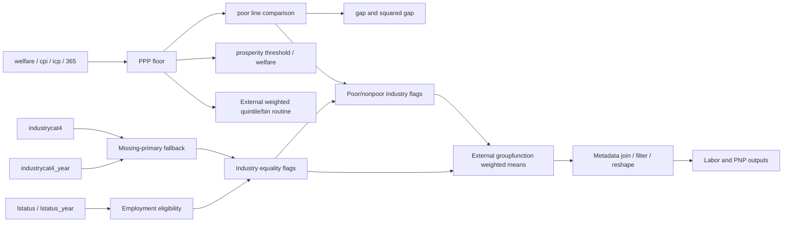

---
{"generated":{"by":"process:build-wbg-okf"},"help_center_commit":"sanitized:3922b3bfe000a87b8aae5305d8d9417ff53718922349db932f5eb85ceef1342d","sources":[{"id":"s-5b708d3f9c379cae-l1","resource":"urn:okf:sanitized:5b708d3f9c379cae4670","sha256":"20a3e0d1b424ccad44d7b6c9dc4b5cf6d142c368b20e3c1c15c4706fe189dd17"},{"id":"s-5b708d3f9c379cae-l104","resource":"urn:okf:sanitized:5b708d3f9c379cae4670","sha256":"20a3e0d1b424ccad44d7b6c9dc4b5cf6d142c368b20e3c1c15c4706fe189dd17"},{"id":"s-5b708d3f9c379cae-l113","resource":"urn:okf:sanitized:5b708d3f9c379cae4670","sha256":"20a3e0d1b424ccad44d7b6c9dc4b5cf6d142c368b20e3c1c15c4706fe189dd17"},{"id":"s-5b708d3f9c379cae-l122","resource":"urn:okf:sanitized:5b708d3f9c379cae4670","sha256":"20a3e0d1b424ccad44d7b6c9dc4b5cf6d142c368b20e3c1c15c4706fe189dd17"},{"id":"s-5b708d3f9c379cae-l131","resource":"urn:okf:sanitized:5b708d3f9c379cae4670","sha256":"20a3e0d1b424ccad44d7b6c9dc4b5cf6d142c368b20e3c1c15c4706fe189dd17"},{"id":"s-5b708d3f9c379cae-l14","resource":"urn:okf:sanitized:5b708d3f9c379cae4670","sha256":"20a3e0d1b424ccad44d7b6c9dc4b5cf6d142c368b20e3c1c15c4706fe189dd17"},{"id":"s-5b708d3f9c379cae-l140","resource":"urn:okf:sanitized:5b708d3f9c379cae4670","sha256":"20a3e0d1b424ccad44d7b6c9dc4b5cf6d142c368b20e3c1c15c4706fe189dd17"},{"id":"s-5b708d3f9c379cae-l149","resource":"urn:okf:sanitized:5b708d3f9c379cae4670","sha256":"20a3e0d1b424ccad44d7b6c9dc4b5cf6d142c368b20e3c1c15c4706fe189dd17"},{"id":"s-5b708d3f9c379cae-l158","resource":"urn:okf:sanitized:5b708d3f9c379cae4670","sha256":"20a3e0d1b424ccad44d7b6c9dc4b5cf6d142c368b20e3c1c15c4706fe189dd17"},{"id":"s-5b708d3f9c379cae-l167","resource":"urn:okf:sanitized:5b708d3f9c379cae4670","sha256":"20a3e0d1b424ccad44d7b6c9dc4b5cf6d142c368b20e3c1c15c4706fe189dd17"},{"id":"s-5b708d3f9c379cae-l176","resource":"urn:okf:sanitized:5b708d3f9c379cae4670","sha256":"20a3e0d1b424ccad44d7b6c9dc4b5cf6d142c368b20e3c1c15c4706fe189dd17"},{"id":"s-5b708d3f9c379cae-l185","resource":"urn:okf:sanitized:5b708d3f9c379cae4670","sha256":"20a3e0d1b424ccad44d7b6c9dc4b5cf6d142c368b20e3c1c15c4706fe189dd17"},{"id":"s-5b708d3f9c379cae-l194","resource":"urn:okf:sanitized:5b708d3f9c379cae4670","sha256":"20a3e0d1b424ccad44d7b6c9dc4b5cf6d142c368b20e3c1c15c4706fe189dd17"},{"id":"s-5b708d3f9c379cae-l203","resource":"urn:okf:sanitized:5b708d3f9c379cae4670","sha256":"20a3e0d1b424ccad44d7b6c9dc4b5cf6d142c368b20e3c1c15c4706fe189dd17"},{"id":"s-5b708d3f9c379cae-l212","resource":"urn:okf:sanitized:5b708d3f9c379cae4670","sha256":"20a3e0d1b424ccad44d7b6c9dc4b5cf6d142c368b20e3c1c15c4706fe189dd17"},{"id":"s-5b708d3f9c379cae-l221","resource":"urn:okf:sanitized:5b708d3f9c379cae4670","sha256":"20a3e0d1b424ccad44d7b6c9dc4b5cf6d142c368b20e3c1c15c4706fe189dd17"},{"id":"s-5b708d3f9c379cae-l23","resource":"urn:okf:sanitized:5b708d3f9c379cae4670","sha256":"20a3e0d1b424ccad44d7b6c9dc4b5cf6d142c368b20e3c1c15c4706fe189dd17"},{"id":"s-5b708d3f9c379cae-l230","resource":"urn:okf:sanitized:5b708d3f9c379cae4670","sha256":"20a3e0d1b424ccad44d7b6c9dc4b5cf6d142c368b20e3c1c15c4706fe189dd17"},{"id":"s-5b708d3f9c379cae-l239","resource":"urn:okf:sanitized:5b708d3f9c379cae4670","sha256":"20a3e0d1b424ccad44d7b6c9dc4b5cf6d142c368b20e3c1c15c4706fe189dd17"},{"id":"s-5b708d3f9c379cae-l248","resource":"urn:okf:sanitized:5b708d3f9c379cae4670","sha256":"20a3e0d1b424ccad44d7b6c9dc4b5cf6d142c368b20e3c1c15c4706fe189dd17"},{"id":"s-5b708d3f9c379cae-l257","resource":"urn:okf:sanitized:5b708d3f9c379cae4670","sha256":"20a3e0d1b424ccad44d7b6c9dc4b5cf6d142c368b20e3c1c15c4706fe189dd17"},{"id":"s-5b708d3f9c379cae-l266","resource":"urn:okf:sanitized:5b708d3f9c379cae4670","sha256":"20a3e0d1b424ccad44d7b6c9dc4b5cf6d142c368b20e3c1c15c4706fe189dd17"},{"id":"s-5b708d3f9c379cae-l275","resource":"urn:okf:sanitized:5b708d3f9c379cae4670","sha256":"20a3e0d1b424ccad44d7b6c9dc4b5cf6d142c368b20e3c1c15c4706fe189dd17"},{"id":"s-5b708d3f9c379cae-l32","resource":"urn:okf:sanitized:5b708d3f9c379cae4670","sha256":"20a3e0d1b424ccad44d7b6c9dc4b5cf6d142c368b20e3c1c15c4706fe189dd17"},{"id":"s-5b708d3f9c379cae-l41","resource":"urn:okf:sanitized:5b708d3f9c379cae4670","sha256":"20a3e0d1b424ccad44d7b6c9dc4b5cf6d142c368b20e3c1c15c4706fe189dd17"},{"id":"s-5b708d3f9c379cae-l5","resource":"urn:okf:sanitized:5b708d3f9c379cae4670","sha256":"20a3e0d1b424ccad44d7b6c9dc4b5cf6d142c368b20e3c1c15c4706fe189dd17"},{"id":"s-5b708d3f9c379cae-l50","resource":"urn:okf:sanitized:5b708d3f9c379cae4670","sha256":"20a3e0d1b424ccad44d7b6c9dc4b5cf6d142c368b20e3c1c15c4706fe189dd17"},{"id":"s-5b708d3f9c379cae-l59","resource":"urn:okf:sanitized:5b708d3f9c379cae4670","sha256":"20a3e0d1b424ccad44d7b6c9dc4b5cf6d142c368b20e3c1c15c4706fe189dd17"},{"id":"s-5b708d3f9c379cae-l68","resource":"urn:okf:sanitized:5b708d3f9c379cae4670","sha256":"20a3e0d1b424ccad44d7b6c9dc4b5cf6d142c368b20e3c1c15c4706fe189dd17"},{"id":"s-5b708d3f9c379cae-l77","resource":"urn:okf:sanitized:5b708d3f9c379cae4670","sha256":"20a3e0d1b424ccad44d7b6c9dc4b5cf6d142c368b20e3c1c15c4706fe189dd17"},{"id":"s-5b708d3f9c379cae-l86","resource":"urn:okf:sanitized:5b708d3f9c379cae4670","sha256":"20a3e0d1b424ccad44d7b6c9dc4b5cf6d142c368b20e3c1c15c4706fe189dd17"},{"id":"s-5b708d3f9c379cae-l95","resource":"urn:okf:sanitized:5b708d3f9c379cae4670","sha256":"20a3e0d1b424ccad44d7b6c9dc4b5cf6d142c368b20e3c1c15c4706fe189dd17"},{"id":"s-9820326829d5f7ac-l1","resource":"urn:okf:sanitized:9820326829d5f7aca6a2","sha256":"822e70ead9362a7e2adb046d5a24b3bf0cecd7768f51ca802c61f8dbb6f0f181"},{"id":"s-b1cc596588fdf84b-l1","resource":"urn:okf:sanitized:b1cc596588fdf84b94c6","sha256":"6616b0f2f227ea02352df5efa6443f7b2d70f868b406d09a2e3493c6e5489a7b"},{"id":"s-b1cc596588fdf84b-l25","resource":"urn:okf:sanitized:b1cc596588fdf84b94c6","sha256":"6616b0f2f227ea02352df5efa6443f7b2d70f868b406d09a2e3493c6e5489a7b"}],"type":"Reference"}
---

<!-- Retrieval block: text/docs/GMI_extended/architecture/file_inventory/00001.md -->
---
{"generated":{"by":"process:build-wbg-okf"},"help_center_commit":"sanitized:3922b3bfe000a87b8aae5305d8d9417ff53718922349db932f5eb85ceef1342d","sources":[{"id":"s-b1cc596588fdf84b-l1","resource":"urn:okf:sanitized:b1cc596588fdf84b94c6","sha256":"6616b0f2f227ea02352df5efa6443f7b2d70f868b406d09a2e3493c6e5489a7b"}],"type":"Reference"}
---

# File inventory

Original: `GMI_extended/architecture/file_inventory.md:L1-L24`.[^s-b1cc596588fdf84b-l1] Product source: `dasalm20/gmi_extended@6f5231790ca118f2bf8c7967f12f1c0f3656ea47`. 

# File inventory

No source executable is silently excluded. The 25 .do files are all represented below. Version-control internals (including sample hooks) and generated AI_KNOWLEDGE scripts are excluded from production coverage. Finder metadata is inventoried but not interpreted.

| File | Role | Active statements | Lines | Workflow |
|---|---|---:|---:|---|
| `01.Programs/00-Master.do` | Session settings, directories, preflight and optional orchestration | 166 | 362 | [file:98be35f872b2091d](../../../lookup/sources/GMI_extended/workflows/00-98be35.md.md) |
| `01.Programs/00b-Pull_API_data.do` | Cache PIP, price framework, GDP and country classification inputs | 230 | 308 | [file:cc12bf8a86984a16](../../../lookup/sources/GMI_extended/workflows/00b-cc12bf.md.md) |
| `01.Programs/00c-fetch server data.do` | Copy six network input files with retries and cache checks | 72 | 115 | [file:76305de4daa10f0e](../../../lookup/sources/GMI_extended/workflows/00c-76305d.md.md) |
| `01.Programs/01aa-GMI extended indicators.do` | Demographic subgroup poverty and poor/nonpoor profiles | 395 | 649 | [file:4147bae642bb6dfa](../../../lookup/sources/GMI_extended/workflows/01aa-4147ba.md.md) |
| `01.Programs/01ab-GMI extended indicators labor ind.do` | Working-age labor and industry poverty cross-tabulations | 286 | 610 | [file:cf70b2568fdbc636](../../../lookup/sources/GMI_extended/workflows/01ab-cf70b2.md.md) |
| `01.Programs/01b-GMI extended indicators spells.do` | GIC welfare bins and spell decompositions | 393 | 766 | [file:693ca49303705cc5](../../../lookup/sources/GMI_extended/workflows/01b-693ca4.md.md) |
| `01.Programs/01c-GMI extended spells pov elasticity.do` | PIP/GDP spell elasticities and descriptive regressions | 118 | 238 | [file:cf769a0c2afa05ae](../../../lookup/sources/GMI_extended/workflows/01c-cf769a.md.md) |
| `01.Programs/02-GMI format.do` | Format demographic, labor, GIC and decomposition outputs | 460 | 651 | [file:ed9a59dcc506e53e](../../../lookup/sources/GMI_extended/workflows/02-ed9a59.md.md) |
| `01.Programs/03-MPO to PEA.do` | Combine actual and projected poverty across MPO vintages | 111 | 195 | [file:41c1576ea77152d1](../../../lookup/sources/GMI_extended/workflows/03-41c157.md.md) |
| `01.Programs/archive/01aa-GMI extended indicators.do` | Demographic subgroup poverty and poor/nonpoor profiles | 424 | 569 | [file:a16ea0d66abc43f7](../../../lookup/sources/GMI_extended/workflows/archive-01aa-a16ea0.md.md) |
| `01.Programs/archive/01ab-GMI extended indicators labor ind.do` | Working-age labor and industry poverty cross-tabulations | 317 | 496 | [file:6cc95ccb6336ad96](../../../lookup/sources/GMI_extended/workflows/archive-01ab-6cc95c.md.md) |
| `01.Programs/archive/01b-GMI extended indicators spells.do` | GIC welfare bins and spell decompositions | 413 | 658 | [file:f4a8bcc412c35bb6](../../../lookup/sources/GMI_extended/workflows/archive-01b-f4a8bc.md.md) |
| `01.Programs/archive/01c-GMI extended spells pov elasticity.do` | PIP/GDP spell elasticities and descriptive regressions | 137 | 179 | [file:e927035de26cc489](../../../lookup/sources/GMI_extended/workflows/archive-01c-e92703.md.md) |
| `01.Programs/archive/02-GMI format.do` | Format demographic, labor, GIC and decomposition outputs | 472 | 583 | [file:0b4abb6f37a1aae3](../../../lookup/sources/GMI_extended/workflows/archive-02-0b4abb.md.md) |
| `01.Programs/archive/03-MPO to PEA.do` | Combine actual and projected poverty across MPO vintages | 114 | 144 | [file:4a53fde318bf0089](../../../lookup/sources/GMI_extended/workflows/archive-03-4a53fd.md.md) |
| `01.Programs/archive/Get PIP for PEA.do` | Legacy direct PIP extraction at eighteen poverty lines | 47 | 57 | [file:ba02e35104a7e1ee](../../../lookup/sources/GMI_extended/workflows/archive-Get_PIP_for_PEA-ba02e3.md.md) |
| `01.Programs/archive/PIP to GIC and Decomposition data.do` | Legacy binned welfare conversion and GIC export | 83 | 118 | [file:ef6ab402032c5fd3](../../../lookup/sources/GMI_extended/workflows/archive-PIP_to_GIC_and_Decomposition_data-ef6ab4.md.md) |
| `01.Programs/archive/Update CLASS.do` | Legacy region/income classification preparation | 24 | 29 | [file:a74011951d9fa6b6](../../../lookup/sources/GMI_extended/workflows/archive-Update_CLASS-a74011.md.md) |

[^s-b1cc596588fdf84b-l1]: urn:okf:sanitized:b1cc596588fdf84b94c6#L1-L24

<!-- Retrieval block: text/docs/GMI_extended/architecture/file_inventory/00025.md -->
---
{"generated":{"by":"process:build-wbg-okf"},"help_center_commit":"sanitized:3922b3bfe000a87b8aae5305d8d9417ff53718922349db932f5eb85ceef1342d","sources":[{"id":"s-b1cc596588fdf84b-l25","resource":"urn:okf:sanitized:b1cc596588fdf84b94c6","sha256":"6616b0f2f227ea02352df5efa6443f7b2d70f868b406d09a2e3493c6e5489a7b"}],"type":"Reference"}
---

# File inventory

Original: `GMI_extended/architecture/file_inventory.md:L25-L31`.[^s-b1cc596588fdf84b-l25] Product source: `dasalm20/gmi_extended@6f5231790ca118f2bf8c7967f12f1c0f3656ea47`. 

Source context:

# File inventory
| File | Role | Active statements | Lines | Workflow |
|---|---|---:|---:|---|

| `04.Checks_Add_reharmonization_results/code/01-Delivery_matrix.do` | Scan raw regional deliveries for exact GMD names and nonmissing coverage; export delivery workbook. | 340 | 517 | [file:a77151611c30e8fe](../../../lookup/sources/GMI_extended/workflows/01-a77151.md.md) |
| `04.Checks_Add_reharmonization_results/code/02-delivery_qcheck.do` | Compare raw delivered distributions with embedded codebooks/thresholds; emit regional qcheck workbooks. | 666 | 1031 | [file:dd095c4aa234e5d1](../../../lookup/sources/GMI_extended/workflows/02-dd095c.md.md) |
| `04.Checks_Add_reharmonization_results/code/99-build_eap_local.do` | Assemble EAP person and household modules into GMD-named local comparison files. | 404 | 594 | [file:e7997a55e10871dd](../../../lookup/sources/GMI_extended/workflows/99-e7997a.md.md) |
| `04.Checks_Add_reharmonization_results/code/99-gmdpatch_diagnostics.do` | Compare local and DLW files after guarded ID fixes; emit match metrics, cross-tabs and QA tables. | 587 | 958 | [file:30607f798de2d826](../../../lookup/sources/GMI_extended/workflows/99-30607f.md.md) |
| `04.Checks_Add_reharmonization_results/code/99-ISO3_education_trace.do` | Rebuild ISO3 education from raw grade codes and compare matched persons with DLW; screen diagnostics and temporary dataset. | 185 | 314 | [file:bfe9b3f95739f102](../../../lookup/sources/GMI_extended/workflows/99-bfe9b3.md.md) |
| `04.Checks_Add_reharmonization_results/code/99-qa_summary.do` | Consume qa_surv/qa_var/qa_code; derive codebook, lost-value and distribution-change findings. | 622 | 942 | [file:eaf3b523707c534a](../../../lookup/sources/GMI_extended/workflows/99-eaf3b5.md.md) |
| `04.Checks_Add_reharmonization_results/code/gmdpatch_fixid.do` | Define guarded country-specific ID correction helper; no production invocation established. | 127 | 251 | [file:ff0cb1097fa67998](../../../lookup/sources/GMI_extended/workflows/gmdpatch_fixid-ff0cb1.md.md) |

[^s-b1cc596588fdf84b-l25]: urn:okf:sanitized:b1cc596588fdf84b94c6#L25-L31

<!-- Retrieval block: text/docs/GMI_extended/architecture/indicator_flow/00001.md -->
---
{"generated":{"by":"process:build-wbg-okf"},"help_center_commit":"sanitized:3922b3bfe000a87b8aae5305d8d9417ff53718922349db932f5eb85ceef1342d","sources":[{"id":"s-9820326829d5f7ac-l1","resource":"urn:okf:sanitized:9820326829d5f7aca6a2","sha256":"822e70ead9362a7e2adb046d5a24b3bf0cecd7768f51ca802c61f8dbb6f0f181"}],"type":"Reference"}
---

# Indicator construction map

Original: `GMI_extended/architecture/indicator_flow.md:L1-L31`.[^s-9820326829d5f7ac-l1] Product source: `dasalm20/gmi_extended@6f5231790ca118f2bf8c7967f12f1c0f3656ea47`. 

# Indicator construction map

Exact expressions, expanded identities, guards and output links are stored per indicator in `index/indicators.jsonl` and `indicators/*.md`. Counts include current and archived instances and imported/QA statistics; they are not a count of unique economic concepts.

The fallback and industry paths are demonstrated at `01.Programs/01ab-GMI extended indicators labor ind.do:L332-L371,L425-L465,L543-L571`. Head variants use `_head==1` and age≥18 in `01.Programs/01aa-GMI extended indicators.do:L333-L403,L590-L601`.

Welfare mean, poverty FGT inputs and prosperity gap are explicit arithmetic. Quantile assignment, Gini, Theil and decomposition algorithms are external command calls. Preserve this distinction: a complete call/return mapping is not a verified internal implementation. Evidence: `01.Programs/01aa-GMI extended indicators.do:L454-L496,L521`; `01.Programs/01b-GMI extended indicators spells.do:L453-L474,L596-L633`.

The poverty gap input multiplies `(z-welfare)/z` by poor; severity squares it. Prosperity gap is the PPP-specific threshold divided by floored welfare. 01ab additionally drops negative welfare before flooring, while 01aa floors it without that drop. The final stored labor flags are not visibly multiplied by 100 despite percent labels. Evidence: `01.Programs/01aa-GMI extended indicators.do:L454-L467`; `01.Programs/01ab-GMI extended indicators labor ind.do:L425-L431`; `01.Programs/02-GMI format.do:L477-L533,L568-L574`.

For exact expected variables after a wildcard rename or column-order range drop, inspect the source and actual schema. The long labor output removes base fields using range varlists and reshapes line-specific fields. Nonagriculture cross-tabs and the 2–3 variant are dropped earlier. Evidence: `01.Programs/02-GMI format.do:L562-L596`.

[^s-9820326829d5f7ac-l1]: urn:okf:sanitized:9820326829d5f7aca6a2#L1-L31

<!-- Retrieval block: text/docs/GMI_extended/architecture/output_lineage/00001.md -->
---
{"generated":{"by":"process:build-wbg-okf"},"help_center_commit":"sanitized:3922b3bfe000a87b8aae5305d8d9417ff53718922349db932f5eb85ceef1342d","sources":[{"id":"s-5b708d3f9c379cae-l1","resource":"urn:okf:sanitized:5b708d3f9c379cae4670","sha256":"20a3e0d1b424ccad44d7b6c9dc4b5cf6d142c368b20e3c1c15c4706fe189dd17"}],"type":"Reference"}
---

# Output lineage

Original: `GMI_extended/architecture/output_lineage.md:L1-L4`.[^s-5b708d3f9c379cae-l1] Product source: `dasalm20/gmi_extended@6f5231790ca118f2bf8c7967f12f1c0f3656ea47`. 

# Output lineage

Each entry is a write site, not a claim that the output exists. Reverse graph traversal uses dependencies.jsonl. Inferred edges are conservative and may include fields later dropped.

[^s-5b708d3f9c379cae-l1]: urn:okf:sanitized:5b708d3f9c379cae4670#L1-L4

<!-- Retrieval block: text/docs/GMI_extended/architecture/output_lineage/00005.md -->
---
{"generated":{"by":"process:build-wbg-okf"},"help_center_commit":"sanitized:3922b3bfe000a87b8aae5305d8d9417ff53718922349db932f5eb85ceef1342d","sources":[{"id":"s-5b708d3f9c379cae-l5","resource":"urn:okf:sanitized:5b708d3f9c379cae4670","sha256":"20a3e0d1b424ccad44d7b6c9dc4b5cf6d142c368b20e3c1c15c4706fe189dd17"}],"type":"Reference"}
---

# Output lineage / output:68258e63fedeed82

Original: `GMI_extended/architecture/output_lineage.md:L5-L13`.[^s-5b708d3f9c379cae-l5] Product source: `dasalm20/gmi_extended@6f5231790ca118f2bf8c7967f12f1c0f3656ea47`. 

Source context:

# Output lineage

Each entry is a write site, not a claim that the output exists. Reverse graph traversal uses dependencies.jsonl. Inferred edges are conservative and may include fields later dropped.

# Output lineage

## output:68258e63fedeed82

`$input\pip`ppp1'.dta` — `01.Programs/00b-Pull_API_data.do:L69-L69`

Producer: `block:a6a0ffddf1ada4c8`. Mode: `replace`.
Immediate input datasets: `dataset:2233ff17d89f8e5f, dataset:83ddf112039eda06`.
Indicator IDs: `indicator:003ec0f54c4febb4, indicator:01b128c400693e5d, indicator:07d8a8126faeead6, indicator:0ee09d06ec0f7166, indicator:121dad16527d1a90, indicator:15a3c2a9ce6249b9, indicator:15b6f909731d39bd, indicator:176f0e1b5dd9905f, indicator:1a8e171d1039d69e, indicator:1cd3f51bcd0d8184, indicator:1dd12d61d254f0ea, indicator:1e0293407e4a522f, indicator:21108d0d537ff27a, indicator:2c76ce313ac79ddd, indicator:2f7e060bcf6923c0, indicator:301ecb40212a2921, indicator:38c5feb025c8d910, indicator:3bbcd271ac27747e, indicator:4004c74de6ea5880, indicator:402f53fe76f98238, indicator:4200347d1db21b9c, indicator:421ea1e6f7519c0d, indicator:437ff6640c14ed82, indicator:452275256e5ca92e, indicator:5390e6ce71fa0e63, indicator:5477c45966452b4b, indicator:6515884b80189769, indicator:65eb6b968eefab7c, indicator:665271d64fd08836, indicator:68ec69992d6be898, indicator:6d78ab6024b28816, indicator:71015e2e6866a15d, indicator:79ab2ce42efd63de, indicator:7b647aeaa15b5c9c, indicator:7c1af4ffa990460e, indicator:81c037d69f898b7d, indicator:83027eb3530b3b76, indicator:870d3709082a18cc, indicator:8be039e0b0890d68, indicator:8c6d5cef7c176afe, indicator:903584b625bd3f64, indicator:90ab179d9c4281a6, indicator:b4e0e09edb65f9fa, indicator:b7110352866e735f, indicator:bfb13392dd28d5da, indicator:c1113a875e1dfcd2, indicator:c618e5aa31387cda, indicator:c61e98985058a0e4, indicator:c9b9080c6fde3a5c, indicator:ca5850106bb8a64b, indicator:e74d7770f386c641, indicator:f3bedeeb7e186a89, indicator:f630b00a335b370b, indicator:faa25127069272e9`.
Conditions: `foreach ppp1 of global ppplist {; if `needpull' == 0 {`.

[^s-5b708d3f9c379cae-l5]: urn:okf:sanitized:5b708d3f9c379cae4670#L5-L13

<!-- Retrieval block: text/docs/GMI_extended/architecture/output_lineage/00014.md -->
---
{"generated":{"by":"process:build-wbg-okf"},"help_center_commit":"sanitized:3922b3bfe000a87b8aae5305d8d9417ff53718922349db932f5eb85ceef1342d","sources":[{"id":"s-5b708d3f9c379cae-l14","resource":"urn:okf:sanitized:5b708d3f9c379cae4670","sha256":"20a3e0d1b424ccad44d7b6c9dc4b5cf6d142c368b20e3c1c15c4706fe189dd17"}],"type":"Reference"}
---

# Output lineage / output:6abeab3e890db588

Original: `GMI_extended/architecture/output_lineage.md:L14-L22`.[^s-5b708d3f9c379cae-l14] Product source: `dasalm20/gmi_extended@6f5231790ca118f2bf8c7967f12f1c0f3656ea47`. 

Source context:

# Output lineage

Each entry is a write site, not a claim that the output exists. Reverse graph traversal uses dependencies.jsonl. Inferred edges are conservative and may include fields later dropped.

# Output lineage
## output:68258e63fedeed82

## output:6abeab3e890db588

``pipbase'` — `01.Programs/00b-Pull_API_data.do:L81-L81`

Producer: `block:afd81f6a7485ff29`. Mode: `replace`.
Immediate input datasets: `dataset:2233ff17d89f8e5f, dataset:83ddf112039eda06`.
Indicator IDs: `not semantically resolved`.
Conditions: `foreach ppp1 of global ppplist {; else {`.

[^s-5b708d3f9c379cae-l14]: urn:okf:sanitized:5b708d3f9c379cae4670#L14-L22

<!-- Retrieval block: text/docs/GMI_extended/architecture/output_lineage/00023.md -->
---
{"generated":{"by":"process:build-wbg-okf"},"help_center_commit":"sanitized:3922b3bfe000a87b8aae5305d8d9417ff53718922349db932f5eb85ceef1342d","sources":[{"id":"s-5b708d3f9c379cae-l23","resource":"urn:okf:sanitized:5b708d3f9c379cae4670","sha256":"20a3e0d1b424ccad44d7b6c9dc4b5cf6d142c368b20e3c1c15c4706fe189dd17"}],"type":"Reference"}
---

# Output lineage / output:68041697c3140f21

Original: `GMI_extended/architecture/output_lineage.md:L23-L31`.[^s-5b708d3f9c379cae-l23] Product source: `dasalm20/gmi_extended@6f5231790ca118f2bf8c7967f12f1c0f3656ea47`. 

Source context:

# Output lineage

Each entry is a write site, not a claim that the output exists. Reverse graph traversal uses dependencies.jsonl. Inferred edges are conservative and may include fields later dropped.

# Output lineage
## output:6abeab3e890db588

## output:68041697c3140f21

``pipbase'` — `01.Programs/00b-Pull_API_data.do:L94-L94`

Producer: `block:f709c2830d8dc7e6`. Mode: `replace`.
Immediate input datasets: `dataset:2233ff17d89f8e5f, dataset:83ddf112039eda06`.
Indicator IDs: `not semantically resolved`.
Conditions: `foreach ppp1 of global ppplist {; else {; foreach num of numlist ${pipextra`ppp1'} {`.

[^s-5b708d3f9c379cae-l23]: urn:okf:sanitized:5b708d3f9c379cae4670#L23-L31

<!-- Retrieval block: text/docs/GMI_extended/architecture/output_lineage/00032.md -->
---
{"generated":{"by":"process:build-wbg-okf"},"help_center_commit":"sanitized:3922b3bfe000a87b8aae5305d8d9417ff53718922349db932f5eb85ceef1342d","sources":[{"id":"s-5b708d3f9c379cae-l32","resource":"urn:okf:sanitized:5b708d3f9c379cae4670","sha256":"20a3e0d1b424ccad44d7b6c9dc4b5cf6d142c368b20e3c1c15c4706fe189dd17"}],"type":"Reference"}
---

# Output lineage / output:45a7f1e145d8f03e

Original: `GMI_extended/architecture/output_lineage.md:L32-L40`.[^s-5b708d3f9c379cae-l32] Product source: `dasalm20/gmi_extended@6f5231790ca118f2bf8c7967f12f1c0f3656ea47`. 

Source context:

# Output lineage

Each entry is a write site, not a claim that the output exists. Reverse graph traversal uses dependencies.jsonl. Inferred edges are conservative and may include fields later dropped.

# Output lineage
## output:68041697c3140f21

## output:45a7f1e145d8f03e

``cachefile'` — `01.Programs/00b-Pull_API_data.do:L100-L100`

Producer: `block:f0da05f4444fc7a7`. Mode: `replace`.
Immediate input datasets: `dataset:83ddf112039eda06`.
Indicator IDs: `not semantically resolved`.
Conditions: `foreach ppp1 of global ppplist {; else {`.

[^s-5b708d3f9c379cae-l32]: urn:okf:sanitized:5b708d3f9c379cae4670#L32-L40

<!-- Retrieval block: text/docs/GMI_extended/architecture/output_lineage/00041.md -->
---
{"generated":{"by":"process:build-wbg-okf"},"help_center_commit":"sanitized:3922b3bfe000a87b8aae5305d8d9417ff53718922349db932f5eb85ceef1342d","sources":[{"id":"s-5b708d3f9c379cae-l41","resource":"urn:okf:sanitized:5b708d3f9c379cae4670","sha256":"20a3e0d1b424ccad44d7b6c9dc4b5cf6d142c368b20e3c1c15c4706fe189dd17"}],"type":"Reference"}
---

# Output lineage / output:ad3e54bd2a6a15e0

Original: `GMI_extended/architecture/output_lineage.md:L41-L49`.[^s-5b708d3f9c379cae-l41] Product source: `dasalm20/gmi_extended@6f5231790ca118f2bf8c7967f12f1c0f3656ea47`. 

Source context:

# Output lineage

Each entry is a write site, not a claim that the output exists. Reverse graph traversal uses dependencies.jsonl. Inferred edges are conservative and may include fields later dropped.

# Output lineage
## output:45a7f1e145d8f03e

## output:ad3e54bd2a6a15e0

`$input\pip`ppp1'.dta` — `01.Programs/00b-Pull_API_data.do:L101-L101`

Producer: `block:0ccad5f96bab5f14`. Mode: `replace`.
Immediate input datasets: `dataset:83ddf112039eda06`.
Indicator IDs: `indicator:003ec0f54c4febb4, indicator:01b128c400693e5d, indicator:07d8a8126faeead6, indicator:0ee09d06ec0f7166, indicator:121dad16527d1a90, indicator:15a3c2a9ce6249b9, indicator:15b6f909731d39bd, indicator:176f0e1b5dd9905f, indicator:1a8e171d1039d69e, indicator:1cd3f51bcd0d8184, indicator:1dd12d61d254f0ea, indicator:1e0293407e4a522f, indicator:21108d0d537ff27a, indicator:2c76ce313ac79ddd, indicator:2f7e060bcf6923c0, indicator:301ecb40212a2921, indicator:38c5feb025c8d910, indicator:3bbcd271ac27747e, indicator:4004c74de6ea5880, indicator:402f53fe76f98238, indicator:4200347d1db21b9c, indicator:421ea1e6f7519c0d, indicator:437ff6640c14ed82, indicator:452275256e5ca92e, indicator:5390e6ce71fa0e63, indicator:5477c45966452b4b, indicator:6515884b80189769, indicator:65eb6b968eefab7c, indicator:665271d64fd08836, indicator:68ec69992d6be898, indicator:6d78ab6024b28816, indicator:71015e2e6866a15d, indicator:79ab2ce42efd63de, indicator:7b647aeaa15b5c9c, indicator:7c1af4ffa990460e, indicator:81c037d69f898b7d, indicator:83027eb3530b3b76, indicator:870d3709082a18cc, indicator:8be039e0b0890d68, indicator:8c6d5cef7c176afe, indicator:903584b625bd3f64, indicator:90ab179d9c4281a6, indicator:b4e0e09edb65f9fa, indicator:b7110352866e735f, indicator:bfb13392dd28d5da, indicator:c1113a875e1dfcd2, indicator:c618e5aa31387cda, indicator:c61e98985058a0e4, indicator:c9b9080c6fde3a5c, indicator:ca5850106bb8a64b, indicator:e74d7770f386c641, indicator:f3bedeeb7e186a89, indicator:f630b00a335b370b, indicator:faa25127069272e9`.
Conditions: `foreach ppp1 of global ppplist {; else {`.

[^s-5b708d3f9c379cae-l41]: urn:okf:sanitized:5b708d3f9c379cae4670#L41-L49

<!-- Retrieval block: text/docs/GMI_extended/architecture/output_lineage/00050.md -->
---
{"generated":{"by":"process:build-wbg-okf"},"help_center_commit":"sanitized:3922b3bfe000a87b8aae5305d8d9417ff53718922349db932f5eb85ceef1342d","sources":[{"id":"s-5b708d3f9c379cae-l50","resource":"urn:okf:sanitized:5b708d3f9c379cae4670","sha256":"20a3e0d1b424ccad44d7b6c9dc4b5cf6d142c368b20e3c1c15c4706fe189dd17"}],"type":"Reference"}
---

# Output lineage / output:bfeac4dbb0964968

Original: `GMI_extended/architecture/output_lineage.md:L50-L58`.[^s-5b708d3f9c379cae-l50] Product source: `dasalm20/gmi_extended@6f5231790ca118f2bf8c7967f12f1c0f3656ea47`. 

Source context:

# Output lineage

Each entry is a write site, not a claim that the output exists. Reverse graph traversal uses dependencies.jsonl. Inferred edges are conservative and may include fields later dropped.

# Output lineage
## output:ad3e54bd2a6a15e0

## output:bfeac4dbb0964968

`$input\pip_framework.dta` — `01.Programs/00b-Pull_API_data.do:L122-L122`

Producer: `block:c2f1791ccdee2dfd`. Mode: `replace`.
Immediate input datasets: `dataset:204922f53ae83bbc`.
Indicator IDs: `indicator:003ec0f54c4febb4, indicator:01b128c400693e5d, indicator:07d8a8126faeead6, indicator:0ee09d06ec0f7166, indicator:121dad16527d1a90, indicator:15a3c2a9ce6249b9, indicator:15b6f909731d39bd, indicator:176f0e1b5dd9905f, indicator:1a8e171d1039d69e, indicator:1cd3f51bcd0d8184, indicator:1dd12d61d254f0ea, indicator:1e0293407e4a522f, indicator:21108d0d537ff27a, indicator:2c76ce313ac79ddd, indicator:2f7e060bcf6923c0, indicator:301ecb40212a2921, indicator:38c5feb025c8d910, indicator:3bbcd271ac27747e, indicator:4004c74de6ea5880, indicator:402f53fe76f98238, indicator:4200347d1db21b9c, indicator:421ea1e6f7519c0d, indicator:437ff6640c14ed82, indicator:452275256e5ca92e, indicator:5390e6ce71fa0e63, indicator:5477c45966452b4b, indicator:6515884b80189769, indicator:65eb6b968eefab7c, indicator:665271d64fd08836, indicator:68ec69992d6be898, indicator:6d78ab6024b28816, indicator:71015e2e6866a15d, indicator:79ab2ce42efd63de, indicator:7b647aeaa15b5c9c, indicator:7c1af4ffa990460e, indicator:81c037d69f898b7d, indicator:83027eb3530b3b76, indicator:870d3709082a18cc, indicator:8be039e0b0890d68, indicator:8c6d5cef7c176afe, indicator:903584b625bd3f64, indicator:90ab179d9c4281a6, indicator:b4e0e09edb65f9fa, indicator:b7110352866e735f, indicator:bfb13392dd28d5da, indicator:c1113a875e1dfcd2, indicator:c618e5aa31387cda, indicator:c61e98985058a0e4, indicator:c9b9080c6fde3a5c, indicator:ca5850106bb8a64b, indicator:e74d7770f386c641, indicator:f3bedeeb7e186a89, indicator:f630b00a335b370b, indicator:faa25127069272e9`.
Conditions: `if `needpull' == 0 {`.

[^s-5b708d3f9c379cae-l50]: urn:okf:sanitized:5b708d3f9c379cae4670#L50-L58

<!-- Retrieval block: text/docs/GMI_extended/architecture/output_lineage/00059.md -->
---
{"generated":{"by":"process:build-wbg-okf"},"help_center_commit":"sanitized:3922b3bfe000a87b8aae5305d8d9417ff53718922349db932f5eb85ceef1342d","sources":[{"id":"s-5b708d3f9c379cae-l59","resource":"urn:okf:sanitized:5b708d3f9c379cae4670","sha256":"20a3e0d1b424ccad44d7b6c9dc4b5cf6d142c368b20e3c1c15c4706fe189dd17"}],"type":"Reference"}
---

# Output lineage / output:c763493a63b4cc5d

Original: `GMI_extended/architecture/output_lineage.md:L59-L67`.[^s-5b708d3f9c379cae-l59] Product source: `dasalm20/gmi_extended@6f5231790ca118f2bf8c7967f12f1c0f3656ea47`. 

Source context:

# Output lineage

Each entry is a write site, not a claim that the output exists. Reverse graph traversal uses dependencies.jsonl. Inferred edges are conservative and may include fields later dropped.

# Output lineage
## output:bfeac4dbb0964968

## output:c763493a63b4cc5d

``cachefile'` — `01.Programs/00b-Pull_API_data.do:L128-L128`

Producer: `block:5c9ac2403d166a11`. Mode: `replace`.
Immediate input datasets: `dataset:204922f53ae83bbc`.
Indicator IDs: `not semantically resolved`.
Conditions: `else {`.

[^s-5b708d3f9c379cae-l59]: urn:okf:sanitized:5b708d3f9c379cae4670#L59-L67

<!-- Retrieval block: text/docs/GMI_extended/architecture/output_lineage/00068.md -->
---
{"generated":{"by":"process:build-wbg-okf"},"help_center_commit":"sanitized:3922b3bfe000a87b8aae5305d8d9417ff53718922349db932f5eb85ceef1342d","sources":[{"id":"s-5b708d3f9c379cae-l68","resource":"urn:okf:sanitized:5b708d3f9c379cae4670","sha256":"20a3e0d1b424ccad44d7b6c9dc4b5cf6d142c368b20e3c1c15c4706fe189dd17"}],"type":"Reference"}
---

# Output lineage / output:dd53d5d4e32cbe99

Original: `GMI_extended/architecture/output_lineage.md:L68-L76`.[^s-5b708d3f9c379cae-l68] Product source: `dasalm20/gmi_extended@6f5231790ca118f2bf8c7967f12f1c0f3656ea47`. 

Source context:

# Output lineage

Each entry is a write site, not a claim that the output exists. Reverse graph traversal uses dependencies.jsonl. Inferred edges are conservative and may include fields later dropped.

# Output lineage
## output:c763493a63b4cc5d

## output:dd53d5d4e32cbe99

`$input\pip_framework.dta` — `01.Programs/00b-Pull_API_data.do:L129-L129`

Producer: `block:49d051f4ae3b2a4d`. Mode: `replace`.
Immediate input datasets: `dataset:204922f53ae83bbc`.
Indicator IDs: `indicator:003ec0f54c4febb4, indicator:01b128c400693e5d, indicator:07d8a8126faeead6, indicator:0ee09d06ec0f7166, indicator:121dad16527d1a90, indicator:15a3c2a9ce6249b9, indicator:15b6f909731d39bd, indicator:176f0e1b5dd9905f, indicator:1a8e171d1039d69e, indicator:1cd3f51bcd0d8184, indicator:1dd12d61d254f0ea, indicator:1e0293407e4a522f, indicator:21108d0d537ff27a, indicator:2c76ce313ac79ddd, indicator:2f7e060bcf6923c0, indicator:301ecb40212a2921, indicator:38c5feb025c8d910, indicator:3bbcd271ac27747e, indicator:4004c74de6ea5880, indicator:402f53fe76f98238, indicator:4200347d1db21b9c, indicator:421ea1e6f7519c0d, indicator:437ff6640c14ed82, indicator:452275256e5ca92e, indicator:5390e6ce71fa0e63, indicator:5477c45966452b4b, indicator:6515884b80189769, indicator:65eb6b968eefab7c, indicator:665271d64fd08836, indicator:68ec69992d6be898, indicator:6d78ab6024b28816, indicator:71015e2e6866a15d, indicator:79ab2ce42efd63de, indicator:7b647aeaa15b5c9c, indicator:7c1af4ffa990460e, indicator:81c037d69f898b7d, indicator:83027eb3530b3b76, indicator:870d3709082a18cc, indicator:8be039e0b0890d68, indicator:8c6d5cef7c176afe, indicator:903584b625bd3f64, indicator:90ab179d9c4281a6, indicator:b4e0e09edb65f9fa, indicator:b7110352866e735f, indicator:bfb13392dd28d5da, indicator:c1113a875e1dfcd2, indicator:c618e5aa31387cda, indicator:c61e98985058a0e4, indicator:c9b9080c6fde3a5c, indicator:ca5850106bb8a64b, indicator:e74d7770f386c641, indicator:f3bedeeb7e186a89, indicator:f630b00a335b370b, indicator:faa25127069272e9`.
Conditions: `else {`.

[^s-5b708d3f9c379cae-l68]: urn:okf:sanitized:5b708d3f9c379cae4670#L68-L76

<!-- Retrieval block: text/docs/GMI_extended/architecture/output_lineage/00077.md -->
---
{"generated":{"by":"process:build-wbg-okf"},"help_center_commit":"sanitized:3922b3bfe000a87b8aae5305d8d9417ff53718922349db932f5eb85ceef1342d","sources":[{"id":"s-5b708d3f9c379cae-l77","resource":"urn:okf:sanitized:5b708d3f9c379cae4670","sha256":"20a3e0d1b424ccad44d7b6c9dc4b5cf6d142c368b20e3c1c15c4706fe189dd17"}],"type":"Reference"}
---

# Output lineage / output:cfbf38804f9eb510

Original: `GMI_extended/architecture/output_lineage.md:L77-L85`.[^s-5b708d3f9c379cae-l77] Product source: `dasalm20/gmi_extended@6f5231790ca118f2bf8c7967f12f1c0f3656ea47`. 

Source context:

# Output lineage

Each entry is a write site, not a claim that the output exists. Reverse graph traversal uses dependencies.jsonl. Inferred edges are conservative and may include fields later dropped.

# Output lineage
## output:dd53d5d4e32cbe99

## output:cfbf38804f9eb510

`$input\pip_pop.dta` — `01.Programs/00b-Pull_API_data.do:L150-L150`

Producer: `block:01127b41515053ca`. Mode: `replace`.
Immediate input datasets: `dataset:3d5327b86b4390ff`.
Indicator IDs: `indicator:003ec0f54c4febb4, indicator:01b128c400693e5d, indicator:07d8a8126faeead6, indicator:0ee09d06ec0f7166, indicator:121dad16527d1a90, indicator:15a3c2a9ce6249b9, indicator:15b6f909731d39bd, indicator:176f0e1b5dd9905f, indicator:1a8e171d1039d69e, indicator:1cd3f51bcd0d8184, indicator:1dd12d61d254f0ea, indicator:1e0293407e4a522f, indicator:21108d0d537ff27a, indicator:2c76ce313ac79ddd, indicator:2f7e060bcf6923c0, indicator:301ecb40212a2921, indicator:38c5feb025c8d910, indicator:3bbcd271ac27747e, indicator:4004c74de6ea5880, indicator:402f53fe76f98238, indicator:4200347d1db21b9c, indicator:421ea1e6f7519c0d, indicator:437ff6640c14ed82, indicator:452275256e5ca92e, indicator:5390e6ce71fa0e63, indicator:5477c45966452b4b, indicator:6515884b80189769, indicator:65eb6b968eefab7c, indicator:665271d64fd08836, indicator:68ec69992d6be898, indicator:6d78ab6024b28816, indicator:71015e2e6866a15d, indicator:79ab2ce42efd63de, indicator:7b647aeaa15b5c9c, indicator:7c1af4ffa990460e, indicator:81c037d69f898b7d, indicator:83027eb3530b3b76, indicator:870d3709082a18cc, indicator:8be039e0b0890d68, indicator:8c6d5cef7c176afe, indicator:903584b625bd3f64, indicator:90ab179d9c4281a6, indicator:b4e0e09edb65f9fa, indicator:b7110352866e735f, indicator:bfb13392dd28d5da, indicator:c1113a875e1dfcd2, indicator:c618e5aa31387cda, indicator:c61e98985058a0e4, indicator:c9b9080c6fde3a5c, indicator:ca5850106bb8a64b, indicator:e74d7770f386c641, indicator:f3bedeeb7e186a89, indicator:f630b00a335b370b, indicator:faa25127069272e9`.
Conditions: `if `needpull' == 0 {`.

[^s-5b708d3f9c379cae-l77]: urn:okf:sanitized:5b708d3f9c379cae4670#L77-L85

<!-- Retrieval block: text/docs/GMI_extended/architecture/output_lineage/00086.md -->
---
{"generated":{"by":"process:build-wbg-okf"},"help_center_commit":"sanitized:3922b3bfe000a87b8aae5305d8d9417ff53718922349db932f5eb85ceef1342d","sources":[{"id":"s-5b708d3f9c379cae-l86","resource":"urn:okf:sanitized:5b708d3f9c379cae4670","sha256":"20a3e0d1b424ccad44d7b6c9dc4b5cf6d142c368b20e3c1c15c4706fe189dd17"}],"type":"Reference"}
---

# Output lineage / output:9c27bab4381b4cd3

Original: `GMI_extended/architecture/output_lineage.md:L86-L94`.[^s-5b708d3f9c379cae-l86] Product source: `dasalm20/gmi_extended@6f5231790ca118f2bf8c7967f12f1c0f3656ea47`. 

Source context:

# Output lineage

Each entry is a write site, not a claim that the output exists. Reverse graph traversal uses dependencies.jsonl. Inferred edges are conservative and may include fields later dropped.

# Output lineage
## output:cfbf38804f9eb510

## output:9c27bab4381b4cd3

``cachefile'` — `01.Programs/00b-Pull_API_data.do:L156-L156`

Producer: `block:de0f3c6181ea673e`. Mode: `replace`.
Immediate input datasets: `dataset:3d5327b86b4390ff`.
Indicator IDs: `not semantically resolved`.
Conditions: `else {`.

[^s-5b708d3f9c379cae-l86]: urn:okf:sanitized:5b708d3f9c379cae4670#L86-L94

<!-- Retrieval block: text/docs/GMI_extended/architecture/output_lineage/00095.md -->
---
{"generated":{"by":"process:build-wbg-okf"},"help_center_commit":"sanitized:3922b3bfe000a87b8aae5305d8d9417ff53718922349db932f5eb85ceef1342d","sources":[{"id":"s-5b708d3f9c379cae-l95","resource":"urn:okf:sanitized:5b708d3f9c379cae4670","sha256":"20a3e0d1b424ccad44d7b6c9dc4b5cf6d142c368b20e3c1c15c4706fe189dd17"}],"type":"Reference"}
---

# Output lineage / output:83ae60e555361787

Original: `GMI_extended/architecture/output_lineage.md:L95-L103`.[^s-5b708d3f9c379cae-l95] Product source: `dasalm20/gmi_extended@6f5231790ca118f2bf8c7967f12f1c0f3656ea47`. 

Source context:

# Output lineage

Each entry is a write site, not a claim that the output exists. Reverse graph traversal uses dependencies.jsonl. Inferred edges are conservative and may include fields later dropped.

# Output lineage
## output:9c27bab4381b4cd3

## output:83ae60e555361787

`$input\pip_pop.dta` — `01.Programs/00b-Pull_API_data.do:L157-L157`

Producer: `block:792f081dad02d102`. Mode: `replace`.
Immediate input datasets: `dataset:3d5327b86b4390ff`.
Indicator IDs: `indicator:003ec0f54c4febb4, indicator:01b128c400693e5d, indicator:07d8a8126faeead6, indicator:0ee09d06ec0f7166, indicator:121dad16527d1a90, indicator:15a3c2a9ce6249b9, indicator:15b6f909731d39bd, indicator:176f0e1b5dd9905f, indicator:1a8e171d1039d69e, indicator:1cd3f51bcd0d8184, indicator:1dd12d61d254f0ea, indicator:1e0293407e4a522f, indicator:21108d0d537ff27a, indicator:2c76ce313ac79ddd, indicator:2f7e060bcf6923c0, indicator:301ecb40212a2921, indicator:38c5feb025c8d910, indicator:3bbcd271ac27747e, indicator:4004c74de6ea5880, indicator:402f53fe76f98238, indicator:4200347d1db21b9c, indicator:421ea1e6f7519c0d, indicator:437ff6640c14ed82, indicator:452275256e5ca92e, indicator:5390e6ce71fa0e63, indicator:5477c45966452b4b, indicator:6515884b80189769, indicator:65eb6b968eefab7c, indicator:665271d64fd08836, indicator:68ec69992d6be898, indicator:6d78ab6024b28816, indicator:71015e2e6866a15d, indicator:79ab2ce42efd63de, indicator:7b647aeaa15b5c9c, indicator:7c1af4ffa990460e, indicator:81c037d69f898b7d, indicator:83027eb3530b3b76, indicator:870d3709082a18cc, indicator:8be039e0b0890d68, indicator:8c6d5cef7c176afe, indicator:903584b625bd3f64, indicator:90ab179d9c4281a6, indicator:b4e0e09edb65f9fa, indicator:b7110352866e735f, indicator:bfb13392dd28d5da, indicator:c1113a875e1dfcd2, indicator:c618e5aa31387cda, indicator:c61e98985058a0e4, indicator:c9b9080c6fde3a5c, indicator:ca5850106bb8a64b, indicator:e74d7770f386c641, indicator:f3bedeeb7e186a89, indicator:f630b00a335b370b, indicator:faa25127069272e9`.
Conditions: `else {`.

[^s-5b708d3f9c379cae-l95]: urn:okf:sanitized:5b708d3f9c379cae4670#L95-L103

<!-- Retrieval block: text/docs/GMI_extended/architecture/output_lineage/00104.md -->
---
{"generated":{"by":"process:build-wbg-okf"},"help_center_commit":"sanitized:3922b3bfe000a87b8aae5305d8d9417ff53718922349db932f5eb85ceef1342d","sources":[{"id":"s-5b708d3f9c379cae-l104","resource":"urn:okf:sanitized:5b708d3f9c379cae4670","sha256":"20a3e0d1b424ccad44d7b6c9dc4b5cf6d142c368b20e3c1c15c4706fe189dd17"}],"type":"Reference"}
---

# Output lineage / output:da3317404b161d1b

Original: `GMI_extended/architecture/output_lineage.md:L104-L112`.[^s-5b708d3f9c379cae-l104] Product source: `dasalm20/gmi_extended@6f5231790ca118f2bf8c7967f12f1c0f3656ea47`. 

Source context:

# Output lineage

Each entry is a write site, not a claim that the output exists. Reverse graph traversal uses dependencies.jsonl. Inferred edges are conservative and may include fields later dropped.

# Output lineage
## output:83ae60e555361787

## output:da3317404b161d1b

`$pfw` — `01.Programs/00b-Pull_API_data.do:L178-L178`

Producer: `block:0a1c6cf5d2cc9ab7`. Mode: `replace`.
Immediate input datasets: `dataset:2ac400011235d8a6`.
Indicator IDs: `not semantically resolved`.
Conditions: `if `needpull' == 0 {`.

[^s-5b708d3f9c379cae-l104]: urn:okf:sanitized:5b708d3f9c379cae4670#L104-L112

<!-- Retrieval block: text/docs/GMI_extended/architecture/output_lineage/00113.md -->
---
{"generated":{"by":"process:build-wbg-okf"},"help_center_commit":"sanitized:3922b3bfe000a87b8aae5305d8d9417ff53718922349db932f5eb85ceef1342d","sources":[{"id":"s-5b708d3f9c379cae-l113","resource":"urn:okf:sanitized:5b708d3f9c379cae4670","sha256":"20a3e0d1b424ccad44d7b6c9dc4b5cf6d142c368b20e3c1c15c4706fe189dd17"}],"type":"Reference"}
---

# Output lineage / output:e6c29e9d3c39ab0b

Original: `GMI_extended/architecture/output_lineage.md:L113-L121`.[^s-5b708d3f9c379cae-l113] Product source: `dasalm20/gmi_extended@6f5231790ca118f2bf8c7967f12f1c0f3656ea47`. 

Source context:

# Output lineage

Each entry is a write site, not a claim that the output exists. Reverse graph traversal uses dependencies.jsonl. Inferred edges are conservative and may include fields later dropped.

# Output lineage
## output:da3317404b161d1b

## output:e6c29e9d3c39ab0b

``cachefile'` — `01.Programs/00b-Pull_API_data.do:L185-L185`

Producer: `block:9dc3d70801253b03`. Mode: `replace`.
Immediate input datasets: `dataset:2ac400011235d8a6`.
Indicator IDs: `not semantically resolved`.
Conditions: `else {`.

[^s-5b708d3f9c379cae-l113]: urn:okf:sanitized:5b708d3f9c379cae4670#L113-L121

<!-- Retrieval block: text/docs/GMI_extended/architecture/output_lineage/00122.md -->
---
{"generated":{"by":"process:build-wbg-okf"},"help_center_commit":"sanitized:3922b3bfe000a87b8aae5305d8d9417ff53718922349db932f5eb85ceef1342d","sources":[{"id":"s-5b708d3f9c379cae-l122","resource":"urn:okf:sanitized:5b708d3f9c379cae4670","sha256":"20a3e0d1b424ccad44d7b6c9dc4b5cf6d142c368b20e3c1c15c4706fe189dd17"}],"type":"Reference"}
---

# Output lineage / output:2cc3c3be2539af2a

Original: `GMI_extended/architecture/output_lineage.md:L122-L130`.[^s-5b708d3f9c379cae-l122] Product source: `dasalm20/gmi_extended@6f5231790ca118f2bf8c7967f12f1c0f3656ea47`. 

Source context:

# Output lineage

Each entry is a write site, not a claim that the output exists. Reverse graph traversal uses dependencies.jsonl. Inferred edges are conservative and may include fields later dropped.

# Output lineage
## output:e6c29e9d3c39ab0b

## output:2cc3c3be2539af2a

`$pfw` — `01.Programs/00b-Pull_API_data.do:L186-L186`

Producer: `block:3162584c2066efcc`. Mode: `replace`.
Immediate input datasets: `dataset:2ac400011235d8a6`.
Indicator IDs: `not semantically resolved`.
Conditions: `else {`.

[^s-5b708d3f9c379cae-l122]: urn:okf:sanitized:5b708d3f9c379cae4670#L122-L130

<!-- Retrieval block: text/docs/GMI_extended/architecture/output_lineage/00131.md -->
---
{"generated":{"by":"process:build-wbg-okf"},"help_center_commit":"sanitized:3922b3bfe000a87b8aae5305d8d9417ff53718922349db932f5eb85ceef1342d","sources":[{"id":"s-5b708d3f9c379cae-l131","resource":"urn:okf:sanitized:5b708d3f9c379cae4670","sha256":"20a3e0d1b424ccad44d7b6c9dc4b5cf6d142c368b20e3c1c15c4706fe189dd17"}],"type":"Reference"}
---

# Output lineage / output:c1da332aaa035f05

Original: `GMI_extended/architecture/output_lineage.md:L131-L139`.[^s-5b708d3f9c379cae-l131] Product source: `dasalm20/gmi_extended@6f5231790ca118f2bf8c7967f12f1c0f3656ea47`. 

Source context:

# Output lineage

Each entry is a write site, not a claim that the output exists. Reverse graph traversal uses dependencies.jsonl. Inferred edges are conservative and may include fields later dropped.

# Output lineage
## output:2cc3c3be2539af2a

## output:c1da332aaa035f05

`$input\PIP_all_GDP.dta` — `01.Programs/00b-Pull_API_data.do:L208-L208`

Producer: `block:b1f6fbc0538ea78a`. Mode: `replace`.
Immediate input datasets: `dataset:01f1237d8f54211e`.
Indicator IDs: `not semantically resolved`.
Conditions: `if `needpull' == 0 {`.

[^s-5b708d3f9c379cae-l131]: urn:okf:sanitized:5b708d3f9c379cae4670#L131-L139

<!-- Retrieval block: text/docs/GMI_extended/architecture/output_lineage/00140.md -->
---
{"generated":{"by":"process:build-wbg-okf"},"help_center_commit":"sanitized:3922b3bfe000a87b8aae5305d8d9417ff53718922349db932f5eb85ceef1342d","sources":[{"id":"s-5b708d3f9c379cae-l140","resource":"urn:okf:sanitized:5b708d3f9c379cae4670","sha256":"20a3e0d1b424ccad44d7b6c9dc4b5cf6d142c368b20e3c1c15c4706fe189dd17"}],"type":"Reference"}
---

# Output lineage / output:f6ea05c10059679e

Original: `GMI_extended/architecture/output_lineage.md:L140-L148`.[^s-5b708d3f9c379cae-l140] Product source: `dasalm20/gmi_extended@6f5231790ca118f2bf8c7967f12f1c0f3656ea47`. 

Source context:

# Output lineage

Each entry is a write site, not a claim that the output exists. Reverse graph traversal uses dependencies.jsonl. Inferred edges are conservative and may include fields later dropped.

# Output lineage
## output:c1da332aaa035f05

## output:f6ea05c10059679e

``cachefile'` — `01.Programs/00b-Pull_API_data.do:L217-L217`

Producer: `block:8a899c2a8d35ef73`. Mode: `replace`.
Immediate input datasets: `dataset:01f1237d8f54211e`.
Indicator IDs: `not semantically resolved`.
Conditions: `else {`.

[^s-5b708d3f9c379cae-l140]: urn:okf:sanitized:5b708d3f9c379cae4670#L140-L148

<!-- Retrieval block: text/docs/GMI_extended/architecture/output_lineage/00149.md -->
---
{"generated":{"by":"process:build-wbg-okf"},"help_center_commit":"sanitized:3922b3bfe000a87b8aae5305d8d9417ff53718922349db932f5eb85ceef1342d","sources":[{"id":"s-5b708d3f9c379cae-l149","resource":"urn:okf:sanitized:5b708d3f9c379cae4670","sha256":"20a3e0d1b424ccad44d7b6c9dc4b5cf6d142c368b20e3c1c15c4706fe189dd17"}],"type":"Reference"}
---

# Output lineage / output:932059c82067069d

Original: `GMI_extended/architecture/output_lineage.md:L149-L157`.[^s-5b708d3f9c379cae-l149] Product source: `dasalm20/gmi_extended@6f5231790ca118f2bf8c7967f12f1c0f3656ea47`. 

Source context:

# Output lineage

Each entry is a write site, not a claim that the output exists. Reverse graph traversal uses dependencies.jsonl. Inferred edges are conservative and may include fields later dropped.

# Output lineage
## output:f6ea05c10059679e

## output:932059c82067069d

`$input\PIP_all_GDP.dta` — `01.Programs/00b-Pull_API_data.do:L218-L218`

Producer: `block:5808153123e0953b`. Mode: `replace`.
Immediate input datasets: `dataset:01f1237d8f54211e`.
Indicator IDs: `not semantically resolved`.
Conditions: `else {`.

[^s-5b708d3f9c379cae-l149]: urn:okf:sanitized:5b708d3f9c379cae4670#L149-L157

<!-- Retrieval block: text/docs/GMI_extended/architecture/output_lineage/00158.md -->
---
{"generated":{"by":"process:build-wbg-okf"},"help_center_commit":"sanitized:3922b3bfe000a87b8aae5305d8d9417ff53718922349db932f5eb85ceef1342d","sources":[{"id":"s-5b708d3f9c379cae-l158","resource":"urn:okf:sanitized:5b708d3f9c379cae4670","sha256":"20a3e0d1b424ccad44d7b6c9dc4b5cf6d142c368b20e3c1c15c4706fe189dd17"}],"type":"Reference"}
---

# Output lineage / output:f1b909a871db8159

Original: `GMI_extended/architecture/output_lineage.md:L158-L166`.[^s-5b708d3f9c379cae-l158] Product source: `dasalm20/gmi_extended@6f5231790ca118f2bf8c7967f12f1c0f3656ea47`. 

Source context:

# Output lineage

Each entry is a write site, not a claim that the output exists. Reverse graph traversal uses dependencies.jsonl. Inferred edges are conservative and may include fields later dropped.

# Output lineage
## output:932059c82067069d

## output:f1b909a871db8159

`$input\CLASS_incg_region.dta` — `01.Programs/00b-Pull_API_data.do:L241-L241`

Producer: `block:6ffaac1e1e3ba2bd`. Mode: `replace`.
Immediate input datasets: `dataset:fd532614e693f3bd`.
Indicator IDs: `not semantically resolved`.
Conditions: `if `needpull' == 0 {`.

[^s-5b708d3f9c379cae-l158]: urn:okf:sanitized:5b708d3f9c379cae4670#L158-L166

<!-- Retrieval block: text/docs/GMI_extended/architecture/output_lineage/00167.md -->
---
{"generated":{"by":"process:build-wbg-okf"},"help_center_commit":"sanitized:3922b3bfe000a87b8aae5305d8d9417ff53718922349db932f5eb85ceef1342d","sources":[{"id":"s-5b708d3f9c379cae-l167","resource":"urn:okf:sanitized:5b708d3f9c379cae4670","sha256":"20a3e0d1b424ccad44d7b6c9dc4b5cf6d142c368b20e3c1c15c4706fe189dd17"}],"type":"Reference"}
---

# Output lineage / output:2ffdfe8ce8210aec

Original: `GMI_extended/architecture/output_lineage.md:L167-L175`.[^s-5b708d3f9c379cae-l167] Product source: `dasalm20/gmi_extended@6f5231790ca118f2bf8c7967f12f1c0f3656ea47`. 

Source context:

# Output lineage

Each entry is a write site, not a claim that the output exists. Reverse graph traversal uses dependencies.jsonl. Inferred edges are conservative and may include fields later dropped.

# Output lineage
## output:f1b909a871db8159

## output:2ffdfe8ce8210aec

``incgroup'` — `01.Programs/00b-Pull_API_data.do:L260-L260`

Producer: `block:5bb6744b363f078a`. Mode: `replace`.
Immediate input datasets: `dataset:45b5ddf45706e7ae, dataset:152ebfca2def79f0`.
Indicator IDs: `not semantically resolved`.
Conditions: `else {`.

[^s-5b708d3f9c379cae-l167]: urn:okf:sanitized:5b708d3f9c379cae4670#L167-L175

<!-- Retrieval block: text/docs/GMI_extended/architecture/output_lineage/00176.md -->
---
{"generated":{"by":"process:build-wbg-okf"},"help_center_commit":"sanitized:3922b3bfe000a87b8aae5305d8d9417ff53718922349db932f5eb85ceef1342d","sources":[{"id":"s-5b708d3f9c379cae-l176","resource":"urn:okf:sanitized:5b708d3f9c379cae4670","sha256":"20a3e0d1b424ccad44d7b6c9dc4b5cf6d142c368b20e3c1c15c4706fe189dd17"}],"type":"Reference"}
---

# Output lineage / output:3726d79d0097ae52

Original: `GMI_extended/architecture/output_lineage.md:L176-L184`.[^s-5b708d3f9c379cae-l176] Product source: `dasalm20/gmi_extended@6f5231790ca118f2bf8c7967f12f1c0f3656ea47`. 

Source context:

# Output lineage

Each entry is a write site, not a claim that the output exists. Reverse graph traversal uses dependencies.jsonl. Inferred edges are conservative and may include fields later dropped.

# Output lineage
## output:2ffdfe8ce8210aec

## output:3726d79d0097ae52

``cachefile'` — `01.Programs/00b-Pull_API_data.do:L271-L271`

Producer: `block:58d5d249ef248bcd`. Mode: `replace`.
Immediate input datasets: `dataset:45b5ddf45706e7ae, dataset:152ebfca2def79f0`.
Indicator IDs: `not semantically resolved`.
Conditions: `else {`.

[^s-5b708d3f9c379cae-l176]: urn:okf:sanitized:5b708d3f9c379cae4670#L176-L184

<!-- Retrieval block: text/docs/GMI_extended/architecture/output_lineage/00185.md -->
---
{"generated":{"by":"process:build-wbg-okf"},"help_center_commit":"sanitized:3922b3bfe000a87b8aae5305d8d9417ff53718922349db932f5eb85ceef1342d","sources":[{"id":"s-5b708d3f9c379cae-l185","resource":"urn:okf:sanitized:5b708d3f9c379cae4670","sha256":"20a3e0d1b424ccad44d7b6c9dc4b5cf6d142c368b20e3c1c15c4706fe189dd17"}],"type":"Reference"}
---

# Output lineage / output:311ac6bc70660abc

Original: `GMI_extended/architecture/output_lineage.md:L185-L193`.[^s-5b708d3f9c379cae-l185] Product source: `dasalm20/gmi_extended@6f5231790ca118f2bf8c7967f12f1c0f3656ea47`. 

Source context:

# Output lineage

Each entry is a write site, not a claim that the output exists. Reverse graph traversal uses dependencies.jsonl. Inferred edges are conservative and may include fields later dropped.

# Output lineage
## output:3726d79d0097ae52

## output:311ac6bc70660abc

`$input\CLASS_incg_region.dta` — `01.Programs/00b-Pull_API_data.do:L272-L272`

Producer: `block:6c559a9e63de0e20`. Mode: `replace`.
Immediate input datasets: `dataset:45b5ddf45706e7ae, dataset:152ebfca2def79f0`.
Indicator IDs: `not semantically resolved`.
Conditions: `else {`.

[^s-5b708d3f9c379cae-l185]: urn:okf:sanitized:5b708d3f9c379cae4670#L185-L193

<!-- Retrieval block: text/docs/GMI_extended/architecture/output_lineage/00194.md -->
---
{"generated":{"by":"process:build-wbg-okf"},"help_center_commit":"sanitized:3922b3bfe000a87b8aae5305d8d9417ff53718922349db932f5eb85ceef1342d","sources":[{"id":"s-5b708d3f9c379cae-l194","resource":"urn:okf:sanitized:5b708d3f9c379cae4670","sha256":"20a3e0d1b424ccad44d7b6c9dc4b5cf6d142c368b20e3c1c15c4706fe189dd17"}],"type":"Reference"}
---

# Output lineage / output:60b733c3b84bfd0e

Original: `GMI_extended/architecture/output_lineage.md:L194-L202`.[^s-5b708d3f9c379cae-l194] Product source: `dasalm20/gmi_extended@6f5231790ca118f2bf8c7967f12f1c0f3656ea47`. 

Source context:

# Output lineage

Each entry is a write site, not a claim that the output exists. Reverse graph traversal uses dependencies.jsonl. Inferred edges are conservative and may include fields later dropped.

# Output lineage
## output:311ac6bc70660abc

## output:60b733c3b84bfd0e

``"`dataall'"'` — `01.Programs/01aa-GMI extended indicators.do:L42-L42`

Producer: `block:df430fa76fb53833`. Mode: `replace`.
Immediate input datasets: ``.
Indicator IDs: `not semantically resolved`.
Conditions: `if `resume'==1 {`.

[^s-5b708d3f9c379cae-l194]: urn:okf:sanitized:5b708d3f9c379cae4670#L194-L202

<!-- Retrieval block: text/docs/GMI_extended/architecture/output_lineage/00203.md -->
---
{"generated":{"by":"process:build-wbg-okf"},"help_center_commit":"sanitized:3922b3bfe000a87b8aae5305d8d9417ff53718922349db932f5eb85ceef1342d","sources":[{"id":"s-5b708d3f9c379cae-l203","resource":"urn:okf:sanitized:5b708d3f9c379cae4670","sha256":"20a3e0d1b424ccad44d7b6c9dc4b5cf6d142c368b20e3c1c15c4706fe189dd17"}],"type":"Reference"}
---

# Output lineage / output:b49480d81345370b

Original: `GMI_extended/architecture/output_lineage.md:L203-L211`.[^s-5b708d3f9c379cae-l203] Product source: `dasalm20/gmi_extended@6f5231790ca118f2bf8c7967f12f1c0f3656ea47`. 

Source context:

# Output lineage

Each entry is a write site, not a claim that the output exists. Reverse graph traversal uses dependencies.jsonl. Inferred edges are conservative and may include fields later dropped.

# Output lineage
## output:60b733c3b84bfd0e

## output:b49480d81345370b

``"`dataall2'"'` — `01.Programs/01aa-GMI extended indicators.do:L43-L43`

Producer: `block:b2257d7e60fd4b5e`. Mode: `replace`.
Immediate input datasets: ``.
Indicator IDs: `not semantically resolved`.
Conditions: `if `resume'==1 {`.

[^s-5b708d3f9c379cae-l203]: urn:okf:sanitized:5b708d3f9c379cae4670#L203-L211

<!-- Retrieval block: text/docs/GMI_extended/architecture/output_lineage/00212.md -->
---
{"generated":{"by":"process:build-wbg-okf"},"help_center_commit":"sanitized:3922b3bfe000a87b8aae5305d8d9417ff53718922349db932f5eb85ceef1342d","sources":[{"id":"s-5b708d3f9c379cae-l212","resource":"urn:okf:sanitized:5b708d3f9c379cae4670","sha256":"20a3e0d1b424ccad44d7b6c9dc4b5cf6d142c368b20e3c1c15c4706fe189dd17"}],"type":"Reference"}
---

# Output lineage / output:7a728f4f9af55dad

Original: `GMI_extended/architecture/output_lineage.md:L212-L220`.[^s-5b708d3f9c379cae-l212] Product source: `dasalm20/gmi_extended@6f5231790ca118f2bf8c7967f12f1c0f3656ea47`. 

Source context:

# Output lineage

Each entry is a write site, not a claim that the output exists. Reverse graph traversal uses dependencies.jsonl. Inferred edges are conservative and may include fields later dropped.

# Output lineage
## output:b49480d81345370b

## output:7a728f4f9af55dad

``data1'` — `01.Programs/01aa-GMI extended indicators.do:L86-L86`

Producer: `block:020166ca99531933`. Mode: `replace`.
Immediate input datasets: `dataset:2427a62d3bc9c48f`.
Indicator IDs: `not semantically resolved`.
Conditions: ``.

[^s-5b708d3f9c379cae-l212]: urn:okf:sanitized:5b708d3f9c379cae4670#L212-L220

<!-- Retrieval block: text/docs/GMI_extended/architecture/output_lineage/00221.md -->
---
{"generated":{"by":"process:build-wbg-okf"},"help_center_commit":"sanitized:3922b3bfe000a87b8aae5305d8d9417ff53718922349db932f5eb85ceef1342d","sources":[{"id":"s-5b708d3f9c379cae-l221","resource":"urn:okf:sanitized:5b708d3f9c379cae4670","sha256":"20a3e0d1b424ccad44d7b6c9dc4b5cf6d142c368b20e3c1c15c4706fe189dd17"}],"type":"Reference"}
---

# Output lineage / output:4ee8b67f49833157

Original: `GMI_extended/architecture/output_lineage.md:L221-L229`.[^s-5b708d3f9c379cae-l221] Product source: `dasalm20/gmi_extended@6f5231790ca118f2bf8c7967f12f1c0f3656ea47`. 

Source context:

# Output lineage

Each entry is a write site, not a claim that the output exists. Reverse graph traversal uses dependencies.jsonl. Inferred edges are conservative and may include fields later dropped.

# Output lineage
## output:7a728f4f9af55dad

## output:4ee8b67f49833157

``purgekeys'` — `01.Programs/01aa-GMI extended indicators.do:L105-L105`

Producer: `block:d98e5d31af03fcdf`. Mode: `replace`.
Immediate input datasets: `dataset:e87990ca8c28f7fc`.
Indicator IDs: `not semantically resolved`.
Conditions: `if `resume' > 1 {`.

[^s-5b708d3f9c379cae-l221]: urn:okf:sanitized:5b708d3f9c379cae4670#L221-L229

<!-- Retrieval block: text/docs/GMI_extended/architecture/output_lineage/00230.md -->
---
{"generated":{"by":"process:build-wbg-okf"},"help_center_commit":"sanitized:3922b3bfe000a87b8aae5305d8d9417ff53718922349db932f5eb85ceef1342d","sources":[{"id":"s-5b708d3f9c379cae-l230","resource":"urn:okf:sanitized:5b708d3f9c379cae4670","sha256":"20a3e0d1b424ccad44d7b6c9dc4b5cf6d142c368b20e3c1c15c4706fe189dd17"}],"type":"Reference"}
---

# Output lineage / output:4a502f83d49afb32

Original: `GMI_extended/architecture/output_lineage.md:L230-L238`.[^s-5b708d3f9c379cae-l230] Product source: `dasalm20/gmi_extended@6f5231790ca118f2bf8c7967f12f1c0f3656ea47`. 

Source context:

# Output lineage

Each entry is a write site, not a claim that the output exists. Reverse graph traversal uses dependencies.jsonl. Inferred edges are conservative and may include fields later dropped.

# Output lineage
## output:4ee8b67f49833157

## output:4a502f83d49afb32

``acc'` — `01.Programs/01aa-GMI extended indicators.do:L114-L114`

Producer: `block:331a59767cbc0b5d`. Mode: `replace`.
Immediate input datasets: `dataset:1803f3701399296b, dataset:657b97c2c5f652fa`.
Indicator IDs: `not semantically resolved`.
Conditions: `if `resume' > 1 {; foreach acc in `"`dataall'"' `"`dataall2'"' {`.

[^s-5b708d3f9c379cae-l230]: urn:okf:sanitized:5b708d3f9c379cae4670#L230-L238

<!-- Retrieval block: text/docs/GMI_extended/architecture/output_lineage/00239.md -->
---
{"generated":{"by":"process:build-wbg-okf"},"help_center_commit":"sanitized:3922b3bfe000a87b8aae5305d8d9417ff53718922349db932f5eb85ceef1342d","sources":[{"id":"s-5b708d3f9c379cae-l239","resource":"urn:okf:sanitized:5b708d3f9c379cae4670","sha256":"20a3e0d1b424ccad44d7b6c9dc4b5cf6d142c368b20e3c1c15c4706fe189dd17"}],"type":"Reference"}
---

# Output lineage / output:b1c4ff41081cb988

Original: `GMI_extended/architecture/output_lineage.md:L239-L247`.[^s-5b708d3f9c379cae-l239] Product source: `dasalm20/gmi_extended@6f5231790ca118f2bf8c7967f12f1c0f3656ea47`. 

Source context:

# Output lineage

Each entry is a write site, not a claim that the output exists. Reverse graph traversal uses dependencies.jsonl. Inferred edges are conservative and may include fields later dropped.

# Output lineage
## output:4a502f83d49afb32

## output:b1c4ff41081cb988

``data2'` — `01.Programs/01aa-GMI extended indicators.do:L502-L502`

Producer: `block:3663ab2065339614`. Mode: `replace`.
Immediate input datasets: `dataset:518207647bcbdb3f`.
Indicator IDs: `not semantically resolved`.
Conditions: `forv i=`resume'(1)`nobs' {; qui if _rc==0 {`.

[^s-5b708d3f9c379cae-l239]: urn:okf:sanitized:5b708d3f9c379cae4670#L239-L247

<!-- Retrieval block: text/docs/GMI_extended/architecture/output_lineage/00248.md -->
---
{"generated":{"by":"process:build-wbg-okf"},"help_center_commit":"sanitized:3922b3bfe000a87b8aae5305d8d9417ff53718922349db932f5eb85ceef1342d","sources":[{"id":"s-5b708d3f9c379cae-l248","resource":"urn:okf:sanitized:5b708d3f9c379cae4670","sha256":"20a3e0d1b424ccad44d7b6c9dc4b5cf6d142c368b20e3c1c15c4706fe189dd17"}],"type":"Reference"}
---

# Output lineage / output:f50f7992c5449576

Original: `GMI_extended/architecture/output_lineage.md:L248-L256`.[^s-5b708d3f9c379cae-l248] Product source: `dasalm20/gmi_extended@6f5231790ca118f2bf8c7967f12f1c0f3656ea47`. 

Source context:

# Output lineage

Each entry is a write site, not a claim that the output exists. Reverse graph traversal uses dependencies.jsonl. Inferred edges are conservative and may include fields later dropped.

# Output lineage
## output:b1c4ff41081cb988

## output:f50f7992c5449576

``dataall'` — `01.Programs/01aa-GMI extended indicators.do:L568-L568`

Producer: `block:c2af9b68068f127a`. Mode: `replace`.
Immediate input datasets: `dataset:17dff56addc9d807, dataset:43c98132eacaf635`.
Indicator IDs: `not semantically resolved`.
Conditions: `forv i=`resume'(1)`nobs' {; qui if _rc==0 {; foreach lvl of local oklist2 {; qui if r(N)>0 {`.

[^s-5b708d3f9c379cae-l248]: urn:okf:sanitized:5b708d3f9c379cae4670#L248-L256

<!-- Retrieval block: text/docs/GMI_extended/architecture/output_lineage/00257.md -->
---
{"generated":{"by":"process:build-wbg-okf"},"help_center_commit":"sanitized:3922b3bfe000a87b8aae5305d8d9417ff53718922349db932f5eb85ceef1342d","sources":[{"id":"s-5b708d3f9c379cae-l257","resource":"urn:okf:sanitized:5b708d3f9c379cae4670","sha256":"20a3e0d1b424ccad44d7b6c9dc4b5cf6d142c368b20e3c1c15c4706fe189dd17"}],"type":"Reference"}
---

# Output lineage / output:5c4df33e17817bc4

Original: `GMI_extended/architecture/output_lineage.md:L257-L265`.[^s-5b708d3f9c379cae-l257] Product source: `dasalm20/gmi_extended@6f5231790ca118f2bf8c7967f12f1c0f3656ea47`. 

Source context:

# Output lineage

Each entry is a write site, not a claim that the output exists. Reverse graph traversal uses dependencies.jsonl. Inferred edges are conservative and may include fields later dropped.

# Output lineage
## output:f50f7992c5449576

## output:5c4df33e17817bc4

`$interm\GMI_extended_${rnd}_allgroups1` — `01.Programs/01aa-GMI extended indicators.do:L569-L569`

Producer: `block:c5a46927f35d307e`. Mode: `replace`.
Immediate input datasets: `dataset:17dff56addc9d807, dataset:43c98132eacaf635`.
Indicator IDs: `not semantically resolved`.
Conditions: `forv i=`resume'(1)`nobs' {; qui if _rc==0 {; foreach lvl of local oklist2 {; qui if r(N)>0 {`.

[^s-5b708d3f9c379cae-l257]: urn:okf:sanitized:5b708d3f9c379cae4670#L257-L265

<!-- Retrieval block: text/docs/GMI_extended/architecture/output_lineage/00266.md -->
---
{"generated":{"by":"process:build-wbg-okf"},"help_center_commit":"sanitized:3922b3bfe000a87b8aae5305d8d9417ff53718922349db932f5eb85ceef1342d","sources":[{"id":"s-5b708d3f9c379cae-l266","resource":"urn:okf:sanitized:5b708d3f9c379cae4670","sha256":"20a3e0d1b424ccad44d7b6c9dc4b5cf6d142c368b20e3c1c15c4706fe189dd17"}],"type":"Reference"}
---

# Output lineage / output:c8d4e8d845b9a955

Original: `GMI_extended/architecture/output_lineage.md:L266-L274`.[^s-5b708d3f9c379cae-l266] Product source: `dasalm20/gmi_extended@6f5231790ca118f2bf8c7967f12f1c0f3656ea47`. 

Source context:

# Output lineage

Each entry is a write site, not a claim that the output exists. Reverse graph traversal uses dependencies.jsonl. Inferred edges are conservative and may include fields later dropped.

# Output lineage
## output:5c4df33e17817bc4

## output:c8d4e8d845b9a955

``dataall2'` — `01.Programs/01aa-GMI extended indicators.do:L600-L600`

Producer: `block:cb0f938f3236a40d`. Mode: `replace`.
Immediate input datasets: `dataset:17dff56addc9d807, dataset:0689dc27cb40d700`.
Indicator IDs: `not semantically resolved`.
Conditions: `forv i=`resume'(1)`nobs' {; qui if _rc==0 {; foreach lvl of local byind {; qui if r(N)>0 {`.

[^s-5b708d3f9c379cae-l266]: urn:okf:sanitized:5b708d3f9c379cae4670#L266-L274

<!-- Retrieval block: text/docs/GMI_extended/architecture/output_lineage/00275.md -->
---
{"generated":{"by":"process:build-wbg-okf"},"help_center_commit":"sanitized:3922b3bfe000a87b8aae5305d8d9417ff53718922349db932f5eb85ceef1342d","sources":[{"id":"s-5b708d3f9c379cae-l275","resource":"urn:okf:sanitized:5b708d3f9c379cae4670","sha256":"20a3e0d1b424ccad44d7b6c9dc4b5cf6d142c368b20e3c1c15c4706fe189dd17"}],"type":"Reference"}
---

# Output lineage / output:37932eccade107d9

Original: `GMI_extended/architecture/output_lineage.md:L275-L283`.[^s-5b708d3f9c379cae-l275] Product source: `dasalm20/gmi_extended@6f5231790ca118f2bf8c7967f12f1c0f3656ea47`. 

Source context:

# Output lineage

Each entry is a write site, not a claim that the output exists. Reverse graph traversal uses dependencies.jsonl. Inferred edges are conservative and may include fields later dropped.

# Output lineage
## output:c8d4e8d845b9a955

## output:37932eccade107d9

`$interm\GMI_extended_${rnd}_PNP1` — `01.Programs/01aa-GMI extended indicators.do:L601-L601`

Producer: `block:b0ece5aa9007a7f7`. Mode: `replace`.
Immediate input datasets: `dataset:17dff56addc9d807, dataset:0689dc27cb40d700`.
Indicator IDs: `not semantically resolved`.
Conditions: `forv i=`resume'(1)`nobs' {; qui if _rc==0 {; foreach lvl of local byind {; qui if r(N)>0 {`.

[^s-5b708d3f9c379cae-l275]: urn:okf:sanitized:5b708d3f9c379cae4670#L275-L283

