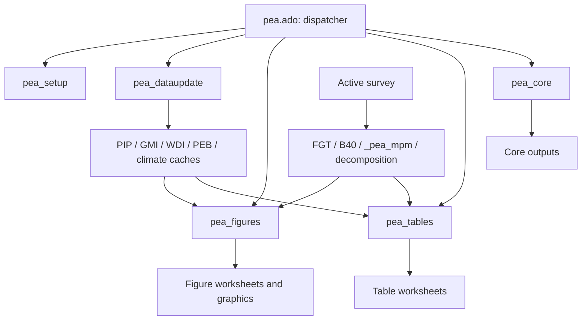
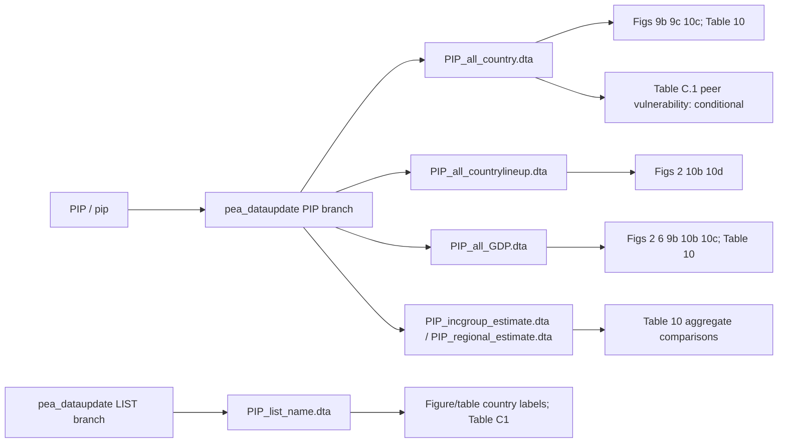
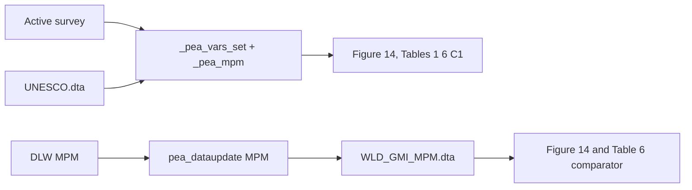
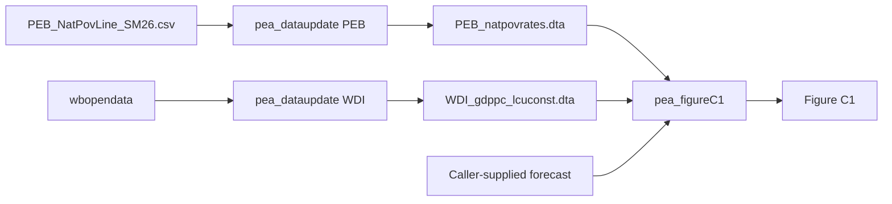
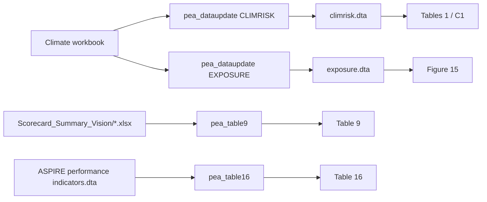
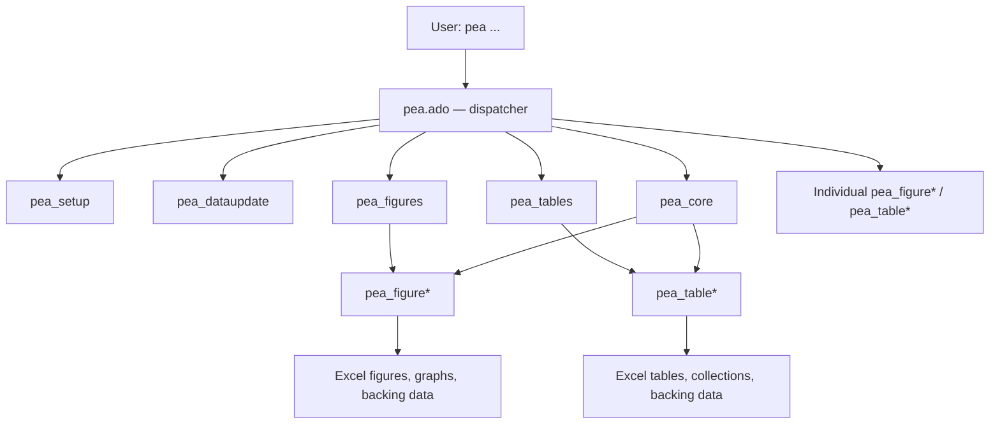
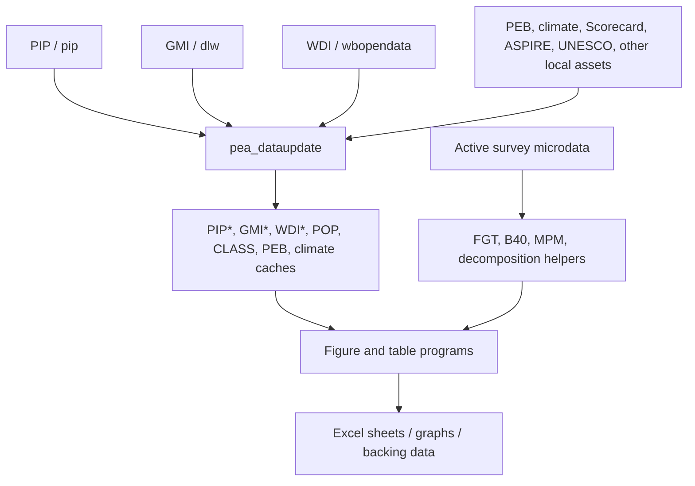

---
{"generated":{"by":"process:build-wbg-okf"},"help_center_commit":"sanitized:3922b3bfe000a87b8aae5305d8d9417ff53718922349db932f5eb85ceef1342d","sources":[{"id":"s-0f94e8f14289d64b-l148","resource":"urn:okf:sanitized:0f94e8f14289d64b7274","sha256":"64ea754b8f9b4eb2fc3cde1cb3ec197a003a3be098b015af29585391f5a31dd1"},{"id":"s-298cd652504181bd-l1","resource":"urn:okf:sanitized:298cd652504181bd4148","sha256":"cf30fd2e12680bf413667db042b3b634522fbcd662762c9aea72f0311c10af71"},{"id":"s-298cd652504181bd-l21","resource":"urn:okf:sanitized:298cd652504181bd4148","sha256":"cf30fd2e12680bf413667db042b3b634522fbcd662762c9aea72f0311c10af71"},{"id":"s-298cd652504181bd-l25","resource":"urn:okf:sanitized:298cd652504181bd4148","sha256":"cf30fd2e12680bf413667db042b3b634522fbcd662762c9aea72f0311c10af71"},{"id":"s-298cd652504181bd-l35","resource":"urn:okf:sanitized:298cd652504181bd4148","sha256":"cf30fd2e12680bf413667db042b3b634522fbcd662762c9aea72f0311c10af71"},{"id":"s-5345176511c133d7-l1","resource":"urn:okf:sanitized:5345176511c133d7c603","sha256":"f69231df8864a99c97e7ac227654ea526a88fc5ce0dd17bf533ff85037f66ba1"},{"id":"s-56c8193a1e6c7f12-l1","resource":"urn:okf:sanitized:56c8193a1e6c7f12f750","sha256":"5b0e4a651df23c1093604dee4918c67d0a048e15bd8bc26f50dd886f5d17ad14"},{"id":"s-5b07dacccacbbe7e-l1","resource":"urn:okf:sanitized:5b07dacccacbbe7e7b73","sha256":"dfa7514bab2a5ede43556e0f278218077de2ef34cafc26c80f0ab28b94131bb4"},{"id":"s-5b07dacccacbbe7e-l21","resource":"urn:okf:sanitized:5b07dacccacbbe7e7b73","sha256":"dfa7514bab2a5ede43556e0f278218077de2ef34cafc26c80f0ab28b94131bb4"},{"id":"s-5b07dacccacbbe7e-l32","resource":"urn:okf:sanitized:5b07dacccacbbe7e7b73","sha256":"dfa7514bab2a5ede43556e0f278218077de2ef34cafc26c80f0ab28b94131bb4"},{"id":"s-5b07dacccacbbe7e-l5","resource":"urn:okf:sanitized:5b07dacccacbbe7e7b73","sha256":"dfa7514bab2a5ede43556e0f278218077de2ef34cafc26c80f0ab28b94131bb4"},{"id":"s-5b07dacccacbbe7e-l50","resource":"urn:okf:sanitized:5b07dacccacbbe7e7b73","sha256":"dfa7514bab2a5ede43556e0f278218077de2ef34cafc26c80f0ab28b94131bb4"},{"id":"s-5b07dacccacbbe7e-l65","resource":"urn:okf:sanitized:5b07dacccacbbe7e7b73","sha256":"dfa7514bab2a5ede43556e0f278218077de2ef34cafc26c80f0ab28b94131bb4"},{"id":"s-5b07dacccacbbe7e-l83","resource":"urn:okf:sanitized:5b07dacccacbbe7e7b73","sha256":"dfa7514bab2a5ede43556e0f278218077de2ef34cafc26c80f0ab28b94131bb4"},{"id":"s-5b07dacccacbbe7e-l88","resource":"urn:okf:sanitized:5b07dacccacbbe7e7b73","sha256":"dfa7514bab2a5ede43556e0f278218077de2ef34cafc26c80f0ab28b94131bb4"},{"id":"s-b48f53b8b1643b19-l1","resource":"urn:okf:sanitized:b48f53b8b1643b195377","sha256":"b4e5df2f642a5260c912c784a0dfd6312010fd843e96d679a3e25635a6d789cc"},{"id":"s-b5496541ea2718ad-l1","resource":"urn:okf:sanitized:b5496541ea2718adb4e1","sha256":"c547c0c598b62de485e78237472c08c86aced8f8c59a93be61e1759f333e96ee"},{"id":"s-f4427d47d4bf8a0e-l1","resource":"urn:okf:sanitized:f4427d47d4bf8a0e030b","sha256":"4e9652d4394a03ef540f72a9c116227afe4a6a66d1715bf059bd777d0f991f49"}],"type":"Reference"}
---

<!-- Retrieval block: text/docs/Stata_package/ANSWERS/00148.md -->
---
{"generated":{"by":"process:build-wbg-okf"},"help_center_commit":"sanitized:3922b3bfe000a87b8aae5305d8d9417ff53718922349db932f5eb85ceef1342d","sources":[{"id":"s-0f94e8f14289d64b-l148","resource":"urn:okf:sanitized:0f94e8f14289d64b7274","sha256":"64ea754b8f9b4eb2fc3cde1cb3ec197a003a3be098b015af29585391f5a31dd1"}],"type":"Reference"}
---

<a id="s-0f94e8f14289d64b-l148"></a>

# Questions country teams ask / 15. Can we merge on year and ignore welfare type or survey name?

Original: `Stata_package/ANSWERS.md:L148-L154`.[^s-0f94e8f14289d64b-l148] Product source: `worldbank/pea@4ec2b06ce63e99771630a8f1e1bb8447cbd6f744`. 

Source context:

# Questions country teams ask

Coverage: **PARTIAL_STATIC**. These answers summarize the ported seed at the [pinned source](../assistant_rules/0001.md#L493-L539), not observed output values. Follow the fuller document for the row, producer and validation boundary.

1. [Why is this row of Table C.1 blank?](0001.md#L201-L233)
2. [Why does my rerun differ from the published table?](0001.md#L236-L282)
3. [Which variables does our country team need to pass?](0001.md#L285-L332)
4. [Where do the peer columns in Table C.1 come from?](0001.md#L335-L382)
5. [Should national poverty and the national number of poor have peer values?](0001.md#L385-L432)
6. [Why does the paid-work row not match our share among workers?](0001.md#L435-L482)
7. [Why is Table 6 MPM different from our local estimate?](0001.md#L485-L532)
8. [We requested 2021 PPP. Why does Figure 14 still mention $2.15?](0001.md#L535-L582)
9. [Why do Figures 10b and 10c show different comparator points?](0001.md#L585-L632)
10. [Why was a comparator exactly three years away excluded?](0001.md#L635-L682)
11. [Why does running through pea_core differ from calling a table directly?](0001.md#L685-L732)
12. [Why does Contents say a figure was produced when the sheet is missing?](0001.md#L735-L782)
13. [Does “vulnerable” mean the same thing in every table?](0001.md#L785-L832)
14. [Are the GDP series in the poverty figures interchangeable?](0001.md#L835-L882)
15. [Can we merge on year and ignore welfare type or survey name?](0001.md#L885-L932)

<a id="q1"></a>

# Questions country teams ask
## 14. Are the GDP series in the poverty figures interchangeable?

## 15. Can we merge on year and ignore welfare type or survey name?

`VERIFIED_STATIC` The source uses different grains: PIP framework joins include country/year/welfare/survey, while the final GMI labor attachment uses code/year. `INFERRED` Omitting a dimension can attach the wrong survey or leave duplicates (P1-02, P1-07, P1-08). `UNVERIFIED` Neither year/rep_year/lineupyear nor welfare_type/welftype/welf_type is interchangeable without a path-specific crosswalk.

**Evidence:** `Stata/plus/p/pea_dataupdate.ado:L463-L475`; `Stata/plus/p/pea_dataupdate.ado:L839-L848`.

**Fuller document:** [Details and checks](0041.md#L176-L202).

[^s-0f94e8f14289d64b-l148]: urn:okf:sanitized:0f94e8f14289d64b7274#L148-L154

<!-- Retrieval block: text/docs/Stata_package/README/00001.md -->
---
{"generated":{"by":"process:build-wbg-okf"},"help_center_commit":"sanitized:3922b3bfe000a87b8aae5305d8d9417ff53718922349db932f5eb85ceef1342d","sources":[{"id":"s-298cd652504181bd-l1","resource":"urn:okf:sanitized:298cd652504181bd4148","sha256":"cf30fd2e12680bf413667db042b3b634522fbcd662762c9aea72f0311c10af71"}],"type":"Reference"}
---

<a id="s-298cd652504181bd-l1"></a>

# PEA Stata package — output navigation

Original: `Stata_package/README.md:L1-L20`.[^s-298cd652504181bd-l1] Product source: `worldbank/pea@4ec2b06ce63e99771630a8f1e1bb8447cbd6f744`. 

# PEA Stata package — output navigation

Coverage: **PARTIAL_STATIC**. Source: `worldbank/pea`, development branch `Package_updates-SEP-30th`, analysed at the commit in [PROVENANCE.md](../assistant_rules/0001.md#L493-L539).

`VERIFIED_STATIC` The package produces PEA table worksheets, figure graphics and backing data from active survey microdata, shared helpers, persisted comparator caches and external inputs. This folder ports the supplied PEA navigation documents into the help-center schema. Start with the output row or figure series, then follow its producer, variables, caches and GMI counterpart.

`UNVERIFIED` No Stata execution, successful workbook production, observed numerical result or physical binary-data schema is certified. Static source evidence establishes code behavior only. The original atlas and diagrams are overviews, not sufficient code-navigation artifacts.

| Need | Start here |
|---|---|
| Ask a country-team question | [Answers](0001.md#L201-L233) |
| Trace a table row or figure series | [Output index](0023.md#L577-L594) |
| Diagnose a blank Table C.1 row | [Table C.1 routes and checks](0004.md#L389-L413) |
| Trace a cache to its producer/consumer | [Source/cache matrix](0002.md#L224-L239) |
| Understand routing and standalone calls | [Workflow](0002.md#L627-L695), [producer reference](0002.md#L745-L762) |
| Check a variable’s identity or coding | [Identifier families](0040.md#L314-L349) |
| Find source-level risks | [All 39 seed issues](../stata_errors/0004.md#L655-L672) |
| Understand boundaries and uncertainty | [Audit scope](../stata_errors/0004.md#L104-L123), [operating rules](0001.md#L6-L23) |
| Review corrected seed claims and citation checks | [Discrepancies](../stata_errors/0006.md#L86-L104), [verification](0023.md#L186-L213) |


[^s-298cd652504181bd-l1]: urn:okf:sanitized:298cd652504181bd4148#L1-L20

<!-- Retrieval block: text/docs/Stata_package/README/00021.md -->
---
{"generated":{"by":"process:build-wbg-okf"},"help_center_commit":"sanitized:3922b3bfe000a87b8aae5305d8d9417ff53718922349db932f5eb85ceef1342d","sources":[{"id":"s-298cd652504181bd-l21","resource":"urn:okf:sanitized:298cd652504181bd4148","sha256":"cf30fd2e12680bf413667db042b3b634522fbcd662762c9aea72f0311c10af71"}],"type":"Reference"}
---

<a id="s-298cd652504181bd-l21"></a>

# PEA Stata package — output navigation / Citation root

Original: `Stata_package/README.md:L21-L24`.[^s-298cd652504181bd-l21] Product source: `worldbank/pea@4ec2b06ce63e99771630a8f1e1bb8447cbd6f744`. 

Source context:

# PEA Stata package — output navigation

Coverage: **PARTIAL_STATIC**. Source: `worldbank/pea`, development branch `Package_updates-SEP-30th`, analysed at the commit in [PROVENANCE.md](../assistant_rules/0001.md#L493-L539).

`VERIFIED_STATIC` The package produces PEA table worksheets, figure graphics and backing data from active survey microdata, shared helpers, persisted comparator caches and external inputs. This folder ports the supplied PEA navigation documents into the help-center schema. Start with the output row or figure series, then follow its producer, variables, caches and GMI counterpart.

`UNVERIFIED` No Stata execution, successful workbook production, observed numerical result or physical binary-data schema is certified. Static source evidence establishes code behavior only. The original atlas and diagrams are overviews, not sufficient code-navigation artifacts.

| Need | Start here |
|---|---|
| Ask a country-team question | [Answers](0001.md#L201-L233) |
| Trace a table row or figure series | [Output index](0023.md#L577-L594) |
| Diagnose a blank Table C.1 row | [Table C.1 routes and checks](0004.md#L389-L413) |
| Trace a cache to its producer/consumer | [Source/cache matrix](0002.md#L224-L239) |
| Understand routing and standalone calls | [Workflow](0002.md#L627-L695), [producer reference](0002.md#L745-L762) |
| Check a variable’s identity or coding | [Identifier families](0040.md#L314-L349) |
| Find source-level risks | [All 39 seed issues](../stata_errors/0004.md#L655-L672) |
| Understand boundaries and uncertainty | [Audit scope](../stata_errors/0004.md#L104-L123), [operating rules](0001.md#L6-L23) |
| Review corrected seed claims and citation checks | [Discrepancies](../stata_errors/0006.md#L86-L104), [verification](0023.md#L186-L213) |


# PEA Stata package — output navigation

## Citation root

Unless its document explicitly states a historical pin, every `*.ado:Lnnn-Lnnn` citation is relative to the root of **worldbank/pea at the analysed commit named in [PROVENANCE.md](../assistant_rules/0001.md#L493-L539)**, not to any path inside this repository. Canonical citations include `Stata/plus/p/`, `Stata/plus/_/` or `Stata/plus/s/`. The preserved discrepancy quotations retain the seed’s original shorthand; their revision is the historical pin stated in that document. Citation ranges prove only the supported source construct, never runtime success.


[^s-298cd652504181bd-l21]: urn:okf:sanitized:298cd652504181bd4148#L21-L24

<!-- Retrieval block: text/docs/Stata_package/README/00025.md -->
---
{"generated":{"by":"process:build-wbg-okf"},"help_center_commit":"sanitized:3922b3bfe000a87b8aae5305d8d9417ff53718922349db932f5eb85ceef1342d","sources":[{"id":"s-298cd652504181bd-l25","resource":"urn:okf:sanitized:298cd652504181bd4148","sha256":"cf30fd2e12680bf413667db042b3b634522fbcd662762c9aea72f0311c10af71"}],"type":"Reference"}
---

<a id="s-298cd652504181bd-l25"></a>

# PEA Stata package — output navigation / Folder spine and coverage

Original: `Stata_package/README.md:L25-L34`.[^s-298cd652504181bd-l25] Product source: `worldbank/pea@4ec2b06ce63e99771630a8f1e1bb8447cbd6f744`. 

Source context:

# PEA Stata package — output navigation

Coverage: **PARTIAL_STATIC**. Source: `worldbank/pea`, development branch `Package_updates-SEP-30th`, analysed at the commit in [PROVENANCE.md](../assistant_rules/0001.md#L493-L539).

`VERIFIED_STATIC` The package produces PEA table worksheets, figure graphics and backing data from active survey microdata, shared helpers, persisted comparator caches and external inputs. This folder ports the supplied PEA navigation documents into the help-center schema. Start with the output row or figure series, then follow its producer, variables, caches and GMI counterpart.

`UNVERIFIED` No Stata execution, successful workbook production, observed numerical result or physical binary-data schema is certified. Static source evidence establishes code behavior only. The original atlas and diagrams are overviews, not sufficient code-navigation artifacts.

| Need | Start here |
|---|---|
| Ask a country-team question | [Answers](0001.md#L201-L233) |
| Trace a table row or figure series | [Output index](0023.md#L577-L594) |
| Diagnose a blank Table C.1 row | [Table C.1 routes and checks](0004.md#L389-L413) |
| Trace a cache to its producer/consumer | [Source/cache matrix](0002.md#L224-L239) |
| Understand routing and standalone calls | [Workflow](0002.md#L627-L695), [producer reference](0002.md#L745-L762) |
| Check a variable’s identity or coding | [Identifier families](0040.md#L314-L349) |
| Find source-level risks | [All 39 seed issues](../stata_errors/0004.md#L655-L672) |
| Understand boundaries and uncertainty | [Audit scope](../stata_errors/0004.md#L104-L123), [operating rules](0001.md#L6-L23) |
| Review corrected seed claims and citation checks | [Discrepancies](../stata_errors/0006.md#L86-L104), [verification](0023.md#L186-L213) |


# PEA Stata package — output navigation
## Citation root

## Folder spine and coverage

This product uses `outputs/` in place of the shared spine’s `indicators/`, because its primary key is a worksheet row or figure series. Dynamic categories/poverty lines remain explicit parameters. `analysis/`, `architecture/`, `variables/` and `maintenance/` hold findings, flow, identity contracts and verification. `index/` and machine-readable `.jsonl` records are deferred; `schemas/` is omitted because [shared conventions](../assistant_rules/0001.md#L62-L125) and the readable output-record fields define this port. No empty placeholder directories are created.

`VERIFIED_STATIC` The seed’s 46 analytical producer entries are retained, including legacy programs. The [pinned declaration inventory](0023.md#L432-L502) records 69 programs, of which 25 are analytical figures and 21 analytical tables. `UNVERIFIED` The seed reports 59 source/data nodes, 124 dictionary entries and 69 producer-specific output families; those fuller inventories were not supplied, so those totals are not claims that this port reconstructed every underlying record.

`VERIFIED_STATIC` Cache paths resolve through `sysdir PERSONAL`; Table C.1 reads GMI peers, conditional PIP vulnerability and focus-country climate through distinct paths. Evidence: `Stata/plus/p/pea_dataupdate.ado:L91-L126`; `Stata/plus/p/pea_tableC1.ado:L201-L221`; `Stata/plus/p/pea_tableC1.ado:L284-L313`; `Stata/plus/p/pea_tableC1.ado:L395-L418`. `INFERRED` A current code checkout can still read older PERSONAL caches; changing a code search path does not rewrite these data paths.

`VERIFIED_STATIC` The update program checks the selected cache’s age and requested release metadata; it is not a universal atomic refresh of every dependency. Evidence: `Stata/plus/p/pea_dataupdate.ado:L113-L154`. See P2-07 and the source/cache matrix before interpreting a rerun.


[^s-298cd652504181bd-l25]: urn:okf:sanitized:298cd652504181bd4148#L25-L34

<!-- Retrieval block: text/docs/Stata_package/README/00035.md -->
---
{"generated":{"by":"process:build-wbg-okf"},"help_center_commit":"sanitized:3922b3bfe000a87b8aae5305d8d9417ff53718922349db932f5eb85ceef1342d","sources":[{"id":"s-298cd652504181bd-l35","resource":"urn:okf:sanitized:298cd652504181bd4148","sha256":"cf30fd2e12680bf413667db042b3b634522fbcd662762c9aea72f0311c10af71"}],"type":"Reference"}
---

<a id="s-298cd652504181bd-l35"></a>

# PEA Stata package — output navigation / Source update — 2026-10-28

Original: `Stata_package/README.md:L35-L37`.[^s-298cd652504181bd-l35] Product source: `worldbank/pea@4ec2b06ce63e99771630a8f1e1bb8447cbd6f744`. 

Source context:

# PEA Stata package — output navigation

Coverage: **PARTIAL_STATIC**. Source: `worldbank/pea`, development branch `Package_updates-SEP-30th`, analysed at the commit in [PROVENANCE.md](../assistant_rules/0001.md#L493-L539).

`VERIFIED_STATIC` The package produces PEA table worksheets, figure graphics and backing data from active survey microdata, shared helpers, persisted comparator caches and external inputs. This folder ports the supplied PEA navigation documents into the help-center schema. Start with the output row or figure series, then follow its producer, variables, caches and GMI counterpart.

`UNVERIFIED` No Stata execution, successful workbook production, observed numerical result or physical binary-data schema is certified. Static source evidence establishes code behavior only. The original atlas and diagrams are overviews, not sufficient code-navigation artifacts.

| Need | Start here |
|---|---|
| Ask a country-team question | [Answers](0001.md#L201-L233) |
| Trace a table row or figure series | [Output index](0023.md#L577-L594) |
| Diagnose a blank Table C.1 row | [Table C.1 routes and checks](0004.md#L389-L413) |
| Trace a cache to its producer/consumer | [Source/cache matrix](0002.md#L224-L239) |
| Understand routing and standalone calls | [Workflow](0002.md#L627-L695), [producer reference](0002.md#L745-L762) |
| Check a variable’s identity or coding | [Identifier families](0040.md#L314-L349) |
| Find source-level risks | [All 39 seed issues](../stata_errors/0004.md#L655-L672) |
| Understand boundaries and uncertainty | [Audit scope](../stata_errors/0004.md#L104-L123), [operating rules](0001.md#L6-L23) |
| Review corrected seed claims and citation checks | [Discrepancies](../stata_errors/0006.md#L86-L104), [verification](0023.md#L186-L213) |


# PEA Stata package — output navigation
## Folder spine and coverage

## Source update — 2026-10-28

Current PEA pin: `4ec2b06ce63e99771630a8f1e1bb8447cbd6f744`. [Changes, resolved issues and limitations](../stata_errors/0006.md#L586-L601). Historical records retain their own source pins.

[^s-298cd652504181bd-l35]: urn:okf:sanitized:298cd652504181bd4148#L35-L37

<!-- Retrieval block: text/docs/Stata_package/architecture/DATA_LINEAGE/00001.md -->
---
{"generated":{"by":"process:build-wbg-okf"},"help_center_commit":"sanitized:3922b3bfe000a87b8aae5305d8d9417ff53718922349db932f5eb85ceef1342d","sources":[{"id":"s-5b07dacccacbbe7e-l1","resource":"urn:okf:sanitized:5b07dacccacbbe7e7b73","sha256":"dfa7514bab2a5ede43556e0f278218077de2ef34cafc26c80f0ab28b94131bb4"}],"type":"Reference"}
---

<a id="s-5b07dacccacbbe7e-l1"></a>

# Bidirectional source/output lineage

Original: `Stata_package/architecture/DATA_LINEAGE.md:L1-L4`.[^s-5b07dacccacbbe7e-l1] Product source: `worldbank/pea@4ec2b06ce63e99771630a8f1e1bb8447cbd6f744`. 

# Bidirectional source/output lineage

`VERIFIED_STATIC` Ported source/cache matrix and reverse program map. Source routes are verified at `97a4659`; expected grains describe source joins, not inspected physical schemas. Corrections and superseded statements are in [the discrepancy record](../stata_errors/0006.md#L86-L104). Start investigations at [outputs/INDEX](0023.md#L577-L594).


[^s-5b07dacccacbbe7e-l1]: urn:okf:sanitized:5b07dacccacbbe7e7b73#L1-L4

<!-- Retrieval block: text/docs/Stata_package/architecture/DATA_LINEAGE/00005.md -->
---
{"generated":{"by":"process:build-wbg-okf"},"help_center_commit":"sanitized:3922b3bfe000a87b8aae5305d8d9417ff53718922349db932f5eb85ceef1342d","sources":[{"id":"s-5b07dacccacbbe7e-l5","resource":"urn:okf:sanitized:5b07dacccacbbe7e7b73","sha256":"dfa7514bab2a5ede43556e0f278218077de2ef34cafc26c80f0ab28b94131bb4"}],"type":"Reference"}
---

<a id="s-5b07dacccacbbe7e-l5"></a>

# Bidirectional source/output lineage / D. Bidirectional lineage

Original: `Stata_package/architecture/DATA_LINEAGE.md:L5-L20`.[^s-5b07dacccacbbe7e-l5] Product source: `worldbank/pea@4ec2b06ce63e99771630a8f1e1bb8447cbd6f744`. 

Source context:

# Bidirectional source/output lineage

`VERIFIED_STATIC` Ported source/cache matrix and reverse program map. Source routes are verified at `97a4659`; expected grains describe source joins, not inspected physical schemas. Corrections and superseded statements are in [the discrepancy record](../stata_errors/0006.md#L86-L104). Start investigations at [outputs/INDEX](0023.md#L577-L594).


# Bidirectional source/output lineage

## D. Bidirectional lineage

### D1. Source → output matrix

| Source/cache | Producer | Key variables or grain | Direct consumers | Final outputs | Evidence | Claim status |
|---|---|---|---|---|---|---|
| Active survey/GMD microdata | Caller; mappings assigned by `_pea_vars_set` | Survey/person/household; year, welfare, weight, demographics | All survey figures/tables | Figures 1, 3–14, 16, C1; Tables 1–8, 10–15, A2, C1 | Child calls: `Stata/plus/p/pea_figures.ado:L163-L453`; `Stata/plus/p/pea_tables.ado:L199-L404`; `Stata/plus/p/pea_core.ado:L212-L316` | `VERIFIED_STATIC` source route; `EXTERNAL_DEPENDENCY` input values/schema |
| `_fgt0_*`, `_fgt1_*`, `_fgt2_*` | `_pea_gen_fgtvars` | Observation × welfare × line | Most poverty figures/tables | Figures 1, 2, 6–8, C1; Tables 1–4, 7, A2, C1 | `_pea_gen_fgtvars.ado`; representative consumption `Stata/plus/p/pea_figure1.ado:L149-L171` | `VERIFIED_STATIC` source route; `EXTERNAL_DEPENDENCY` input values/schema |
| B40/T60 fields | `_pea_gen_b40` | Observation/year | Orchestrators, Table 1 | Table1/TableA1 and dependent distribution summaries | `Stata/plus/p/pea_figures.ado:L150-L150`; `Stata/plus/p/pea_tables.ado:L176-L176`; `Stata/plus/p/pea_core.ado:L189-L189` | `VERIFIED_STATIC` source route; `EXTERNAL_DEPENDENCY` input values/schema |
| `PIP_all_country.dta` | `pea_dataupdate, datatype(PIP)` | Country-year-welfare type-PPP | Figures 9b, 9c, 10c; Tables 10 and C.1 (conditional peer vulnerability) | Cross-country inequality/PG/GDP figures and comparison table | Producer `Stata/plus/p/pea_dataupdate.ado:L384-L490`; Table C.1: `Stata/plus/p/pea_tableC1.ado:L395-L418`; `Stata/plus/p/pea_tableC1.ado:L464-L483`; `Stata/plus/p/pea_tableC1.ado:L535-L558` | `VERIFIED_STATIC` source route; `EXTERNAL_DEPENDENCY` input values/schema |
| `PIP_all_countrylineup.dta` | PIP branch | Country-lineup year-welfare type-PPP | Figures 2, 10b, 10d | Lined-up poverty, PG/GDP, PG histories | `Stata/plus/p/pea_dataupdate.ado:L498-L560`; `Stata/plus/p/pea_figure2.ado:L127-L171` | `VERIFIED_STATIC` source route; `EXTERNAL_DEPENDENCY` input values/schema |
| `PIP_all_GDP.dta` | PIP branch | `code year`, `gdppc` | Figures 2, 6, 9b, 10b, 10c; Table 10 | GDP-poverty, GDP-Gini, GDP-PG products | `Stata/plus/p/pea_dataupdate.ado:L357-L381`; e.g. `Stata/plus/p/pea_figure6.ado:L141-L164` | `VERIFIED_STATIC` source route; `EXTERNAL_DEPENDENCY` input values/schema |
| `PIP_list_name.dta` | LIST branch | Country code, country name, region | Figures 2, 9b, 10b/c/d, 14; Tables 6, 9, 10 | Country labels, region/benchmark grouping | `Stata/plus/p/pea_dataupdate.ado:L227-L244`; e.g. `Stata/plus/p/pea_figure2.ado:L143-L154` | `VERIFIED_STATIC` source route; `EXTERNAL_DEPENDENCY` input values/schema |
| `PIP_incgroup_estimate.dta` | PIP branch | Income group-year-PPP | Table 10 and upstream comparison preparation | Income-group comparison cells | `Stata/plus/p/pea_dataupdate.ado:L562-L669` | `VERIFIED_STATIC` source route; `EXTERNAL_DEPENDENCY` input values/schema |
| `PIP_regional_estimate.dta` | PIP branch | Region-year-PPP | Table 10 and upstream comparison preparation | Regional comparison cells | `Stata/plus/p/pea_dataupdate.ado:L671-L748` | `VERIFIED_STATIC` source route; `EXTERNAL_DEPENDENCY` input values/schema |
| `POP.dta` | POP branch | Country-year population and age-group population | PIP aggregation; GMI/Table C1 preparation | Population-weighted regional/income-group and Table C1 cells | `Stata/plus/p/pea_dataupdate.ado:L304-L334`; `Stata/plus/p/pea_dataupdate.ado:L373-L381` | `VERIFIED_STATIC` source route; `EXTERNAL_DEPENDENCY` input values/schema |

[^s-5b07dacccacbbe7e-l5]: urn:okf:sanitized:5b07dacccacbbe7e7b73#L5-L20

<!-- Retrieval block: text/docs/Stata_package/architecture/DATA_LINEAGE/00021.md -->
---
{"generated":{"by":"process:build-wbg-okf"},"help_center_commit":"sanitized:3922b3bfe000a87b8aae5305d8d9417ff53718922349db932f5eb85ceef1342d","sources":[{"id":"s-5b07dacccacbbe7e-l21","resource":"urn:okf:sanitized:5b07dacccacbbe7e7b73","sha256":"dfa7514bab2a5ede43556e0f278218077de2ef34cafc26c80f0ab28b94131bb4"}],"type":"Reference"}
---

<a id="s-5b07dacccacbbe7e-l21"></a>

# Bidirectional source/output lineage

Original: `Stata_package/architecture/DATA_LINEAGE.md:L21-L31`.[^s-5b07dacccacbbe7e-l21] Product source: `worldbank/pea@4ec2b06ce63e99771630a8f1e1bb8447cbd6f744`. 

Source context:

# Bidirectional source/output lineage

`VERIFIED_STATIC` Ported source/cache matrix and reverse program map. Source routes are verified at `97a4659`; expected grains describe source joins, not inspected physical schemas. Corrections and superseded statements are in [the discrepancy record](../stata_errors/0006.md#L86-L104). Start investigations at [outputs/INDEX](0023.md#L577-L594).


# Bidirectional source/output lineage
## D. Bidirectional lineage
### D1. Source → output matrix
| Source/cache | Producer | Key variables or grain | Direct consumers | Final outputs | Evidence | Claim status |
|---|---|---|---|---|---|---|

| `CLASS.dta` | External/bundled raw input | Country-year classifications | CLASS branch; Table 9 | Classification input / Scorecard regional lookup | `Stata/plus/p/pea_dataupdate.ado:L194-L225`; `Stata/plus/p/pea_table9.ado:L74-L74` | `VERIFIED_STATIC` source route; `EXTERNAL_DEPENDENCY` input values/schema |
| `CLASS_incg_region.dta` | CLASS branch | Country-year derived region/current/historical income groups | PIP and GMI preparation; Figure 15 | Aggregate and climate comparison grouping | `Stata/plus/p/pea_dataupdate.ado:L194-L225`; `Stata/plus/p/pea_figure15.ado:L66-L82` | `VERIFIED_STATIC` source route; `EXTERNAL_DEPENDENCY` input values/schema |
| `Survey_price_framework.dta` | `EXTERNAL_DEPENDENCY`: persisted input, no identified repository writer | Country-reporting-year-welfare-survey selection metadata | GMI branch | Table C.1 GMI selection | `Stata/plus/p/pea_dataupdate.ado:L775-L782` | `VERIFIED_STATIC` source route; `EXTERNAL_DEPENDENCY` input values/schema |
| PIP framework API result | `pip tables, table(framework)` (temporary `pfr`) | Country-year-welfare type-survey | PIP country construction only | Figures 9b/c, 10c; Tables 10, C.1 vulnerability | `Stata/plus/p/pea_dataupdate.ado:L456-L490` | `VERIFIED_STATIC` source route; `EXTERNAL_DEPENDENCY` input values/schema |
| `WLD_GMI_MPM.dta` | MPM/DLW branch | Country-survey-year-PPP/reporting metadata | Figure 14; Table 6; GMI preparation | MPM comparator figures/tables; Table C.1 indirectly | `Stata/plus/p/pea_dataupdate.ado:L165-L175`; `Stata/plus/p/pea_figure14.ado:L79-L128`; `Stata/plus/p/pea_dataupdate.ado:L848-L852` | `VERIFIED_STATIC` source route; `EXTERNAL_DEPENDENCY` input values/schema |
| `GMI_extend_all_country.dta` | GMI branch | Country-year-survey-welfare/reporting grain | Table C1 | Peer poverty, inequality, labor, MPM and climate cells | `Stata/plus/p/pea_dataupdate.ado:L757-L852`; `Stata/plus/p/pea_tableC1.ado:L284-L613` | `VERIFIED_STATIC` source route; `EXTERNAL_DEPENDENCY` input values/schema |
| UNESCO cache | UNESCO branch | Country/official primary-age metadata | `_pea_mpm` | Local MPM in Figure 14 and Tables 1, 6, C1 | `Stata/plus/p/pea_dataupdate.ado:L188-L192`; `Stata/plus/_/_pea_mpm.ado:L70-L80` | `VERIFIED_STATIC` source route; `EXTERNAL_DEPENDENCY` input values/schema |
| `climrisk.dta` | CLIMRISK branch | Country; risk percentages | Tables 1 and C.1 focus-country; GMI preparation | `atrisk`/climate cells | `Stata/plus/p/pea_dataupdate.ado:L278-L289`; `Stata/plus/p/pea_table1.ado:L226-L244`; `Stata/plus/p/pea_tableC1.ado:L201-L221`; `Stata/plus/p/pea_dataupdate.ado:L850-L852` | `VERIFIED_STATIC` source route; `EXTERNAL_DEPENDENCY` input values/schema |
| `exposure.dta` | EXPOSURE branch | Country/year; exposure fractions | Figure 15 | Country/region climate exposure comparison | `Stata/plus/p/pea_dataupdate.ado:L291-L302`; `Stata/plus/p/pea_figure15.ado:L39-L103` | `VERIFIED_STATIC` source route; `EXTERNAL_DEPENDENCY` input values/schema |
| PEB cache | PEB branch | Country-year poverty/comparability | Figure C1 | Historical national poverty series | `Stata/plus/p/pea_dataupdate.ado:L246-L254`; `Stata/plus/p/pea_figureC1.ado:L154-L163` | `VERIFIED_STATIC` source route; `EXTERNAL_DEPENDENCY` input values/schema |
| WDI cache | WDI branch / `wbopendata` | Country-year GDP per capita | Figure C1 | Historical GDP series | `Stata/plus/p/pea_dataupdate.ado:L261-L276`; `Stata/plus/p/pea_figureC1.ado:L164-L177` | `VERIFIED_STATIC` source route; `EXTERNAL_DEPENDENCY` input values/schema |

[^s-5b07dacccacbbe7e-l21]: urn:okf:sanitized:5b07dacccacbbe7e7b73#L21-L31

<!-- Retrieval block: text/docs/Stata_package/architecture/DATA_LINEAGE/00032.md -->
---
{"generated":{"by":"process:build-wbg-okf"},"help_center_commit":"sanitized:3922b3bfe000a87b8aae5305d8d9417ff53718922349db932f5eb85ceef1342d","sources":[{"id":"s-5b07dacccacbbe7e-l32","resource":"urn:okf:sanitized:5b07dacccacbbe7e7b73","sha256":"dfa7514bab2a5ede43556e0f278218077de2ef34cafc26c80f0ab28b94131bb4"}],"type":"Reference"}
---

<a id="s-5b07dacccacbbe7e-l32"></a>

# Bidirectional source/output lineage / D2. Output → source index for all 46 analytical programs

Original: `Stata_package/architecture/DATA_LINEAGE.md:L32-L49`.[^s-5b07dacccacbbe7e-l32] Product source: `worldbank/pea@4ec2b06ce63e99771630a8f1e1bb8447cbd6f744`. 

Source context:

# Bidirectional source/output lineage

`VERIFIED_STATIC` Ported source/cache matrix and reverse program map. Source routes are verified at `97a4659`; expected grains describe source joins, not inspected physical schemas. Corrections and superseded statements are in [the discrepancy record](../stata_errors/0006.md#L86-L104). Start investigations at [outputs/INDEX](0023.md#L577-L594).


# Bidirectional source/output lineage
## D. Bidirectional lineage
### D1. Source → output matrix
| Source/cache | Producer | Key variables or grain | Direct consumers | Final outputs | Evidence | Claim status |
|---|---|---|---|---|---|---|

| `ASPIRE performance indicators.dta` | `EXTERNAL_DEPENDENCY`: supplied input; no identified local producer | Country-year-indicator | Table 16 | Social-protection coverage/adequacy table | `Stata/plus/p/pea_table16.ado:L47-L145` | `VERIFIED_STATIC` source route; `EXTERNAL_DEPENDENCY` input values/schema |
| `Scorecard_Summary_Vision/*.xlsx` | External/bundled Scorecard workbooks | Country/year/indicator/value | Table 9 | Country/region inequality comparison | `Stata/plus/p/pea_table9.ado:L27-L30`; `Stata/plus/p/pea_table9.ado:L86-L178` | `VERIFIED_STATIC` source route; `EXTERNAL_DEPENDENCY` input values/schema |

### D2. Output → source index for all 46 analytical programs

| Program | Indicator/output family | Original data and calculation | Primary evidence | Claim status |
|---|---|---|---|---|
| `pea_figure1` | Poverty-rate trends | Survey FGT0 by year/comparability and optional urban group | `Stata/plus/p/pea_figure1.ado:L38-L38`; `Stata/plus/p/pea_figure1.ado:L149-L171`; `Stata/plus/p/pea_figure1.ado:L248-L320` | `VERIFIED_STATIC` source route; `EXTERNAL_DEPENDENCY` input values/schema |
| `pea_figure2` | Poverty vs GDP | Local survey FGT0 + PIP lined-up poverty/GDP/list | `Stata/plus/p/pea_figure2.ado:L120-L171`; `Stata/plus/p/pea_figure2.ado:L245-L299` | `VERIFIED_STATIC` source route; `EXTERNAL_DEPENDENCY` input values/schema |
| `pea_figure3a` | GIC by requested groups | Survey percentile welfare; annualized endpoint growth | `Stata/plus/p/pea_figure3a.ado:L345-L563`; `Stata/plus/p/pea_figure3a.ado:L608-L719` | `VERIFIED_STATIC` source route; `EXTERNAL_DEPENDENCY` input values/schema |
| `pea_figure3b` | GIC by urban/rural | Same percentile method, split by `by()` | `Stata/plus/p/pea_figure3b.ado:L134-L186`; `Stata/plus/p/pea_figure3b.ado:L241-L283` | `VERIFIED_STATIC` source route; `EXTERNAL_DEPENDENCY` input values/schema |
| `pea_figure4` | Datt–Ravallion/Shorrocks decompositions | Survey + external `drdecomp`/`skdecomp` | `Stata/plus/p/pea_figure4.ado:L147-L213`; `Stata/plus/p/pea_figure4.ado:L237-L311` | `VERIFIED_STATIC` source route; `EXTERNAL_DEPENDENCY` input values/schema |
| `pea_figure5a` | Huppi–Ravallion, urban/rural | Survey + local `sedecomposition` | `Stata/plus/p/pea_figure5a.ado:L147-L229`; `Stata/plus/p/pea_figure5a.ado:L261-L295` | `VERIFIED_STATIC` source route; `EXTERNAL_DEPENDENCY` input values/schema |
| `pea_figure5b` | Huppi–Ravallion, industry | Survey; household-head sector + `sedecomposition` | `Stata/plus/p/pea_figure5b.ado:L73-L75`; `Stata/plus/p/pea_figure5b.ado:L156-L240`; `Stata/plus/p/pea_figure5b.ado:L272-L305` | `VERIFIED_STATIC` source route; `EXTERNAL_DEPENDENCY` input values/schema |
| `pea_figure6` | Poverty/GDP growth elasticity | Survey FGT0 + PIP GDP; annualized growth ratios | `Stata/plus/p/pea_figure6.ado:L141-L190`; `Stata/plus/p/pea_figure6.ado:L243-L269` | `VERIFIED_STATIC` source route; `EXTERNAL_DEPENDENCY` input values/schema |
| `pea_figure7a` | Share of poor vs population | Survey FGT0 and weight totals by demographic group | `Stata/plus/p/pea_figure7a.ado:L103-L137`; `Stata/plus/p/pea_figure7a.ado:L153-L176` | `VERIFIED_STATIC` source route; `EXTERNAL_DEPENDENCY` input values/schema |
| `pea_figure7b` | Group poverty rates | Survey FGT0 by demographic group | `Stata/plus/p/pea_figure7b.ado:L105-L135`; `Stata/plus/p/pea_figure7b.ado:L152-L173` | `VERIFIED_STATIC` source route; `EXTERNAL_DEPENDENCY` input values/schema |
| `pea_figure8` | Age-sex poverty profiles | Latest survey, weighted FGT0 | `Stata/plus/p/pea_figure8.ado:L47-L57`; `Stata/plus/p/pea_figure8.ado:L103-L207` | `VERIFIED_STATIC` source route; `EXTERNAL_DEPENDENCY` input values/schema |

[^s-5b07dacccacbbe7e-l32]: urn:okf:sanitized:5b07dacccacbbe7e7b73#L32-L49

<!-- Retrieval block: text/docs/Stata_package/architecture/DATA_LINEAGE/00050.md -->
---
{"generated":{"by":"process:build-wbg-okf"},"help_center_commit":"sanitized:3922b3bfe000a87b8aae5305d8d9417ff53718922349db932f5eb85ceef1342d","sources":[{"id":"s-5b07dacccacbbe7e-l50","resource":"urn:okf:sanitized:5b07dacccacbbe7e7b73","sha256":"dfa7514bab2a5ede43556e0f278218077de2ef34cafc26c80f0ab28b94131bb4"}],"type":"Reference"}
---

<a id="s-5b07dacccacbbe7e-l50"></a>

# Bidirectional source/output lineage

Original: `Stata_package/architecture/DATA_LINEAGE.md:L50-L64`.[^s-5b07dacccacbbe7e-l50] Product source: `worldbank/pea@4ec2b06ce63e99771630a8f1e1bb8447cbd6f744`. 

Source context:

# Bidirectional source/output lineage

`VERIFIED_STATIC` Ported source/cache matrix and reverse program map. Source routes are verified at `97a4659`; expected grains describe source joins, not inspected physical schemas. Corrections and superseded statements are in [the discrepancy record](../stata_errors/0006.md#L86-L104). Start investigations at [outputs/INDEX](0023.md#L577-L594).


# Bidirectional source/output lineage
## D. Bidirectional lineage
### D2. Output → source index for all 46 analytical programs
| Program | Indicator/output family | Original data and calculation | Primary evidence | Claim status |
|---|---|---|---|---|

| `pea_figure9a` | Gini/Theil/Palma/top-20 | Survey, `_ebin`, `ineqdeco` | `Stata/plus/p/pea_figure9a.ado:L109-L167`; `Stata/plus/p/pea_figure9a.ado:L208-L287` | `VERIFIED_STATIC` source route; `EXTERNAL_DEPENDENCY` input values/schema |
| `pea_figure9b` | Gini vs GDP | Local Gini + PIP country/GDP/list | `Stata/plus/p/pea_figure9b.ado:L105-L164`; `Stata/plus/p/pea_figure9b.ado:L229-L304` | `VERIFIED_STATIC` source route; `EXTERNAL_DEPENDENCY` input values/schema |
| `pea_figure9c` | Gini ranking | Local Gini + PIP nearest-year country estimates | `Stata/plus/p/pea_figure9c.ado:L105-L161`; `Stata/plus/p/pea_figure9c.ado:L174-L236` | `VERIFIED_STATIC` source route; `EXTERNAL_DEPENDENCY` input values/schema |
| `pea_figure9d` | Welfare percentiles | Survey p10/p25/p50/p75/p90 | `Stata/plus/p/pea_figure9d.ado:L80-L120`; `Stata/plus/p/pea_figure9d.ado:L123-L182` | `VERIFIED_STATIC` source route; `EXTERNAL_DEPENDENCY` input values/schema |
| `pea_figure10a` | Prosperity-gap trends | Survey mean `prosgline/floored welfare` | `Stata/plus/p/pea_figure10a.ado:L66-L119`; `Stata/plus/p/pea_figure10a.ado:L198-L230` | `VERIFIED_STATIC` source route; `EXTERNAL_DEPENDENCY` input values/schema |
| `pea_figure10b` | Lined-up PG vs GDP | Local PG + PIP lineup/GDP/list | `Stata/plus/p/pea_figure10b.ado:L86-L147`; `Stata/plus/p/pea_figure10b.ado:L247-L272` | `VERIFIED_STATIC` source route; `EXTERNAL_DEPENDENCY` input values/schema |
| `pea_figure10c` | Nearest-year PG vs GDP | Local PG + PIP country/GDP/list | `Stata/plus/p/pea_figure10c.ado:L93-L152`; `Stata/plus/p/pea_figure10c.ado:L218-L276` | `VERIFIED_STATIC` source route; `EXTERNAL_DEPENDENCY` input values/schema |
| `pea_figure10d` | Historical PG | Local PG + PIP lineup, fixed 20-year window | `Stata/plus/p/pea_figure10d.ado:L86-L168`; `Stata/plus/p/pea_figure10d.ado:L192-L217` | `VERIFIED_STATIC` source route; `EXTERNAL_DEPENDENCY` input values/schema |
| `pea_figure12` | PG-change decomposition | Survey mean-welfare and inequality-ratio log changes | `Stata/plus/p/pea_figure12.ado:L124-L212`; `Stata/plus/p/pea_figure12.ado:L252-L258` | `VERIFIED_STATIC` source route; `EXTERNAL_DEPENDENCY` input values/schema |
| `pea_figure13` | Welfare shares by decile | Survey weighted welfare sums | `Stata/plus/p/pea_figure13.ado:L48-L133`; `Stata/plus/p/pea_figure13.ado:L148-L229` | `VERIFIED_STATIC` source route; `EXTERNAL_DEPENDENCY` input values/schema |
| `pea_figure14` | MPM components/comparators | Local `_pea_mpm` + `WLD_GMI_MPM.dta` | `Stata/plus/p/pea_figure14.ado:L71-L146`; `Stata/plus/p/pea_figure14.ado:L149-L336` | `VERIFIED_STATIC` source route; `EXTERNAL_DEPENDENCY` input values/schema |
| `pea_figure15` | Climate exposure | `exposure.dta` + `CLASS.dta` | `Stata/plus/p/pea_figure15.ado:L37-L103`; `Stata/plus/p/pea_figure15.ado:L104-L141` | `VERIFIED_STATIC` source route; `EXTERNAL_DEPENDENCY` input values/schema |
| `pea_figure16` | Poor household typologies | Latest survey, household composition and work counts | `Stata/plus/p/pea_figure16.ado:L69-L220`; `Stata/plus/p/pea_figure16.ado:L261-L326` | `VERIFIED_STATIC` source route; `EXTERNAL_DEPENDENCY` input values/schema |
| `pea_figureC1` | Poverty/GDP history and forecasts | Survey + PEB + WDI + caller forecasts | `Stata/plus/p/pea_figureC1.ado:L70-L177`; `Stata/plus/p/pea_figureC1.ado:L235-L329` | `VERIFIED_STATIC` source route; `EXTERNAL_DEPENDENCY` input values/schema |
| `pea_table1` | Headline poverty/welfare | Survey + MPM + climate; optional survey SE | `Stata/plus/p/pea_table1.ado:L112-L290`; `Stata/plus/p/pea_table1.ado:L366-L398` | `VERIFIED_STATIC` source route; `EXTERNAL_DEPENDENCY` input values/schema |

[^s-5b07dacccacbbe7e-l50]: urn:okf:sanitized:5b07dacccacbbe7e7b73#L50-L64

<!-- Retrieval block: text/docs/Stata_package/architecture/DATA_LINEAGE/00065.md -->
---
{"generated":{"by":"process:build-wbg-okf"},"help_center_commit":"sanitized:3922b3bfe000a87b8aae5305d8d9417ff53718922349db932f5eb85ceef1342d","sources":[{"id":"s-5b07dacccacbbe7e-l65","resource":"urn:okf:sanitized:5b07dacccacbbe7e7b73","sha256":"dfa7514bab2a5ede43556e0f278218077de2ef34cafc26c80f0ab28b94131bb4"}],"type":"Reference"}
---

<a id="s-5b07dacccacbbe7e-l65"></a>

# Bidirectional source/output lineage

Original: `Stata_package/architecture/DATA_LINEAGE.md:L65-L82`.[^s-5b07dacccacbbe7e-l65] Product source: `worldbank/pea@4ec2b06ce63e99771630a8f1e1bb8447cbd6f744`. 

Source context:

# Bidirectional source/output lineage

`VERIFIED_STATIC` Ported source/cache matrix and reverse program map. Source routes are verified at `97a4659`; expected grains describe source joins, not inspected physical schemas. Corrections and superseded statements are in [the discrepancy record](../stata_errors/0006.md#L86-L104). Start investigations at [outputs/INDEX](0023.md#L577-L594).


# Bidirectional source/output lineage
## D. Bidirectional lineage
### D2. Output → source index for all 46 analytical programs
| Program | Indicator/output family | Original data and calculation | Primary evidence | Claim status |
|---|---|---|---|---|

| `pea_table1_std` | Legacy headline table | Survey, mandatory survey-SE path | `Stata/plus/p/pea_table1_std.ado:L154-L242`; `Stata/plus/p/pea_table1_std.ado:L384-L434` | `VERIFIED_STATIC` source route; `EXTERNAL_DEPENDENCY` input values/schema |
| `pea_table2` | Subgroup poverty | Survey FGT/population aggregation | `Stata/plus/p/pea_table2.ado:L124-L237` | `VERIFIED_STATIC` source route; `EXTERNAL_DEPENDENCY` input values/schema |
| `pea_table3` | Demographic poverty | Survey FGT by sex/age/education/head status | `Stata/plus/p/pea_table3.ado:L104-L362` | `VERIFIED_STATIC` source route; `EXTERNAL_DEPENDENCY` input values/schema |
| `pea_table4` | Household profiles | Survey characteristics by poor/nonpoor/total | `Stata/plus/p/pea_table4.ado:L95-L397` | `VERIFIED_STATIC` source route; `EXTERNAL_DEPENDENCY` input values/schema |
| `pea_table5` | Labor profile | Latest survey labor/status indicators | `Stata/plus/p/pea_table5.ado:L53-L187`; `Stata/plus/p/pea_table5.ado:L216-L241` | `VERIFIED_STATIC` source route; `EXTERNAL_DEPENDENCY` input values/schema |
| `pea_table6` | MPM comparison | Local `_pea_mpm` + cached GMI MPM | `Stata/plus/p/pea_table6.ado:L47-L188` | `VERIFIED_STATIC` source route; `EXTERNAL_DEPENDENCY` input values/schema |
| `pea_table7` | Vulnerability profiles | Survey interval vulnerability | `Stata/plus/p/pea_table7.ado:L115-L222` | `VERIFIED_STATIC` source route; `EXTERNAL_DEPENDENCY` input values/schema |
| `pea_table8` | Inequality indices | Survey deciles + external `ineqdeco` | `Stata/plus/p/pea_table8.ado:L103-L215` | `VERIFIED_STATIC` source route; `EXTERNAL_DEPENDENCY` input values/schema |
| `pea_table9` | Scorecard inequality | Scorecard workbooks + PIP names + CLASS | `Stata/plus/p/pea_table9.ado:L27-L178` | `VERIFIED_STATIC` source route; `EXTERNAL_DEPENDENCY` input values/schema |
| `pea_table10` | Country/peer indicators | Local survey + PIP country/GDP/list/classification | `Stata/plus/p/pea_table10.ado:L53-L353` | `VERIFIED_STATIC` source route; `EXTERNAL_DEPENDENCY` input values/schema |
| `pea_table11` | GIC table/graphs | Survey percentile welfare growth | `Stata/plus/p/pea_table11.ado:L113-L254` | `VERIFIED_STATIC` source route; `EXTERNAL_DEPENDENCY` input values/schema |
| `pea_table12` | Poverty decomposition | Survey + external `drdecomp`/`skdecomp` | `Stata/plus/p/pea_table12.ado:L137-L253` | `VERIFIED_STATIC` source route; `EXTERNAL_DEPENDENCY` input values/schema |
| `pea_table13a` | Sector decomposition | Survey urban/rural + local `sedecomposition` | `Stata/plus/p/pea_table13a.ado:L155-L272` | `VERIFIED_STATIC` source route; `EXTERNAL_DEPENDENCY` input values/schema |
| `pea_table13b` | Industry decomposition | Survey head-industry + local `sedecomposition` | `Stata/plus/p/pea_table13b.ado:L89-L93`; `Stata/plus/p/pea_table13b.ado:L158-L280` | `VERIFIED_STATIC` source route; `EXTERNAL_DEPENDENCY` input values/schema |
| `pea_table14` | Household typologies | Survey demographic/economic groups | `Stata/plus/p/pea_table14.ado:L104-L315` | `VERIFIED_STATIC` source route; `EXTERNAL_DEPENDENCY` input values/schema |
| `pea_table15` | Decile welfare shares | Survey weighted welfare sums | `Stata/plus/p/pea_table15.ado:L36-L107` | `VERIFIED_STATIC` source route; `EXTERNAL_DEPENDENCY` input values/schema |
| `pea_table16` | Social protection | ASPIRE cache | `Stata/plus/p/pea_table16.ado:L47-L145` | `VERIFIED_STATIC` source route; `EXTERNAL_DEPENDENCY` input values/schema |
| `pea_tableA2` | Detailed subgroup poverty | Survey FGT, population, subgroup fields | `Stata/plus/p/pea_tableA2.ado:L128-L268` | `VERIFIED_STATIC` source route; `EXTERNAL_DEPENDENCY` input values/schema |

[^s-5b07dacccacbbe7e-l65]: urn:okf:sanitized:5b07dacccacbbe7e7b73#L65-L82

<!-- Retrieval block: text/docs/Stata_package/architecture/DATA_LINEAGE/00083.md -->
---
{"generated":{"by":"process:build-wbg-okf"},"help_center_commit":"sanitized:3922b3bfe000a87b8aae5305d8d9417ff53718922349db932f5eb85ceef1342d","sources":[{"id":"s-5b07dacccacbbe7e-l83","resource":"urn:okf:sanitized:5b07dacccacbbe7e7b73","sha256":"dfa7514bab2a5ede43556e0f278218077de2ef34cafc26c80f0ab28b94131bb4"}],"type":"Reference"}
---

<a id="s-5b07dacccacbbe7e-l83"></a>

# Bidirectional source/output lineage

Original: `Stata_package/architecture/DATA_LINEAGE.md:L83-L87`.[^s-5b07dacccacbbe7e-l83] Product source: `worldbank/pea@4ec2b06ce63e99771630a8f1e1bb8447cbd6f744`. 

Source context:

# Bidirectional source/output lineage

`VERIFIED_STATIC` Ported source/cache matrix and reverse program map. Source routes are verified at `97a4659`; expected grains describe source joins, not inspected physical schemas. Corrections and superseded statements are in [the discrepancy record](../stata_errors/0006.md#L86-L104). Start investigations at [outputs/INDEX](0023.md#L577-L594).


# Bidirectional source/output lineage
## D. Bidirectional lineage
### D2. Output → source index for all 46 analytical programs
| Program | Indicator/output family | Original data and calculation | Primary evidence | Claim status |
|---|---|---|---|---|

| `pea_table_A2_std` | Legacy detailed poverty | Survey; SE code commented out | `Stata/plus/p/pea_table_A2_std.ado:L116-L170`; `Stata/plus/p/pea_table_A2_std.ado:L250-L265` | `VERIFIED_STATIC` source route; `EXTERNAL_DEPENDENCY` input values/schema |
| `pea_tableC1` | Country diagnostics/peers | Survey + MPM + GMI + PIP + climate | `Stata/plus/p/pea_tableC1.ado:L145-L766` | `VERIFIED_STATIC` source route; `EXTERNAL_DEPENDENCY` input values/schema |

---


[^s-5b07dacccacbbe7e-l83]: urn:okf:sanitized:5b07dacccacbbe7e7b73#L83-L87

<!-- Retrieval block: text/docs/Stata_package/architecture/DATA_LINEAGE/00088.md -->
---
{"generated":{"by":"process:build-wbg-okf"},"help_center_commit":"sanitized:3922b3bfe000a87b8aae5305d8d9417ff53718922349db932f5eb85ceef1342d","sources":[{"id":"s-5b07dacccacbbe7e-l88","resource":"urn:okf:sanitized:5b07dacccacbbe7e7b73","sha256":"dfa7514bab2a5ede43556e0f278218077de2ef34cafc26c80f0ab28b94131bb4"}],"type":"Reference"}
---

<a id="s-5b07dacccacbbe7e-l88"></a>

# Bidirectional source/output lineage / Updated dependency boundary

Original: `Stata_package/architecture/DATA_LINEAGE.md:L88-L90`.[^s-5b07dacccacbbe7e-l88] Product source: `worldbank/pea@4ec2b06ce63e99771630a8f1e1bb8447cbd6f744`. 

Source context:

# Bidirectional source/output lineage

`VERIFIED_STATIC` Ported source/cache matrix and reverse program map. Source routes are verified at `97a4659`; expected grains describe source joins, not inspected physical schemas. Corrections and superseded statements are in [the discrepancy record](../stata_errors/0006.md#L86-L104). Start investigations at [outputs/INDEX](0023.md#L577-L594).


# Bidirectional source/output lineage
## D. Bidirectional lineage
### D2. Output → source index for all 46 analytical programs

## Updated dependency boundary

`VERIFIED_STATIC` The POP writer now creates the intended `pop_1564` field. PIP reads POP at `Stata/plus/p/pea_dataupdate.ado:L374-L381` and GMI at `Stata/plus/p/pea_dataupdate.ado:L771-L774`. Existing recursive update failures can still be captured; a successful source fix does not prove a fresh cache. Two binary files were added: `Stata/personal/pea/SM2025/ASPIRE performance indicators.dta` and `Stata/personal/pea/exposure_vulnerability_2021.dta`. The unchanged Table 16 reader expects PERSONAL `pea/ASPIRE performance indicators.dta` without SM2025 (`Stata/plus/p/pea_table16.ado:L48-L55`); EXPOSURE still reads the climate workbook (`Stata/plus/p/pea_dataupdate.ado:L292-L302`). No direct reader of the new exposure filename was found. `UNVERIFIED` Dataset contents, deployment/copy steps and cache freshness were not tested.

[^s-5b07dacccacbbe7e-l88]: urn:okf:sanitized:5b07dacccacbbe7e7b73#L88-L90

<!-- Retrieval block: text/docs/Stata_package/architecture/PEA_Architecture_Mermaid/00001.md -->
---
{"generated":{"by":"process:build-wbg-okf"},"help_center_commit":"sanitized:3922b3bfe000a87b8aae5305d8d9417ff53718922349db932f5eb85ceef1342d","sources":[{"id":"s-f4427d47d4bf8a0e-l1","resource":"urn:okf:sanitized:f4427d47d4bf8a0e030b","sha256":"4e9652d4394a03ef540f72a9c116227afe4a6a66d1715bf059bd777d0f991f49"}],"type":"Reference"}
---

<a id="s-f4427d47d4bf8a0e-l1"></a>

# PEA Stata architecture — editable Mermaid source

Original: `Stata_package/architecture/PEA_Architecture_Mermaid.md:L1-L70`.[^s-f4427d47d4bf8a0e-l1] Product source: `worldbank/pea@4ec2b06ce63e99771630a8f1e1bb8447cbd6f744`. 

# PEA Stata architecture — editable Mermaid source

`VERIFIED_STATIC` Source-flow summary ported from the seed, with lineage corrections at `97a4659`. Arrows describe source reads/calls; input contents and external implementations are `EXTERNAL_DEPENDENCY`. See [lineage evidence](0002.md#L224-L239) and [discrepancies](../stata_errors/0006.md#L86-L104).

## Overall execution


## PIP direct consumers


## MPM paths — not interchangeable


## Figure C1


## Specialized outputs


[^s-f4427d47d4bf8a0e-l1]: urn:okf:sanitized:f4427d47d4bf8a0e030b#L1-L70

<!-- Retrieval block: text/docs/Stata_package/architecture/README/00001.md -->
---
{"generated":{"by":"process:build-wbg-okf"},"help_center_commit":"sanitized:3922b3bfe000a87b8aae5305d8d9417ff53718922349db932f5eb85ceef1342d","sources":[{"id":"s-5345176511c133d7-l1","resource":"urn:okf:sanitized:5345176511c133d7c603","sha256":"f69231df8864a99c97e7ac227654ea526a88fc5ce0dd17bf533ff85037f66ba1"}],"type":"Reference"}
---

<a id="s-5345176511c133d7-l1"></a>

# Execution, caches and producer reference

Original: `Stata_package/architecture/README.md:L1-L18`.[^s-5345176511c133d7-l1] Product source: `worldbank/pea@4ec2b06ce63e99771630a8f1e1bb8447cbd6f744`. 

# Execution, caches and producer reference

| Need | Document |
|---|---|
| Dispatcher and orchestrators | [WORKFLOW](0002.md#L627-L695) |
| Persisted caches, inputs and output reverse lineage | [DATA_LINEAGE](0002.md#L224-L239) |
| Detailed seed producer narratives | [Program reference](0002.md#L745-L762) |
| Table C.1 local/peer paths and intermediates | [Table C.1](0004.md#L389-L413) |
| Editable text architecture diagrams | [Mermaid](0002.md#L511-L592) |
| Human editing diagram | [draw.io](../../../deployment.md) |

`UNVERIFIED` The draw.io file is copied unchanged from the seed. It is a **diagram for humans, not navigation**; its embedded claims are not individually refreshed. Use the corrected text lineage and source citations for investigations. The Mermaid text preserves the seed diagrams with documented source-lineage corrections.

`VERIFIED_STATIC` Source citations use the upstream commit in [PROVENANCE](../assistant_rules/0001.md#L493-L539). The help center contains documentation only, not the upstream Stata source or input data.

## Source update — 2026-10-28

Current PEA pin: `4ec2b06ce63e99771630a8f1e1bb8447cbd6f744`. [Changes, resolved issues and limitations](../stata_errors/0006.md#L586-L601). Historical records retain their own source pins.

[^s-5345176511c133d7-l1]: urn:okf:sanitized:5345176511c133d7c603#L1-L18

<!-- Retrieval block: text/docs/Stata_package/architecture/WORKFLOW/00001.md -->
---
{"generated":{"by":"process:build-wbg-okf"},"help_center_commit":"sanitized:3922b3bfe000a87b8aae5305d8d9417ff53718922349db932f5eb85ceef1342d","sources":[{"id":"s-b5496541ea2718ad-l1","resource":"urn:okf:sanitized:b5496541ea2718adb4e1","sha256":"c547c0c598b62de485e78237472c08c86aced8f8c59a93be61e1759f333e96ee"}],"type":"Reference"}
---

<a id="s-b5496541ea2718ad-l1"></a>

# Execution and data workflow

Original: `Stata_package/architecture/WORKFLOW.md:L1-L57`.[^s-b5496541ea2718ad-l1] Product source: `worldbank/pea@4ec2b06ce63e99771630a8f1e1bb8447cbd6f744`. 

# Execution and data workflow

`VERIFIED_STATIC` `VERIFIED_STATIC` Routing and cache-flow diagrams describe source calls, not successful execution. See [cache lineage](0002.md#L224-L239), [producer reference](0002.md#L745-L762), and [discrepancies](../stata_errors/0006.md#L86-L104).

## 1. Command routing



## 2. Source and cache flow



`VERIFIED_STATIC` **Do not infer every bundled source is refreshed by `pea_dataupdate`:** ASPIRE and some other assets have no identified repository-local producer.

## 3. Key paths

- `VERIFIED_STATIC` `Stata/plus/p/pea.ado`: entry dispatcher
- `VERIFIED_STATIC` `Stata/plus/p/pea_dataupdate.ado`: external/bundled source and cache preparation
- `VERIFIED_STATIC` `Stata/plus/p/pea_figures.ado`, `pea_tables.ado`, `pea_core.ado`: orchestrators
- `VERIFIED_STATIC` `Stata/plus/p/pea_figure*.ado`, `pea_table*.ado`: output implementations
- `VERIFIED_STATIC` `Stata/plus/_/_pea_*.ado`: shared helpers
- `VERIFIED_STATIC` `Stata/plus/s/sedecomposition.ado`: repository-local sector decomposition
- `VERIFIED_STATIC` `Stata/personal/pea/`: reported cache/bundled asset location

## 4. Cross-cutting propagation concern

`VERIFIED_STATIC` The audit reports that orchestrators accept `[if] [in] [aw pw fw]` but can omit caller `if/in` when invoking children and pass weights as analytic weights. Evidence: `Stata/plus/p/pea_figures.ado:L30-L30`; `Stata/plus/p/pea_figures.ado:L107-L120`; `Stata/plus/p/pea_figures.ado:L163-L453`, `Stata/plus/p/pea_tables.ado:L37-L37`; `Stata/plus/p/pea_tables.ado:L136-L153`; `Stata/plus/p/pea_tables.ado:L199-L404`, `Stata/plus/p/pea_core.ado:L46-L46`; `Stata/plus/p/pea_core.ado:L143-L161`; `Stata/plus/p/pea_core.ado:L189-L316`. This is a source-level finding, not a measured runtime result.

## Updated dispatch and producers

`VERIFIED_STATIC` All `pea <subcommand>` calls now use installed-program discovery and dynamic dispatch, with caller-frame restoration and fixed-name frame cleanup. `Stata/plus/p/pea.ado:L84-L117`. Core/tables/figures validate required inputs before preparation; captured child failures remain. Figure 3a preserves/restores its input, can save its result dataset and creates one workbook sheet for all requested groups. See [current Figure 3a contract](0010.md#L172-L189).

[^s-b5496541ea2718ad-l1]: urn:okf:sanitized:b5496541ea2718adb4e1#L1-L57

<!-- Retrieval block: text/docs/Stata_package/architecture/cache-checks/00001.md -->
---
{"generated":{"by":"process:build-wbg-okf"},"help_center_commit":"sanitized:3922b3bfe000a87b8aae5305d8d9417ff53718922349db932f5eb85ceef1342d","sources":[{"id":"s-b48f53b8b1643b19-l1","resource":"urn:okf:sanitized:b48f53b8b1643b195377","sha256":"b4e5df2f642a5260c912c784a0dfd6312010fd843e96d679a3e25635a6d789cc"}],"type":"Reference"}
---

<a id="s-b48f53b8b1643b19-l1"></a>

# Rerun and cache checks

Original: `Stata_package/architecture/cache-checks.md:L1-L33`.[^s-b48f53b8b1643b19-l1] Product source: `worldbank/pea@4ec2b06ce63e99771630a8f1e1bb8447cbd6f744`. 

# Rerun and cache checks

`VERIFIED_STATIC` The cache directory is read from `sysdir PERSONAL`. The selected primary file is checked for existence/readability, its `_dta[version]` age and, when requested, `_dta[pip_release]`. Captured recursive updates do not prove a complete related bundle. Evidence: `Stata/plus/p/pea_dataupdate.ado:L91-L154`; `Stata/plus/p/pea_dataupdate.ado:L373-L381`.

`INFERRED` A difference from a published workbook requires comparison of the source revision, command/options, input survey, caller sample/weights, field mappings, PPP, reference years, installed dependencies and actual cache metadata. An unchanged package revision does not pin these other inputs.

`UNVERIFIED` The following is a proposed diagnostic for a later authorized Stata session. It was **not run** during the port. Replace expected fields only according to the row record; absence, duplicates and metadata values are not predicted here.

```stata
which pea_tableC1
sysdir
local pea_cache_root : sysdir PERSONAL
preserve
use "`pea_cache_root'pea/GMI_extend_all_country.dta", clear
char list _dta[]
describe code year ppp welftype survname fgt0_ipl gini pg mdpoor_i1 _working_ind
duplicates report code year welftype survname ppp
restore
preserve
use "`pea_cache_root'pea/PIP_all_country.dta", clear
char list _dta[]
describe code year ppp welfare_type headcount*
duplicates report code year welfare_type ppp
restore
preserve
use "`pea_cache_root'pea/climrisk.dta", clear
char list _dta[]
describe code year atrisk
list code year atrisk if code == "<FOCUS_COUNTRY_CODE>"
restore
```

`UNVERIFIED` These checks read caches and return to the active survey; they do not establish correct harmonization, complete schema or unique records after output-specific selection. Compare the exact nearest-year selection and join key in the producer before adding/removing duplicates. Record date, command, input identities and output evidence before changing any runtime evidence status.

[^s-b48f53b8b1643b19-l1]: urn:okf:sanitized:b48f53b8b1643b195377#L1-L33

<!-- Retrieval block: text/docs/Stata_package/architecture/program_reference/00001.md -->
---
{"generated":{"by":"process:build-wbg-okf"},"help_center_commit":"sanitized:3922b3bfe000a87b8aae5305d8d9417ff53718922349db932f5eb85ceef1342d","sources":[{"id":"s-56c8193a1e6c7f12-l1","resource":"urn:okf:sanitized:56c8193a1e6c7f12f750","sha256":"5b0e4a651df23c1093604dee4918c67d0a048e15bd8bc26f50dd886f5d17ad14"}],"type":"Reference"}
---

<a id="s-56c8193a1e6c7f12-l1"></a>

# Program and output reference

Original: `Stata_package/architecture/program_reference.md:L1-L6`.[^s-56c8193a1e6c7f12-l1] Product source: `worldbank/pea@4ec2b06ce63e99771630a8f1e1bb8447cbd6f744`. 

# Program and output reference

`VERIFIED_STATIC` Coverage: **PARTIAL_STATIC**. Ported from FUNCTIONS.md; start with the [output-cell index](0023.md#L577-L594). Risk statements are conditional, and external algorithms remain unverified. All citations use the pin in [PROVENANCE](../assistant_rules/0001.md#L493-L539).

`VERIFIED_STATIC` See [WORKFLOW.md](0002.md#L627-L695) for routing and [DATA_LINEAGE.md](0002.md#L224-L239) for source paths.


[^s-56c8193a1e6c7f12-l1]: urn:okf:sanitized:56c8193a1e6c7f12f750#L1-L6

